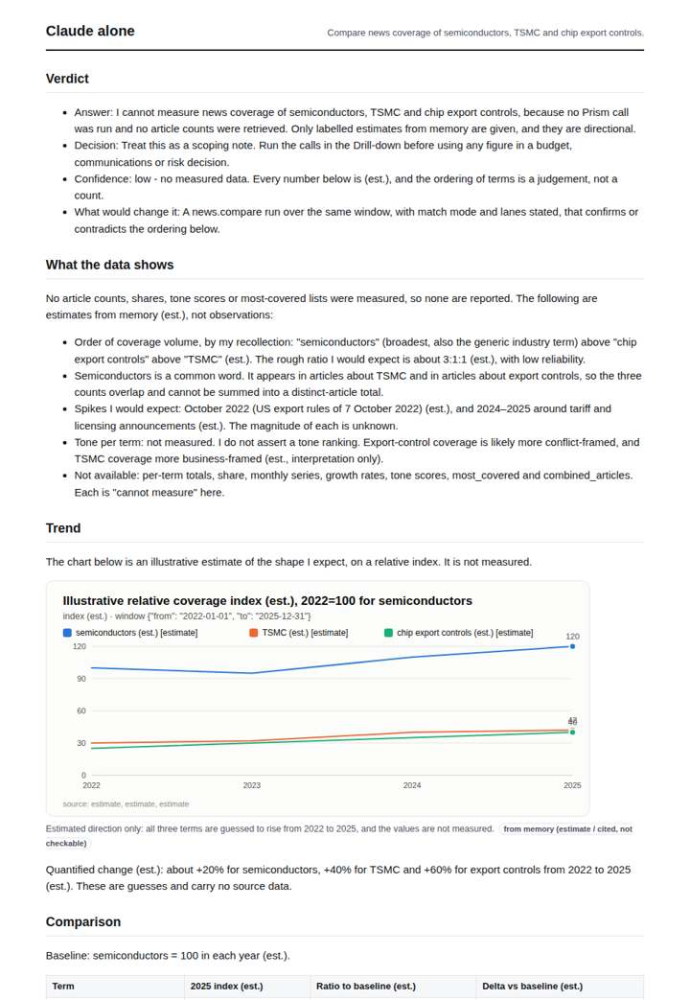
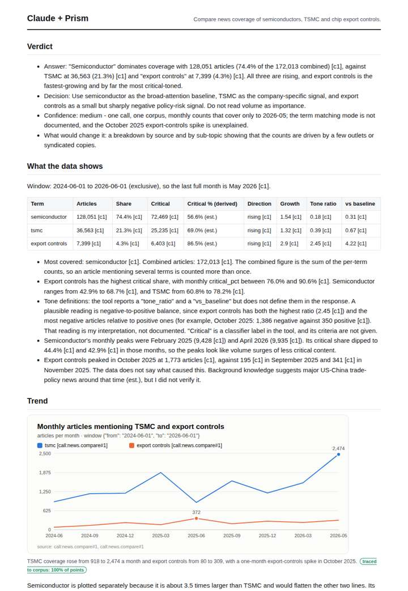
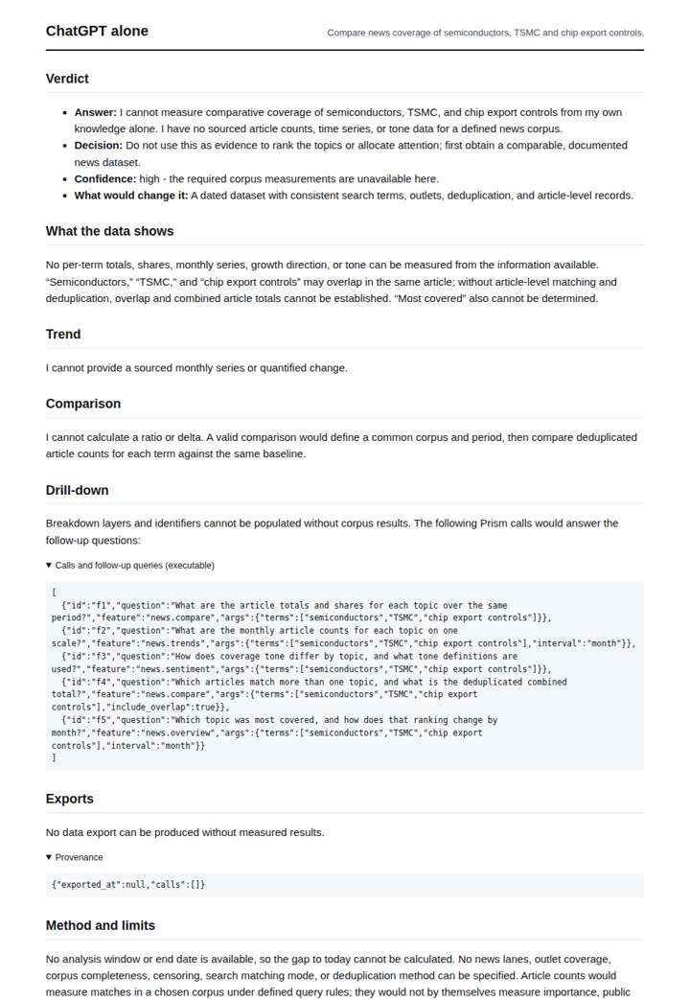
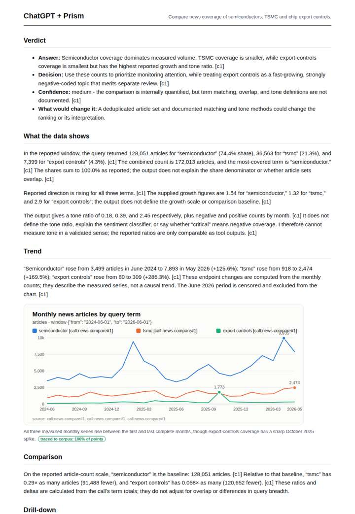

# Chips race in the news

**Question.** Compare news coverage of semiconductors, TSMC and chip export controls.

**Category:** Technology & AI · **Pattern:** `compare` · **Why it is hard:** Export-control coverage spikes on US announcements.

| Score /100 | Claude alone | Claude + Prism | ChatGPT alone | ChatGPT + Prism |
|---|---|---|---|---|
| Weighted (strict) | 32.0 | **74.2** | 25.7 | 70.0 |
| Opus judge | 26.1 | 77.2 | 22.4 | 70.4 |
| GPT judge | 37.8 | 71.3 | 28.9 | 69.6 |

## Parameter scores (0-5)

| Parameter | Weight | Claude alone | Claude + Prism | ChatGPT alone | ChatGPT + Prism |
|---|---|---|---|---|---|
| Measured trend | 10 | 1.0 | 4.0 | 0.0 | 4.0 |
| Measured comparison | 7 | 1.0 | 4.5 | 0.0 | 4.0 |
| Visualisation from counted data | 10 | 1.0 | 3.0 | 0.0 | 3.0 |
| Exploration and drill-down | 7 | 1.0 | 3.0 | 1.0 | 2.0 |
| Data export with provenance | 8 | 1.0 | 3.0 | 0.0 | 4.5 |
| Reproducibility | 12 | 0.0 | 4.0 | 1.0 | 3.5 |
| Accuracy against the corpus | 12 | 3.0 | 3.5 | 3.5 | 3.5 |
| Calibration and limits | 8 | 3.0 | 4.5 | 3.0 | 3.0 |
| Decision-grade verdict | 12 | 3.0 | 3.5 | 2.5 | 3.5 |
| Facet coverage | 6 | 1.5 | 4.5 | 0.5 | 4.0 |

## Script findings

| Check | Claude alone | Claude + Prism | ChatGPT alone | ChatGPT + Prism |
|---|---|---|---|---|
| Numbers traced to the corpus | 0/14 | 76/81 | 0/0 | 29/31 |
| Charts (traced share) | memory | 100% | none | 100% |
| DOIs that resolve | 0/0 | 0/0 | 0/0 | 0/0 |
| Follow-up queries that ran | 1/6 | 6/6 | 1/5 | 1/4 |
| Invention gate | clear | clear | clear | clear |

**Claude Opus judge:** B and C both reported traced figures from the same news.compare call. C went further: it decomposed critical share by term, named the peaks and the October 2025 export-control spike (1,773 vs 195 the month before), and flagged undefined fields and the generic-term over-count. B instead gave cleaner, complete exports. A gave an estimated term ordering that contradicts the measured data, and D gave no answer at all.

**GPT judge:** A is the strongest decision aid: it provides the complete traced monthly series, comparable totals, and caveats, while avoiding D’s unsupported reading of critical coverage as negative tone. D covers more facets and offers stronger limits, but its sparse chart and partial monthly export weaken auditability, and its verdict overstates what the tone and generic export-controls match can show.

## Before / after (first screen)

| | Alone | With Prism |
|---|---|---|
| Claude |  |  |
| ChatGPT |  |  |

Full deliverables, rendered: [PDF](https://fliarbi.com/demo/docs/prism-benchmark-v2-4ed65c83/full/semiconductors-compare.pdf). Raw answers, ground pass and judge outputs: `answers.json`, `ground.json`, `judge_opus.json`, `judge_gpt.json` in this folder.
