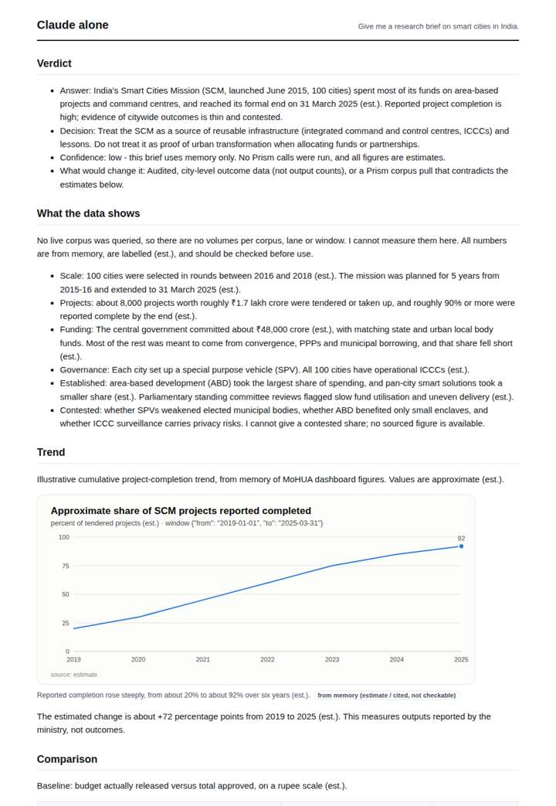
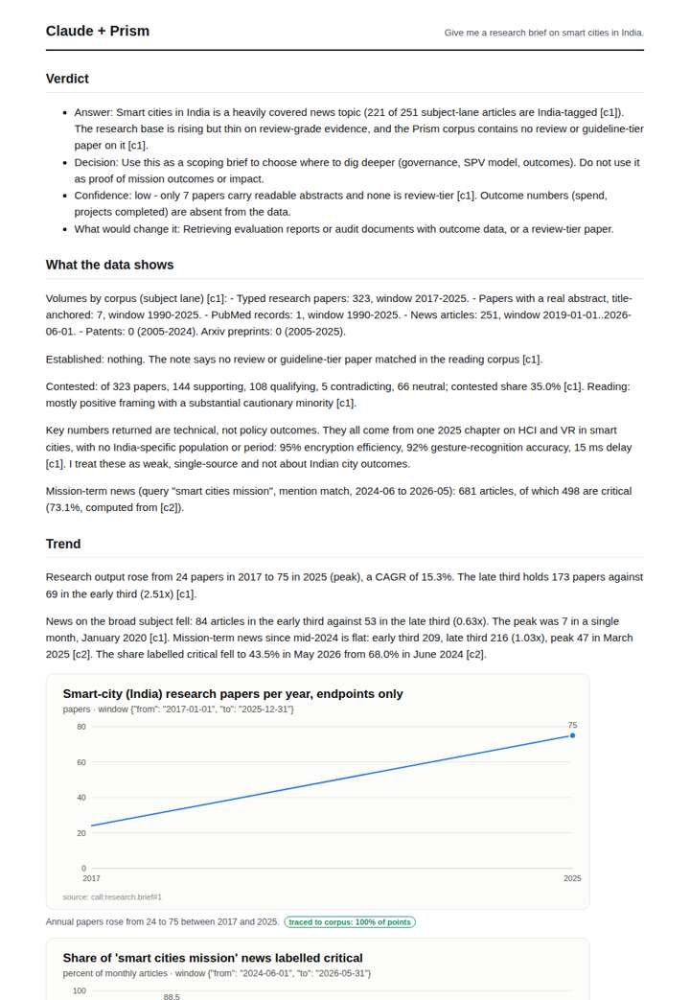
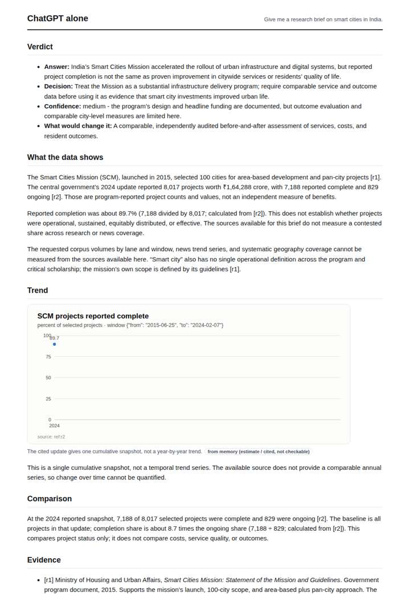
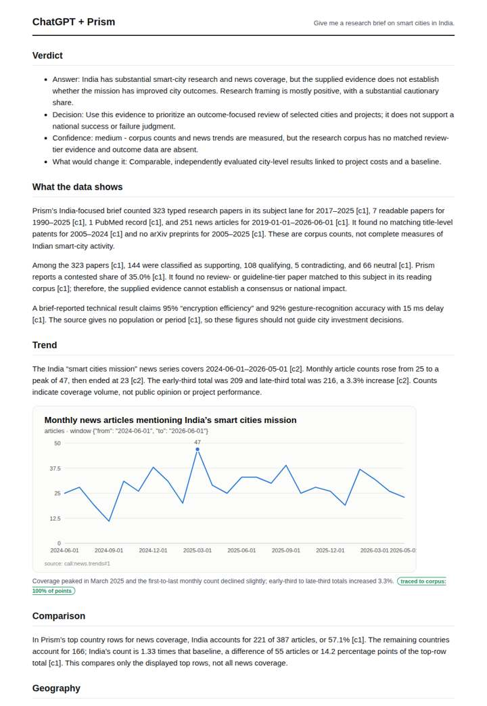

# Smart Cities Mission brief

**Question.** Give me a research brief on smart cities in India.

**Category:** Policy & regulation · **Pattern:** `brief` · **Why it is hard:** Many papers mention smart cities generically; India scope must be enforced.

| Score /100 | Claude alone | Claude + Prism | ChatGPT alone | ChatGPT + Prism |
|---|---|---|---|---|
| Weighted (strict) | 34.7 | 65.3 | 35.8 | **71.4** |
| Opus judge | 32.6 | 73.4 | 29.8 | 67.8 |
| GPT judge | 36.8 | 57.2 | 41.8 | 75.0 |

## Parameter scores (0-5)

| Parameter | Weight | Claude alone | Claude + Prism | ChatGPT alone | ChatGPT + Prism |
|---|---|---|---|---|---|
| Measured trend | 10 | 1.0 | 4.0 | 0.5 | 4.0 |
| Measured comparison | 7 | 1.5 | 4.0 | 2.0 | 4.0 |
| Visualisation from counted data | 10 | 1.0 | 3.0 | 1.0 | 3.5 |
| Exploration and drill-down | 7 | 1.0 | 2.5 | 1.0 | 1.0 |
| Data export with provenance | 8 | 1.0 | 2.0 | 1.0 | 3.5 |
| Reproducibility | 12 | 1.0 | 4.0 | 1.0 | 4.5 |
| Traceable references | 8 | 0.5 | 3.5 | 1.5 | 3.0 |
| Accuracy against the corpus | 12 | 3.5 | 2.5 | 3.0 | 4.0 |
| Calibration and limits | 8 | 3.5 | 4.0 | 3.0 | 3.0 |
| Decision-grade verdict | 12 | 3.0 | 3.0 | 3.5 | 4.0 |
| Facet coverage | 6 | 1.0 | 3.5 | 1.5 | 3.5 |

## Script findings

| Check | Claude alone | Claude + Prism | ChatGPT alone | ChatGPT + Prism |
|---|---|---|---|---|
| Numbers traced to the corpus | 0/15 | 58/58 | 0/14 | 40/40 |
| Charts (traced share) | memory | 100%, 100% | memory | 100% |
| DOIs that resolve | 0/0 | 7/7 | 0/0 | 7/7 |
| Follow-up queries that ran | 1/7 | 2/6 | 0/5 | 0/5 |
| Invention gate | clear | clear | clear | clear |

**Claude Opus judge:** B and D both grounded every number in the recorded database responses, while A and C relied on memory; C labelled its estimates honestly, and A dressed unverifiable figures in generic citations. D edged ahead of B by covering the facets B omitted: the research trend, the critical-share decomposition and institutions. D also flagged the off-topic key numbers and the geography artefact. B had the cleaner full-series chart and export.

**GPT judge:** B is the strongest decision brief: its traced series, comparisons, exports, and reproducibility make the evidence usable, while it limits its conclusion to what the corpus can establish. C is similarly rich but misstates two central geography figures; A and D offer more limited, largely unmeasured coverage.

## Before / after (first screen)

| | Alone | With Prism |
|---|---|---|
| Claude |  |  |
| ChatGPT |  |  |

Full deliverables, rendered: [PDF](https://fliarbi.com/demo/docs/prism-benchmark-v2-4ed65c83/full/smart-cities-india-brief.pdf). Raw answers, ground pass and judge outputs: `answers.json`, `ground.json`, `judge_opus.json`, `judge_gpt.json` in this folder.
