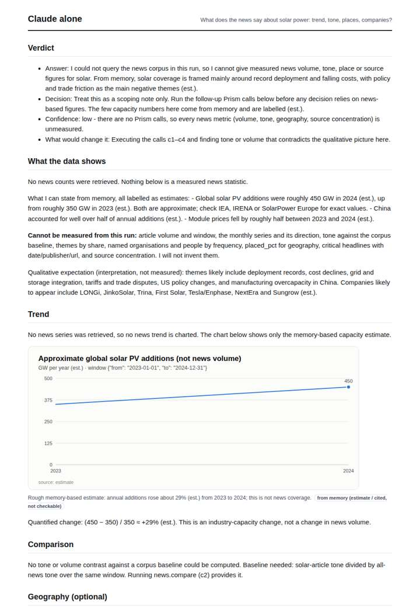
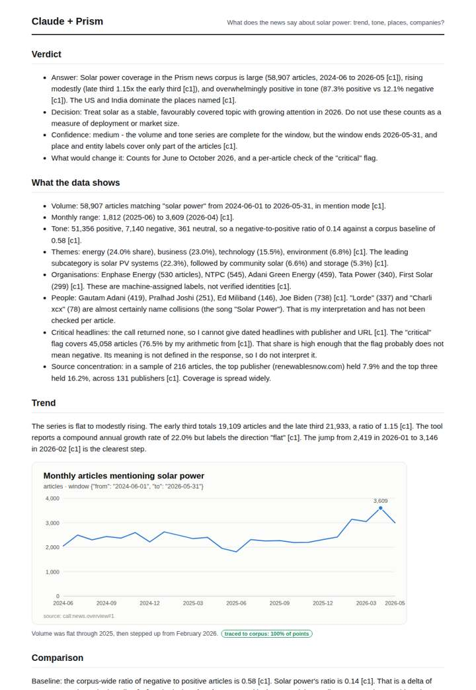
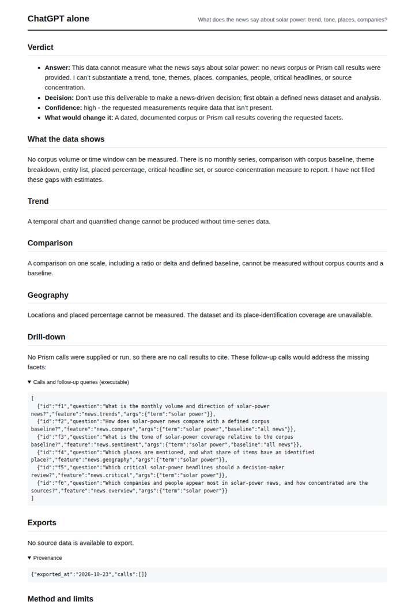
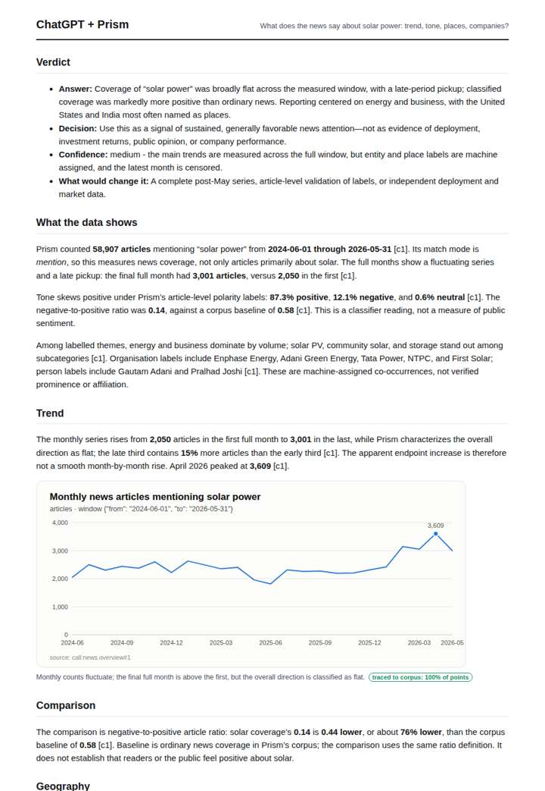

# Solar power coverage

**Question.** What does the news say about solar power: trend, tone, places, companies?

**Category:** Energy & climate · **Pattern:** `pulse` · **Why it is hard:** Product reviews mention 'solar' constantly; centrality matching keeps them out.

| Score /100 | Claude alone | Claude + Prism | ChatGPT alone | ChatGPT + Prism |
|---|---|---|---|---|
| Weighted (strict) | 27.2 | 67.6 | 23.8 | **72.3** |
| Opus judge | 23.0 | 69.0 | 22.0 | 69.4 |
| GPT judge | 31.4 | 66.2 | 25.6 | 75.2 |

## Parameter scores (0-5)

| Parameter | Weight | Claude alone | Claude + Prism | ChatGPT alone | ChatGPT + Prism |
|---|---|---|---|---|---|
| Measured trend | 10 | 0.5 | 3.5 | 0.0 | 4.0 |
| Measured comparison | 7 | 0.0 | 4.0 | 0.0 | 4.0 |
| Visualisation from counted data | 10 | 1.0 | 4.0 | 0.0 | 3.5 |
| Exploration and drill-down | 7 | 1.0 | 3.0 | 2.0 | 3.5 |
| Data export with provenance | 8 | 1.0 | 3.0 | 0.0 | 4.0 |
| Reproducibility | 12 | 1.0 | 4.0 | 1.0 | 4.0 |
| Traceable references | 8 | 0.5 | 1.0 | 0.5 | 1.0 |
| Accuracy against the corpus | 12 | 2.5 | 2.5 | 3.0 | 3.5 |
| Calibration and limits | 8 | 3.0 | 4.0 | 2.5 | 4.0 |
| Decision-grade verdict | 12 | 2.5 | 3.5 | 2.5 | 4.0 |
| Facet coverage | 6 | 1.0 | 5.0 | 0.5 | 4.0 |

## Script findings

| Check | Claude alone | Claude + Prism | ChatGPT alone | ChatGPT + Prism |
|---|---|---|---|---|
| Numbers traced to the corpus | 0/7 | 68/68 | 0/0 | 29/30 |
| Charts (traced share) | memory | 100% | none | 100% |
| DOIs that resolve | 0/0 | 0/0 | 0/0 | 0/0 |
| Follow-up queries that ran | 0/6 | 3/6 | 3/6 | 5/6 |
| Invention gate | clear | clear | clear | clear |

**Claude Opus judge:** A and B both deliver traced volume, tone-vs-baseline, geography and company answers with the proper window and censoring. B edges ahead because it flags the Lorde/Charli XCX name collisions and the undefined 'critical' field. A has the more complete exports, but its single chart omits tone. C refuses honestly, and D offers only off-question memory estimates, so neither supports a news-based decision.

**GPT judge:** A is the most decision-ready: it gives a measured, bounded account of volume, tone, places, and organizations, with traceable exports and a cautious interpretation. C covers more facets but overstates the trend as rising and leaves the export incomplete; B and D correctly acknowledge missing measurements but cannot answer the question from grounded news data.

## Before / after (first screen)

| | Alone | With Prism |
|---|---|---|
| Claude |  |  |
| ChatGPT |  |  |

Full deliverables, rendered: [PDF](https://fliarbi.com/demo/docs/prism-benchmark-v2-4ed65c83/full/solar-power-pulse.pdf). Raw answers, ground pass and judge outputs: `answers.json`, `ground.json`, `judge_opus.json`, `judge_gpt.json` in this folder.
