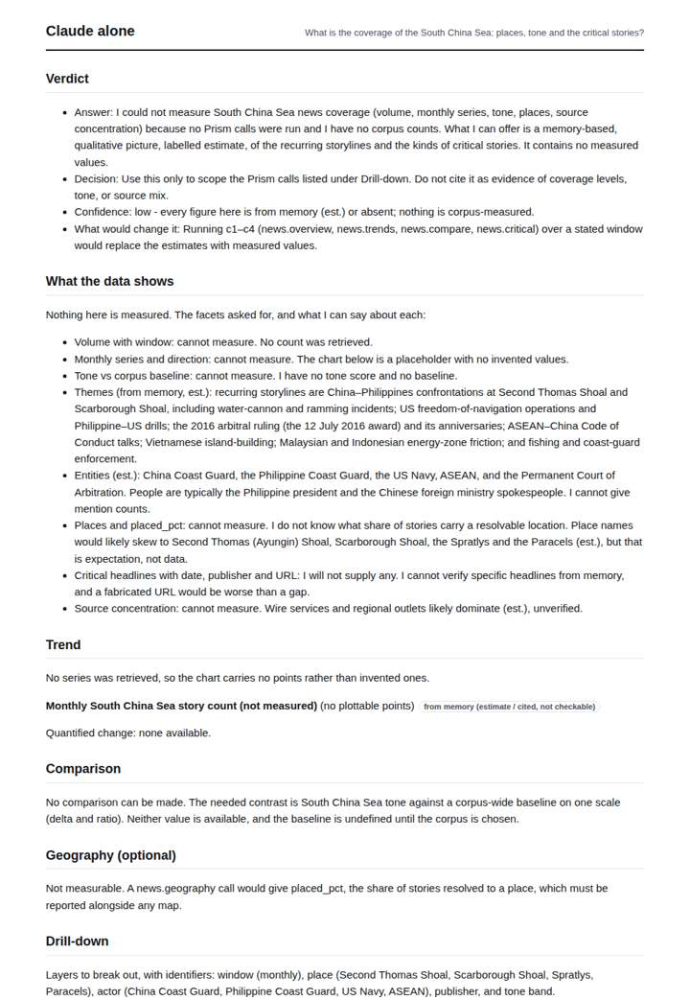
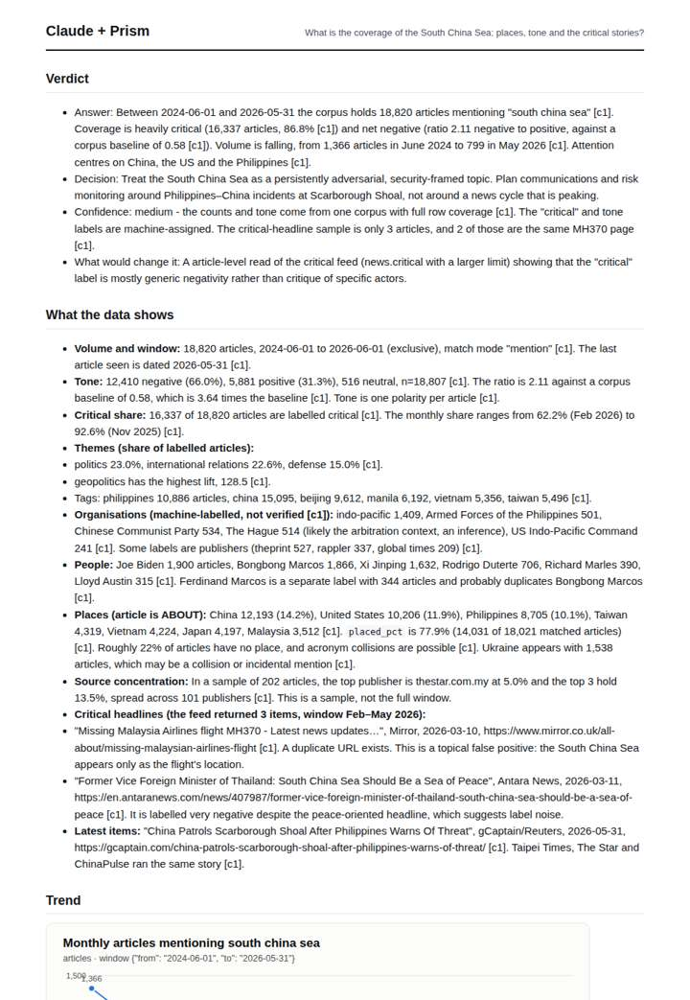
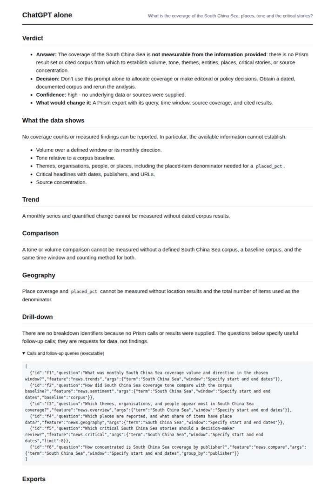
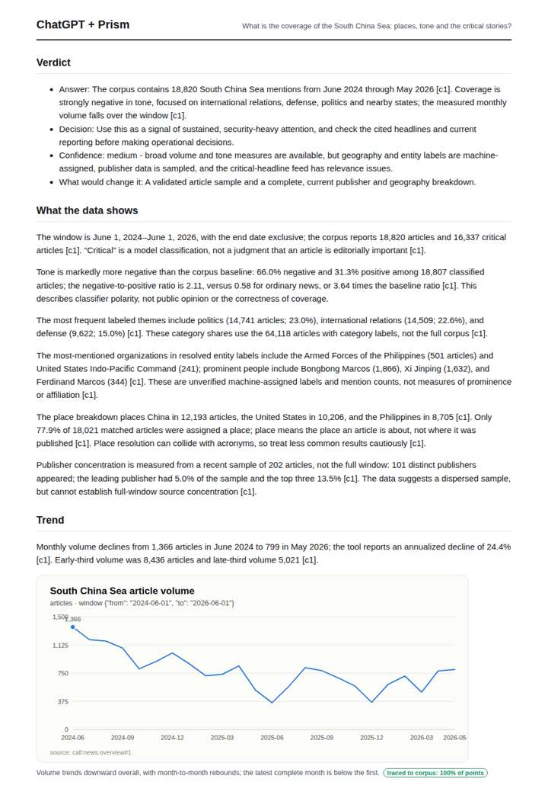

# South China Sea tensions

**Question.** What is the coverage of the South China Sea: places, tone and the critical stories?

**Category:** Defence & geopolitics · **Pattern:** `pulse` · **Why it is hard:** Philippine, Vietnamese and Chinese framing differ; geography splits it.

| Score /100 | Claude alone | Claude + Prism | ChatGPT alone | ChatGPT + Prism |
|---|---|---|---|---|
| Weighted (strict) | 29.2 | 69.6 | 26.3 | **77.9** |
| Opus judge | 19.4 | 72.6 | 18.2 | 70.6 |
| GPT judge | 39.0 | 66.6 | 34.4 | 85.2 |

## Parameter scores (0-5)

| Parameter | Weight | Claude alone | Claude + Prism | ChatGPT alone | ChatGPT + Prism |
|---|---|---|---|---|---|
| Measured trend | 10 | 0.5 | 4.0 | 0.0 | 4.0 |
| Measured comparison | 7 | 0.5 | 4.5 | 0.5 | 4.5 |
| Visualisation from counted data | 10 | 0.5 | 4.0 | 0.0 | 4.0 |
| Exploration and drill-down | 7 | 1.5 | 2.5 | 1.0 | 3.0 |
| Data export with provenance | 8 | 0.5 | 3.0 | 0.0 | 4.5 |
| Reproducibility | 12 | 0.0 | 5.0 | 1.0 | 5.0 |
| Traceable references | 8 | 0.5 | 1.5 | 0.5 | 1.0 |
| Accuracy against the corpus | 12 | 4.0 | 3.5 | 4.0 | 4.5 |
| Calibration and limits | 8 | 3.0 | 3.0 | 3.0 | 3.0 |
| Decision-grade verdict | 12 | 2.5 | 2.5 | 2.0 | 4.0 |
| Facet coverage | 6 | 2.0 | 4.5 | 1.5 | 4.5 |

## Script findings

| Check | Claude alone | Claude + Prism | ChatGPT alone | ChatGPT + Prism |
|---|---|---|---|---|
| Numbers traced to the corpus | 0/1 | 97/97 | 0/0 | 44/44 |
| Charts (traced share) | memory | 100% | none | 100% |
| DOIs that resolve | 0/0 | 0/0 | 0/0 | 0/0 |
| Follow-up queries that ran | 1/4 | 1/6 | 0/6 | 3/5 |
| Invention gate | clear | clear | clear | clear |

**Claude Opus judge:** A and C both grounded every number in the recorded overview. A went further: it named the peak and trough, flagged the Feb-2026 positive-tone anomaly, attached URLs to the critical headlines, and caught the feed's false positives and label duplications. C is clean but thinner on the critical stories. B and D honestly declined to measure, which leaves a decision-maker with nothing usable beyond a plan of calls.

**GPT judge:** A is the strongest decision aid: it combines a traced trend, tone comparison, topical and geographic breakdowns, and explicit limits while keeping critical labels distinct from editorial importance. B is broader and includes headline URLs, but its geography denominator, enrichment bound, and tone-trend reading contain material errors; C and D provide no measured answer.

## Before / after (first screen)

| | Alone | With Prism |
|---|---|---|
| Claude |  |  |
| ChatGPT |  |  |

Full deliverables, rendered: [PDF](https://fliarbi.com/demo/docs/prism-benchmark-v2-4ed65c83/full/south-china-sea.pdf). Raw answers, ground pass and judge outputs: `answers.json`, `ground.json`, `judge_opus.json`, `judge_gpt.json` in this folder.
