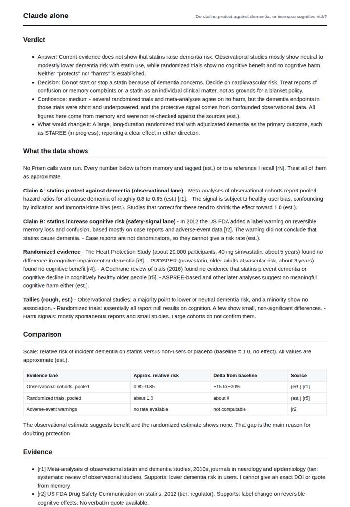
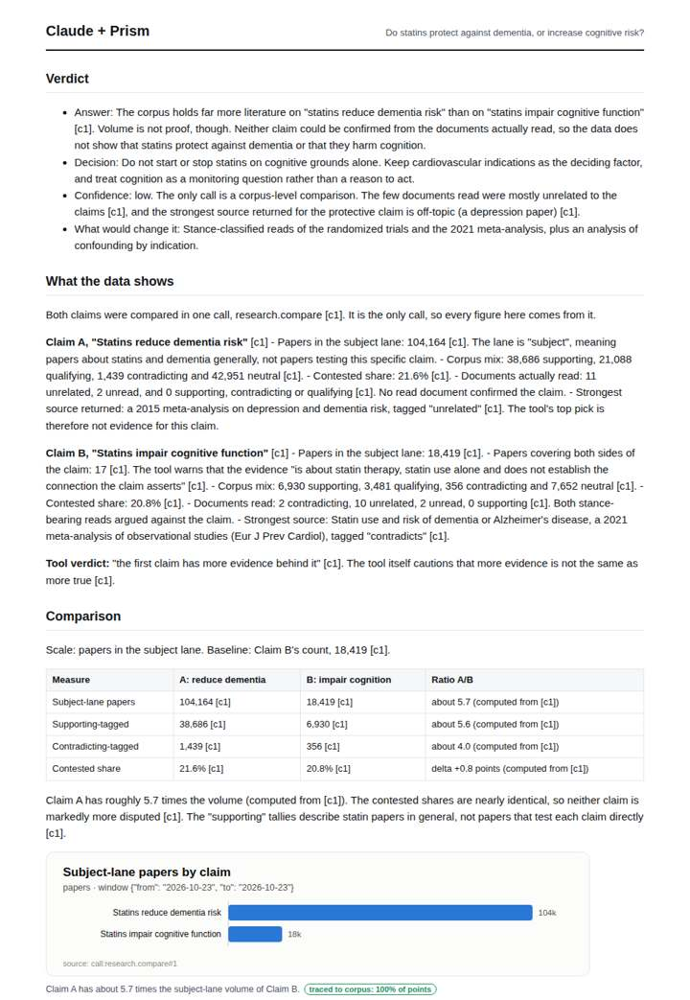
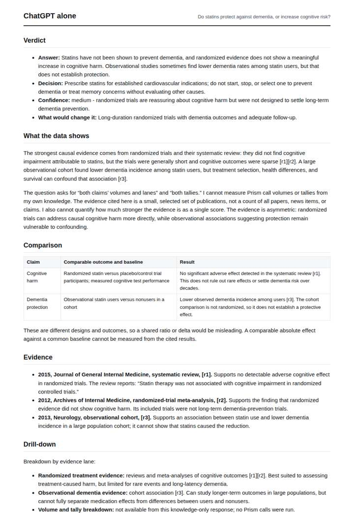
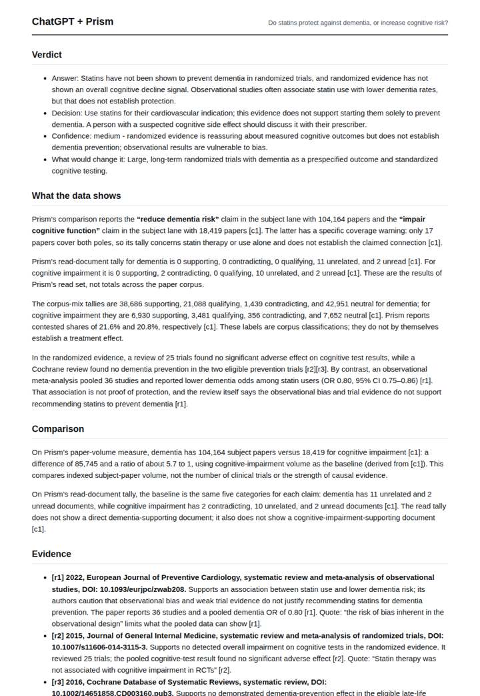

# Statins and dementia risk

**Question.** Do statins protect against dementia, or increase cognitive risk?

**Category:** Medical & clinical evidence · **Pattern:** `claims` · **Why it is hard:** The literature points both ways; the useful output is the tier-weighted balance, not a yes/no.

| Score /100 | Claude alone | Claude + Prism | ChatGPT alone | ChatGPT + Prism |
|---|---|---|---|---|
| Weighted (strict) | 33.1 | **77.8** | 29.1 | 51.7 |
| Opus judge | 30.9 | 74.4 | 23.1 | 49.6 |
| GPT judge | 35.3 | 81.1 | 35.1 | 53.8 |

## Parameter scores (0-5)

| Parameter | Weight | Claude alone | Claude + Prism | ChatGPT alone | ChatGPT + Prism |
|---|---|---|---|---|---|
| Measured comparison | 7 | 2.0 | 5.0 | 1.0 | 4.5 |
| Visualisation from counted data | 10 | 0.0 | 3.5 | 0.0 | 0.0 |
| Exploration and drill-down | 7 | 1.0 | 2.0 | 1.0 | 1.0 |
| Data export with provenance | 8 | 1.0 | 3.0 | 0.0 | 3.0 |
| Reproducibility | 12 | 0.0 | 4.0 | 1.0 | 3.0 |
| Traceable references | 8 | 1.0 | 4.5 | 0.0 | 1.0 |
| Accuracy against the corpus | 12 | 3.5 | 4.5 | 2.5 | 2.5 |
| Calibration and limits | 8 | 3.5 | 4.0 | 3.0 | 3.0 |
| Decision-grade verdict | 12 | 3.0 | 4.0 | 3.5 | 4.0 |
| Facet coverage | 6 | 1.0 | 4.0 | 1.5 | 4.0 |

## Script findings

| Check | Claude alone | Claude + Prism | ChatGPT alone | ChatGPT + Prism |
|---|---|---|---|---|
| Numbers traced to the corpus | 0/13 | 34/35 | 0/1 | 30/37 |
| Charts (traced share) | none | 100% | none | none |
| DOIs that resolve | 0/0 | 2/2 | 1/3 | 4/8 |
| Follow-up queries that ran | 1/6 | 1/6 | 0/4 | 0/3 |
| Invention gate | clear | clear | clear | clear |

**Claude Opus judge:** D traced nearly every number to the single comparison call and computed exact ratios. It also flagged the record's own anomaly: the off-topic depression paper returned as claim A's strongest source. C traced the same tallies but misread that field and mixed memory effect sizes into the measured layer. A and B gave reasonable clinical verdicts from memory but no measured balance, and A's citations contain fabricated venue and DOI details.

**GPT judge:** B is strongest because it turns the recorded comparison into a reproducible, correctly caveated contrast and clearly distinguishes corpus volume from clinical truth. Its chart and exports are useful, though the database has no explicit window and the clinical evidence remains unresolved; the other deliverables either rely on unverified specifics or omit the measured comparison.

## Before / after (first screen)

| | Alone | With Prism |
|---|---|---|
| Claude |  |  |
| ChatGPT |  |  |

Full deliverables, rendered: [PDF](https://fliarbi.com/demo/docs/prism-benchmark-v2-4ed65c83/full/statins-dementia.pdf). Raw answers, ground pass and judge outputs: `answers.json`, `ground.json`, `judge_opus.json`, `judge_gpt.json` in this folder.
