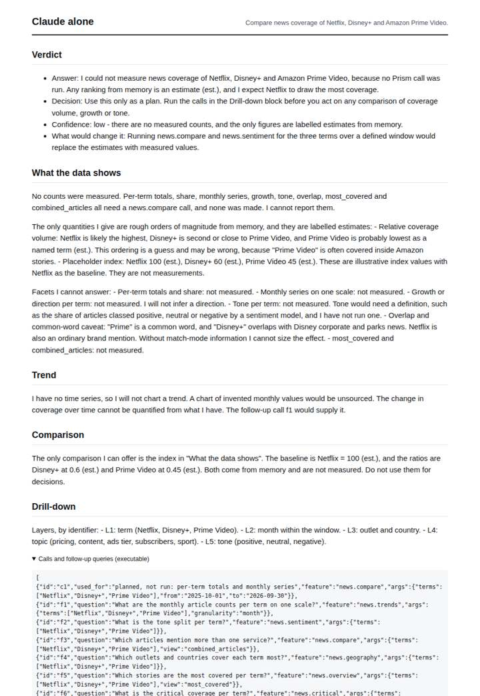
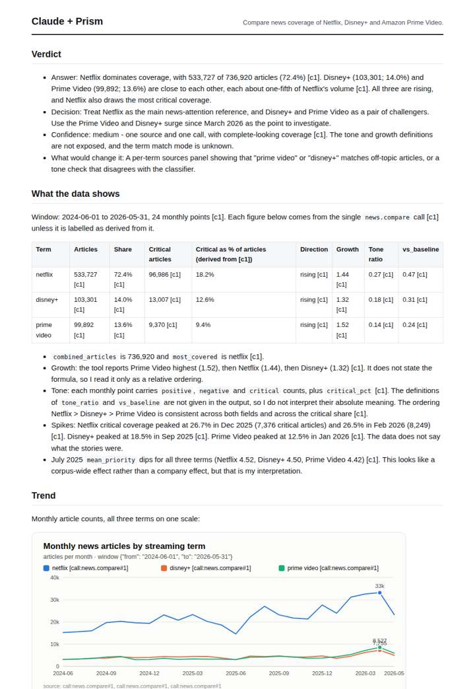
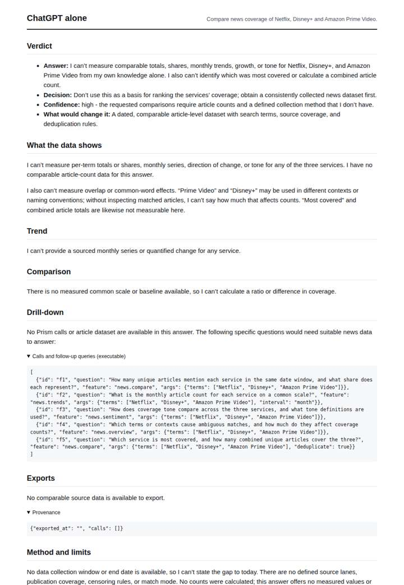
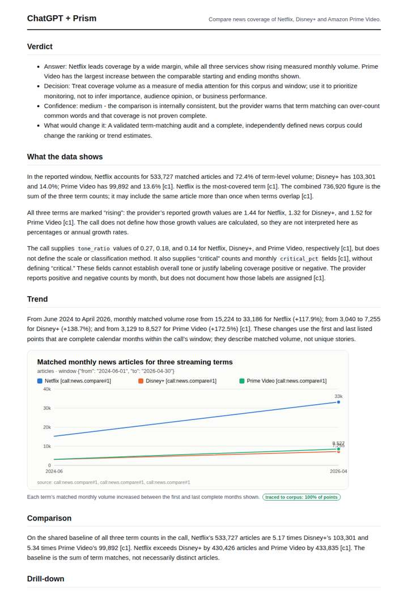

# Netflix vs Disney+ vs Prime Video

**Question.** Compare news coverage of Netflix, Disney+ and Amazon Prime Video.

**Category:** Consumer, brands & media · **Pattern:** `compare` · **Why it is hard:** Netflix dominates; growth tells the challenger story.

| Score /100 | Claude alone | Claude + Prism | ChatGPT alone | ChatGPT + Prism |
|---|---|---|---|---|
| Weighted (strict) | 28.3 | 64.3 | 23.5 | **64.5** |
| Opus judge | 27.0 | 75.9 | 18.0 | 56.3 |
| GPT judge | 29.6 | 52.8 | 28.9 | 72.6 |

## Parameter scores (0-5)

| Parameter | Weight | Claude alone | Claude + Prism | ChatGPT alone | ChatGPT + Prism |
|---|---|---|---|---|---|
| Measured trend | 10 | 0.0 | 3.0 | 0.0 | 3.5 |
| Measured comparison | 7 | 1.0 | 5.0 | 0.0 | 4.5 |
| Visualisation from counted data | 10 | 0.0 | 3.0 | 0.0 | 2.0 |
| Exploration and drill-down | 7 | 1.0 | 2.0 | 1.0 | 1.0 |
| Data export with provenance | 8 | 1.0 | 3.5 | 0.0 | 3.5 |
| Reproducibility | 12 | 1.0 | 4.0 | 1.0 | 4.0 |
| Accuracy against the corpus | 12 | 3.0 | 2.5 | 3.0 | 3.0 |
| Calibration and limits | 8 | 3.0 | 3.0 | 2.5 | 3.5 |
| Decision-grade verdict | 12 | 2.5 | 3.0 | 2.5 | 3.5 |
| Facet coverage | 6 | 1.0 | 3.5 | 0.5 | 3.5 |

## Script findings

| Check | Claude alone | Claude + Prism | ChatGPT alone | ChatGPT + Prism |
|---|---|---|---|---|
| Numbers traced to the corpus | 0/7 | 76/77 | 0/0 | 30/30 |
| Charts (traced share) | none | 100%, 100% | none | 100% |
| DOIs that resolve | 0/0 | 0/0 | 0/0 | 0/0 |
| Follow-up queries that ran | 0/6 | 1/6 | 1/5 | 0/4 |
| Invention gate | clear | clear | clear | clear |

**Claude Opus judge:** A gives the decision-maker the full traced monthly series for all three services. It also computes the share shift that actually tells the challenger story: Prime Video gains about 2.8 points while Netflix slips 3.4. It adds a critical-share contrast, with only a minor critical-peak slip. D's numbers trace, but it reduces the trend to two endpoints and misreads the censoring rule. B and C measured nothing, and B's estimate index points the wrong way on Disney+ vs Prime.

**GPT judge:** A is the most decision-ready: it quantifies the attention gap and challenger growth, preserves key caveats, and supplies a traced monthly export. C has richer charts and tables, but its treatment of censored May 2026 as a real collapse undermines its trend and verdict; B and D appropriately acknowledge that they cannot measure the comparison.

## Before / after (first screen)

| | Alone | With Prism |
|---|---|---|
| Claude |  |  |
| ChatGPT |  |  |

Full deliverables, rendered: [PDF](https://fliarbi.com/demo/docs/prism-benchmark-v2-4ed65c83/full/streaming-compare.pdf). Raw answers, ground pass and judge outputs: `answers.json`, `ground.json`, `judge_opus.json`, `judge_gpt.json` in this folder.
