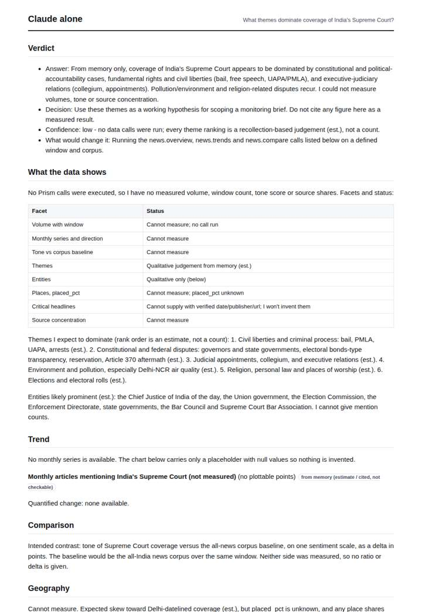
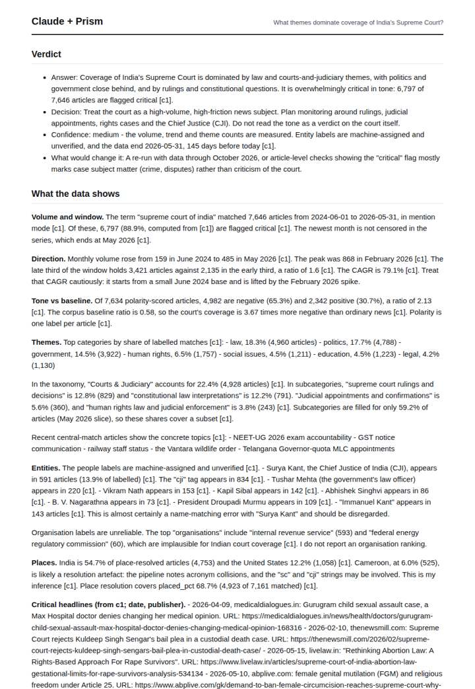
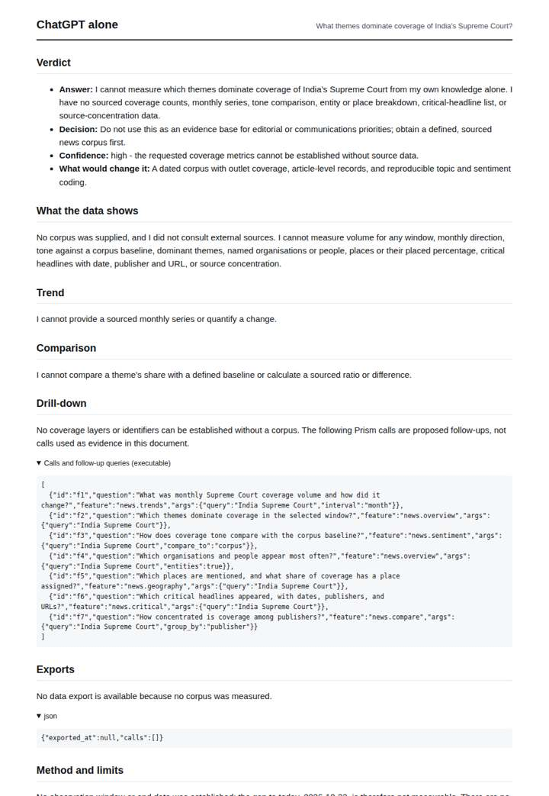
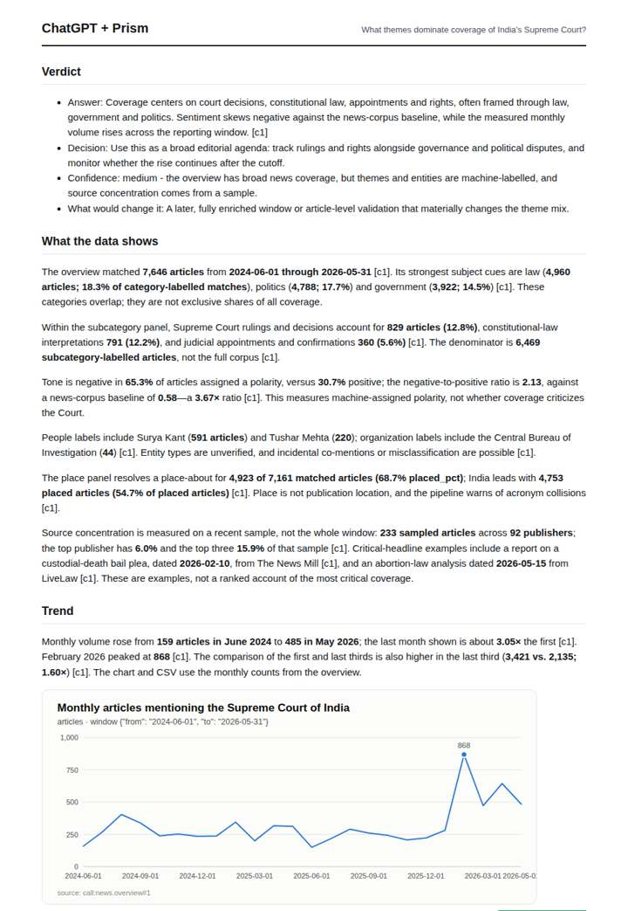

# Supreme Court of India coverage

**Question.** What themes dominate coverage of India's Supreme Court?

**Category:** Legal & compliance · **Pattern:** `pulse` · **Why it is hard:** 'Supreme Court' is ambiguous across countries; geography disambiguates.

| Score /100 | Claude alone | Claude + Prism | ChatGPT alone | ChatGPT + Prism |
|---|---|---|---|---|
| Weighted (strict) | 31.8 | **77.5** | 23.6 | 72.6 |
| Opus judge | 25.8 | 83.6 | 14.2 | 74.2 |
| GPT judge | 37.8 | 71.4 | 33.0 | 71.0 |

## Parameter scores (0-5)

| Parameter | Weight | Claude alone | Claude + Prism | ChatGPT alone | ChatGPT + Prism |
|---|---|---|---|---|---|
| Measured trend | 10 | 0.5 | 4.0 | 0.0 | 4.0 |
| Measured comparison | 7 | 0.5 | 4.5 | 0.0 | 3.5 |
| Visualisation from counted data | 10 | 0.5 | 3.5 | 0.0 | 3.5 |
| Exploration and drill-down | 7 | 1.5 | 4.0 | 1.0 | 2.5 |
| Data export with provenance | 8 | 1.0 | 3.0 | 0.0 | 4.0 |
| Reproducibility | 12 | 1.0 | 5.0 | 0.5 | 5.0 |
| Traceable references | 8 | 0.5 | 1.0 | 0.5 | 1.0 |
| Accuracy against the corpus | 12 | 3.5 | 4.0 | 4.0 | 3.5 |
| Calibration and limits | 8 | 3.0 | 4.0 | 2.5 | 4.0 |
| Decision-grade verdict | 12 | 3.0 | 4.5 | 2.0 | 4.0 |
| Facet coverage | 6 | 1.5 | 4.5 | 1.5 | 4.0 |

## Script findings

| Check | Claude alone | Claude + Prism | ChatGPT alone | ChatGPT + Prism |
|---|---|---|---|---|
| Numbers traced to the corpus | 0/1 | 104/104 | 0/0 | 44/44 |
| Charts (traced share) | memory | 100% | none | 100% |
| DOIs that resolve | 0/0 | 0/0 | 0/0 | 0/0 |
| Follow-up queries that ran | 2/6 | 3/6 | 0/7 | 1/6 |
| Invention gate | clear | clear | clear | clear |

**Claude Opus judge:** B and D both traced every number to the overview call. B went further: it read the data critically, flagging the Immanuel Kant, Cameroon and IRS label artefacts, explaining what the 'critical' flag actually marks, and linking headline URLs. A gave honest but unmeasured memory themes, and C declined to answer, so neither supports a decision.

**GPT judge:** D is the strongest decision aid: it gives a traced answer about dominant themes, a quantified trend, and specific limits on the news data. Its main correction is that the sentiment baseline is cached over 30 days, not measured across the full reporting window; A has richer drill-down but makes unsupported or conflicting claims about censoring and theme coverage.

## Before / after (first screen)

| | Alone | With Prism |
|---|---|---|
| Claude |  |  |
| ChatGPT |  |  |

Full deliverables, rendered: [PDF](https://fliarbi.com/demo/docs/prism-benchmark-v2-4ed65c83/full/supreme-court-india.pdf). Raw answers, ground pass and judge outputs: `answers.json`, `ground.json`, `judge_opus.json`, `judge_gpt.json` in this folder.
