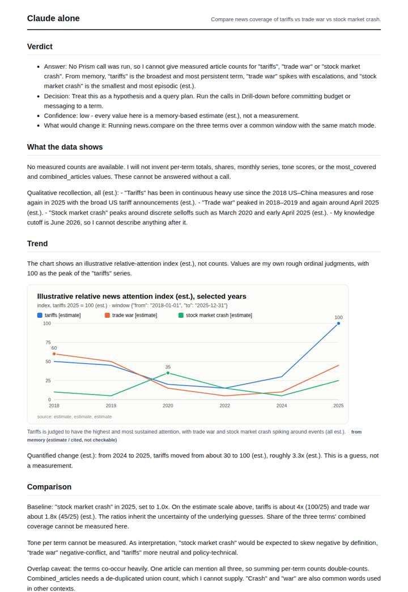
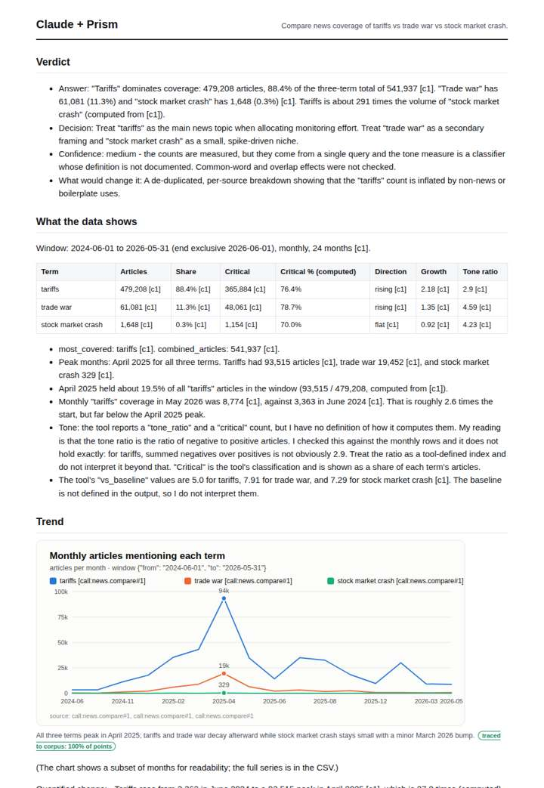
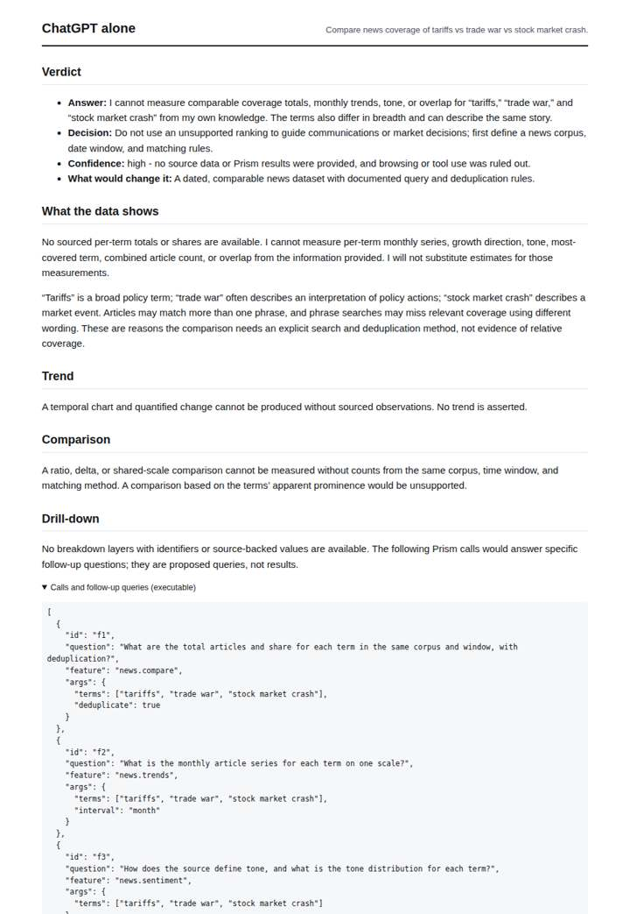
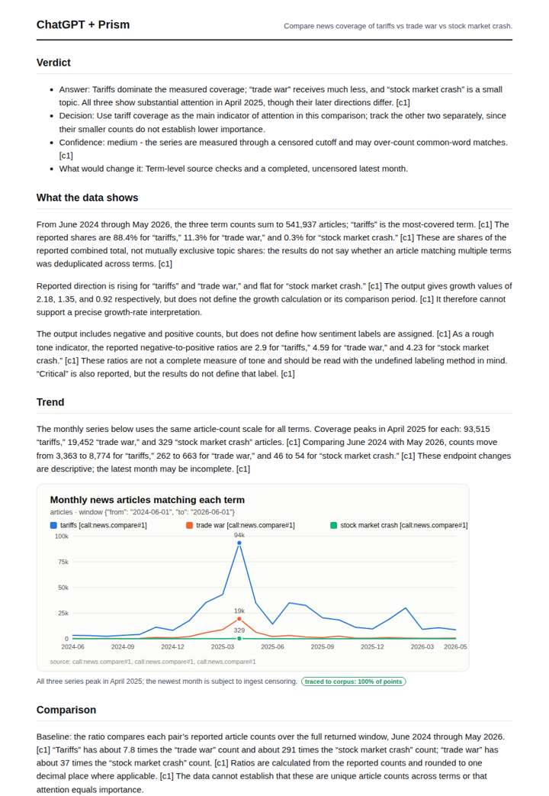

# Tariffs and stock markets

**Question.** Compare news coverage of tariffs vs trade war vs stock market crash.

**Category:** Finance & markets · **Pattern:** `compare` · **Why it is hard:** 2025 tariff announcements created sharp spikes; the comparison must show the timing.

| Score /100 | Claude alone | Claude + Prism | ChatGPT alone | ChatGPT + Prism |
|---|---|---|---|---|
| Weighted (strict) | 34.6 | **75.7** | 24.3 | 62.1 |
| Opus judge | 31.3 | 72.0 | 19.8 | 56.3 |
| GPT judge | 37.8 | 79.3 | 28.9 | 67.8 |

## Parameter scores (0-5)

| Parameter | Weight | Claude alone | Claude + Prism | ChatGPT alone | ChatGPT + Prism |
|---|---|---|---|---|---|
| Measured trend | 10 | 1.0 | 4.0 | 0.0 | 4.0 |
| Measured comparison | 7 | 1.5 | 4.5 | 0.0 | 4.5 |
| Visualisation from counted data | 10 | 1.0 | 2.5 | 0.0 | 4.5 |
| Exploration and drill-down | 7 | 1.5 | 3.5 | 1.0 | 1.0 |
| Data export with provenance | 8 | 1.0 | 3.0 | 0.0 | 0.0 |
| Reproducibility | 12 | 0.0 | 4.5 | 1.0 | 3.0 |
| Accuracy against the corpus | 12 | 3.0 | 3.5 | 4.0 | 3.0 |
| Calibration and limits | 8 | 4.0 | 4.0 | 3.0 | 3.0 |
| Decision-grade verdict | 12 | 3.0 | 4.0 | 1.5 | 3.5 |
| Facet coverage | 6 | 1.0 | 4.5 | 0.5 | 4.0 |

## Script findings

| Check | Claude alone | Claude + Prism | ChatGPT alone | ChatGPT + Prism |
|---|---|---|---|---|
| Numbers traced to the corpus | 0/9 | 79/82 | 0/0 | 21/24 |
| Charts (traced share) | memory | 100% | none | 100% |
| DOIs that resolve | 0/0 | 0/0 | 0/0 | 0/0 |
| Follow-up queries that ran | 1/6 | 5/6 | 0/4 | 0/5 |
| Invention gate | clear | clear | clear | clear |

**Claude Opus judge:** B and C both traced the measured April 2025 spike: 93,515 tariffs, 19,452 trade war and 329 stock market crash articles. B quantified the rise and decay, defined its baseline and placed the specific limits next to the numbers. C plotted the full series but zero-filled tone columns and misplaced the censoring caveat onto May 2026. A and D answered from memory or not at all: honest, but they give a decision-maker nothing measured.

**GPT judge:** C is the most decision-ready: it quantifies the shared April 2025 spike, ranks the three terms on a common window, and provides reproducible calls and useful caveats. Its selected-month chart/export and unresolved trend-label tension keep the timing evidence from being fully audit-ready; A has the complete chart but its export contradicts the recorded tone counts.

## Before / after (first screen)

| | Alone | With Prism |
|---|---|---|
| Claude |  |  |
| ChatGPT |  |  |

Full deliverables, rendered: [PDF](https://fliarbi.com/demo/docs/prism-benchmark-v2-4ed65c83/full/tariffs-markets.pdf). Raw answers, ground pass and judge outputs: `answers.json`, `ground.json`, `judge_opus.json`, `judge_gpt.json` in this folder.
