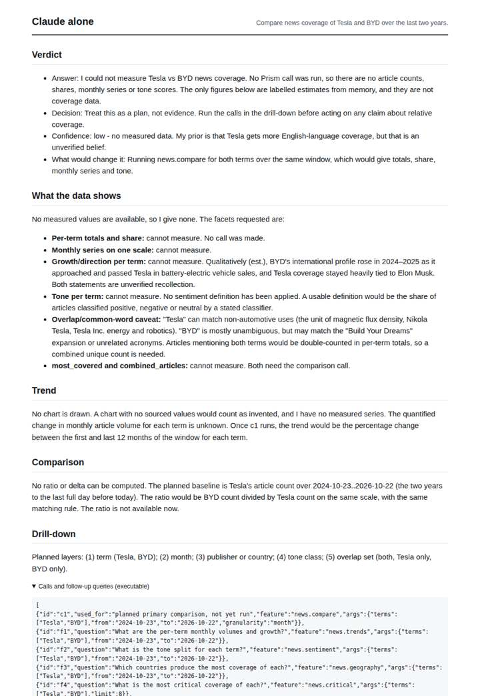
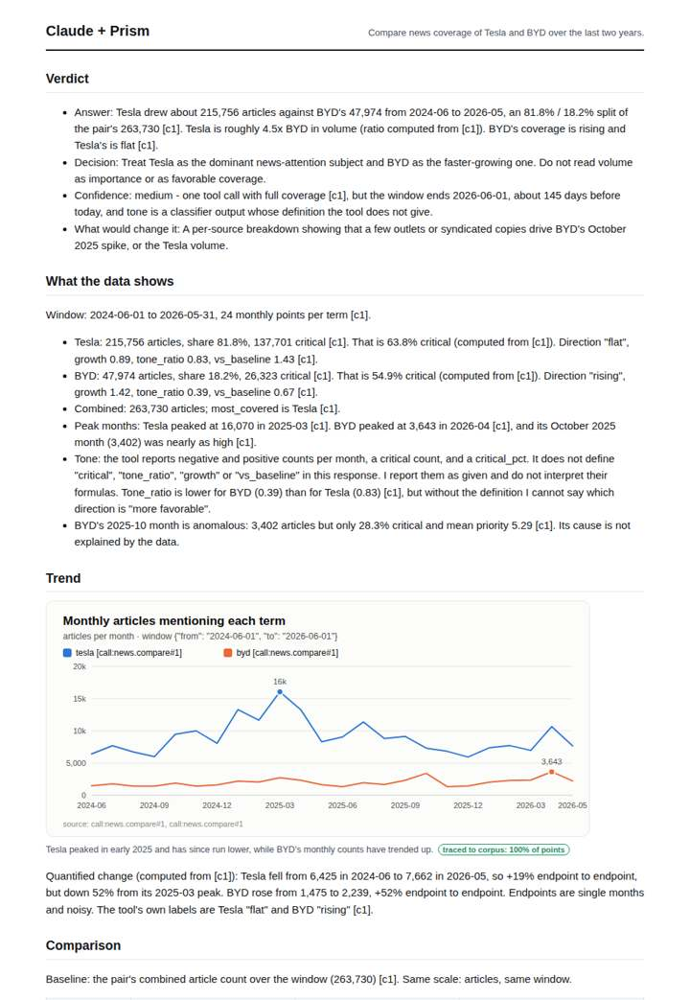
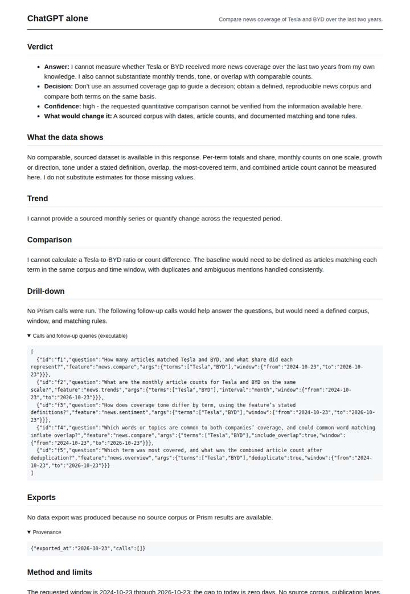
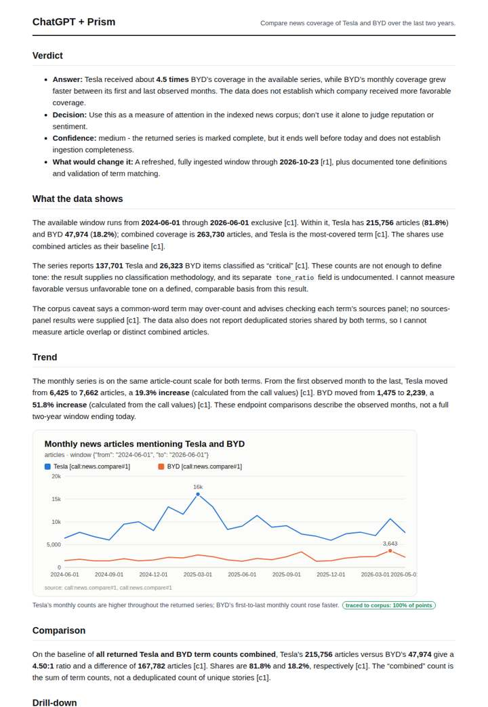

# Tesla vs BYD

**Question.** Compare news coverage of Tesla and BYD over the last two years.

**Category:** Company & competitive intelligence · **Pattern:** `compare` · **Why it is hard:** BYD overtook Tesla in EV sales in 2024-2025; does attention follow sales?

| Score /100 | Claude alone | Claude + Prism | ChatGPT alone | ChatGPT + Prism |
|---|---|---|---|---|
| Weighted (strict) | 26.7 | 40 | 25.8 | **78.6** |
| Opus judge | 22.6 | 40 | 19.8 | 68.7 |
| GPT judge | 30.9 | 40 | 31.7 | 88.5 |

## Parameter scores (0-5)

| Parameter | Weight | Claude alone | Claude + Prism | ChatGPT alone | ChatGPT + Prism |
|---|---|---|---|---|---|
| Measured trend | 10 | 0.0 | 4.5 | 0.0 | 4.0 |
| Measured comparison | 7 | 1.0 | 4.5 | 0.5 | 4.5 |
| Visualisation from counted data | 10 | 0.0 | 4.0 | 0.0 | 4.0 |
| Exploration and drill-down | 7 | 1.0 | 2.0 | 1.0 | 2.0 |
| Data export with provenance | 8 | 0.0 | 4.5 | 0.0 | 4.5 |
| Reproducibility | 12 | 0.0 | 4.0 | 1.0 | 4.0 |
| Accuracy against the corpus | 12 | 3.5 | 3.5 | 3.5 | 4.0 |
| Calibration and limits | 8 | 3.5 | 4.0 | 3.0 | 4.0 |
| Decision-grade verdict | 12 | 2.5 | 0.0 | 2.0 | 4.0 |
| Facet coverage | 6 | 1.5 | 4.5 | 1.0 | 4.0 |

## Script findings

| Check | Claude alone | Claude + Prism | ChatGPT alone | ChatGPT + Prism |
|---|---|---|---|---|
| Numbers traced to the corpus | 0/1 | 56/59 | 0/0 | 22/23 |
| Charts (traced share) | none | 100% | none | 100% |
| DOIs that resolve | 0/0 | 0/0 | 0/0 | 0/0 |
| Follow-up queries that ran | 0/6 | 2/6 | 0/5 | 1/4 |
| Invention gate | clear | tripped | clear | clear |

**Claude Opus judge:** A and B both traced the full monthly series and exports correctly, and neither tested whether attention follows sales. A gave the richer reading (peaks, critical shares, the 2025-10 BYD anomaly) but placed an untagged, slightly wrong day count in its verdict, which voids it. B is exact throughout, and its verdict is supported and bounded. C and D were honest refusals with no measured content.

**GPT judge:** C is the strongest decision deliverable: it compares Tesla and BYD on the same traced monthly scale, quantifies their relative attention and growth, and bounds its conclusion by the corpus and window. B has similarly rich evidence and exports, but its invented verdict number fails the script gate; both reports still need executed follow-ups to explain the observed spikes.

## Before / after (first screen)

| | Alone | With Prism |
|---|---|---|
| Claude |  |  |
| ChatGPT |  |  |

Full deliverables, rendered: [PDF](https://fliarbi.com/demo/docs/prism-benchmark-v2-4ed65c83/full/tesla-vs-byd.pdf). Raw answers, ground pass and judge outputs: `answers.json`, `ground.json`, `judge_opus.json`, `judge_gpt.json` in this folder.
