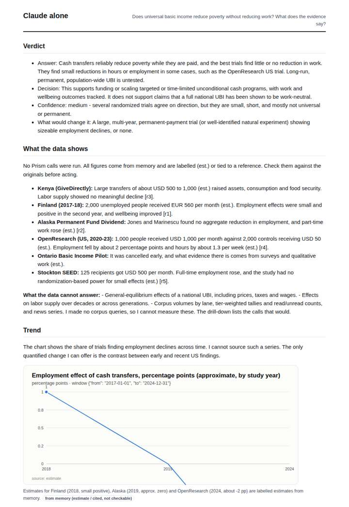
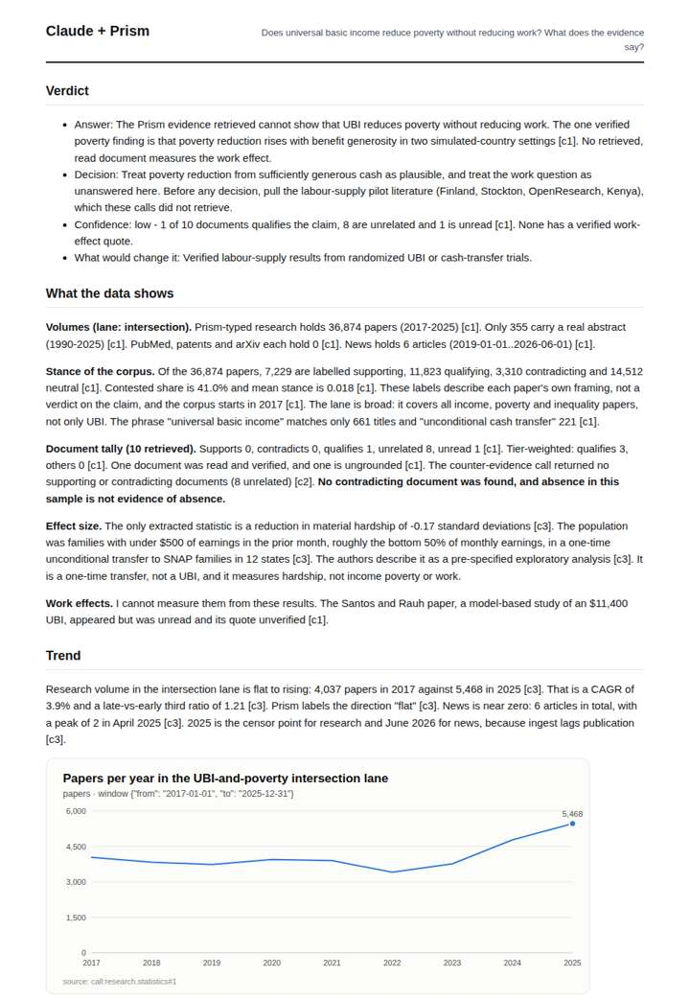
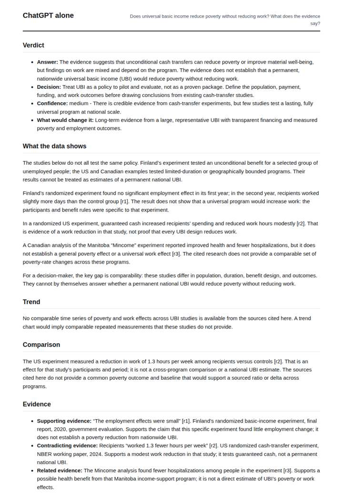
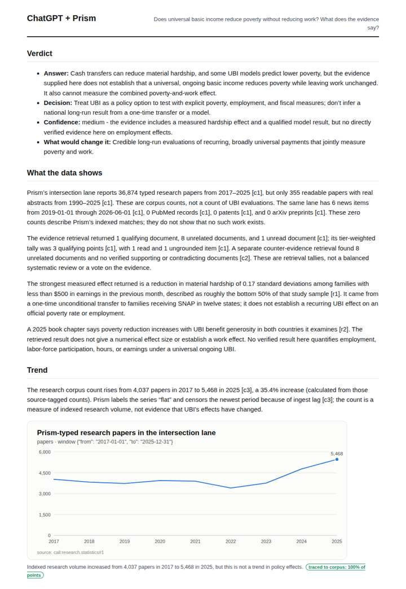

# Universal basic income evidence

**Question.** Does universal basic income reduce poverty without reducing work? What does the evidence say?

**Category:** Policy & regulation · **Pattern:** `evidence` · **Why it is hard:** Pilots are small and local; the counter-evidence on labour supply must be shown.

| Score /100 | Claude alone | Claude + Prism | ChatGPT alone | ChatGPT + Prism |
|---|---|---|---|---|
| Weighted (strict) | 37.6 | **71.9** | 34.9 | 67.2 |
| Opus judge | 35.8 | 73.8 | 34.4 | 66.6 |
| GPT judge | 39.4 | 70.0 | 35.4 | 67.8 |

## Parameter scores (0-5)

| Parameter | Weight | Claude alone | Claude + Prism | ChatGPT alone | ChatGPT + Prism |
|---|---|---|---|---|---|
| Measured trend | 10 | 1.0 | 4.0 | 0.0 | 3.0 |
| Measured comparison | 7 | 2.0 | 2.5 | 1.5 | 1.5 |
| Visualisation from counted data | 10 | 1.0 | 3.5 | 0.0 | 3.0 |
| Exploration and drill-down | 7 | 1.0 | 4.0 | 1.0 | 3.5 |
| Data export with provenance | 8 | 1.0 | 3.0 | 1.0 | 3.0 |
| Reproducibility | 12 | 0.0 | 4.0 | 1.0 | 3.0 |
| Traceable references | 8 | 2.0 | 3.5 | 3.0 | 4.0 |
| Accuracy against the corpus | 12 | 3.5 | 3.5 | 3.0 | 4.0 |
| Calibration and limits | 8 | 3.0 | 3.5 | 2.5 | 4.0 |
| Decision-grade verdict | 12 | 4.0 | 4.0 | 4.0 | 4.0 |
| Facet coverage | 6 | 1.5 | 3.5 | 1.5 | 3.5 |

## Script findings

| Check | Claude alone | Claude + Prism | ChatGPT alone | ChatGPT + Prism |
|---|---|---|---|---|
| Numbers traced to the corpus | 0/15 | 45/46 | 0/3 | 20/22 |
| Charts (traced share) | memory | 100% | none | 100% |
| DOIs that resolve | 2/2 | 4/4 | 1/1 | 2/2 |
| Follow-up queries that ran | 0/6 | 5/6 | 0/3 | 3/4 |
| Invention gate | clear | clear | clear | clear |

**Claude Opus judge:** A and C grounded every number in the recorded calls and were honest that the retrieved evidence measures poverty but not work. A went further: it quantified the trend, flagged the broad lane, said explicitly that the work half was never queried, and set low confidence to match. B and D gave the more substantively informative memory-based answers on labour supply, including the OpenResearch work reduction, but nothing they reported can be traced or regenerated.

**GPT judge:** A is the strongest decision aid: it separates a measured one-time hardship result from the unanswered work and ongoing-UBI questions, and its verdict is bounded by those gaps. C has richer corpus tracing, but its cross-lane research/news ratio and unsupported detail about an unread model paper weaken its decision value.

## Before / after (first screen)

| | Alone | With Prism |
|---|---|---|
| Claude |  |  |
| ChatGPT |  |  |

Full deliverables, rendered: [PDF](https://fliarbi.com/demo/docs/prism-benchmark-v2-4ed65c83/full/ubi-evidence.pdf). Raw answers, ground pass and judge outputs: `answers.json`, `ground.json`, `judge_opus.json`, `judge_gpt.json` in this folder.
