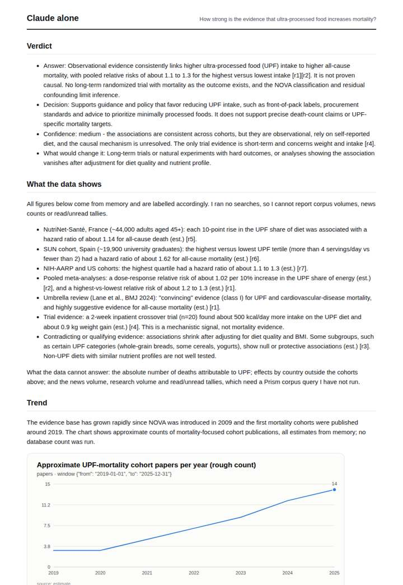
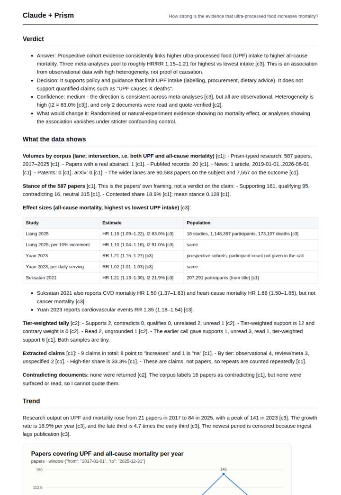
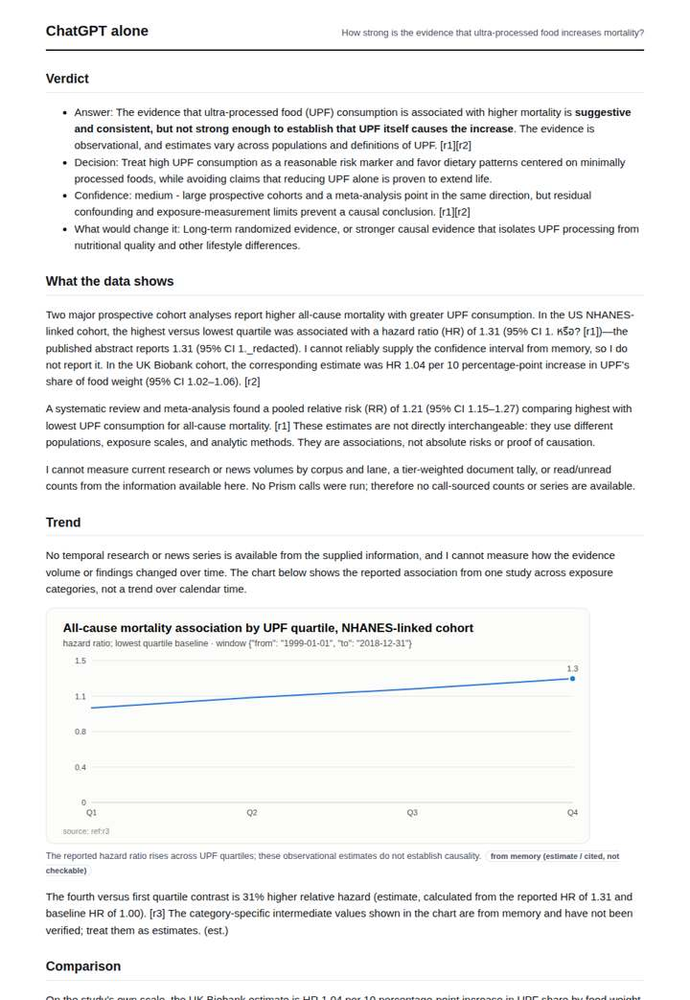
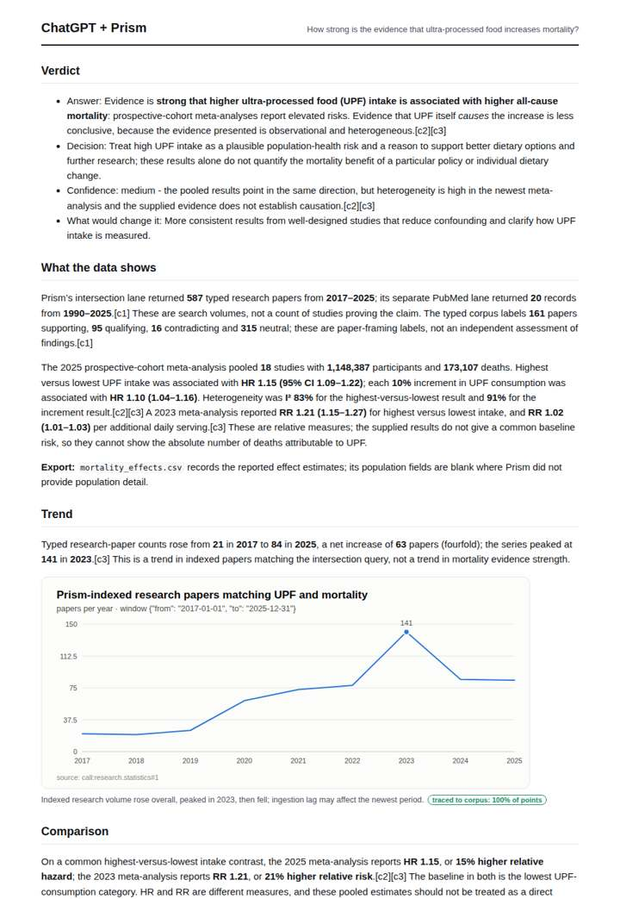

# Ultra-processed food and health

**Question.** How strong is the evidence that ultra-processed food increases mortality?

**Category:** Consumer, brands & media · **Pattern:** `evidence` · **Why it is hard:** A large 2019+ cohort literature with umbrella reviews in 2024.

| Score /100 | Claude alone | Claude + Prism | ChatGPT alone | ChatGPT + Prism |
|---|---|---|---|---|
| Weighted (strict) | 35.2 | **77.2** | 27.3 | 76.9 |
| Opus judge | 31.8 | 73.4 | 22.8 | 70.8 |
| GPT judge | 38.6 | 81.0 | 31.8 | 83.0 |

## Parameter scores (0-5)

| Parameter | Weight | Claude alone | Claude + Prism | ChatGPT alone | ChatGPT + Prism |
|---|---|---|---|---|---|
| Measured trend | 10 | 1.0 | 4.5 | 0.0 | 4.5 |
| Measured comparison | 7 | 2.0 | 4.0 | 1.5 | 3.5 |
| Visualisation from counted data | 10 | 1.0 | 4.5 | 1.0 | 3.5 |
| Exploration and drill-down | 7 | 1.0 | 1.0 | 1.0 | 1.0 |
| Data export with provenance | 8 | 1.0 | 4.5 | 0.0 | 4.0 |
| Reproducibility | 12 | 0.0 | 4.5 | 1.0 | 4.5 |
| Traceable references | 8 | 1.0 | 3.5 | 1.0 | 4.0 |
| Accuracy against the corpus | 12 | 3.5 | 3.0 | 2.0 | 4.0 |
| Calibration and limits | 8 | 4.0 | 4.0 | 2.5 | 4.0 |
| Decision-grade verdict | 12 | 3.0 | 4.0 | 3.0 | 4.0 |
| Facet coverage | 6 | 1.5 | 4.5 | 1.5 | 4.5 |

## Script findings

| Check | Claude alone | Claude + Prism | ChatGPT alone | ChatGPT + Prism |
|---|---|---|---|---|
| Numbers traced to the corpus | 0/37 | 94/94 | 0/22 | 56/57 |
| Charts (traced share) | memory | 100%, 100% | memory | 100% |
| DOIs that resolve | 0/0 | 4/4 | 0/0 | 3/3 |
| Follow-up queries that ran | 0/6 | 0/6 | 0/5 | 0/3 |
| Invention gate | clear | clear | clear | clear |

**Claude Opus judge:** C and D both ground the answer in the three recorded meta-analyses (HR/RR 1.15–1.21, with I² 83% in the newest) and reach the same calibrated answer: a consistent association that is not proven causal. C goes further, with two charts, two exports and a fuller tally and limits picture, but it slips in untraced Bonaccio subgroup figures; D is narrower but cleaner. A and B rely on memory: B is honestly labelled and largely correct, while A contains garbled and misattributed figures.

**GPT judge:** B gives the clearest decision-grade account: it grounds the pooled mortality estimates, distinguishes association from causation, and supplies a reproducible trend and useful export. D is more complete on charts and facets, but its unverified quote and unsupported Bonaccio estimate weaken its factual reliability.

## Before / after (first screen)

| | Alone | With Prism |
|---|---|---|
| Claude |  |  |
| ChatGPT |  |  |

Full deliverables, rendered: [PDF](https://fliarbi.com/demo/docs/prism-benchmark-v2-4ed65c83/full/ultra-processed-food.pdf). Raw answers, ground pass and judge outputs: `answers.json`, `ground.json`, `judge_opus.json`, `judge_gpt.json` in this folder.
