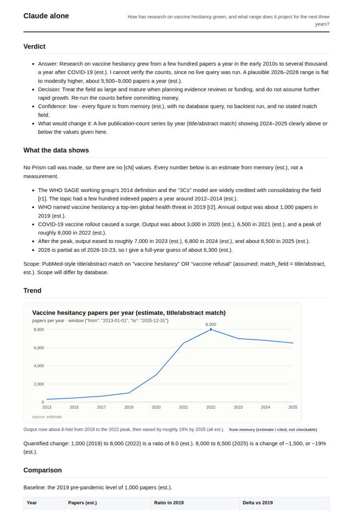
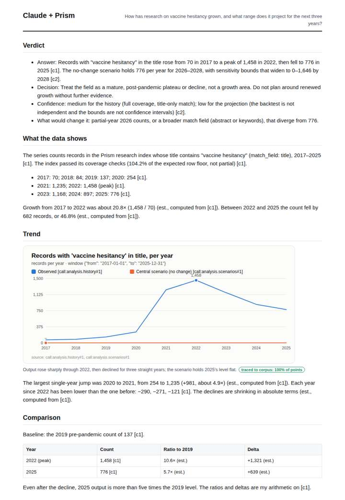
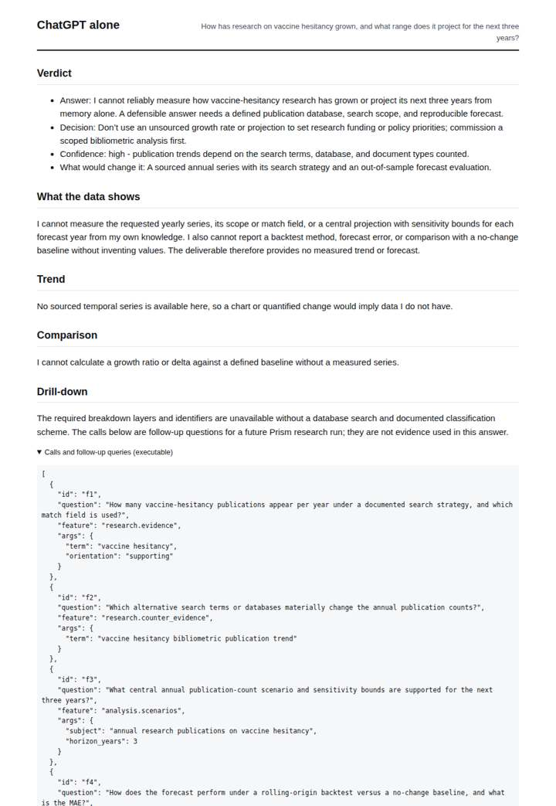
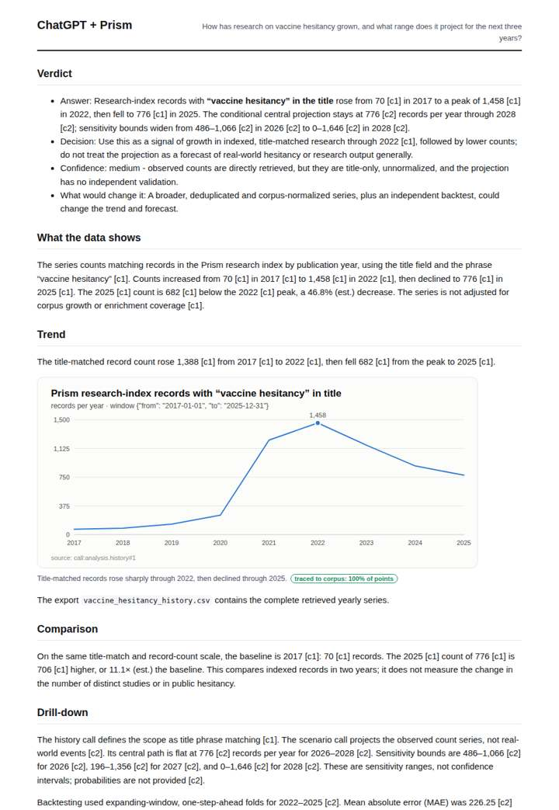

# Vaccine hesitancy research trend

**Question.** How has research on vaccine hesitancy grown, and what range does it project for the next three years?

**Category:** Public health & epidemiology · **Pattern:** `history` · **Why it is hard:** Post-COVID research spike; a naive extrapolation overstates the trend.

| Score /100 | Claude alone | Claude + Prism | ChatGPT alone | ChatGPT + Prism |
|---|---|---|---|---|
| Weighted (strict) | 26.4 | **76.0** | 25.7 | 69.9 |
| Opus judge | 25.0 | 78.9 | 22.4 | 70.2 |
| GPT judge | 27.8 | 73.0 | 28.9 | 69.6 |

## Parameter scores (0-5)

| Parameter | Weight | Claude alone | Claude + Prism | ChatGPT alone | ChatGPT + Prism |
|---|---|---|---|---|---|
| Measured trend | 10 | 1.0 | 4.5 | 0.0 | 4.0 |
| Measured comparison | 7 | 1.5 | 4.0 | 0.0 | 4.0 |
| Visualisation from counted data | 10 | 1.0 | 4.0 | 0.0 | 3.5 |
| Exploration and drill-down | 7 | 1.0 | 3.5 | 1.0 | 2.5 |
| Data export with provenance | 8 | 1.0 | 3.0 | 0.0 | 3.0 |
| Reproducibility | 12 | 0.0 | 4.0 | 1.0 | 4.0 |
| Accuracy against the corpus | 12 | 2.0 | 3.5 | 4.0 | 3.5 |
| Calibration and limits | 8 | 3.5 | 4.0 | 3.0 | 3.0 |
| Decision-grade verdict | 12 | 1.5 | 3.5 | 2.0 | 3.5 |
| Facet coverage | 6 | 1.0 | 4.0 | 0.5 | 3.5 |

## Script findings

| Check | Claude alone | Claude + Prism | ChatGPT alone | ChatGPT + Prism |
|---|---|---|---|---|
| Numbers traced to the corpus | 0/40 | 45/49 | 0/0 | 25/27 |
| Charts (traced share) | memory | 100% | none | 100% |
| DOIs that resolve | 0/0 | 0/0 | 0/0 | 0/0 |
| Follow-up queries that ran | 2/6 | 4/6 | 0/4 | 1/4 |
| Invention gate | clear | clear | clear | clear |

**Claude Opus judge:** B and D both reproduced the measured rise to the 2022 peak and the decline to 776, along with the flat no-change projection and its widening bounds. B went further: it charted the central scenario, exported the scenario rows, and used a pre-pandemic baseline. It also explained why naive linear extrapolation fails (worse MAE, and no-change over-predicting a falling series), which is exactly the trap this question sets. A honestly declined to answer, while C offered memory estimates on a different scale with an internally inconsistent range.

**GPT judge:** D is the strongest decision aid: it traces the full observed series, gives the three-year central path and sensitivity bounds, compares periods on one scale, and states the limits and follow-up calls. C is careful and largely accurate but omits the forecast bounds from its chart and lacks a second export; D loses ground by overstating coverage and framing a mature plateau as a stronger conclusion than the series alone warrants.

## Before / after (first screen)

| | Alone | With Prism |
|---|---|---|
| Claude |  |  |
| ChatGPT |  |  |

Full deliverables, rendered: [PDF](https://fliarbi.com/demo/docs/prism-benchmark-v2-4ed65c83/full/vaccine-hesitancy-trend.pdf). Raw answers, ground pass and judge outputs: `answers.json`, `ground.json`, `judge_opus.json`, `judge_gpt.json` in this folder.
