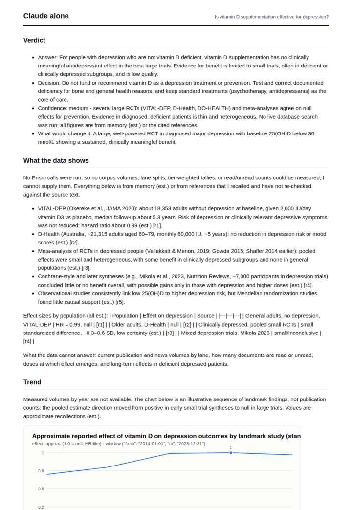
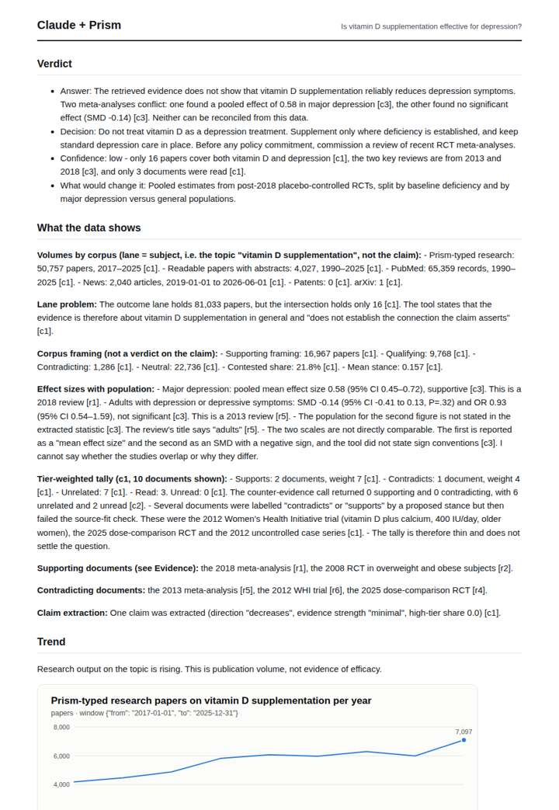
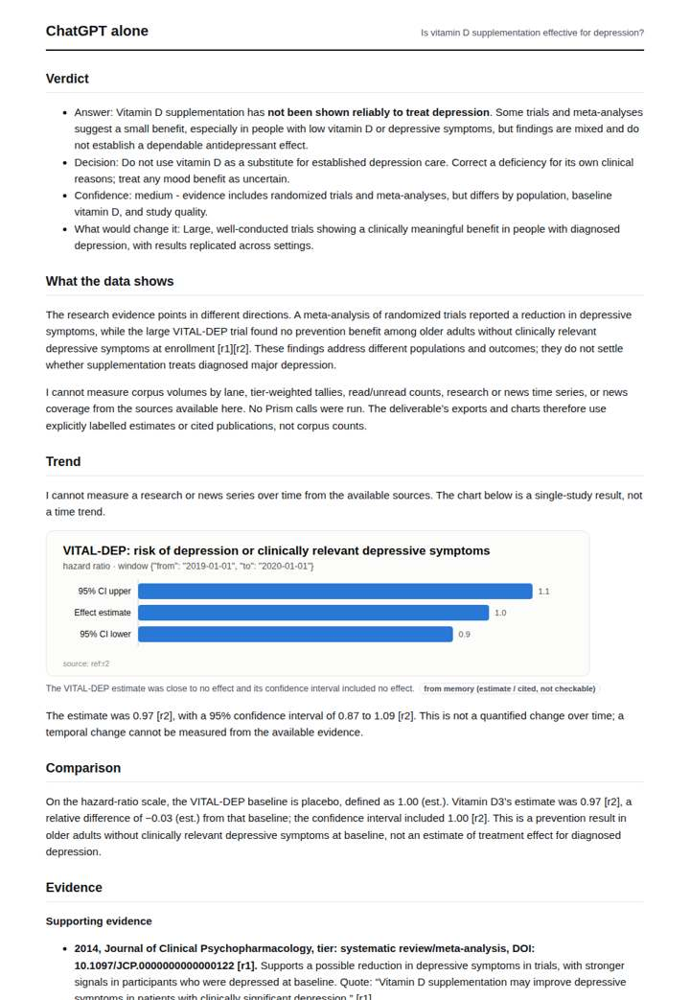
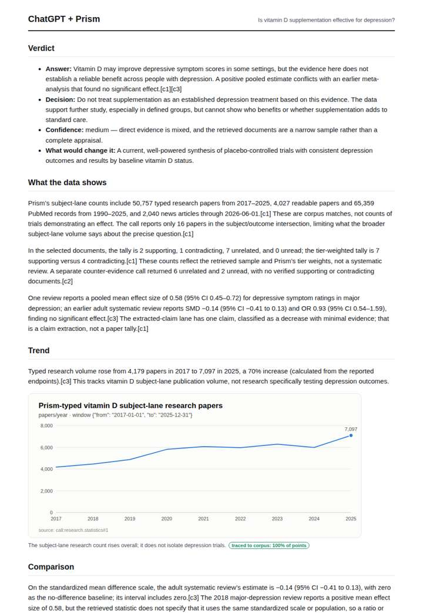

# Vitamin D and depression

**Question.** Is vitamin D supplementation effective for depression?

**Category:** Medical & clinical evidence · **Pattern:** `evidence` · **Why it is hard:** Hundreds of association papers drown a handful of RCTs; counting them equally gives the wrong answer.

| Score /100 | Claude alone | Claude + Prism | ChatGPT alone | ChatGPT + Prism |
|---|---|---|---|---|
| Weighted (strict) | 21.5 | 71.4 | 26.3 | **80.2** |
| Opus judge | 22.2 | 69.0 | 24.2 | 71.4 |
| GPT judge | 20.8 | 73.8 | 28.4 | 89.0 |

## Parameter scores (0-5)

| Parameter | Weight | Claude alone | Claude + Prism | ChatGPT alone | ChatGPT + Prism |
|---|---|---|---|---|---|
| Measured trend | 10 | 1.0 | 4.5 | 0.0 | 4.0 |
| Measured comparison | 7 | 1.5 | 4.0 | 1.5 | 4.0 |
| Visualisation from counted data | 10 | 1.0 | 4.0 | 1.0 | 4.0 |
| Exploration and drill-down | 7 | 1.0 | 1.0 | 1.0 | 2.0 |
| Data export with provenance | 8 | 1.0 | 0.0 | 0.5 | 3.0 |
| Reproducibility | 12 | 0.0 | 4.0 | 1.0 | 4.5 |
| Traceable references | 8 | 1.0 | 4.5 | 0.5 | 4.5 |
| Accuracy against the corpus | 12 | 2.0 | 4.0 | 1.5 | 4.5 |
| Calibration and limits | 8 | 3.0 | 4.5 | 3.0 | 4.5 |
| Decision-grade verdict | 12 | 0.0 | 3.5 | 3.0 | 4.5 |
| Facet coverage | 6 | 1.0 | 4.5 | 1.0 | 3.5 |

## Script findings

| Check | Claude alone | Claude + Prism | ChatGPT alone | ChatGPT + Prism |
|---|---|---|---|---|
| Numbers traced to the corpus | 0/27 | 54/54 | 0/10 | 44/44 |
| Charts (traced share) | memory | 100% | memory | 100% |
| DOIs that resolve | 0/0 | 7/7 | 1/2 | 3/3 |
| Follow-up queries that ran | 1/6 | 0/6 | 0/5 | 1/4 |
| Invention gate | tripped | clear | clear | clear |

**Claude Opus judge:** D and A both grounded their answer in the recorded calls, with verbatim quotes and resolving DOIs. D went further: it surfaced the 16-paper subject/outcome intersection, the news trend, the source-fit failures and per-corpus gaps to today, which justified a low-confidence 'not established' verdict. B and C reached clinically sensible conclusions from memory, but could not be traced; C also attached mismatched or unresolvable identifiers to its key references.

**GPT judge:** A best supports a treatment decision: it gives a cautious answer, distinguishes broad vitamin D publication volume from depression-specific evidence, and presents the conflicting review findings with traceable sources. B covers more corpus facets, but its unsupported news detail and treatment of source-fit failures as contradictions reduce confidence; C and D rely on unverified specifics.

## Before / after (first screen)

| | Alone | With Prism |
|---|---|---|
| Claude |  |  |
| ChatGPT |  |  |

Full deliverables, rendered: [PDF](https://fliarbi.com/demo/docs/prism-benchmark-v2-4ed65c83/full/vitamin-d-depression.pdf). Raw answers, ground pass and judge outputs: `answers.json`, `ground.json`, `judge_opus.json`, `judge_gpt.json` in this folder.
