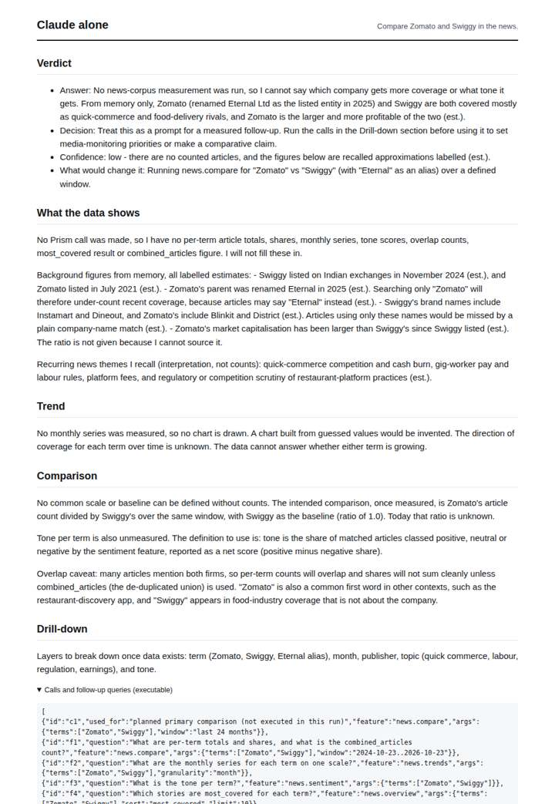
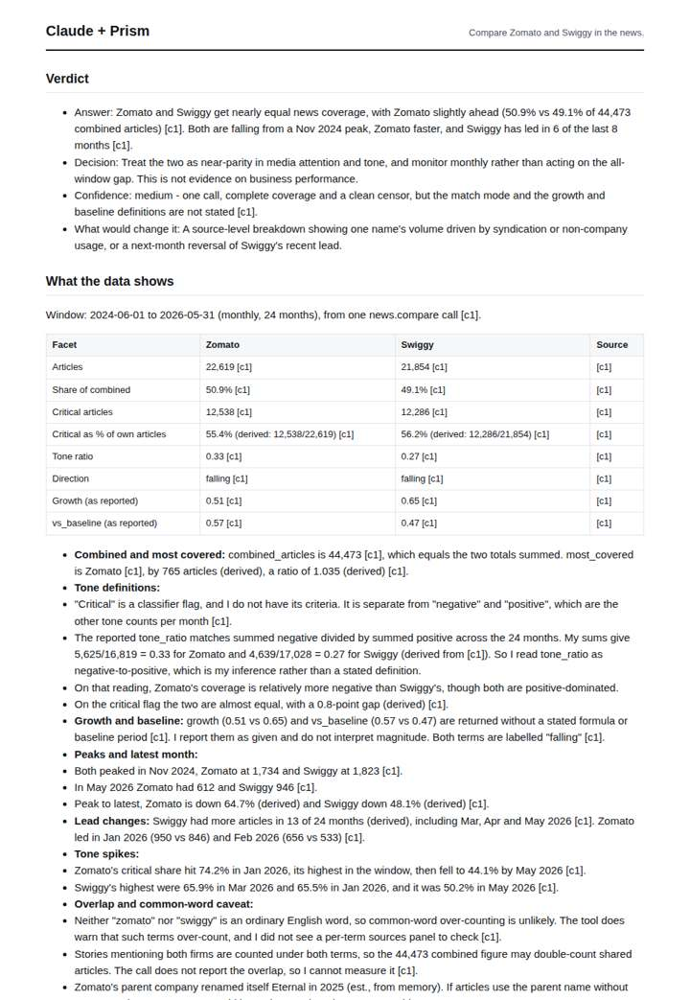
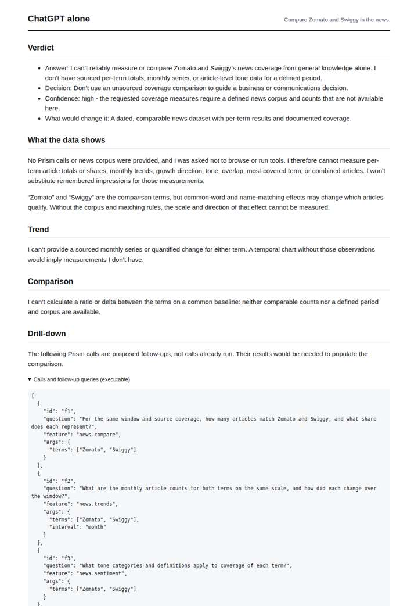
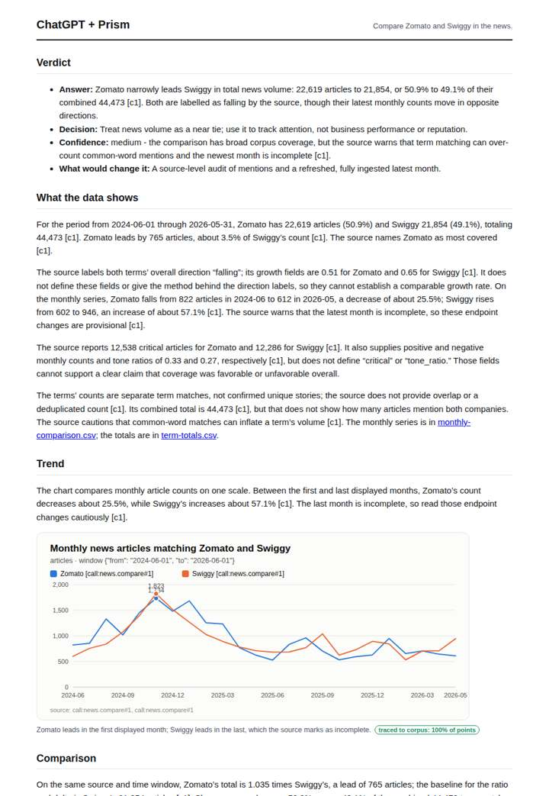

# Zomato vs Swiggy

**Question.** Compare Zomato and Swiggy in the news.

**Category:** Company & competitive intelligence · **Pattern:** `compare` · **Why it is hard:** Zomato renamed its parent to Eternal in 2025; a model may not know.

| Score /100 | Claude alone | Claude + Prism | ChatGPT alone | ChatGPT + Prism |
|---|---|---|---|---|
| Weighted (strict) | 22.1 | **76.0** | 23.8 | 58.3 |
| Opus judge | 20.2 | 84.6 | 17.2 | 60.0 |
| GPT judge | 23.9 | 67.4 | 30.4 | 56.5 |

## Parameter scores (0-5)

| Parameter | Weight | Claude alone | Claude + Prism | ChatGPT alone | ChatGPT + Prism |
|---|---|---|---|---|---|
| Measured trend | 10 | 0.5 | 4.5 | 0.0 | 3.0 |
| Measured comparison | 7 | 0.5 | 4.5 | 0.5 | 4.0 |
| Visualisation from counted data | 10 | 0.0 | 4.5 | 0.0 | 3.0 |
| Exploration and drill-down | 7 | 1.0 | 2.0 | 1.0 | 2.0 |
| Data export with provenance | 8 | 1.0 | 4.5 | 0.0 | 2.5 |
| Reproducibility | 12 | 0.0 | 4.0 | 0.5 | 4.0 |
| Accuracy against the corpus | 12 | 2.0 | 3.0 | 3.0 | 2.0 |
| Calibration and limits | 8 | 3.0 | 3.5 | 3.0 | 2.5 |
| Decision-grade verdict | 12 | 2.0 | 3.5 | 2.5 | 3.0 |
| Facet coverage | 6 | 1.0 | 4.0 | 0.5 | 3.0 |

## Script findings

| Check | Claude alone | Claude + Prism | ChatGPT alone | ChatGPT + Prism |
|---|---|---|---|---|
| Numbers traced to the corpus | 0/1 | 82/88 | 0/0 | 32/34 |
| Charts (traced share) | none | 100%, 100% | none | 100% |
| DOIs that resolve | 0/0 | 0/0 | 0/0 | 0/0 |
| Follow-up queries that ran | 1/7 | 1/7 | 1/5 | 1/6 |
| Invention gate | clear | clear | clear | clear |

**Claude Opus judge:** A read the full traced series correctly. It named the peaks, computed exact declines and lead changes, decomposed tone, and flagged the Eternal rename and the overlap. C used the same data but compared only endpoints and misread the censoring, treating May 2026 as incomplete. B and D measured nothing; B also misdescribed combined_articles.

**GPT judge:** A is the most decision-ready: it gives the strongest traced volume and tone comparison, useful charts, and complete exports, though its recent-lead count and coverage claim need correction. D is close on the core comparison, but its false claim that May 2026 is censored materially distorts the trend and exports. B is careful but offers no measured comparison; C adds unsupported memory claims.

## Before / after (first screen)

| | Alone | With Prism |
|---|---|---|
| Claude |  |  |
| ChatGPT |  |  |

Full deliverables, rendered: [PDF](https://fliarbi.com/demo/docs/prism-benchmark-v2-4ed65c83/full/zomato-swiggy.pdf). Raw answers, ground pass and judge outputs: `answers.json`, `ground.json`, `judge_opus.json`, `judge_gpt.json` in this folder.
