# Dashboards built with the Prism MCP

Each dashboard below was built by an assistant from **one brief**, connected live to the Prism MCP: it chose its
own tools, built the page, checked it with Prism's `check_report`, and handed back working HTML. Every page
records the exact prompt, the tool calls in order with their timings, and the checks the finished page passed.

| Dashboard | Use case | Built by | Prism calls | Time | Live |
| --- | --- | --- | ---: | ---: | --- |
| [Air pollution: where it is reported, studied and patented](air-pollution-geo/README.md) | GEO intelligence (world map, India states, cities) | Claude Opus 5.5 | 19 | 7.0 min | [open](https://fliarbi.com/demo/docs/prism-dashboards-3bb43e4c/air-pollution-geo/) |

Rebuild or add one: `python3 showcase/dashboards.py --only <slug>` (briefs live in `showcase/dashboards.py`).
Maps use `showcase/assets/world_india_official.geojson` and `india_states_official.geojson`, which draw India
with its official outline (built by `tools/world_india_official.py` and `tools/india_states_official.py`).

## Gallery

<table>
<tr><td colspan="3"><b><a href="https://fliarbi.com/demo/docs/prism-dashboards-3bb43e4c/air-pollution-geo/">Air pollution geo-intelligence dashboard</a></b> · Built by Claude Opus 5.5 from one brief: world map, India states, cities, trend, studied vs reported vs patented.</td></tr>
<tr><td width="33%"><a href="https://fliarbi.com/demo/docs/prism-dashboards-3bb43e4c/air-pollution-geo/">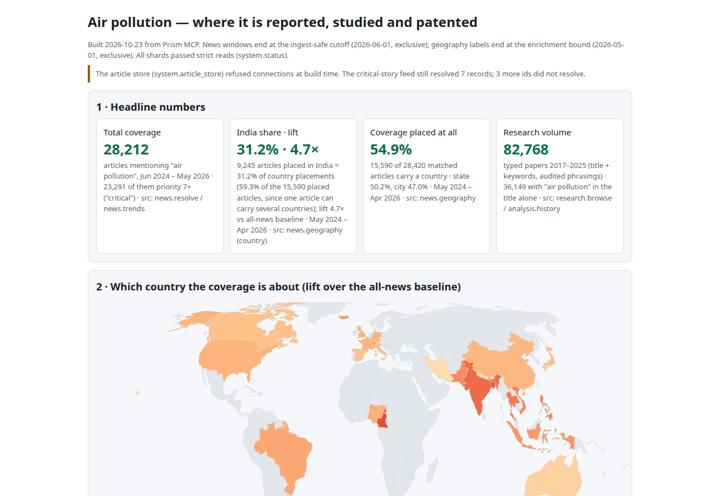</a></td><td width="33%"><a href="https://fliarbi.com/demo/docs/prism-dashboards-3bb43e4c/air-pollution-geo/">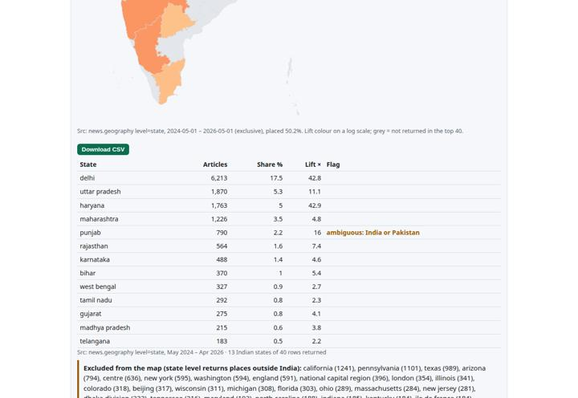</a></td><td width="33%"><a href="https://fliarbi.com/demo/docs/prism-dashboards-3bb43e4c/air-pollution-geo/">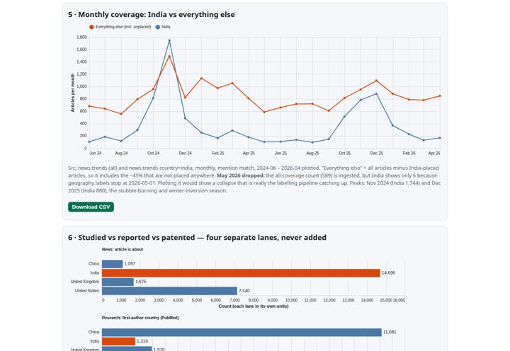</a></td></tr>
<tr><td colspan="3"><b><a href="https://fliarbi.com/prism/explore/reports/urban-heat/">Urban heat interactive report</a></b> · 67,602 research records and 3,961 news articles: inequality, places, what is rising and falling, what cools a city.</td></tr>
<tr><td width="33%"><a href="https://fliarbi.com/prism/explore/reports/urban-heat/">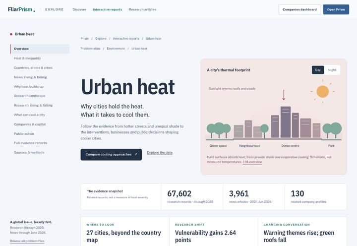</a></td><td width="33%"><a href="https://fliarbi.com/prism/explore/reports/urban-heat/">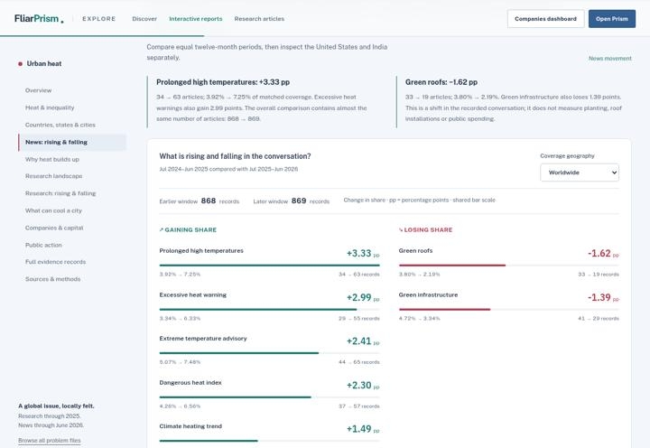</a></td><td width="33%"><a href="https://fliarbi.com/prism/explore/reports/urban-heat/">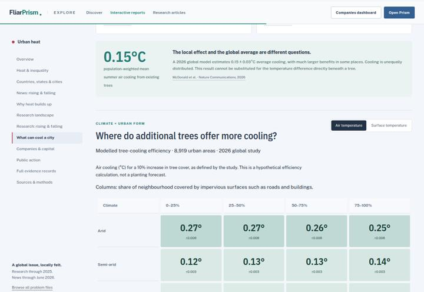</a></td></tr>
<tr><td colspan="3"><b><a href="https://fliarbi.com/prism/explore/reports/groundwater-depletion/">Groundwater depletion interactive report</a></b> · 311,396 research records: where the problem is, how the evidence is shaped, response approaches, companies.</td></tr>
<tr><td width="33%"><a href="https://fliarbi.com/prism/explore/reports/groundwater-depletion/">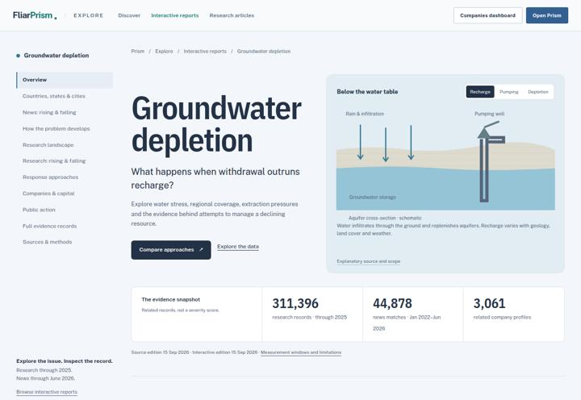</a></td><td width="33%"><a href="https://fliarbi.com/prism/explore/reports/groundwater-depletion/">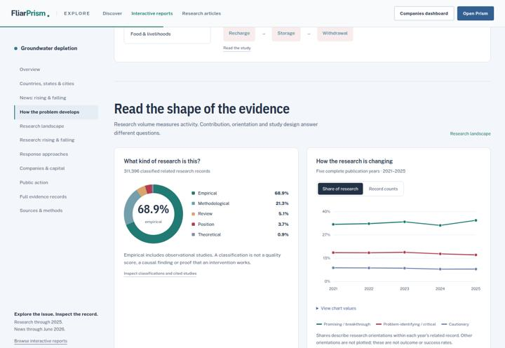</a></td><td width="33%"><a href="https://fliarbi.com/prism/explore/reports/groundwater-depletion/">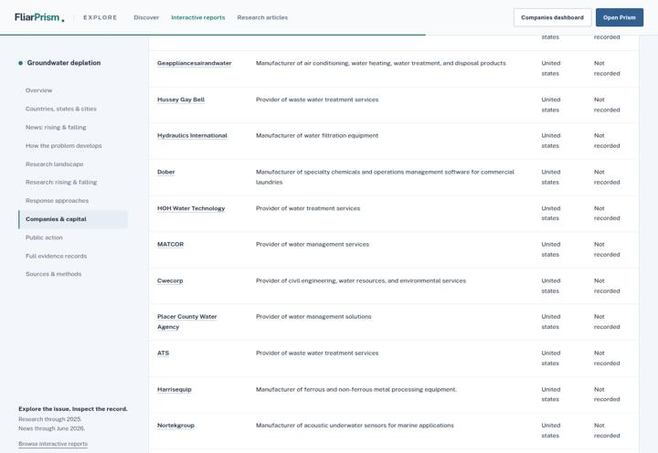</a></td></tr>
<tr><td colspan="3"><b><a href="https://fliarbi.com/assets/papers/hcc-input-audit-v2-20260915/index.html">Research: auditing a 55.5M-relation biomedical corpus</a></b> · Preprint built on Prism's Health Claims Corpus: input recovery, model replay and a lexical safeguard.</td></tr>
<tr><td width="33%"><a href="https://fliarbi.com/assets/papers/hcc-input-audit-v2-20260915/index.html">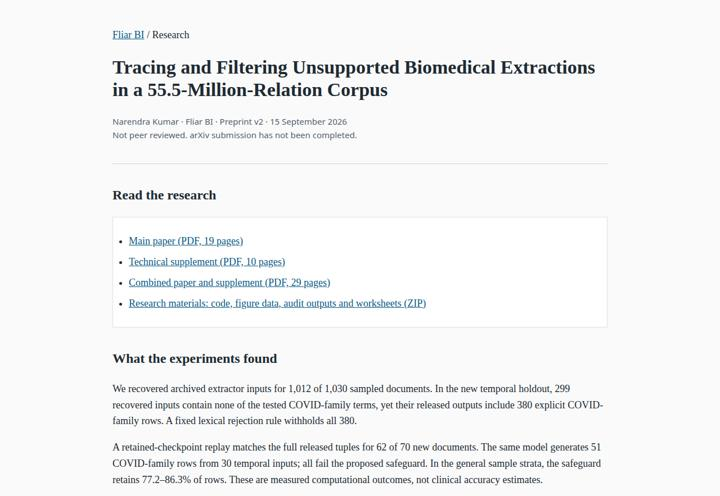</a></td><td width="33%"><a href="https://fliarbi.com/assets/papers/hcc-input-audit-v2-20260915/index.html">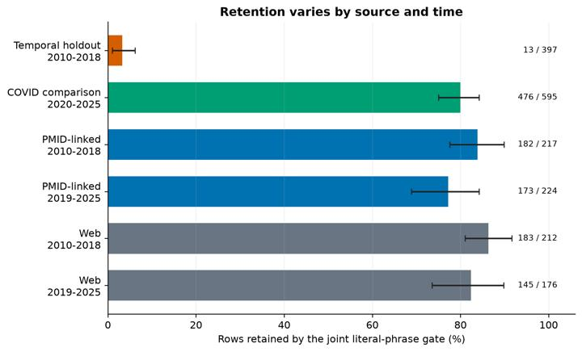</a></td><td width="33%"><a href="https://fliarbi.com/assets/papers/hcc-input-audit-v2-20260915/index.html">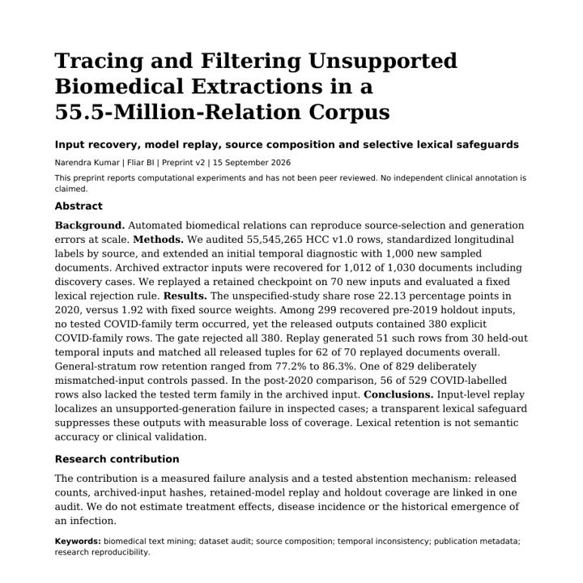</a></td></tr>
</table>
