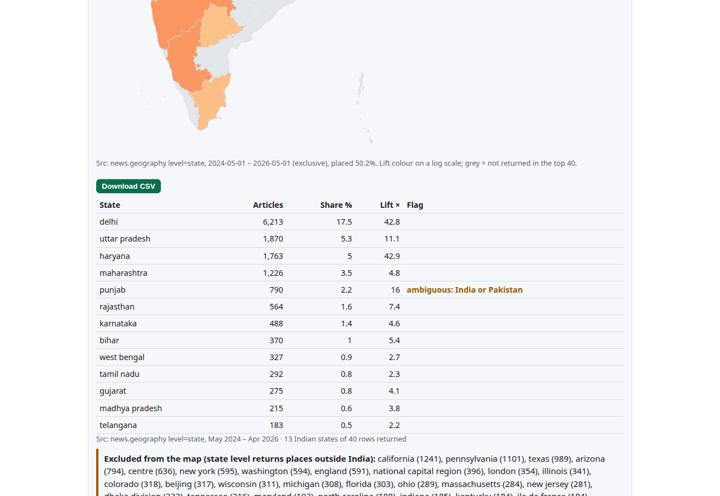
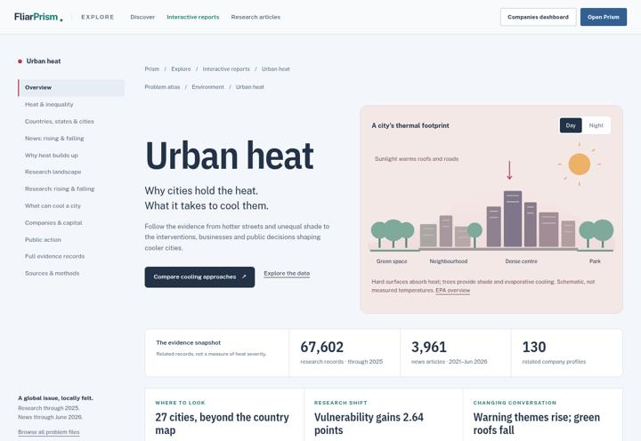
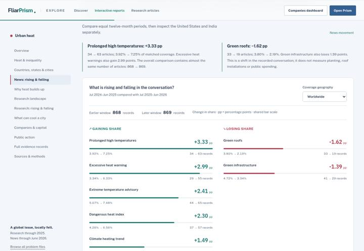
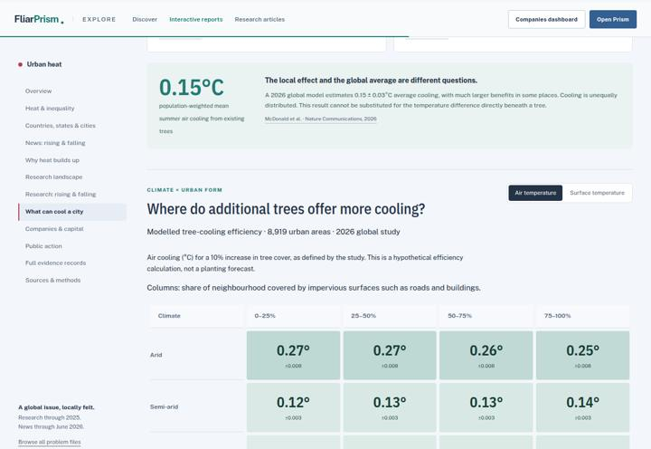
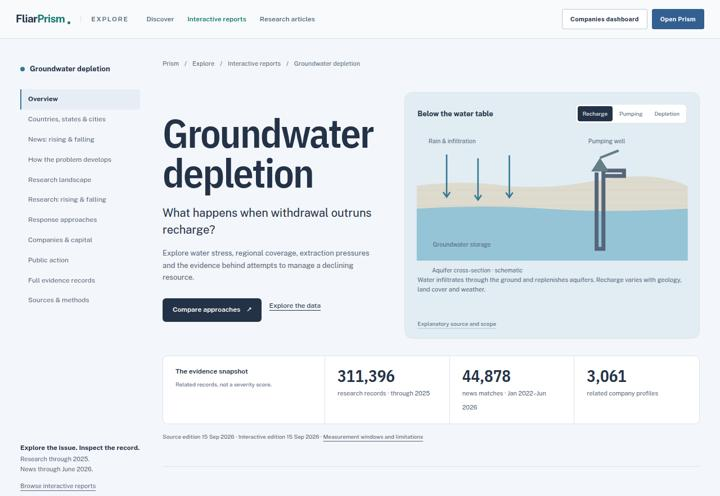
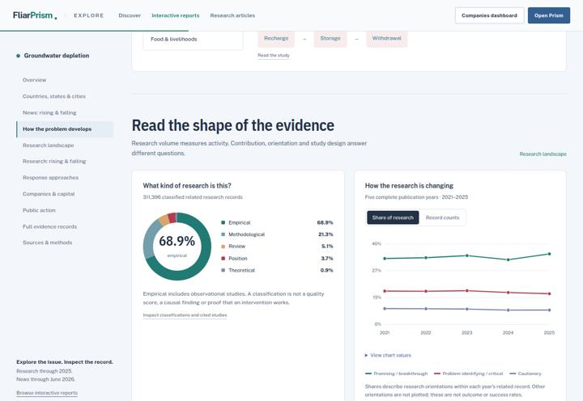
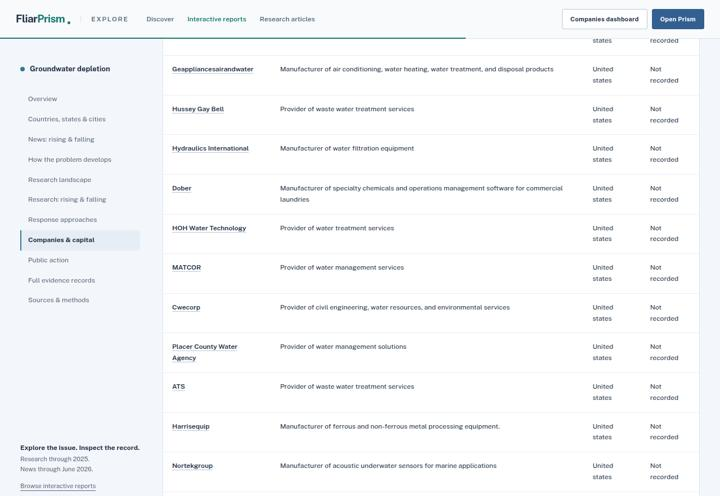

# Dashboards built with the Prism MCP

Each dashboard below was built by an assistant from **one brief**, connected live to the Prism MCP: it chose its
own tools, built the page, checked it with Prism's `check_report`, and handed back working HTML. Every page
records the brief, the tool calls in order, and the checks the finished page passed.

| Dashboard | Use case | Built by | Prism calls | Live |
| --- | --- | --- | ---: | --- |
| [Air pollution: where it is reported, studied and patented](air-pollution-geo/README.md) | GEO intelligence (world map, India states, cities) | Claude | 19 | [open](https://fliarbi.com/demo/docs/prism-dashboards-3bb43e4c/air-pollution-geo/) |

Maps use `world_india_official.geojson` and `india_states_official.geojson` (in each dashboard folder), which draw
India with its official outline.

## Gallery

<table>
<tr><td colspan="3"><b><a href="https://fliarbi.com/demo/docs/prism-dashboards-3bb43e4c/air-pollution-geo/">Air pollution geo-intelligence dashboard</a></b> · Built by Claude from one brief: world map, India states, cities, trend, studied vs reported vs patented.</td></tr>
<tr><td width="33%"></td><td width="33%"></td><td width="33%"></td></tr>
<tr><td colspan="3"><b><a href="https://fliarbi.com/prism/explore/reports/urban-heat/">Urban heat interactive report</a></b> · Research and news on urban heat: inequality, the places affected, what is rising and falling, what cools a city.</td></tr>
<tr><td width="33%"></td><td width="33%"></td><td width="33%"></td></tr>
<tr><td colspan="3"><b><a href="https://fliarbi.com/prism/explore/reports/groundwater-depletion/">Groundwater depletion interactive report</a></b> · Where the problem is, how the evidence is shaped, which responses are tried, and the companies working on it.</td></tr>
<tr><td width="33%"></td><td width="33%"></td><td width="33%"></td></tr>
</table>
