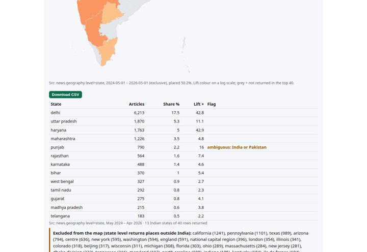

# Air pollution: geo-intelligence dashboard

**Use case:** GEO intelligence · **Built by:** Claude, connected live to the Prism MCP · 19 Prism calls

**[Open the live dashboard](https://fliarbi.com/demo/docs/prism-dashboards-3bb43e4c/air-pollution-geo/)** · source: [dashboard.html](dashboard.html) (serve it next to the two map files)



## The brief

One brief, given verbatim:

```text
Build a geo-intelligence dashboard on AIR POLLUTION for an environmental policy team in India, using the
Prism tools. They want to see, on one screen and then below it, where the issue is being reported, where it is
studied, how India compares with the world, and which places and stories are driving it.

Panels:
1. Header KPI tiles: total coverage, India's share of placed coverage and its lift, how much coverage could be
   placed at all, and the research volume. Each tile states its window.
2. World map: the country each article is about, coloured by lift over the all-news baseline, with a ranked table
   (articles, share, lift).
3. India state map: coverage and lift by state. The state level returns places outside India too; show only
   Indian states on the map and list what you excluded.
4. City leaderboard: the Indian cities and the NCR cluster, with lift.
5. Trend: monthly coverage for India against the rest of the world, with the incomplete newest month handled.
6. Studied vs reported vs patented: the separate geography lanes for research and patents next to news, never
   added together, with India and three comparators.
7. The critical stories: date, publisher, headline and link.
8. Data quality: placement share, windows and censoring, and any artefacts you caught (labels that are not
   places, acronym collisions), so a reader trusts the map for the right reasons.
```

Plus the build rules every dashboard gets (Vega-Lite, the official-outline map files, a source line under every panel, CSV downloads, and a `check_report` pass before answering).

## How the assistant built it

The assistant chose these Prism tools itself, in this order:

| # | Tool | Arguments |
|---:|---|---|
| 1 | `corpus_status` | `{}` |
| 2 | `freshness_status` | `{}` |
| 3 | `resolve_term` | `{"term": "air pollution"}` |
| 4 | `article_store_status` | `{}` |
| 5 | `news_geography` | `{"term": "air pollution", "level": "country", "limit": 25}` |
| 6 | `news_geography` | `{"term": "air pollution", "level": "state", "limit": 40}` |
| 7 | `news_geography` | `{"term": "air pollution", "level": "city", "limit": 40}` |
| 8 | `news_trends` | `{"term": "air pollution", "granularity": "monthly"}` |
| 9 | `news_trends` | `{"term": "air pollution", "granularity": "monthly", "country": "india"}` |
| 10 | `global_comparison` | `{"claim": "air pollution", "country": "india"}` |
| 11 | `browse_research` | `{"term": "air pollution", "limit": 5}` |
| 12 | `critical_news` | `{"term": "air pollution", "days": 365, "limit": 12}` |
| 13 | `historical_analysis` | `{"subject_phrases": ["air pollution"], "first_year": 2017, "last_year": 2025}` |
| 14 | `check_report` | `{"html": "…the finished page…"}` |
| 15 | `check_report` | `{"html": "…the finished page…"}` |
| 16 | `check_report` | `{"html": "…the finished page…"}` |
| 17 | `list_features` | `{}` |
| 18 | `check_report` | `{"html": "…the finished page…"}` |
| 19 | `check_report` | `{"html": "…the finished page…"}` |

## Checks on the finished page

- Charts rendered in a browser: **5**, zero-width: 0, console errors: 0
- Prism `check_report`: ready, nothing to fix
- India appears with its official outline (J&K including PoK, Gilgit-Baltistan and Aksai Chin; Ladakh is drawn inside J&K in the state file).


