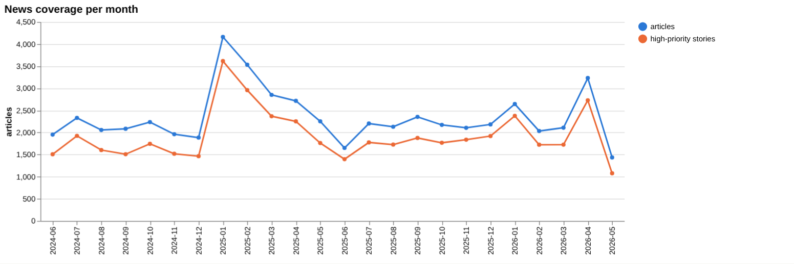
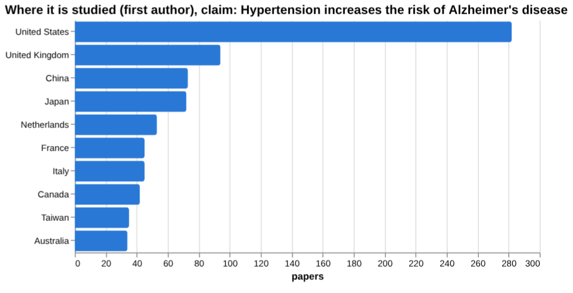
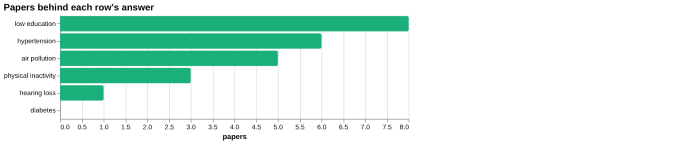
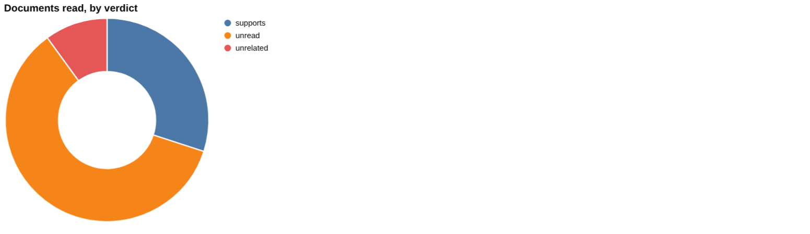
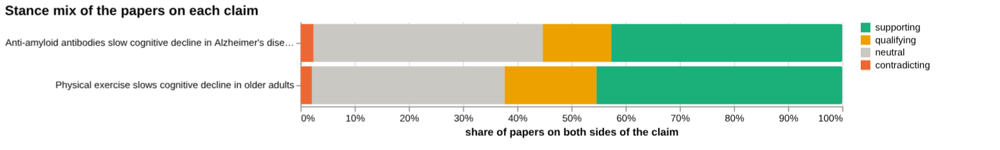
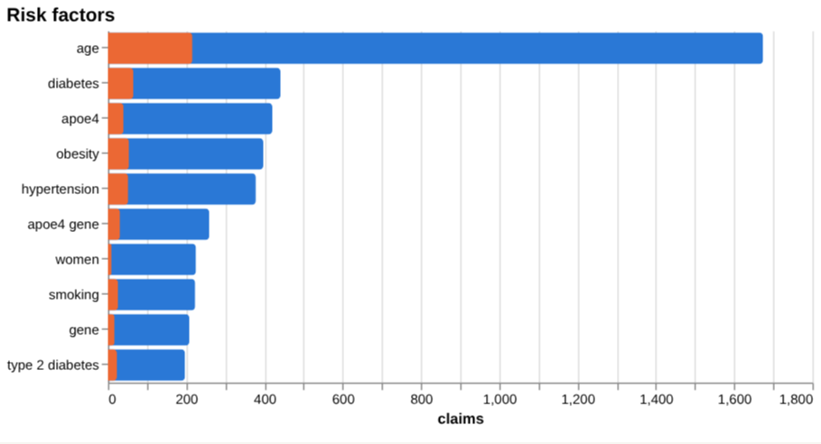
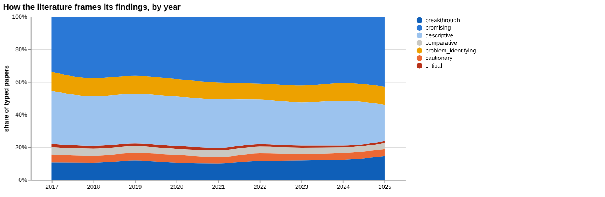
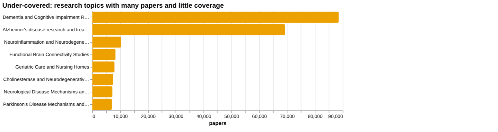
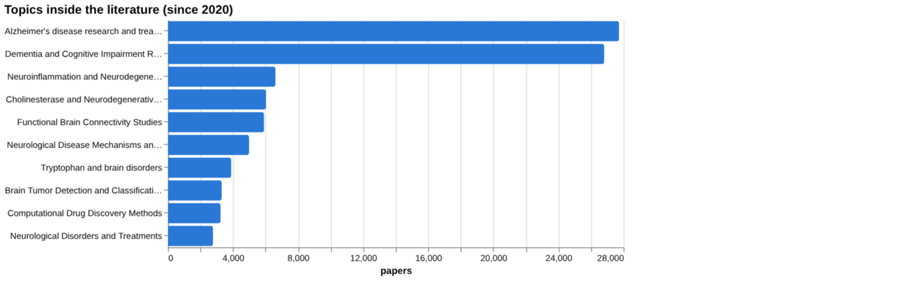

# Alzheimer's disease: disease intelligence

*For policy makers, doctors and scientists* · built from **19 Prism MCP calls** · **[Open the interactive report](https://fliarbi.com/demo/docs/prism-dashboards-3bb43e4c/diseases/alzheimers-disease/)** (tabs: Summary · For policy makers · For doctors · For scientists · Research methods · Month by month · Built with MCP)

> **Partial index.** Built while part of the news index was offline: counts and shares here are lower bounds (floors), and will be rebuilt in full when the index is complete.

The index holds 157,312 typed research papers for 2017-2025 on Alzheimer's disease, and 61,827 news articles for 2019-01-01..2026-06-01. The literature is described as mixed framing with no dominant lean: 76,150 papers are supporting, 25,040 qualifying, 2,299 contradicting and 53,823 neutral, with contested share at 17.4. On the clinical claim that anti-amyloid antibodies slow cognitive decline, 293 papers are typed, with contested share at 15.0, and the documents read lean towards support while not establishing consensus. For risk factors, the screening figures cover hypertension, physical inactivity and air pollution, while diabetes, hearing loss and low education have no figure. News coverage describes the withdrawal of Biogen's aducanumab in April 2026 and a shift towards non-amyloid targets and blood-based diagnostics. Research is concentrated in a few countries, and 0 patents match by title.

## For policy makers

The index shows a large literature of 157,312 typed papers for 2017-2025, with news interest of 61,827 articles. Where studied, the ranking starts with the United States at 282, then the United Kingdom at 94, China at 73 and Japan at 72. Where reported, the ranking starts with the United States at 15,237, then the United Kingdom at 4,615, Canada at 1,672 and Australia at 1,444. News describes a turning point with the withdrawal of Biogen's aducanumab in April 2026, followed by a move to anti-inflammatory approaches, novel delivery platforms and non-amyloid targets. The first FDA-cleared Elecsys pTau181 blood test (Oct 2025) and primary-care screening strategies are noted as moves towards clinical tools. Framing is broadly unchanged between earlier and recent windows, so the literature gives little sign of a change in tone. No patents match by title for 2005-2024, which is a point to watch when considering where translational activity sits.

- Watch how the post-aducanumab shift to non-amyloid targets and anti-inflammatory approaches shows up in new trial reports
- Commission an independent review of anti-amyloid antibody evidence, since the sampled documents do not establish scientific consensus
- Track uptake and evidence for blood-based diagnostics, including the FDA-cleared Elecsys pTau181 test, in primary care
- Consider funding research from settings outside the leading countries, given that the United States leads both the studied and reported rankings
- Commission evidence mapping for modifiable risk factors with no figure found, such as diabetes, hearing loss and low education

## For doctors

For the claim that anti-amyloid antibodies slow cognitive decline in Alzheimer's disease, 293 papers are typed: 125 supporting, 37 qualifying, 7 contradicting and 124 neutral, with contested share at 15.0. Of the documents read, 3 support, 0 contradict, 0 qualify and 11 are unrelated; the strongest source is a 2025 meta-analysis of lecanemab in mild Alzheimer's disease, which supports the claim. A separate sample read 1 supporting, 0 contradicting and 9 unrelated, and the stated reading is that this sample does not establish scientific consensus. For hypertension, an individual participant data meta-analysis (2024) reports 1.29 (95% CI 1.03-1.60) for risk of non-AD dementia in participants with treated hypertension. Among other risk factors, a 2023 meta-analysis reports 6.6% (95% CI: 3.6%, 9.6%) as the weighted overall impact of physical inactivity on dementia in cases of dementia, and a 2025 Burden of Proof meta-analysis reports a 14% increased risk of dementia associated with PM2.5 exposure. Diabetes has 0 papers screened and no figure, which means no figure was found rather than no effect.

- Meta-analysis tier: an individual participant data meta-analysis (2024) reports 1.29 (95% CI 1.03-1.60) for risk of non-AD dementia in participants with treated hypertension
- Meta-analysis tier: the weighted overall impact of physical inactivity on dementia is 6.6% (95% CI: 3.6%, 9.6%) in cases of dementia
- Meta-analysis tier: long-term PM2.5 exposure is associated with a 14% increased risk of dementia
- Meta-analysis tier, blood biomarkers: the standardized mean difference is 0.82 for NfL and 1.57 for GFAP, in patients on the AD continuum versus cognitively unimpaired
- Meta-analysis tier on anti-amyloid antibodies: the lecanemab meta-analysis (2025) supports the claim, but 11 of the documents read were unrelated and a contested share of 15.0%

**Risk-factor screen:** *Is {row} associated with the risk of Alzheimer's disease or dementia?*

| Factor | Effect size (quoted) | Measures | Source |
| --- | --- | --- | --- |
| hypertension | 1.29 (95% CI 1.03-1.60) | risk of non-AD dementia | Blood Pressure, Antihypertensive Use, and Late-Life Alzheimer and Non-Alzheimer Dementia R (2024) |
| diabetes | no figure found |  |  |
| hearing loss | no figure found |  | Early detection and management of hearing loss to reduce dementia risk in older adults wit (2025) |
| physical inactivity | 6.6% (95% CI: 3.6%, 9.6%) | overall impact of physical inactivity on dementia (weighted) | Systematic review and meta-analysis on population attributable fraction for physical inact (2023) |
| air pollution | 14% increased risk | increased risk of dementia associated with PM2.5 exposure | A systematic review with a Burden of Proof meta-analysis of health effects of long-term am (2025) |
| low education | no figure found |  | Cognitive Screening Instruments for Older Adults with Low Educational and Literacy Levels: (2021) |

**Clinical claim:** *Anti-amyloid antibodies slow cognitive decline in Alzheimer's disease*. Documents read: supports 3, unrelated 1, unread 6.

**Head to head:** Anti-amyloid antibodies slow cognitive decline in Alzheimer's disease vs Physical exercise slows cognitive decline in older adults: the first claim has more evidence behind it.

## For scientists

The literature frames itself as mixed, with contested share at 17.4 across 157,312 typed papers. By year, positive share rises from 21.9 in 2017 to 28.9 in 2025, while contested share runs from 9.3 in 2017 to 8.3 in 2025. The framing shift between windows is -0.8 percentage points, read as broadly unchanged, and orientation labels describe a paper's own framing, not the truth. Orientation is led by promising at 42,101 papers (40.9%), with cautionary at 4,340 and critical at 1,402. By contribution, empirical papers number 68,706 and theoretical papers 570. The hypertension components in the gap check are all marked as having evidence, but several risk factors lack a quantified figure, and Mendelian randomisation work reports pooled odds ratios such as 1.047 for myasthenia gravis as a risk factor for AD.

- Why is cautionary framing only 4,340 papers while promising framing is 42,101, and does this reflect the evidence or reporting habits?
- How do anti-amyloid antibody findings hold up when 11 of the documents read were unrelated to the claim?
- Can quantified risk estimates be established for diabetes, hearing loss and low education, where no figure was found?
- Do the Mendelian randomisation odds ratios for myasthenia gravis (1.037, 1.084, 1.054 and a pooled 1.047) replicate in other datasets?
- How will the shift towards non-amyloid targets and blood biomarkers (NfL 0.82, GFAP 1.57) change the framing of the literature after the aducanumab withdrawal?

## Research exploration methods

Nine ways to explore the research, each run on this disease. The interactive report shows each call and its result.

**Chaining them.** Start with the frontier scan and facets to see the shape of the field: what kind of papers dominate and which topics are covered. Then use triangulation and head-to-head on a specific treatment claim, noting how many documents were actually read, since most were unread or unrelated here. Use screening to pull effect sizes for risk factors, and gap mapping to confirm each part of a risk claim has a literature, remembering that coverage is not strength. Read framing drift and geography as context, not as evidence of truth. Rerun the empty history step with a clearer window before any trend is cited.

### Evidence triangulation

*Is a clinical claim supported, and by how strong a design?* `find_evidence` + `find_counter_evidence` + `rank_sources`

For the claim that anti-amyloid antibodies slow cognitive decline, the clinical documents split into 3 supporting, 1 unrelated and 6 unread, so most of what was retrieved was never read for a verdict. By tier they are 5 meta-analyses, 1 trial, 3 reviews and 1 guideline, which is a strong design mix on paper. The wider corpus of 293 papers is 125 supporting, 37 qualifying, 7 contradicting and 124 neutral, with a contested share of 15.0% and a reading of mixed framing with no dominant lean. The counter-evidence search found 1 supporting, 0 contradicting, 0 qualifying and 9 unrelated, so no disagreement was located, but nine of ten being unrelated means the search mostly missed the topic rather than cleared it. The tool itself says this sample does not establish scientific consensus, and that caution should stand. The risk-claim sources (5 meta-analyses, 6 trials, 6 reviews, 7 articles) are a separate strand about risk factors, and the top four listed all show cited_by of 0, as they are recent. A careful researcher would read the six unread documents and test the claim against effect sizes and safety outcomes, not just direction.

### Head-to-head claims

*Which of two interventions has more and stronger evidence?* `compare_claims`

The comparison sets anti-amyloid antibodies (293 papers on both poles) against physical exercise (2,551 papers). The verdict says the first claim has more evidence behind it, but that rests on documents read and source strength, not on paper count, where exercise is far larger. Anti-amyloid has 3 documents supporting and 11 unrelated; exercise has 1 supporting, 1 contradicting, 8 unrelated and 4 unread. Contested share is 15.0 for anti-amyloid and 19.1 for exercise, so exercise is the more disputed of the two in the corpus. The strongest anti-amyloid source is a 2025 meta-analysis on lecanemab marked as supporting; the strongest exercise source, a 2014 meta-analysis, was marked unrelated, which is a mismatch that weakens the exercise side of the comparison. The verdict therefore reflects thin reading on both sides and should not be treated as a finding about which intervention works better. A careful researcher would re-read the exercise evidence with a better-matched source and compare outcomes on a common measure.

### Cross-row screening

*Which risk factors carry a measured effect size, and how large?* `research_table`

Of six risk factors, three returned a quoted figure: hypertension at 1.29 (95% CI 1.03-1.60) for risk of non-AD dementia in participants with treated hypertension, physical inactivity at 6.6% (95% CI: 3.6%, 9.6%) as a weighted population attributable fraction for dementia, and air pollution at 14% increased risk of dementia with PM2.5 exposure. These are different kinds of quantity (a ratio-style estimate, an attributable fraction, a percentage increase) and cannot be ranked against one another. The hypertension figure concerns non-AD dementia and treated hypertension, so it does not directly answer the Alzheimer's question the screening asked. Diabetes returned no figure from 0 papers, which means the search found nothing, not that there is no effect. Hearing loss (1 paper) and low education (8 papers) returned no value; the low-education source is a review of cognitive screening instruments, so it is off target. A careful researcher would pull effect sizes for these gaps directly from dedicated meta-analyses and harmonise the outcome definitions before comparing.

### Framing drift

*Is the literature becoming more hopeful or more cautious?* `stance_trends`

Between 2017 and 2025 the positive share rose from 21.9 to 28.9 percent, with a rise in most years and a dip in 2024 (26.5 after 27.1 in 2023). The contested share moved from 9.3 in 2017 to 8.3 in 2025, with a low of 7.8 in 2023, so it fell slightly and stayed in a narrow band. Read together, the literature has become somewhat more hopeful in tone without becoming notably less contested or more cautious. This measures how papers describe themselves, not whether their findings are correct, and a rising positive share can reflect new drug approvals or publishing habits as easily as stronger evidence. It also says nothing about which topics drive the shift. A careful researcher would split the trend by intervention type, such as antibodies versus risk-factor work, and check whether the 2025 rise holds once that year's papers are fully indexed.

### Frontier scan

*What is new, and what is the research not reaching?* `research_radar`

The most-cited new work is mainly descriptive or problem-identifying: the 2023 facts and figures report (cited_by 2,943), the revised diagnostic criteria (1,824) and global burden and prevalence estimates. The one trial entry, two phase 3 studies of aducanumab (1,256), is labelled critical. So the high-citation new work is about scale, diagnosis and pipeline, not newly established treatments. The framing shift between windows is broadly unchanged: cautionary papers were 17.1 percent of 43,408 recent papers and 17.9 percent of 34,782 earlier papers, a delta of -0.8 percentage points. The caveat given is that orientation labels the paper's own framing, not the truth. The under-covered list is led by Dementia and Cognitive Impairment Research (88,580) and Alzheimer's disease research and treatments (69,262), which are large topics, so the label points to breadth with thin coverage per sub-question rather than neglected niches. A careful researcher would drill into those topics for specific sub-questions before concluding anything about gaps.

### Gap mapping

*Which parts of a claim does the literature actually cover?* `research_gaps`

The hypertension claim was split into three components: hypertension as a risk factor for Alzheimer's disease, elevated blood pressure increasing dementia risk, and vascular factors contributing to neurodegeneration. All three returned evidence: yes. This shows that a literature exists for each component, and no component is orphaned. It does not show how strong that literature is, whether it is causal, or whether it agrees. The screening result suggests care is needed, since the quoted hypertension figure concerned non-AD dementia in treated hypertension, not Alzheimer's disease specifically. A careful researcher would check the design and outcome definition within each component, and look separately at whether treatment of blood pressure changes Alzheimer's risk.

### Count history and backtested scenarios

*Is research on this growing, and where could it be in three years?* `historical_analysis` + `scenarios`

This method returned nothing: no counts per year, no scenarios and no baseline. That means no trend or three-year projection can be stated for this disease from these results, and it should not be read as flat or declining research. The absence most likely reflects the title-matching or window setup returning no usable series, not an absence of papers, given the very large paper counts elsewhere. The framing-by-year table covers 2017 to 2025 but gives percentages, not volumes, so it cannot stand in for a count history. A careful researcher would rerun the count with a broader title query and an explicit window, then check that the backtest has enough points before relying on any scenario.

### Geographic triangulation

*Where is it studied, published, reported and patented?* `global_comparison` + `news_geography`

The studied lane lists the United States first with 282, then the United Kingdom with 94, China with 73, Japan with 72, Netherlands with 53, France and Italy with 45 each, and Canada with 42. The reported lane is led by the United States at 15,237, then the United Kingdom at 4,615, Canada at 1,672, Australia at 1,444, China at 1,178, France at 1,045, Japan at 1,029 and Germany at 970. The lanes measure different things and must not be added together. Both put the United States and the United Kingdom first, but the order below that differs: Canada and Australia rank higher in reporting than in study, while China and Japan rank higher in study. No patent lane was returned, so nothing can be said about where inventions are filed. A careful researcher would check whether the study counts reflect the specific anti-amyloid claim, and look for regions with high disease burden that appear in neither lane.

### Faceted browsing

*What kind of literature is it: empirical, review, position? Problem-identifying or promising?* `browse_research`

By orientation, promising papers number 42,101 (40.9 percent), descriptive 27,691 (26.9), breakthrough 12,384 (12.0), problem-identifying 11,004 (10.7), cautionary 4,340 (4.2), comparative 3,948 (3.8) and critical 1,402 (1.4). The literature is therefore framed mostly in hopeful terms, with cautionary and critical work a small minority, though these labels describe how papers present themselves. By contribution, empirical work leads at 68,706, followed by review at 16,618, methodological at 14,119, position at 2,857 and theoretical at 570. The topic list includes items that do not obviously belong to Alzheimer's research, such as Brain Tumor Detection and Classification (3,307), which suggests some topic bleed. The most-cited-since-2020 list shows cited_by of 1 for every entry, all from 2025, so it reflects recency and says nothing about influence. A careful researcher would filter out off-topic clusters and rank by a citation-aged measure before treating these facets as a map of the field.

## Built with MCP

Every number and chart above comes from these 19 Prism MCP tool calls, made over MCP (streamable HTTP). The list with arguments and timings is in [mcp_calls.json](mcp_calls.json); the responses are in [data.json](data.json).

| MCP tool | Time | Result |
| --- | ---: | --- |
| `disease_profile` | 6.8 s | ok |
| `stance_trends` | 72.5 s | ok |
| `browse_research` | 92.0 s | ok |
| `historical_analysis` | 33.8 s | no data |
| `research_radar` | 289.1 s | ok |
| `research_gaps` | 245.0 s | ok |
| `global_comparison` | 207.3 s | ok |
| `news_trends` | 46.5 s | ok |
| `news_geography` | 58.8 s | ok |
| `critical_news` | 50.0 s | ok |
| `research_brief` | 426.0 s | ok |
| `news_factors` | 205.3 s | ok |
| `find_evidence` | 411.8 s | ok |
| `find_counter_evidence` | 378.5 s | ok |
| `rank_sources` | 273.8 s | ok |
| `deep_timeline` | 96.2 s | ok |
| `research_table` | 635.9 s | ok |
| `find_statistics` | 349.9 s | ok |
| `compare_claims` | 443.6 s | ok |

> Research intelligence, not medical advice: counts, framings and effect sizes are measured from the research and news index and quoted from their sources; they do not replace clinical guidelines or a clinician's judgement.

