# Breast cancer: disease intelligence

*For policy makers, doctors and scientists* · built from **20 Prism MCP calls** · **[Open the interactive report](https://fliarbi.com/demo/docs/prism-dashboards-3bb43e4c/diseases/breast-cancer/)** (tabs: Summary · For policy makers · For doctors · For scientists · Research methods · Month by month · Built with MCP)

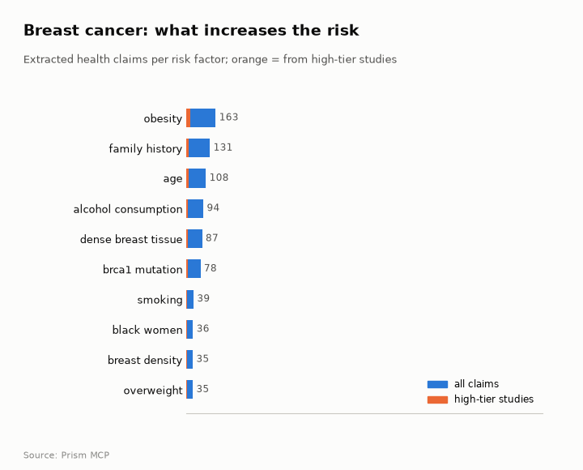

> **Partial index.** Built while part of the news index was offline: counts and shares here are lower bounds (floors), and will be rebuilt in full when the index is complete.

The index holds 81,392 Prism-typed research papers on breast cancer for 2017-2025, with literature framing mixed and no dominant lean, and a contested share of 18.4%. Annual output rose from 23,764 papers in 2017 to 46,466 in 2025, with a peak of 54,789 in 2023. Research is concentrated in treatment, HER2/EGFR work, screening and AI-based detection, while the most-studied risk factors in the claims corpus are obesity, family history and age. For mammography screening reducing mortality, the corpus is mostly positive with a substantial cautionary minority (a contested share of 20.4%), and the strongest source read is a 2020 meta-analysis of cohort studies that supports it. The evidence on night shift work is small and inconsistent: a pooled relative risk of 1.05 (95% CI 0.96-1.14) for ever exposure, against 1.25 (95% CI 1.01-1.55) for ≥20 years. Geography is skewed, with the United States leading both where studied and where reported.

## For policy makers

The index holds 81,392 research papers for 2017-2025, and annual output rose from 23,764 in 2017 to 46,466 in 2025, after 54,789 in 2023 and 40,964 in 2024. The scenario ranges are wide: the 2026 central figure is 46,466, with a lower sensitivity of 23,993 and an upper of 68,939, and the range widens further for 2027 and 2028. Attention is concentrated in Breast Cancer Treatment Studies (29,581 papers), HER2/EGFR in Cancer Research (14,799) and Global Cancer Incidence and Screening (13,246). Topics flagged as under-covered relative to their volume include Advanced Breast Cancer Therapies (28,361), Breast Lesions and Carcinomas (23,600) and Breast Implant and Reconstruction (7,343). Geographically, the United States dominates studied settings (59) and reported coverage (13,045), followed by the United Kingdom (16 and 4,350), while India appears in reporting (1,678) but not among the leading studied countries. News coverage tracks early detection, AI in mammogram reading and a £14.4 million funding boost for early-detection projects, alongside concern about mental-health support after diagnosis.

- Watch whether research output holds near 46,466 papers a year or falls towards the lower 2026 sensitivity of 23,993
- Commission a review of the gap between where breast cancer is studied and where it is reported, notably India (1,678 reported) against the studied-country list
- Track evidence on AI in mammogram reading, a theme in both the literature (13,238 papers) and the news
- Consider commissioning evidence on mental-health support after diagnosis, raised in news coverage of a patient death
- Monitor the effect of the £14.4 million early-detection funding on screening and detection research

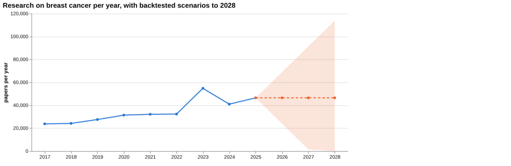

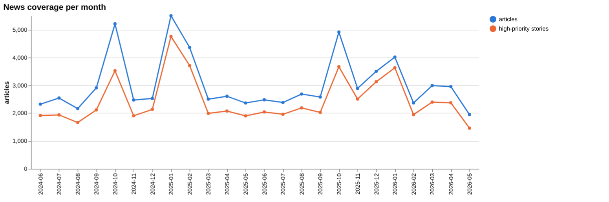

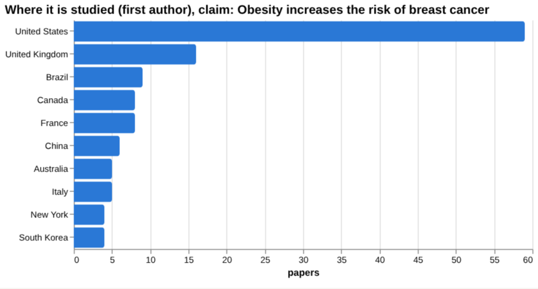

## For doctors

For the claim that mammography screening reduces breast cancer mortality, the corpus of 49,558 papers is mostly positive with a substantial cautionary minority, and a contested share of 20.4%. Of the documents read, 2 support the claim, 1 contradicts it and 7 are unrelated, so the direct evidence is thin. The strongest source is a 2020 meta-analysis of cohort studies on incidence-based breast cancer mortality, which supports the claim. For obesity as a risk factor, a 2025 systematic review and meta-analysis reports an adjusted odds ratio of AOR=2.4, 95 % CI; 1.35-4.27 for breast cancer risk in women, based on 6 papers in the screening. The night shift evidence is mixed: pooled relative risk for ever exposure is 1.05 (95% CI 0.96-1.14) and for ≥20 years is 1.25 (95% CI 1.01-1.55). Alcohol cessation shows RR = 0.88, 95%CI, 0.79-0.98 for ER+ breast cancer risk, and a figure for physical inactivity was not found, which does not mean no effect.

- Meta-analysis tier: mammography screening is supported by a 2020 worldwide meta-analysis of cohort studies on incidence-based mortality, but only 2 documents read support it and 1 contradicts it
- Meta-analysis tier: central obesity gave AOR=2.4, 95 % CI; 1.35-4.27 for breast cancer risk in women (6 papers)
- Meta-analysis tier: night shift work gave a pooled relative risk of 1.05 (95% CI 0.96-1.14) for ever exposure and 1.25 (95% CI 1.01-1.55) for ≥20 years
- Meta-analysis tier: exclusive breastfeeding versus never in parous women gave a summary relative risk of 0.72, 95% confidence interval (CI) [0.58, 0.90]
- Meta-analysis tier: HR+/HER2- patients on palbociclib had a progression-free survival HR 1.74 (95%CI from 1.28 to 2.37) favouring PPI non-users

**Risk-factor screen:** *Is {row} associated with the risk of breast cancer?*

| Factor | Effect size (quoted) | Measures | Source |
| --- | --- | --- | --- |
| obesity | AOR=2.4, 95 % CI; 1.35-4.27 | adjusted odds ratio for breast cancer risk | Central obesity increases the risk of breast cancer irrespective of menopausal status in w (2025) |
| alcohol consumption | RR = 0.88, 95%CI, 0.79-0.98 | risk of ER+ breast cancer | Alcohol cessation and breast cancer risk stratified by hormone receptor status. (2024) |
| hormone replacement therapy | HR = 0.98; 95% CI 0.63-1.52 | hazard ratio for breast cancer risk | Hormone replacement therapy after prophylactic risk-reducing salpingo-oophorectomy and bre (2018) |
| night shift work | no figure found |  | Night Shift Work and Breast Cancer Incidence: Three Prospective Studies and Meta-analysis  (2016) |
| physical inactivity | no figure found |  |  |
| breastfeeding | 0.72, 95% confidence interval (CI) [0.58, 0.90] | summary relative risk for breast cancer | Breastfeeding Mode and Risk of Breast Cancer: A Dose-Response Meta-Analysis. (2017) |

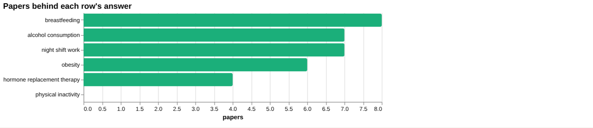

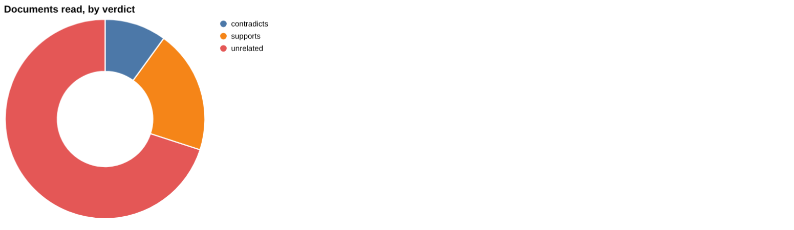

**Clinical claim:** *Mammography screening reduces breast cancer mortality*. Documents read: supports 2, contradicts 1, unrelated 7.

**Head to head:** Mammography screening reduces breast cancer mortality vs Breast MRI screening improves cancer detection in high-risk women: the first claim has more evidence behind it.

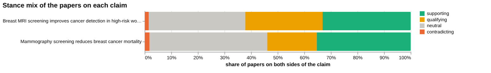

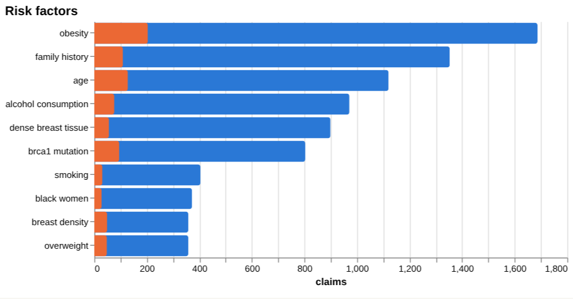

## For scientists

The literature is mixed in framing, with 31,652 supporting, 13,659 qualifying, 1,296 contradicting and 34,785 neutral papers. Orientation is led by promising work (88,112 papers, 40.7%), while cautionary (13,231) and critical (2,686) papers are fewer. Framing is broadly unchanged between windows, with cautionary_pct 17.3 recently (22,601 papers) against 19.8 earlier (18,173 papers). Newer work includes a phthalate cohort study labelled cautionary, a Mendelian randomisation study of thyroid and breast neoplasms, and a galectin-3 biomarker review. Direct evidence is thin in places: breast MRI screening in high-risk women has 4,420 papers and a contested share of 30.6%, but none of the documents read supports, contradicts or qualifies it. Empirical contributions number 156,844 papers against only 194 theoretical ones.

- Does the association between night shift work and breast cancer strengthen with duration, given 1.05 (95% CI 0.96-1.14) for ever exposure and 1.25 (95% CI 1.01-1.55) for ≥20 years?
- What direct evidence supports breast MRI screening in high-risk women, given a contested share of 30.6% and no supporting documents read?
- Is the thyroid and breast neoplasm link found by Mendelian randomisation replicated in other designs?
- Can the cautionary signal on di-2-ethylhexyl phthalate exposure and breast neoplasm incidence be confirmed outside a single cohort?
- How should the evidence on physical inactivity, where no papers were found in the screening, be filled, given physical activity appears as a protective factor in the claims corpus?

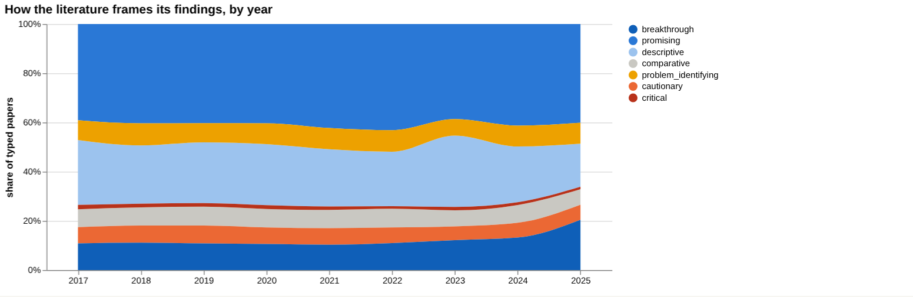

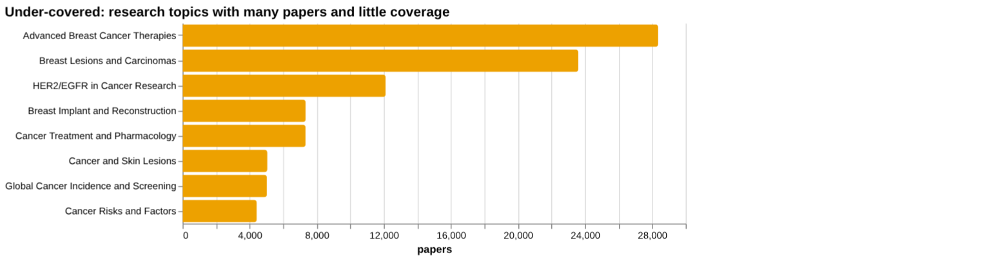

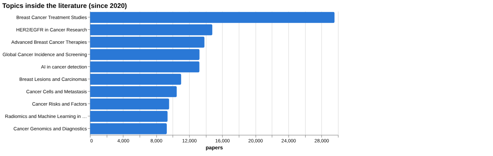

## Research exploration methods

Nine ways to explore the research, each run on this disease. The interactive report shows each call and its result.

**Chaining them.** Start with the facets and the history counts to see the size and shape of the field: mostly empirical, mostly promising, and growing. Use triangulation on a specific claim such as mammography and mortality, then head-to-head to place it against a rival claim, repairing any side where the documents read were unrelated, as with MRI. For risk factors, run the screening table, then gap mapping on any factor with a figure, and go back to the rows with no figure, such as night shift work and physical inactivity. Use framing drift and the frontier scan to see whether caution is increasing and what new work is emerging, treating low citation counts as a limit. Finish with the geographic lanes to see where the evidence comes from and who might be missing from it.

### Evidence triangulation

*Is a clinical claim supported, and by how strong a design?* `find_evidence` + `find_counter_evidence` + `rank_sources`

For the claim that mammography screening reduces breast cancer mortality, the clinical documents read split into 2 that support, 1 that contradicts and 7 unrelated. By design they sit high on the evidence ladder: 4 meta-analyses, 5 trials and 1 review. The wider corpus of 49,558 papers is mostly positive (17,528 supporting) with 9,216 qualifying, 883 contradicting and 21,931 neutral, giving a contested share of 20.4. The counter-evidence search returned 3 supporting and 1 contradicting document, so the disagreement is real but small. This does not show the size of the benefit, nor why the one contradicting document differs; the stated recommendation is to explain differences between the supporting and contradictory findings. The risk-claim sources (5 meta-analyses, 6 trials, 7 reviews, 1 observational, 1 article) concern adiposity, and their top four show 0 citations each, so rank on the ladder is not rank by influence. A careful researcher would read the contradicting document against the supporting meta-analysis, looking at population, outcome definition and period.

### Head-to-head claims

*Which of two interventions has more and stronger evidence?* `compare_claims`

Mammography screening has the larger evidence base: 49,558 papers against 4,420 for breast MRI screening in high-risk women. Mammography's documents read give 2 supporting and 1 contradicting; for MRI, 0 supporting, 0 contradicting and 12 unrelated, with 2 unread. The mammography strongest source is a 2020 meta-analysis that supports the claim. The MRI strongest source is a 2024 guideline on breast self-examination whose stance is unrelated, so it is not a test of the MRI claim. The MRI corpus is more contested, at 30.6 against 20.4. The verdict that the first claim has more evidence behind it reflects volume and design, but the MRI result mainly shows that the documents retrieved did not address the claim, not that the claim is weak. A careful researcher would rerun the MRI side with targeted searches for high-risk screening trials and cohort studies before drawing any comparison.

### Cross-row screening

*Which risk factors carry a measured effect size, and how large?* `research_table`

Four of the six risk factors returned a quoted effect size. Obesity gave AOR=2.4, 95 % CI; 1.35-4.27 for women (6 papers, 2025). Alcohol gave RR = 0.88, 95%CI, 0.79-0.98 for ER+ breast cancer, but the source concerns alcohol cessation, so that figure is not the effect of drinking itself. Hormone replacement therapy gave HR = 0.98; 95% CI 0.63-1.52 in BRCA1 and BRCA2 carriers after risk-reducing surgery, a narrow population with an interval that is wide. Breastfeeding gave 0.72, 95% confidence interval (CI) [0.58, 0.90] for exclusive breastfeeding against never. Night shift work (7 papers) returned no figure, and physical inactivity found 0 papers, which means the extraction failed or the search terms missed, not that there is no effect. The figures use different measures (odds ratio, relative risk, hazard ratio) and populations, so they should not be ranked against each other. A careful researcher would extract the missing rows by hand and match measure and population.

### Framing drift

*Is the literature becoming more hopeful or more cautious?* `stance_trends`

From 2017 to 2025 the positive share of typed papers moved from 24.9 to 30.3, with small movement in between (for example 25.7 in 2018 and 27.5 in 2024). The contested share stayed in a narrow band, from 8.1 in 2017 to 7.9 in 2025, with a low of 6.8 in 2023. The reading is a modest rise in hopeful framing alongside steady caution. It does not show that treatments or screening work better; the labels describe how papers present themselves, not whether they are right. The series also covers only nine years and gives no paper counts per year, so a small shift cannot be tested. A careful researcher would check which subtopics drive the 2025 rise in positive framing before treating it as a field-wide change.

### Frontier scan

*What is new, and what is the research not reaching?* `research_radar`

The most-cited new work is scattered across topics: a 2024 cohort study on di-2-ethylhexyl phthalate and breast neoplasm incidence (cited by 13, cautionary), a 2024 mindfulness trial (12, promising), a 2022 Mendelian randomisation study of thyroid and breast neoplasms (10, promising), and others at 9 or 8 citations. Citation counts are low, so none is established. Framing between windows is broadly unchanged: cautionary share was 17.3 across 22,601 recent papers against 19.8 across 18,173 earlier papers, a delta of -2.5 percentage points. The under-covered list puts Advanced Breast Cancer Therapies at 28,361 and Breast Lesions and Carcinomas at 23,600 first, followed by HER2/EGFR in Cancer Research at 12,112, Breast Implant and Reconstruction at 7,343, Cancer Treatment and Pharmacology at 7,337 and Cancer and Skin Lesions at 5,053. These topics have many papers but little coverage by the tool, so they are places where the picture here is thin. The orientation labels describe the paper's own framing, not the truth. A careful researcher would read the phthalate cohort and the Mendelian randomisation study first, then examine the under-covered topics directly.

### Gap mapping

*Which parts of a claim does the literature actually cover?* `research_gaps`

The claim that obesity increases the risk of breast cancer was split into two components: obesity associated with higher breast cancer risk, and excess adiposity linked to increased breast cancer incidence. Both show evidence: yes. This means a literature exists for each component, consistent with the screening figure of AOR=2.4, 95 % CI; 1.35-4.27. It does not show how strong or consistent that literature is, whether the effect differs by menopausal status or receptor subtype, or whether it is causal. Two components that are close restatements of one another is also a thin test; a finer split would be more informative. A careful researcher would add components such as menopausal status, hormone receptor subtype, weight change and mechanism, and check each in turn.

### Count history and backtested scenarios

*Is research on this growing, and where could it be in three years?* `historical_analysis` + `trend_scenarios`

Title-matched papers per year rose from 23,764 in 2017 to 46,466 in 2025, with 54,789 in 2023 the highest year, followed by a fall to 40,964 in 2024. The 2023 spike is a feature to explain rather than a trend, and could reflect indexing or a one-off cluster of publications. The scenario method used the no-change baseline, so the central figure for 2026, 2027 and 2028 is 46,466 in each year. The sensitivity band widens from 23,993 to 68,939 in 2026, to 1,520 to 91,412 in 2027, and 0 to 113,885 in 2028. By 2028 the band is so wide that it carries almost no information. These figures show that the field is large and has grown, not where it will be. A careful researcher would check the 2023 jump and treat the scenarios as a short-term guide only.

### Geographic triangulation

*Where is it studied, published, reported and patented?* `global_comparison` + `news_geography`

Studied lane: the United States leads with 59, followed by the United Kingdom at 16, Brazil at 9, Canada and France at 8 each, China at 6, and Australia and Italy at 5 each. Reported lane: the United States has 13,045, the United Kingdom 4,350, Canada 1,755, India 1,678, Australia 1,367, Germany 965, France 961 and China 873. The lanes answer different questions and are not added together. The same two countries top both, but Brazil appears among the studied countries and not the reported ones, while India and Germany appear in the reported lane only. This suggests where research is done and where coverage is concentrated do not fully align. The facts give no publication or patent lanes and no incidence data, so the results say nothing about where disease burden is highest. A careful researcher would add those lanes and compare coverage against burden before drawing conclusions about neglected regions.

### Faceted browsing

*What kind of literature is it: empirical, review, position? Problem-identifying or promising?* `browse_research`

By orientation, promising papers number 88,112 (40.7 percent), descriptive 50,329 (23.3), breakthrough 28,853 (13.3), problem_identifying 17,686 (8.2), comparative 15,339 (7.1), cautionary 13,231 (6.1) and critical 2,686 (1.2). The literature is therefore mostly hopeful in its framing, with critical work a small fraction. By contribution, empirical papers number 156,844, methodological 30,418, review 24,572, position 4,208 and theoretical 194. The top topic is Breast Cancer Treatment Studies at 29,581, ahead of HER2/EGFR in Cancer Research at 14,799, with AI in cancer detection at 13,238 and Radiomics and Machine Learning in Medical Imaging at 9,389 also prominent. The most-cited-since-2020 list shows citations of 1 or 0, so it reflects recency and not influence and should not be read as the key recent work. Orientation is the paper's own framing, so a high promising share does not mean treatments work. A careful researcher would filter to the empirical, cautionary and problem-identifying papers to test the hopeful majority.

## Built with MCP

Every number and chart above comes from these 20 Prism MCP tool calls, made over MCP (streamable HTTP). The list with arguments and timings is in [mcp_calls.json](mcp_calls.json); the responses are in [data.json](data.json).

| MCP tool | Time | Result |
| --- | ---: | --- |
| `disease_profile` | 3.6 s | ok |
| `stance_trends` | 47.8 s | ok |
| `browse_research` | 62.4 s | ok |
| `historical_analysis` | 0.0 s | ok |
| `global_comparison` | 5.2 s | ok |
| `research_gaps` | 19.9 s | ok |
| `news_trends` | 11.8 s | ok |
| `news_geography` | 20.9 s | ok |
| `critical_news` | 47.9 s | ok |
| `research_radar` | 224.6 s | ok |
| `research_brief` | 266.7 s | ok |
| `news_factors` | 187.3 s | ok |
| `rank_sources` | 23.2 s | ok |
| `find_evidence` | 209.6 s | ok |
| `find_counter_evidence` | 182.2 s | ok |
| `deep_timeline` | 96.6 s | ok |
| `research_table` | 545.2 s | ok |
| `compare_claims` | 480.9 s | ok |
| `find_statistics` | 370.1 s | ok |
| `trend_scenarios` | 0.1 s | ok |

> Research intelligence, not medical advice: counts, framings and effect sizes are measured from the research and news index and quoted from their sources; they do not replace clinical guidelines or a clinician's judgement.

