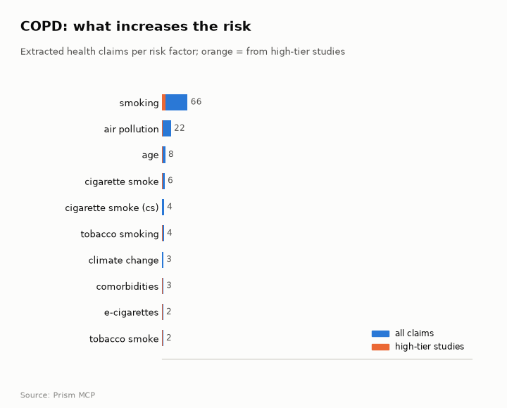
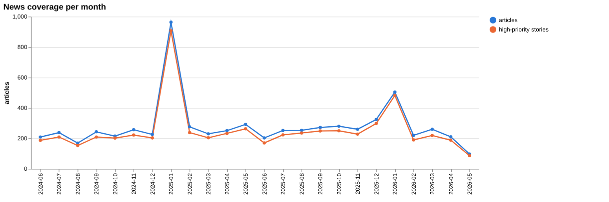
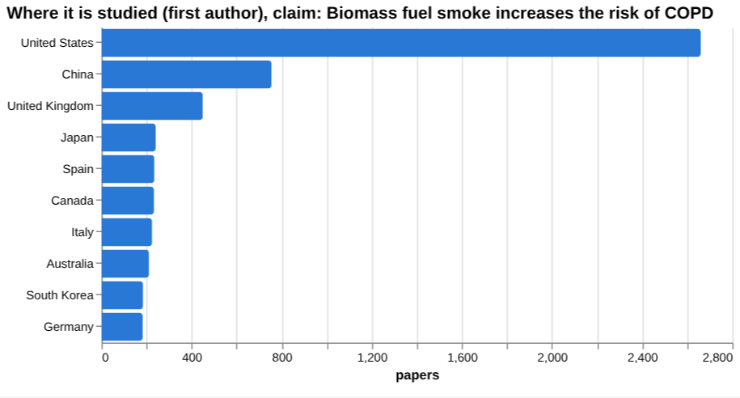
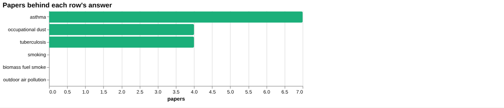
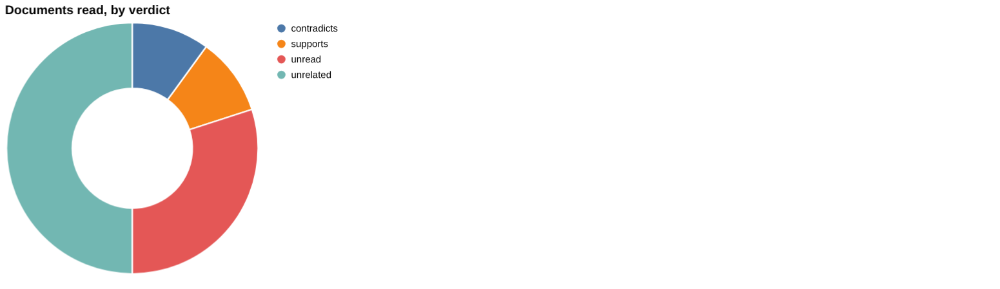
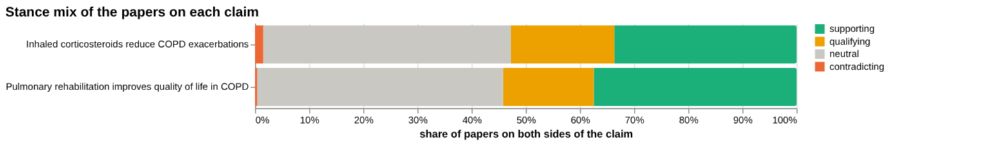
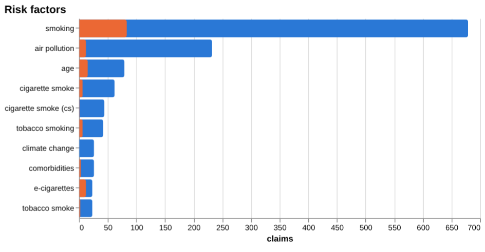
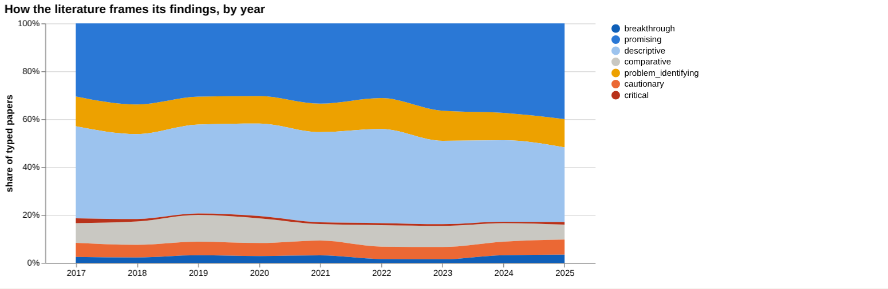
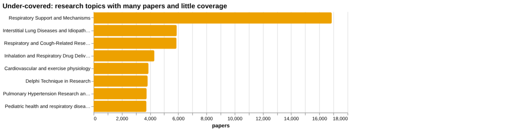
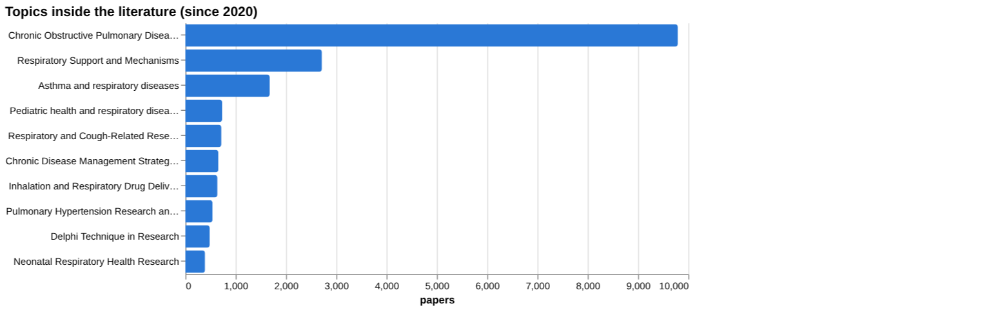

# COPD: disease intelligence

*For policy makers, doctors and scientists* · built from **19 Prism MCP calls** · **[Open the interactive report](https://fliarbi.com/demo/docs/prism-dashboards-3bb43e4c/diseases/copd/)** (tabs: Summary · For policy makers · For doctors · For scientists · Research methods · Month by month · Built with MCP)

> **Partial index.** Built while part of the news index was offline: counts and shares here are lower bounds (floors), and will be rebuilt in full when the index is complete.

The COPD literature in the index holds 81,979 typed research papers for 2017-2025, with framing that is mixed and has no dominant lean; a contested share of 19.8%. News coverage is large, with 18,104 articles, and centres on air pollution, smoking and mortality. For clinicians, pulmonary rehabilitation has the stronger evidence base of the two claims compared, with 2,908 papers at both poles and a contested share of 17.2%, against 4,154 and 20.6 for inhaled corticosteroids and exacerbations. Risk-factor screening is thin: smoking, biomass fuel smoke and outdoor air pollution returned 0 papers, and the only quoted effect size is ES=1.01 for occupational wood dust exposure. Descriptive and promising framings dominate the orientation facets, and the framing shift between earlier and recent windows is broadly unchanged. Several topic areas, such as interstitial lung disease and respiratory drug delivery, are flagged as under-covered relative to their size.

## For policy makers

The index shows 81,979 typed research papers for 2017-2025 and 18,104 news articles, so COPD attracts sustained attention in both research and the press. Where studied is led by the United States with 2,660 papers, then China with 755 and the United Kingdom with 450. Where reported in the news is led by the United States with 744 articles, then the United Kingdom with 289 and India with 237. India's position in the news but not in the research list suggests a gap between media attention and local research. News causes centre on air pollution, smoking, ozone, wildfire smoke and heatwaves, and one impact cited is 141,733 deaths in the United States in 2023. The news arc moves from burden and novel therapies towards prevention, hidden prevalence in low-resource settings, precision approaches and environmental interventions. Framing in research is broadly unchanged, with a change of -1.4 percentage points in cautionary share between earlier and recent windows.

- Commission evidence reviews on air pollution and COPD, since news coverage stresses it but screening found 0 papers for outdoor air pollution as a risk factor
- Watch prevalence and risk-factor work in low-resource settings, where news reports hidden prevalence and research geography is led by the United States, China and the United Kingdom
- Fund pulmonary rehabilitation delivery research, given the 2025 meta-analyses on delivery models and wearable monitoring
- Track the Lancet Commission and Global Burden of Disease work on burden and economic cost as reference points for planning
- Monitor under-covered topics such as respiratory drug delivery, with 4,307 papers flagged, and interstitial lung disease, with 5,893

## For doctors

The clinical claim examined is that pulmonary rehabilitation improves quality of life in COPD. The corpus holds 2,908 papers at both poles, with 1,089 supporting, 487 qualifying, 12 contradicting and 1,320 neutral, and a contested share of 17.2%. The strongest source is a 2014 meta-analysis of Tai Chi on exercise capacity and health-related quality of life, which supports the claim. Among documents read for this claim, 2 support and 2 contradict, and 10 are unrelated, so the sample does not establish scientific consensus. Key numbers from a rehabilitation-related synthesis in patients with chronic respiratory diseases are a mean difference of -0.82 in mMRC dyspnea score and a mean difference of 65.45 in 6-minute walk test distance. Risk-factor evidence is uneven: smoking appears in 679 claims, air pollution in 232, and the biomass fuel smoke screening returned 0 papers.

- Meta-analysis tier: a 2014 meta-analysis of Tai Chi supports improved exercise capacity and health-related quality of life in COPD
- Meta-analysis tier: pooled mean difference of -0.82 in mMRC dyspnea score and 65.45 in 6-minute walk test distance in patients with chronic respiratory diseases
- Corpus tier: for pulmonary rehabilitation and quality of life, 12 papers contradict and 487 qualify out of 2,908, with a contested share of 17.2%
- Meta-analysis tier: occupational wood dust exposure shows ES=1.01 for association with COPD risk, from 4 papers, a 2019 meta-analysis
- Review tier: the GOLD strategy report (2007) and a Cochrane review of pulmonary rehabilitation (2015) remain the most cited reviews, with 4,686 and 2,518 citations

**Risk-factor screen:** *Does {row} increase the risk of chronic obstructive pulmonary disease?*

| Factor | Effect size (quoted) | Measures | Source |
| --- | --- | --- | --- |
| smoking | no figure found |  |  |
| biomass fuel smoke | no figure found |  |  |
| outdoor air pollution | no figure found |  |  |
| occupational dust | ES=1.01 | association between occupational wood dust exposure and COPD risk | [Meta-analysis study on occupational wood dust exposure association with chronic obstructi (2019) |
| asthma | no figure found |  | Glucagon-like peptide 1 (GLP-1) receptor agonists and asthma and COPD exacerbations in adu (2025) |
| tuberculosis | no figure found |  | Inhaled Corticosteroids and Mycobacterial Infection in Patients with Chronic Airway Diseas (2022) |

**Clinical claim:** *Pulmonary rehabilitation improves quality of life in COPD*. Documents read: unrelated 5, supports 1, contradicts 1, unread 3.

**Head to head:** Pulmonary rehabilitation improves quality of life in COPD vs Inhaled corticosteroids reduce COPD exacerbations: the first claim has more evidence behind it.

## For scientists

The literature is mixed in framing, with 28,007 supporting, 15,285 qualifying, 972 contradicting and 37,715 neutral papers. Orientation facets are led by descriptive papers at 5,121 (35.6%) and promising papers at 5,004 (34.8%), with cautionary at 836 (5.8%) and critical at 115 (0.8%). Empirical work accounts for 10,754 papers, against 2,437 reviews and only 16 theoretical papers. Newer prominent work is largely descriptive burden modelling, such as the 2022 Lancet Respiratory Medicine prevalence analysis with 1,260 citations, plus the Lancet Commission on elimination. Thin areas include risk-factor screening, where smoking, biomass fuel smoke and outdoor air pollution returned 0 papers, and under-covered topics led by Respiratory Support and Mechanisms with 16,883 papers. The 2025 papers carry 0 citations so far, so their influence cannot yet be judged.

- Why did screening for smoking, biomass fuel smoke and outdoor air pollution return 0 papers with a quantified effect, and can effect sizes be extracted from the wider literature?
- What does the ES=1.01 for occupational wood dust exposure mean given only 4 papers, and how robust is it?
- Do pulmonary rehabilitation delivery models differ in effect on quality of life, dyspnoea and exercise capacity?
- How should COPD be defined and named, following the call for revision of its definition and nomenclature?
- What explains the gap between news attention in India, with 237 articles, and its place in the research geography?

## Research exploration methods

Nine ways to explore the research, each run on this disease. The interactive report shows each call and its result.

**Chaining them.** Begin with triangulation to establish whether a clinical claim has supporting evidence and to gauge the balance of support versus contradiction. Use head‑to‑head comparison to assess which of two interventions has a larger evidence base. Apply screening to identify risk factors with quantified effect sizes, noting any missing estimates. Examine framing trends to understand whether the literature is becoming more hopeful or cautious, and complement this with a frontier scan to spot newly influential work and under‑covered topics. Finally, map gaps, geography and facets to confirm coverage, locate research hubs and understand the types of studies available, guiding subsequent focused reviews.

### Evidence triangulation

*Is a clinical claim supported, and by how strong a design?* `find_evidence` + `find_counter_evidence` + `rank_sources`

The claim that pulmonary rehabilitation improves quality of life in COPD is supported by a sample of documents, with one document supporting and one contradicting the claim. The tier distribution shows five meta‑analyses, three trials and two reviews among the clinical corpus. The broader corpus of 2,908 papers is split into 1,089 supporting, 487 qualifying, 12 contradicting and 1,320 neutral, giving a contested proportion of 17.2 %. The reading is described as mixed framing with no dominant lean, and the counter‑evidence tally adds two supports and no contradictions. The recommendation notes that the selected sample does not establish scientific consensus. A careful researcher would broaden the sample, verify the tier quality of the supporting sources and seek a systematic synthesis to determine consensus.

### Head-to-head claims

*Which of two interventions has more and stronger evidence?* `compare_claims`

Two interventions are compared: pulmonary rehabilitation versus inhaled corticosteroids. The rehabilitation claim is linked to 2,908 papers with a corpus mix of 1,089 supporting, 487 qualifying, 12 contradicting and 1,320 neutral, and a contested proportion of 17.2 %; the strongest source is a 2014 meta‑analysis that supports the claim. The corticosteroid claim is linked to 4,154 papers with a corpus mix of 1,398 supporting, 793 qualifying, 63 contradicting and 1,900 neutral, and a contested proportion of 20.6 %; its strongest source is a 2010 meta‑analysis that also supports the claim. The verdict states that the first claim has more evidence behind it, but the result does not quantify the magnitude of benefit. A careful researcher would examine the effect sizes and methodological rigour of the strongest sources before drawing clinical conclusions.

### Cross-row screening

*Which risk factors carry a measured effect size, and how large?* `research_table`

Only the occupational dust row returned a measured effect size, listed as ES=1.01 for the association between occupational wood dust exposure and COPD risk, based on four papers from 2019. All other rows – smoking, biomass fuel smoke, outdoor air pollution, asthma and tuberculosis – have null values and zero papers reported. The absence of values indicates that no quantified risk estimate was found for those factors in this screening, not that the factors lack risk. This does not provide a complete risk profile for COPD. A careful researcher would search for primary studies on the missing factors and extract effect sizes to fill the gaps.

### Framing drift

*Is the literature becoming more hopeful or more cautious?* `stance_trends`

The yearly positive percentages rise from 16.3 % in 2017 to 21.9 % in 2025, while contested percentages remain around 9–10 % over the same period. This pattern suggests that the literature is becoming more hopeful over time. The data do not explain why the optimism is increasing or which sub‑areas drive the change. It also does not assess the validity of the positive framing. A careful researcher would investigate the drivers of the rising positive orientation and test whether it aligns with clinical outcomes.

### Frontier scan

*What is new, and what is the research not reaching?* `research_radar`

The frontier scan lists six recent highly cited works, most of which are descriptive, with citation counts ranging from 450 to 1,260. The framing shift shows a delta of -1.4 percentage points, and the reading notes that framing is broadly unchanged. Under‑covered topics such as Respiratory Support and Mechanisms (16,883 papers) and Interstitial Lung Diseases (5,893 papers) are highlighted, indicating areas with many papers but little coverage in the new work. The result does not assess the quality or impact of the new publications. A careful researcher would examine the under‑covered topics for research opportunities and evaluate the methodological strength of the newly identified works.

### Gap mapping

*Which parts of a claim does the literature actually cover?* `research_gaps`

For the claim that biomass fuel smoke increases COPD risk, the gap analysis finds evidence for exposure, increased risk and the risk factor relationship, indicating that the literature covers all three components. This shows that the claim is well represented in the existing literature. The analysis does not provide any quantitative estimate of the risk magnitude. A careful researcher would therefore seek to quantify the effect size, perhaps through a meta‑analysis, to complement the presence of evidence.

### Count history and backtested scenarios

*Is research on this growing, and where could it be in three years?* `historical_analysis` + `scenarios`

The historical analysis returns empty structures for research per year, scenarios and baseline, indicating that no publication count data were available for this disease. Consequently, no trend of growth or projection can be inferred from this method. The absence does not imply that research is static; it simply reflects missing data. A careful researcher would need to compile yearly publication counts from external sources before modelling future trajectories.

### Geographic triangulation

*Where is it studied, published, reported and patented?* `global_comparison` + `news_geography`

The geographic triangulation shows that the United States leads with 2,660 studies, followed by China (755) and the United Kingdom (450). Reporting counts differ, with the United States again highest at 744, the United Kingdom at 289 and India at 237. These figures illustrate where research is conducted and where it is reported, but they do not indicate the quality or relevance of the studies across regions. The result also does not reveal any regional differences in outcomes. A careful researcher would compare study designs and findings across the major countries to assess generalisability.

### Faceted browsing

*What kind of literature is it: empirical, review, position? Problem-identifying or promising?* `browse_research`

Orientation facets reveal that descriptive (5,121 papers, 35.6 %) and promising (5,004 papers, 34.8 %) orientations dominate the COPD literature, while cautionary and critical orientations are less common. Contribution facets show that empirical papers (10,754) far exceed reviews (2,437) and other types. Topic facets list the most frequent topics, with COPD research itself (9,793 papers) leading, and several other areas such as Respiratory Support (2,715 papers) and Asthma (1,678 papers) following. The data do not convey the depth or impact of each orientation or topic. A careful researcher would target under‑represented orientations or topics for deeper investigation.

## Built with MCP

Every number and chart above comes from these 19 Prism MCP tool calls, made over MCP (streamable HTTP). The list with arguments and timings is in [mcp_calls.json](mcp_calls.json); the responses are in [data.json](data.json).

| MCP tool | Time | Result |
| --- | ---: | --- |
| `disease_profile` | 4.3 s | ok |
| `stance_trends` | 38.3 s | ok |
| `browse_research` | 63.9 s | ok |
| `historical_analysis` | 6.1 s | no data |
| `research_radar` | 136.9 s | ok |
| `research_gaps` | 155.0 s | ok |
| `global_comparison` | 139.7 s | ok |
| `news_trends` | 97.1 s | ok |
| `news_geography` | 63.4 s | ok |
| `research_brief` | 257.8 s | ok |
| `critical_news` | 27.1 s | ok |
| `news_factors` | 201.0 s | ok |
| `find_evidence` | 387.4 s | ok |
| `find_counter_evidence` | 398.2 s | ok |
| `rank_sources` | 313.2 s | ok |
| `deep_timeline` | 33.3 s | ok |
| `research_table` | 548.0 s | ok |
| `find_statistics` | 286.5 s | no data |
| `compare_claims` | 429.0 s | ok |

> Research intelligence, not medical advice: counts, framings and effect sizes are measured from the research and news index and quoted from their sources; they do not replace clinical guidelines or a clinician's judgement.

