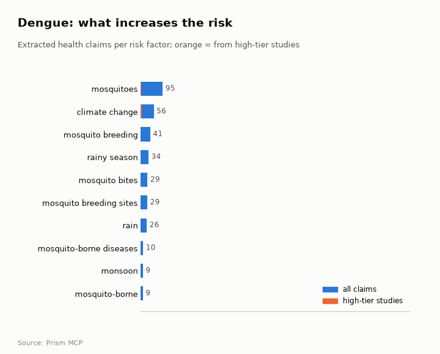
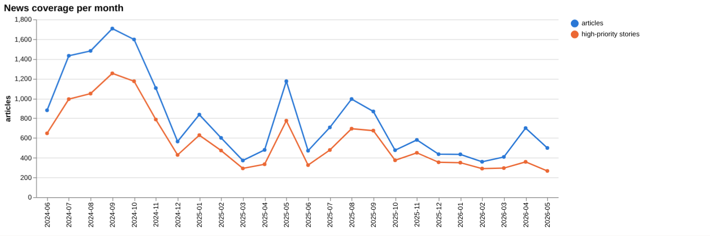
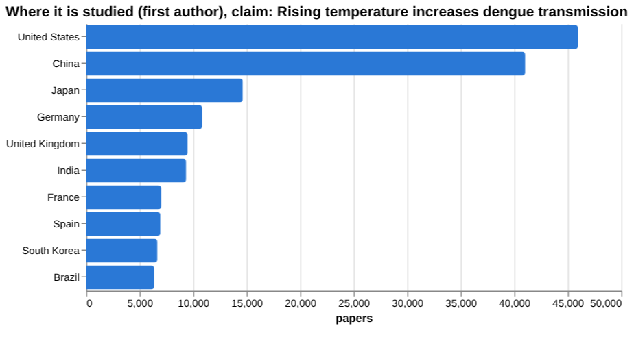
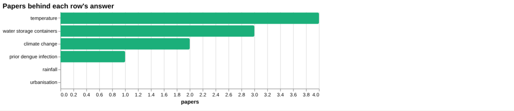
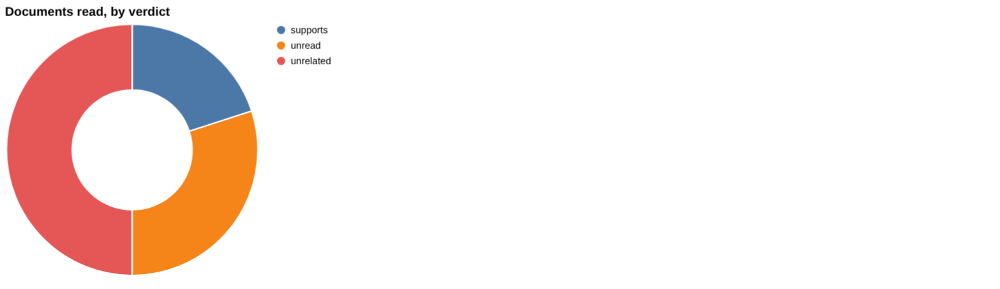
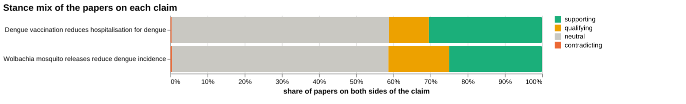
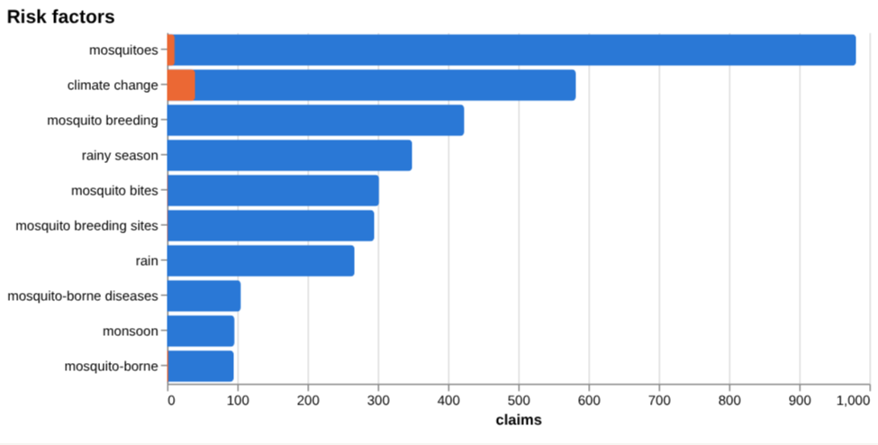
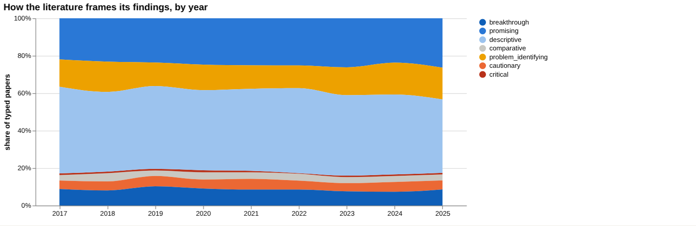
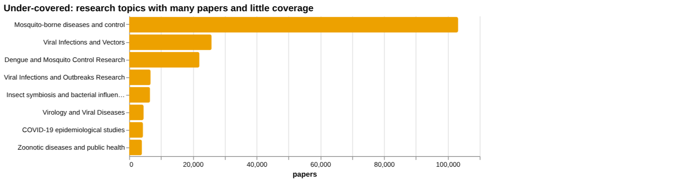
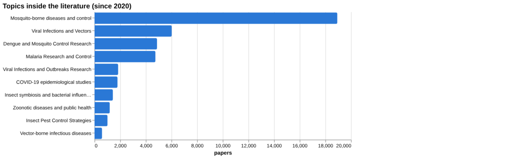

# Dengue: disease intelligence

*For policy makers, doctors and scientists* · built from **19 Prism MCP calls** · **[Open the interactive report](https://fliarbi.com/demo/docs/prism-dashboards-3bb43e4c/diseases/dengue/)** (tabs: Summary · For policy makers · For doctors · For scientists · Research methods · Month by month · Built with MCP)

> **Partial index.** Built while part of the news index was offline: counts and shares here are lower bounds (floors), and will be rebuilt in full when the index is complete.

The index holds 118,399 Prism-typed research papers on dengue for 2017-2025, alongside 12,992 the health literature index records, 7,828 news articles, 404 patents and 18 preprints. Framing is mixed with no dominant lean, and a contested share of 19.7%. One source cited in the facts estimates that more than 390 million people are potentially affected by dengue fever each year. The clinical claim that Wolbachia mosquito releases reduce dengue incidence reads as supported in the documents examined, with a cluster-randomised target trial emulation as the strongest source, though this sample does not establish scientific consensus. For the risk claim that rising temperature increases dengue transmission, the top sources returned are mostly off-topic, so direct evidence is thin in this sample. Research is concentrated in the United States and China, while news reporting is led by India.

## For policy makers

The facts cite more than 390 million people annually as potentially affected by dengue fever worldwide. Research output is led by the United States with 45,962 papers and China with 41,020, whereas news reporting is led by India with 2,794 articles, then the United States with 1,500 and Brazil with 734. Bangladesh (454) and the Philippines (205) also appear in the reported list, so attention and research location do not map closely onto each other. The framing of the literature has been broadly unchanged between earlier and recent windows, with cautionary share at 19.9 and 19.3 per cent respectively. News coverage describes rising cases in South Asia, Brazil's first death of the period and the Cook Islands' first death, with heatwaves flagged as a risk in May 2026. Among immunocompromised groups, one meta-analysis reports mortality of 66.7% in HSCT and 10% in SOT, which marks a group worth watching.

- Watch South Asian and Brazilian case reporting, where news attention is highest
- Commission evidence on Wolbachia release outcomes beyond the single cluster-randomised target trial emulation
- Commission direct dengue evidence on vaccination and hospitalisation, where none of the documents read supported the claim
- Track dengue outcomes in immunocompromised patients, given the reported mortality of 66.7% in HSCT and 10% in SOT
- Fund climate-linked dengue surveillance, as heat and rainfall evidence is sparse in the screening

## For doctors

For the claim that Wolbachia mosquito releases reduce dengue incidence, the corpus holds 8,207 papers with both poles, of which 2,051 are supporting, 1,342 qualifying and 36 contradicting; a contested share of 16.8%. Of the documents read, 3 support the claim and none contradict or qualify it, but the selected sample does not establish scientific consensus. The strongest source is a 2025 trial-tier study, an emulation of a cluster randomised target trial on adjacent spillover efficacy. Among risk factors, prior dengue infection shows 0.85; 95% CI: [0.75; 0.98] for likelihood of developing DVC in participants with prior infection, from a single meta-analysis of placebo arms. A 2025 meta-analysis in immunocompromised populations reports 0.27 [0.22-0.33] for estimated severe dengue and 0.14 [0.10-0.18] for estimated mortality, and frequency of 0.3% to 6.3% across cohorts. No temperature, rainfall or urbanisation effect size for dengue was found in screening.

- Meta-analysis tier: dengue in immunocompromised patients reports estimated severe dengue of 0.27 [0.22-0.33] and estimated mortality of 0.14 [0.10-0.18]
- Meta-analysis tier: mortality of 66.7% in HSCT and 10% in SOT, and frequency of 0.3% to 6.3% across immunocompromised cohorts
- Trial tier: a cluster randomised target trial emulation (2025) is the strongest source supporting Wolbachia reducing dengue incidence
- Meta-analysis tier: prior dengue infection, 0.85; 95% CI: [0.75; 0.98] for likelihood of developing DVC in participants with prior infection
- Vaccination and hospitalisation: 0 of the documents read supported the claim, and the strongest source was rated unrelated

**Risk-factor screen:** *Is {row} associated with dengue risk?*

| Factor | Effect size (quoted) | Measures | Source |
| --- | --- | --- | --- |
| temperature | 1.834, 95% CI: 1.204-2.794 | relative risk at 1.30 °C | Environmental Temperature and the Risk of Hand, Foot, and Mouth Disease Transmission in th (2025) |
| rainfall | no figure found |  | Associations between monthly rainfall and mortality in cattle due to East Coast fever, ana (2020) |
| urbanisation | no figure found |  |  |
| water storage containers | no figure found |  | Abundance and prevalence of Aedes aegypti immatures and relationships with household water (2011) |
| climate change | no figure found |  | HLA alleles and dengue susceptibility across populations in the era of climate change: a c (2025) |
| prior dengue infection | 0.85; 95% CI: [0.75; 0.98] | likelihood of developing DVC | Impact of Prior Dengue Infection on the Severity and Outcomes of Subsequent Infections: A  (2024) |

**Clinical claim:** *Wolbachia mosquito releases reduce dengue incidence*. Documents read: supports 2, unrelated 5, unread 3.

**Head to head:** Wolbachia mosquito releases reduce dengue incidence vs Dengue vaccination reduces hospitalisation for dengue: the first claim has more evidence behind it.

## For scientists

The literature is framed as mixed, with 40,527 supporting, 22,192 qualifying, 1,134 contradicting and 54,546 neutral papers. By orientation, descriptive work accounts for 11,511 papers (42.8 per cent) and promising for 6,697 (24.9 per cent), while cautionary has 1,360 and critical 202. Empirical contributions number 20,812, against 2,903 methodological and 105 theoretical. Contested_pct moved from 9.8 in 2017 to 11.1 in 2025, with a peak of 11.6 in 2024. Topic gaps are marked for Mosquito-borne diseases and control (103,225), Viral Infections and Vectors (25,869) and Dengue and Mosquito Control Research (22,035). Screening found no dengue effect size for temperature, and the top sources for the temperature claim concerned other conditions, so direct dengue evidence is thin in that sample. Recent frontier work includes deep learning forecasting from climate data in Vietnam and a meta-analysis of high temperatures and heatwaves.

- What dengue-specific effect sizes link temperature and heatwaves to transmission, given that the temperature screening returned a non-dengue relative risk?
- Do Wolbachia effects replicate beyond one cluster-randomised target trial emulation?
- What trial or cohort evidence links dengue vaccination to reduced hospitalisation?
- Why is mortality reported as 66.7% in HSCT and 10% in SOT, and how robust are these figures?
- Can climate-driven forecasting models, such as the Vietnam deep learning work, be validated across other settings?

## Research exploration methods

Nine ways to explore the research, each run on this disease. The interactive report shows each call and its result.

**Chaining them.** Begin with the facets and frontier scans to see what kind of literature exists and which topics it covers, and note that descriptive work dominates and framing is steady. Use gap mapping next to check that each part of a claim, such as the temperature chain, has a literature at all. Then apply triangulation and head-to-head comparison to the claims that matter, here Wolbachia and vaccination, reading the unread and unrelated documents to see what the verdict really rests on. Use cross-row screening to look for quoted effect sizes, checking that each source concerns dengue and the right population. Treat the empty count history as a reason to rerun it before saying anything about growth, and use the geography lanes last, to see whether the research matches where dengue is reported.

### Evidence triangulation

*Is a clinical claim supported, and by how strong a design?* `find_evidence` + `find_counter_evidence` + `rank_sources`

The claim that Wolbachia mosquito releases reduce dengue incidence is supported by the documents actually read: 2 supported it, 5 were unrelated and 3 were unread. Across the wider corpus of 8,207 papers, 2051 support the claim, 1,342 qualify it, 36 contradict it and 4,778 are neutral, with contested share at 16.8 and a reading of mixed framing with no dominant lean. The counter-evidence search found 0 contradicting and 0 qualifying documents, but 4 were unread, so the absence of disagreement is only partly tested. The risk-claim sources are a warning sign: the top four concern heat and congenital heart defects, hand, foot and mouth disease, respiratory infections and oesophageal monitoring during ablation, none of which is about dengue, and each has cited_by of 0. The tool's own recommendation is that this selected sample does not establish scientific consensus. A careful researcher would read the 3 unread clinical documents and the 4 unread counter-evidence documents, and replace the off-topic risk sources with dengue-specific ones.

### Head-to-head claims

*Which of two interventions has more and stronger evidence?* `compare_claims`

The comparison favours the Wolbachia claim over the claim that dengue vaccination reduces hospitalisation for dengue. Wolbachia has 8,207 papers on both poles, with contested share at 16.8, and 3 documents read as supporting. Its strongest source is a 2025 trial, 'Adjacent spillover efficacy of Wolbachia for control of dengue: emulation of a cluster randomised target trial', with a stance of supports. Vaccination has more papers, 22,035, and a lower a contested share of 11.0%, but none of the documents read supported it: 12 were unrelated and 2 were unread. Its strongest source is a 2025 meta-analysis on dengue among immunocompromised patients, whose stance is unrelated. The verdict therefore reflects what was read, not the size of the literature; a larger corpus does not mean stronger evidence. The vaccination claim is not shown to be false, only untested by the documents read, so the next step is to find vaccine trials or cohort studies that report hospitalisation outcomes directly. Note too that the Wolbachia strongest source is an emulated trial, which is a different design from a real cluster randomised trial.

### Cross-row screening

*Which risk factors carry a measured effect size, and how large?* `research_table`

Only two of the six risk factors returned a measured figure, and neither is a clean dengue estimate. Temperature gave 1.834, 95% CI: 1.204-2.794, described as relative risk at 1.30 °C, from 4 papers, but the cited source is about hand, foot and mouth disease in the Yangtze River Region of China, not dengue. Prior dengue infection gave 0.85; 95% CI: [0.75; 0.98] for the likelihood of developing DVC in participants with prior infection, from 1 paper, a 2024 meta-analysis of placebo arms of clinical trials. Rainfall returned no value and its source is a 2020 paper on cattle diseases, so it is unrelated. Urbanisation had 0 papers and no source. Water storage containers (3 papers, a 2011 Viet Nam study) and climate change (2 papers, a 2025 HLA review) returned no figure. The absence of a value means the question was not answered in extractable form, not that there is no effect. A careful researcher would rerun the screen with dengue-specific wording and check what outcome DVC refers to before using the 0.85 figure.

### Framing drift

*Is the literature becoming more hopeful or more cautious?* `stance_trends`

Framing across 2017 to 2025 is broadly flat. Positive_pct moves from 15.1 in 2017 to 17.2 in 2025, with 17.0 in 2020 and 2023 and a dip to 15.6 in 2024. Contested_pct sits between 8.6 in 2022 and 11.6 in 2024, finishing at 11.1 in 2025. There is a modest rise in contested share from 2022 onward, from 8.6 to 10.1, 11.6 and 11.1, but the movements are small and the series does not show the literature turning decisively hopeful or cautious. These percentages describe how papers frame themselves, not whether the findings are correct. They also say nothing about which topics drive the change. A careful researcher would split the 2024 and 2025 contested share by topic, such as vaccines, vector control and climate, to see whether any one area accounts for it.

### Frontier scan

*What is new, and what is the research not reaching?* `research_radar`

The most-cited new work since 2022 is mostly descriptive or review-type: neurological complications of dengue (cited_by 171), imported cases in China (103), immune-mediated pathogenesis (102), deep learning forecasting from climate data in Vietnam (86), a heat and heatwave meta-analysis (84) and an Ethiopian literature review (74). Only two of the six are labelled promising. The framing shift between windows is small: cautionary_pct was 19.3 for the recent window of 28,845 papers and 19.9 for the earlier window of 30,513, a change of -0.6 percentage points, read as broadly unchanged. The labels reflect each paper's own framing, not truth. These are broad topics with large counts, so they show where the volume is and the tool flags them as thinly covered, but they do not identify a specific missing question. A careful researcher would look inside these topics for narrower gaps.

### Gap mapping

*Which parts of a claim does the literature actually cover?* `research_gaps`

The temperature claim, that rising temperature increases dengue transmission, is covered at every step. All three components, higher temperatures boosting mosquito breeding, higher temperatures increasing viral replication in vectors, and higher temperatures leading to increased dengue transmission, are marked evidence: yes. This means a literature exists for each link in the causal chain, so no component is empty. It does not show how strong that literature is, what design it uses, or how large the effects are. The screening result adds a caution, since the only temperature figure found came from a hand, foot and mouth disease study. A careful researcher would check the design and effect size behind each of the three components, and look for dengue-specific estimates, perhaps starting with the 2023 heat and heatwave meta-analysis seen in the frontier scan.

### Count history and backtested scenarios

*Is research on this growing, and where could it be in three years?* `historical_analysis` + `scenarios`

This method returned nothing: the research-per-year counts are empty, there are no scenarios and no baseline was chosen. That means no yearly series was available to count, so there is no basis for saying whether dengue research is growing, and no three-year projection can be offered. It is a failure to produce output, not evidence of a flat or falling field. The year-by-year framing percentages in the framing method cover 2017 to 2025 but are shares, not paper counts, so they cannot stand in for growth. A careful researcher would rerun the count with an explicit year window and a clear title-matching term, and only then treat any backtested scenario as meaningful.

### Geographic triangulation

*Where is it studied, published, reported and patented?* `global_comparison` + `news_geography`

Where dengue-related work is studied and where it is reported differ markedly. The studied lane is led by the United States with 45,962 papers, then China with 41,020, Japan with 14,638, Germany with 10,849, the United Kingdom with 9,479, India with 9,344, France with 7,025 and Spain with 6,940. The reported lane is led by India with 2,794, then the United States with 1,500, Brazil with 734, Bangladesh with 454, the United Kingdom with 280, France with 259, Australia with 216 and the Philippines with 205. Brazil, Bangladesh and the Philippines appear in the reported lane but not among the top eight studied. The lanes answer different questions and are not added together. The result shows no published or patented lane, so those questions are unanswered here. A careful researcher would check whether research output sits with the places where dengue coverage is concentrated, and whether trial evidence comes from those settings.

### Faceted browsing

*What kind of literature is it: empirical, review, position? Problem-identifying or promising?* `browse_research`

The literature is mostly descriptive and empirical. By orientation, descriptive accounts for 11,511 papers (42.8%), promising 6,697 (24.9%), problem_identifying 3,958 (14.7%), breakthrough 2,215 (8.2%), cautionary 1,360 (5.1%), comparative 953 (3.5%) and critical 202 (0.8%). By contribution, empirical is 20,812, methodological 2,903, review 2,359, position 717 and theoretical 105. The topic list is led by 'Mosquito-borne diseases and control' at 18,935, and includes malaria research (4,750) and COVID-19 epidemiological studies (1,792), so the pool is not dengue alone. The most-cited-since-2020 list is weak as a guide: all six items are from 2025 with cited_by of 1 or 0, so it reflects recency, not influence. A careful researcher would narrow the facets to dengue-specific topics and filter to empirical, promising or breakthrough papers before drawing conclusions.

## Built with MCP

Every number and chart above comes from these 19 Prism MCP tool calls, made over MCP (streamable HTTP). The list with arguments and timings is in [mcp_calls.json](mcp_calls.json); the responses are in [data.json](data.json).

| MCP tool | Time | Result |
| --- | ---: | --- |
| `disease_profile` | 10.7 s | ok |
| `stance_trends` | 30.9 s | ok |
| `browse_research` | 46.5 s | ok |
| `historical_analysis` | 136.1 s | no data |
| `research_radar` | 172.1 s | ok |
| `news_trends` | 49.7 s | ok |
| `research_brief` | 236.7 s | ok |
| `news_geography` | 54.8 s | ok |
| `critical_news` | 36.4 s | ok |
| `news_factors` | 216.5 s | ok |
| `research_gaps` | 425.0 s | ok |
| `global_comparison` | 302.1 s | ok |
| `rank_sources` | 222.4 s | ok |
| `find_evidence` | 269.6 s | ok |
| `find_counter_evidence` | 276.0 s | ok |
| `deep_timeline` | 27.0 s | ok |
| `research_table` | 502.3 s | ok |
| `compare_claims` | 182.6 s | ok |
| `find_statistics` | 210.5 s | ok |

> Research intelligence, not medical advice: counts, framings and effect sizes are measured from the research and news index and quoted from their sources; they do not replace clinical guidelines or a clinician's judgement.

