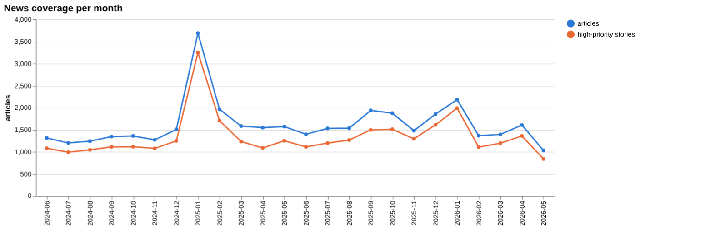
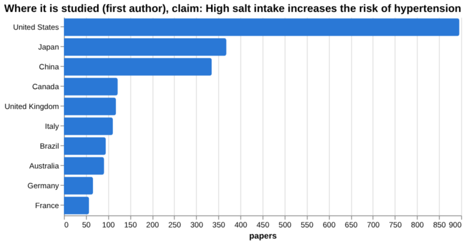
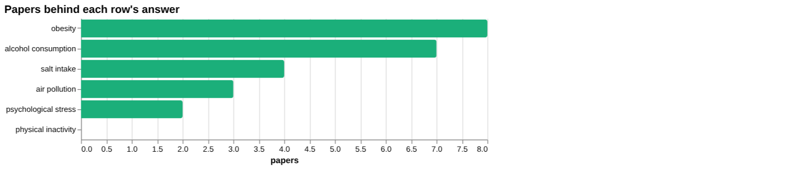
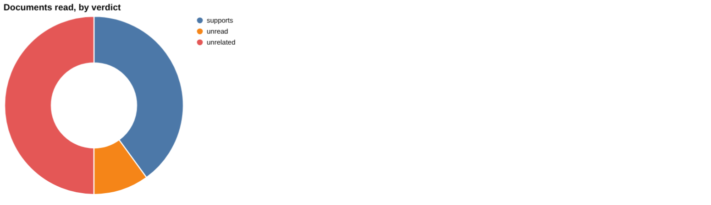
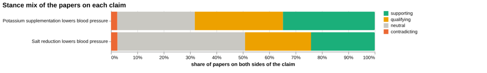
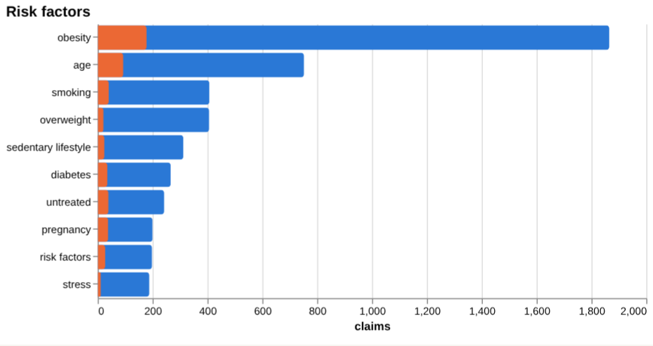
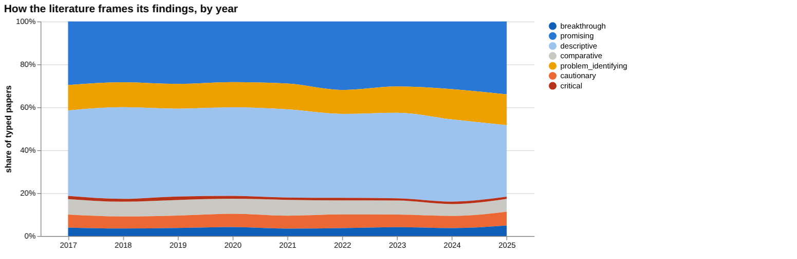
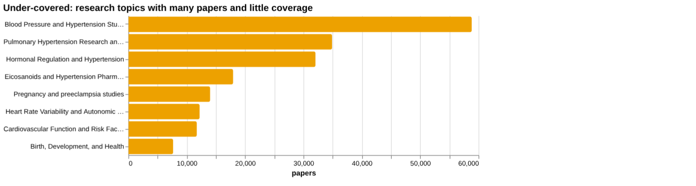
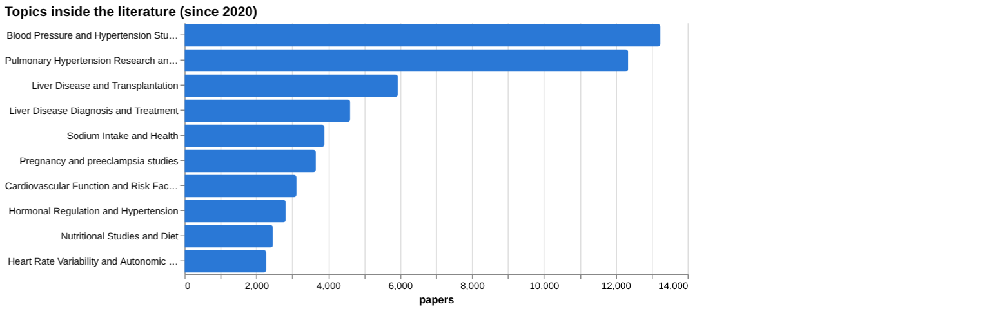

# Hypertension: disease intelligence

*For policy makers, doctors and scientists* · built from **19 Prism MCP calls** · **[Open the interactive report](https://fliarbi.com/demo/docs/prism-dashboards-3bb43e4c/diseases/hypertension/)** (tabs: Summary · For policy makers · For doctors · For scientists · Research methods · Month by month · Built with MCP)

> **Partial index.** Built while part of the news index was offline: counts and shares here are lower bounds (floors), and will be rebuilt in full when the index is complete.

The index holds 282,902 typed research papers on hypertension for 2017-2025, alongside 81,644 news articles and 9,939 patents. Literature framing is mostly positive, with a substantial cautionary minority, and contested share stands at 20.0. Framing is broadly unchanged between the earlier and recent windows. For the claim that salt reduction lowers blood pressure, the documents read support it and none contradict, though the sample is too small to establish consensus. Some topics, including pulmonary hypertension and pregnancy, carry large paper counts but are flagged as under-covered. Several risk-factor rows, including salt intake, physical inactivity, air pollution and psychological stress, have no effect size in the index.

## For policy makers

The index holds 282,902 typed research papers for 2017-2025 and 81,644 news articles for 2019-01-01..2026-06-01, so hypertension draws sustained attention from both researchers and the press. Research is most often recorded in the United States (896), Japan (368) and China (335), while news reporting is most frequent for the United States (4,547), India (1,555) and the United Kingdom (1,077). That difference in geography is worth noting when judging where evidence and public attention sit. News coverage in the most recent period points to therapeutic advances, global estimates of 1.28 billion adults with high blood pressure, and large undiagnosed burdens in India. Literature framing shifted little between the earlier window (cautionary_pct 20.2) and the recent window (cautionary_pct 20.0). Topics flagged as under-covered include Blood Pressure and Hypertension Studies (58,839), Pulmonary Hypertension Research and Treatments (34,904) and Pregnancy and preeclampsia studies (14,012).

- Watch whether research output in India keeps pace with the 1,555 news articles reported there, given the undiagnosed burden described in coverage
- Commission an evidence review on population-level sodium reduction, building on the 2025 meta-analysis of randomised trials
- Track the under-covered areas of pulmonary hypertension (34,904) and pregnancy and preeclampsia (14,012)
- Monitor new treatment evidence such as the sotatercept phase 3 trial and the baxdrostat phase 2 trial
- Ask for quantified effect sizes where the index has none, including salt intake and air pollution

## For doctors

For the claim that salt reduction lowers blood pressure, the documents read include 3 meta-analyses, 5 trials and 2 reviews, and the tally is 5 supporting, 0 contradicting and 0 qualifying. Four documents were judged to support the claim by verdict, five were unrelated and one was unread. The surrounding corpus of 6,187 papers has a contested share of 27.4%, so a notable share of papers qualify or contradict. The strongest source named is a 2025 dose-response meta-analysis of dietary sodium reduction in hypertensive and chronic kidney disease patients. Among risk factors, obesity has a hazard ratio of HR 4.01 (95% CI 2.20-7.32) for hypertension in a community cohort study from North China, where participants remained obese throughout. Alcohol has a relative risk of 1.19 (1.07–1.31; I 2 =59%) for hypertension compared with abstainers, in men, from a cohort meta-analysis. The index states that this selected sample does not establish scientific consensus.

- Meta-analysis tier: the 2025 dose-response meta-analysis in hypertensive and chronic kidney disease patients is the strongest source for salt reduction lowering blood pressure
- Corpus tier: 6,187 papers on the salt claim show a contested share of 27.4%, so roughly a quarter qualify or contradict
- Cohort tier: obesity maintained over time carried HR 4.01 (95% CI 2.20-7.32), a hazard ratio for hypertension
- Meta-analysis of cohorts: alcohol consumption in men had relative risk=1.19 (1.07–1.31; I 2 =59%) versus abstainers
- Potassium supplementation shows a contested share of 35.8% across 1,275 papers, higher than for salt reduction

**Risk-factor screen:** *Does {row} increase the risk of hypertension?*

| Factor | Effect size (quoted) | Measures | Source |
| --- | --- | --- | --- |
| salt intake | no figure found |  | Effect of population-based sodium reduction interventions on blood pressure: a systematic  (2025) |
| obesity | HR 4.01 (95% CI 2.20-7.32) | hazard ratio for hypertension | Keeping obesity status is a risk factor of hypertension onset: evidence from a community-b (2023) |
| alcohol consumption | relative risk=1.19 (1.07–1.31; I 2 =59%) | risk of hypertension compared with abstainers | Sex‐Specific Associations Between Alcohol Consumption and Incidence of Hypertension: A Sys (2018) |
| physical inactivity | no figure found |  | Physical inactivity as a risk factor for diabetic retinopathy? A review (2014) |
| air pollution | no figure found |  | Air Pollution and Chronic Kidney Disease Risk in Oil and Gas- Situated Communities: A Syst (2022) |
| psychological stress | no figure found |  | Effect of psychological stress on blood pressure increase: a meta-analysis of cohort studi (2009) |

**Clinical claim:** *Salt reduction lowers blood pressure*. Documents read: supports 4, unrelated 5, unread 1.

**Head to head:** Salt reduction lowers blood pressure vs Potassium supplementation lowers blood pressure: the first claim has more evidence behind it.

## For scientists

The literature mix is 96,822 supporting, 52,527 qualifying, 4,152 contradicting and 129,401 neutral papers. Orientation labels are mostly descriptive (28,592) and promising (22,912), with cautionary (4,478) and critical (789) smaller. Empirical work dominates contributions (57,833) over reviews (10,666), and theoretical work is thin at 169. Leading topics are Blood Pressure and Hypertension Studies (13,246) and Pulmonary Hypertension Research and Treatments (12,346), with Sodium Intake and Health at 3,895. Several risk-factor rows lack effect sizes, with salt intake linked to 4 papers, air pollution 3, psychological stress 2 and physical inactivity 0. Treatment claims vary widely, such as riociguat (210 claims) and renal denervation (265 claims), and orientation labels reflect a paper's own framing, not the truth.

- What quantified effect sizes link salt intake to incident hypertension, given that the index records none?
- Why is the potassium supplementation claim more contested (35.8) than salt reduction (27.4)?
- What is the effect of air pollution and psychological stress on hypertension risk in well-designed cohorts?
- Which mechanisms, such as inflammation, immunity and oxidative stress, offer tractable therapeutic targets?
- How do renal denervation and other device-based treatments compare with antihypertensive medication in head-to-head designs?

## Research exploration methods

Nine ways to explore the research, each run on this disease. The interactive report shows each call and its result.

**Chaining them.** Start with the gap map and triangulation to confirm that the salt claim has a literature and that nothing read contradicts it, while noting the 27.4 contested share in the wider corpus. Then use head-to-head to see how salt compares with potassium on volume and stance, and use screening to look for effect sizes, accepting that salt returned none and needs a better query. Facets and the frontier scan should come next to remove off-topic pulmonary and liver papers and to see what recent guidelines and trials add. Framing drift and geography then give context on tone and on where the evidence was produced and reported. The history method returned nothing, so any statement about growth or future volume should wait for a rerun.

### Evidence triangulation

*Is a clinical claim supported, and by how strong a design?* `find_evidence` + `find_counter_evidence` + `rank_sources`

For the claim "Salt reduction lowers blood pressure", the documents read lean one way: 4 support, 5 are unrelated and 1 is unread, with tiers of 3 meta-analyses, 5 trials and 2 reviews. The counter-evidence search found 5 supporting, 0 contradicting and 0 qualifying documents, so nothing read disagrees. The wider corpus of 6,187 papers is less uniform: 1,495 supporting, 1,548 qualifying, 150 contradicting and 2,994 neutral, with a contested share of 27.4%, described as mostly positive framing with a substantial cautionary minority. The result does not establish scientific consensus; the tool itself says the selected sample cannot do that. The unrelated documents show that retrieval is noisy, and corpus stance labels describe how papers frame their findings, not effect sizes. A careful researcher would read the 1,548 qualifying papers to learn what conditions limit the effect, and check the effect sizes in the top meta-analyses, the highest-ranked being a 2021 review of behaviour change interventions cited by 36.

### Head-to-head claims

*Which of two interventions has more and stronger evidence?* `compare_claims`

Salt reduction has the larger body of evidence than potassium supplementation, and the tool's verdict says so. Salt has 6,187 papers across both poles against 1,275 for potassium. Of the documents read, salt has 5 supporting, 0 contradicting and 6 unrelated; potassium has 3 supporting, 1 contradicting and 7 unrelated. Contested_pct is 27.4 for salt and 35.8 for potassium, so potassium's literature is the more disputed. Both claims have a meta-analysis as their strongest source (2025 for salt, 2024 for potassium). Potassium's strongest source concerns the general normotensive population, so it does not speak directly to people with hypertension. This comparison measures volume and stance, not the size of each effect; the two interventions still need comparing on effect size in comparable populations.

### Cross-row screening

*Which risk factors carry a measured effect size, and how large?* `research_table`

Only two of six risk factors returned a quoted effect size. Obesity gave HR 4.01 (95% CI 2.20-7.32) as a hazard ratio for hypertension, from a 2023 community cohort in North China, in people who were obese all the time. Alcohol gave relative risk=1.19 (1.07–1.31; I 2 =59%) for men compared with abstainers, from a 2018 meta-analysis of cohort studies. Salt intake, physical inactivity, air pollution and psychological stress returned no value. For salt this does not mean no effect: 4 papers were found, but the matched source was a trial meta-analysis of blood pressure, not a risk estimate for hypertension onset. Physical inactivity found 0 papers and its source concerned diabetic retinopathy, and the air pollution source concerned kidney disease, so both are mismatches. The two figures come from different designs and populations and should not be ranked against each other; the obesity estimate is from a single cohort, and the alcohol estimate carries notable heterogeneity. The next step is to search these four rows with more targeted queries.

### Framing drift

*Is the literature becoming more hopeful or more cautious?* `stance_trends`

Between 2017 and 2025, positive share moved from 16.9 to 19.3 and contested share from 9.7 to 10.8. Positive framing was 15.9 in 2018 and rose to 17.8 in 2022, 17.1 in 2023 and 17.7 in 2024 before reaching 19.3 in 2025. Contested framing sat between 9.2 and 9.5 from 2018 to 2023, then reached 10.5 in 2024 and 10.8 in 2025. Both measures edged up together at the end, so the literature is not simply becoming more hopeful or more cautious. The percentages describe how papers present themselves, not whether their conclusions are correct. The last years may be less settled, and the figures are shares of typed papers, not counts. A careful researcher would look at which topics drive the 2024 and 2025 rises before reading anything into them.

### Frontier scan

*What is new, and what is the research not reaching?* `research_radar`

The most-cited new work is dominated by guidelines: the 2023 ESH Guidelines cited by 2,831 and the 2022 ESC/ERS pulmonary hypertension guidelines cited by 1919. The list also includes NEJM trials, such as sotatercept in pulmonary arterial hypertension (583), treatment of mild chronic hypertension in pregnancy (493) and phase 2 baxdrostat in treatment-resistant hypertension (326). Two of six items concern pulmonary hypertension, a different condition from systemic hypertension, so the list is mixed. The framing shift is small: cautionary_pct was 20.0 in the recent window of 71,480 papers against 20.2 in the earlier window of 70,321, a delta of -0.2 percentage points, described as broadly unchanged. Its labelling of these large core topics as under-covered is odd and suggests the metric reflects relative coverage, not true neglect, so it needs care. Orientation labels show the papers' own framing, not truth.

### Gap mapping

*Which parts of a claim does the literature actually cover?* `research_gaps`

All three components of the claim "High salt intake increases the risk of hypertension" were marked "yes" for evidence. The components are high dietary sodium intake leading to increased hypertension risk, salt consumption associated with elevated blood pressure, and sodium intake contributing to hypertension development. This shows that a literature exists for each part, so no gap appears at this level. It does not show how strong that literature is, what designs it uses, or whether it gives effect sizes. The three components are close paraphrases of one another, so the check is coarse and may miss gaps in dose, population or time course. This also sits alongside the screening result, where salt intake returned no quoted risk figure. A careful researcher would split the claim more finely, for example by population, level of intake and outcome, and test each part.

### Count history and backtested scenarios

*Is research on this growing, and where could it be in three years?* `historical_analysis` + `scenarios`

This method returned nothing: the research-per-year counts are empty, no scenarios were produced and no baseline was selected. That means there is no basis here to say whether research on this topic is growing, or where it might be in three years. It should not be read as flat or declining output. The framing-by-year table covers 2017 to 2025 but gives shares, not paper counts, so it cannot substitute. A careful researcher would rerun the count with an explicit window and a clearer title-matching term before drawing any trend conclusion.

### Geographic triangulation

*Where is it studied, published, reported and patented?* `global_comparison` + `news_geography`

On where it is studied, the United States leads with 896, followed by Japan with 368, China with 335, Canada with 122, the United Kingdom with 118, Italy with 111, Brazil with 95 and Australia with 91. Where reported has a different order: the United States 4,547, India 1,555, the United Kingdom 1,077, China 612, Canada 520, Japan 480, Germany 442 and Norway 418. India is second in coverage but absent from the studied list, and Japan ranks second in research but sixth in reporting. The lanes answer different questions and must not be added together. Only two lanes are present, so publishing and patenting are not shown. These counts do not show where hypertension burden is greatest or where findings apply. A careful researcher would check whether salt-reduction trial populations match the countries where the coverage is concentrated.

### Faceted browsing

*What kind of literature is it: empirical, review, position? Problem-identifying or promising?* `browse_research`

By orientation, 28,592 papers (38.7%) are descriptive and 22,912 (31.0%) promising, followed by problem_identifying at 9,348 (12.6%), comparative at 4,844 (6.6%), cautionary at 4,478 (6.1%), breakthrough at 2,961 (4.0%) and critical at 789 (1.1%). By contribution, 57,833 are empirical, 10,666 reviews, 3,026 methodological, 2,230 position and 169 theoretical. The topic list shows how mixed the corpus is: Blood Pressure and Hypertension Studies has 13,246 papers and Pulmonary Hypertension Research and Treatments 12,346, with Liver Disease and Transplantation at 5,939 and Liver Disease Diagnosis and Treatment at 4,611, so the term "hypertension" has pulled in related conditions such as portal hypertension. Sodium Intake and Health has 3,895. The most-cited-since-2020 list is all 2025 papers with 0 or 1 citations, so it reflects recency and not influence, and includes small local studies and a hypothesis paper. A careful researcher would filter out the pulmonary and liver topics before using these shares for systemic hypertension.

## Built with MCP

Every number and chart above comes from these 19 Prism MCP tool calls, made over MCP (streamable HTTP). The list with arguments and timings is in [mcp_calls.json](mcp_calls.json); the responses are in [data.json](data.json).

| MCP tool | Time | Result |
| --- | ---: | --- |
| `disease_profile` | 9.2 s | ok |
| `stance_trends` | 17.4 s | ok |
| `browse_research` | 41.5 s | ok |
| `historical_analysis` | 63.6 s | no data |
| `research_radar` | 122.0 s | ok |
| `news_trends` | 65.8 s | ok |
| `research_gaps` | 204.9 s | ok |
| `global_comparison` | 128.1 s | ok |
| `research_brief` | 234.1 s | ok |
| `news_geography` | 76.3 s | ok |
| `critical_news` | 59.0 s | no data |
| `news_factors` | 188.5 s | ok |
| `find_evidence` | 387.7 s | ok |
| `find_counter_evidence` | 376.7 s | ok |
| `rank_sources` | 359.9 s | ok |
| `deep_timeline` | 31.4 s | ok |
| `research_table` | 615.8 s | ok |
| `find_statistics` | 270.0 s | no data |
| `compare_claims` | 377.9 s | ok |

> Research intelligence, not medical advice: counts, framings and effect sizes are measured from the research and news index and quoted from their sources; they do not replace clinical guidelines or a clinician's judgement.

