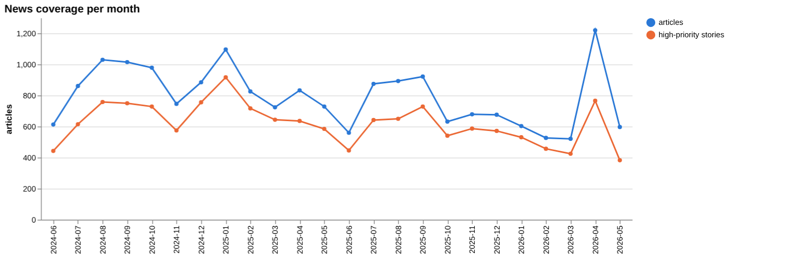
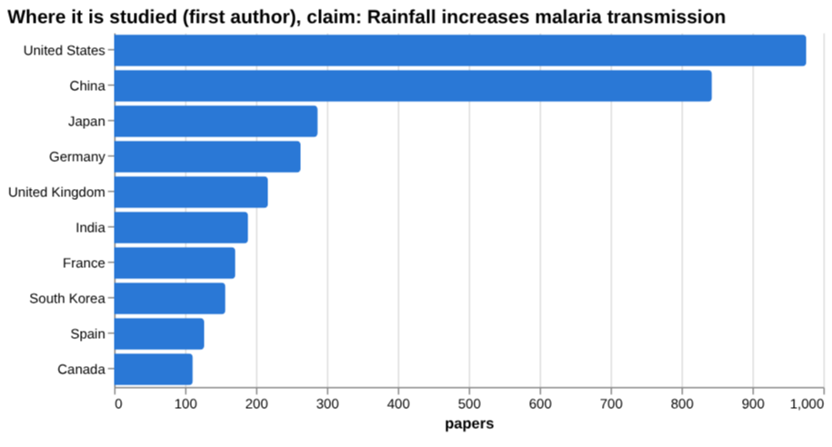
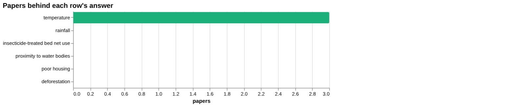
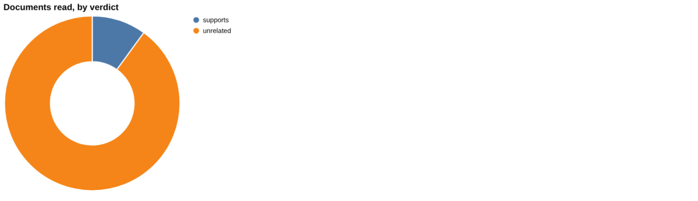
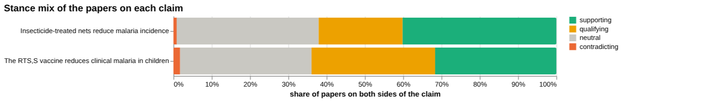
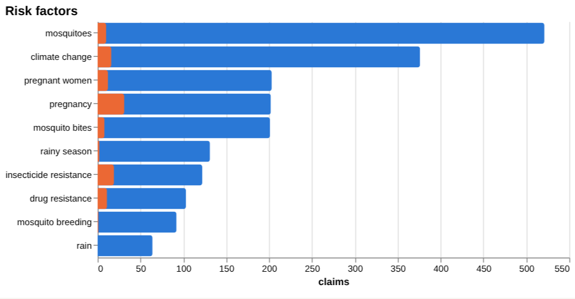
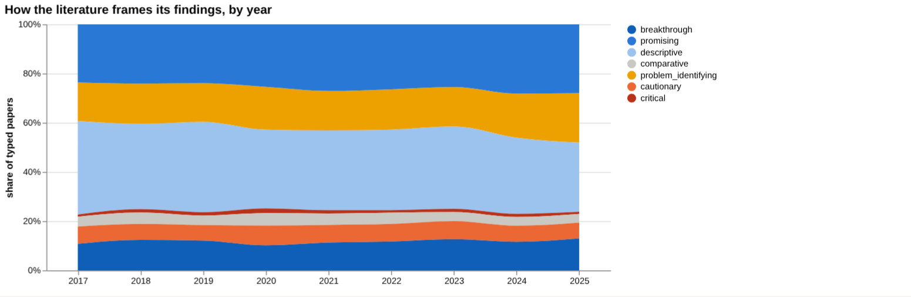
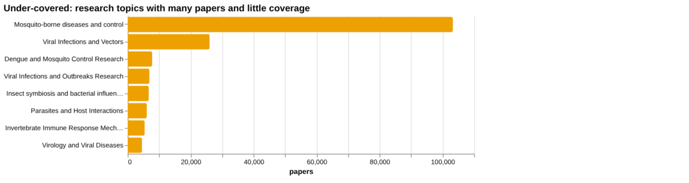
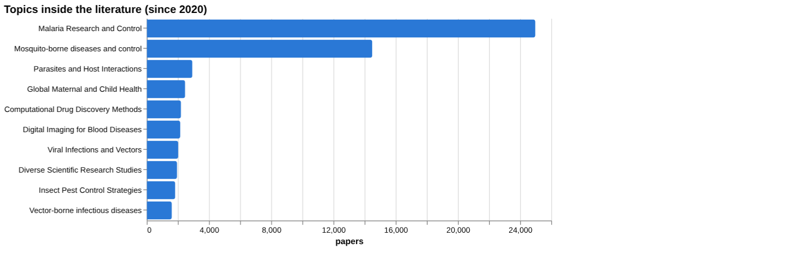

# Malaria: disease intelligence

*For policy makers, doctors and scientists* · built from **19 Prism MCP calls** · **[Open the interactive report](https://fliarbi.com/demo/docs/prism-dashboards-3bb43e4c/diseases/malaria/)** (tabs: Summary · For policy makers · For doctors · For scientists · Research methods · Month by month · Built with MCP)

> **Partial index.** Built while part of the news index was offline: counts and shares here are lower bounds (floors), and will be rebuilt in full when the index is complete.

The index holds 136,257 Prism-typed research papers on malaria for 2017-2025, with 2,719 news articles for 2019-01-01..2026-06-01. The literature is mostly positively framed, with a substantial cautionary minority: a contested share of 20.5%. Framing is broadly unchanged between earlier and recent windows. For the claim that insecticide-treated nets reduce malaria incidence, the corpus of 6,190 papers shows a contested share of 22.8%, and one read document supports it. The rainfall claim has no relevant sources: the top-listed items concern erosivity, groundwater and nanoprecipitation, not malaria. News coverage describes seasonal rains, climate-driven vector expansion, drug-resistance surveillance and financing gaps.

## For policy makers

The index shows 64,147 the health literature index records and 2,719 news articles, so attention is substantial. Where studied, the United States (976) and China (843) head the list, while where reported the United States (3,020), India (1,803) and Nigeria (1,174) lead. This points to a gap between the places producing research and several places where malaria is reported in the news. Asymptomatic malaria is a visible theme: a 2025 meta-analysis gives pooled prevalence of 33% (95% CI 26-41) in Nigeria. News coverage cites funding cuts, a collapse of routine malaria services in some settings, mortality above 600,000 and the invasive Anopheles stephensi. It also reports sharp prevalence declines, including Zanzibar's 0.04% rate and Lagos' 2% rate, and India's announced 97% case reduction.

- Commission verified evidence reviews on rainfall and malaria transmission, as the index holds no relevant sources for that claim
- Watch asymptomatic malaria burden, using the Nigeria pooled prevalence of 33% (95% CI 26-41) as a reference point
- Monitor drug-resistance and insecticide-resistance surveillance, including the invasive Anopheles stephensi
- Track the RTS,S vaccine rollout, such as in Cameroon, against the trial evidence
- Follow funding gaps and routine service continuity, which news coverage links to rises in infections and deaths

## For doctors

For the claim that insecticide-treated nets reduce malaria incidence, the corpus has 6,190 papers: 2,487 supporting, 1,357 qualifying, 52 contradicting and 2,294 neutral, with a contested share of 22.8%. Of the documents read, one supports it, none contradict or qualify, and most were unrelated. The strongest source is a 2013 review of net ownership and use during pregnancy in sub-Saharan Africa. The verified-document tally does not support a wording recommendation for this claim. A Cochrane meta-analysis of pyronaridine-artesunate reports a PCR-adjusted failure risk ratio at day 42 of RR 0.86, 95% CI 0.49 to 1.51 in 2575 participants. It also reports a bilirubin risk ratio of RR 1.03, 95% CI 0.49 to 2.18 in 6384 participants. A Nigerian meta-analysis gives prevalence by subgroup, from 25% in the general population to 52% in children.

- Meta-analysis tier: pooled asymptomatic malaria prevalence in Nigeria was 33% (95% CI 26-41)
- Meta-analysis tier: prevalence ranged from 25% in the general population to 52% in children
- Meta-analysis tier (Cochrane): PCR-adjusted failure risk ratio at day 42 was RR 0.86, 95% CI 0.49 to 1.51 in 2575 participants
- Review tier: the strongest source supporting net effect is a 2013 review of net use in pregnancy; the corpus is 22.8 contested share
- Trial tier: a 2025 phase 2b trial supports sustained RTS,S efficacy over 50 months in young children in Ghana and Kenya; corpus a contested share of 34.0%

**Risk-factor screen:** *Is {row} associated with malaria risk?*

| Factor | Effect size (quoted) | Measures | Source |
| --- | --- | --- | --- |
| rainfall | no figure found |  | Study on Rainfall Erosivity in Funiu Mountainous Region Using Daily Rainfall Amounts Model (2006) |
| temperature | no figure found |  | Impacts of climate change on water-related mosquito-borne diseases in temperate regions: A (2024) |
| insecticide-treated bed net use | no figure found |  | Prevalence and determinants of insecticide-treated bed-net utilization among under-five ch (2025) |
| proximity to water bodies | no figure found |  |  |
| poor housing | no figure found |  | Housing modification to prevent malaria in Uganda: an analysis of costs, willingness to pa (2025) |
| deforestation | no figure found |  | Land-use change is associated with multi-century loss of elephant ecosystems in Asia (2023) |

**Clinical claim:** *Insecticide-treated nets reduce malaria incidence*. Documents read: supports 1, unrelated 9.

**Head to head:** Insecticide-treated nets reduce malaria incidence vs The RTS,S vaccine reduces clinical malaria in children: the first claim has more evidence behind it.

## For scientists

The literature is dominated by descriptive (14,849) and promising (12,457) orientations, with cautionary (3,303) and critical (586) papers a small share. Empirical work (34,726) far exceeds theoretical (142). The leading topic is Malaria Research and Control (24,975 papers). Newer high-profile work covers rice-growing villages, temperature and Anopheles suitability, deep learning diagnosis and shifts in vector species. Most recent papers have few citations, as expected for 2025 publications. The rainfall gap analysis shows evidence for rainfall correlating with cases and vector habitat effects, but none for rainfall driving mosquito breeding. Screening rows for rainfall, bed-net use, water proximity, housing and deforestation returned no effect values.

- Does increased rainfall lead to higher mosquito breeding, where the gap analysis found no evidence?
- What are the quantified effects of rainfall, temperature, housing and deforestation on malaria risk, given that screening rows returned no values?
- Why does RTS,S show a contested share of 34.0% compared with 22.8 for insecticide-treated nets?
- How do climate change and insecticide resistance interact in malaria vectors?
- How can research output be better matched to places where malaria is reported, such as Nigeria, Kenya and Ghana?

## Research exploration methods

Nine ways to explore the research, each run on this disease. The interactive report shows each call and its result.

**Chaining them.** Begin with faceted browsing to see the shape of the literature, then use the frontier scan to find recent work and adjacent topics. Next, test a specific claim with evidence triangulation, and use the head-to-head comparison to set it against a rival such as the RTS,S vaccine. Where a claim has several parts, such as rainfall and transmission, gap mapping shows which links have a literature, and cross-row screening should then be used to pull effect sizes, though here it returned none. Framing drift and the geography lanes give context on tone and on who is studying and reporting. Count history returned nothing and should be rerun before any statement about growth. Throughout, empty or off-topic results should be read as search limits, and key papers should be read directly.

### Evidence triangulation

*Is a clinical claim supported, and by how strong a design?* `find_evidence` + `find_counter_evidence` + `rank_sources`

For the claim that insecticide-treated nets reduce malaria incidence, the document-level check is thin: of the clinical documents read, 1 supports and 9 are unrelated, even though the documents sit in strong tiers (3 meta-analyses, 3 trials, 3 reviews, 1 article). The wider corpus of 6,190 papers shows 2,487 supporting, 1,357 qualifying, 52 contradicting and 2,294 neutral, with a contested share of 22.8%, read as mostly positive framing with a substantial cautionary minority. The counter-evidence search found nothing that contradicts or qualifies (8 unrelated, 2 unread), so the absence of disagreement reflects an unproductive search, not confirmed consensus; the tool itself states that no verified document verdict supports a wording recommendation. The risk-claim sources are unrelated to malaria: they cover Flash NanoPrecipitation and rainfall erosivity, so they say nothing about transmission. A careful researcher would read the 3 meta-analyses and 3 trials directly, check whether they concern nets, and then rerun the counter-evidence search with narrower terms.

### Head-to-head claims

*Which of two interventions has more and stronger evidence?* `compare_claims`

On the same measures, nets have 6,190 papers on both poles against 1,636 for the RTS,S vaccine, and the tool's verdict is that the first claim has more evidence behind it. Contested share is 22.8 for nets and 34.0 for the vaccine, so the vaccine literature is more disputed, with 528 qualifying papers against 518 supporting. Document reading is sparse on both sides: 1 supporting document each, none contradicting, and many unrelated (13 for nets, 11 for the vaccine, with 2 unread). The strongest source for nets is a 2013 review on use during pregnancy, while for the vaccine it is a 2025 randomised trial in Ghana and Kenya, a stronger design. Paper volume is therefore not the same as design strength, and the verdict reflects volume. The two claims also concern different tools, so a researcher should compare the trial-level effect measures directly instead of relying on counts.

### Cross-row screening

*Which risk factors carry a measured effect size, and how large?* `research_table`

The screening returned no effect size for any of the six factors: rainfall, temperature, insecticide-treated bed net use, proximity to water bodies, poor housing and deforestation all show null values, measures and populations. Paper counts are 0 for five rows and 3 for temperature, so even where papers were matched, no quotable figure was extracted. Several listed sources are off-target: a rainfall erosivity study, an elephant ecosystem paper on land-use change, and a housing paper on costs and willingness to pay. The absence means this screen cannot rank risk factors; it does not mean the factors are unassociated with malaria. A careful researcher would go to the temperature systematic review and meta-analysis from 2024 and the Ethiopian bed-net meta-analysis from 2025 and extract their estimates manually, and would reword the question for the rows with no hits.

### Framing drift

*Is the literature becoming more hopeful or more cautious?* `stance_trends`

From 2017 to 2025, positive framing rises slightly from 17.3 to 20.6 percent, with a figure of 19.7 in 2024. Contested framing stays in a narrow band, from 11.4 in 2019 to 13.8 in 2025, with a peak of 13.6 in 2020. The reading is of a stable literature with a mild drift towards hopeful wording, and both series move by only a few points. The figures describe how papers frame themselves, not whether interventions work. They also cover only typed papers and give no sign of what drove the movement. A researcher should check whether the 2025 rise reflects a particular topic, such as vaccines or diagnostics, before treating it as a field-wide change, and should read it alongside the frontier window comparison.

### Frontier scan

*What is new, and what is the research not reaching?* `research_radar`

The most-cited new work since the start year is mostly about transmission context: rice-growing villages (124 citations), temperature suitability for Anopheles gambiae and Anopheles stephensi (110), deep learning for diagnosis (89), changing vector species contributions (89), climate and vulnerability in Mozambique (85) and highland transmission in Ethiopia (79). Framing between windows is broadly unchanged: cautionary share is 19.5 percent across 34,333 recent papers against 21.6 across 33,581 earlier papers, a delta of -2.1 percentage points. The caveat stands that orientation labels a paper's own framing, not the truth. The under-covered list, headed by Mosquito-borne diseases and control with 103,225 papers, followed by Viral Infections and Vectors with 26,019, shows broad vector-borne topics with many papers but thin coverage by the tool's measure; it points to adjacent fields more than to specific malaria gaps. A researcher should treat the new-work list as a reading list on climate, vectors and diagnostics, and test the gap topics against narrower malaria terms.

### Gap mapping

*Which parts of a claim does the literature actually cover?* `research_gaps`

The claim that rainfall increases malaria transmission splits into three components, and the literature covers two of them. Evidence exists for higher rainfall correlating with increased malaria cases and for rainfall-driven changes in vector habitat affecting transmission rates. No evidence was found for increased rainfall leading to higher mosquito breeding, which is the mechanistic link between the other two. The result therefore supports an association but leaves the breeding step unsupported in this search. A 'yes' shows only that a literature exists, not its size, design or direction. Because the earlier screening also found no rainfall effect size, a careful researcher would search specifically for breeding-site and larval studies, and check whether the missing component is a real gap or a failure of wording.

### Count history and backtested scenarios

*Is research on this growing, and where could it be in three years?* `historical_analysis` + `scenarios`

This method returned nothing: there are no per-year counts, no scenarios and no baseline. Without them, nothing can be said about whether malaria research is growing or where it might be in three years. The empty result is a limit of the tool run, not evidence of a flat or shrinking field. The framing table does show years from 2017 to 2025, but it gives percentages and not paper counts, so it cannot stand in for volume. A researcher should rerun the count with an explicit year window and title terms, and only then judge whether a backtested projection is credible.

### Geographic triangulation

*Where is it studied, published, reported and patented?* `global_comparison` + `news_geography`

Where malaria work is studied, the United States leads the list with 976 papers, followed by China with 843, Japan with 287, Germany with 263, the United Kingdom with 217, India with 189, France with 171 and South Korea with 157. Where it is reported in the news, the order differs: the united states has 3,020, india 1,803, nigeria 1,174, the united kingdom 904, kenya 554, china 463, ghana 447 and germany 438. Nigeria, Kenya and Ghana appear in coverage but not among the top studied countries. The lanes answer different questions and must not be added together. The study lane reflects where the matched papers originate, not where the disease burden lies. Only two lanes are shown here, with none for publication venue or patents, so the picture is partial. A researcher should check how much of the research on African settings is led from those countries before drawing conclusions on local relevance.

### Faceted browsing

*What kind of literature is it: empirical, review, position? Problem-identifying or promising?* `browse_research`

The literature is mostly descriptive (14,849 papers, 31.8 percent) and promising (12,457, 26.7 percent), followed by problem_identifying (7,993, 17.1), breakthrough (5,488, 11.8), cautionary (3,303, 7.1), comparative (1,963, 4.2) and critical (586, 1.3). By contribution, empirical work dominates with 34,726 papers, against 5,151 methodological, 4,840 review, 1,780 position and 142 theoretical. Critical and cautionary papers together are a small share, so sceptical voices are few in number. The most-cited list since 2020 carries citation counts of only 0 to 2, because the papers are 2025 publications, so it shows recency, not influence. A researcher should use the facets to choose a slice, such as reviews or cautionary papers, and then sort by citations within an older window.

## Built with MCP

Every number and chart above comes from these 19 Prism MCP tool calls, made over MCP (streamable HTTP). The list with arguments and timings is in [mcp_calls.json](mcp_calls.json); the responses are in [data.json](data.json).

| MCP tool | Time | Result |
| --- | ---: | --- |
| `disease_profile` | 3.9 s | ok |
| `stance_trends` | 35.2 s | ok |
| `browse_research` | 63.1 s | ok |
| `historical_analysis` | 3.0 s | no data |
| `research_radar` | 193.6 s | ok |
| `research_gaps` | 162.3 s | ok |
| `global_comparison` | 140.8 s | ok |
| `news_trends` | 16.1 s | ok |
| `news_geography` | 26.6 s | ok |
| `critical_news` | 35.7 s | ok |
| `research_brief` | 296.9 s | ok |
| `news_factors` | 160.7 s | ok |
| `find_evidence` | 208.8 s | ok |
| `find_counter_evidence` | 161.6 s | ok |
| `rank_sources` | 124.7 s | ok |
| `research_table` | 290.5 s | ok |
| `deep_timeline` | 31.1 s | ok |
| `find_statistics` | 90.9 s | ok |
| `compare_claims` | 170.0 s | ok |

> Research intelligence, not medical advice: counts, framings and effect sizes are measured from the research and news index and quoted from their sources; they do not replace clinical guidelines or a clinician's judgement.

