# Tuberculosis: disease intelligence

*For policy makers, doctors and scientists* · built from **20 Prism MCP calls** · **[Open the interactive report](https://fliarbi.com/demo/docs/prism-dashboards-3bb43e4c/diseases/tuberculosis/)** (tabs: Summary · For policy makers · For doctors · For scientists · Research methods · Month by month · Built with MCP)

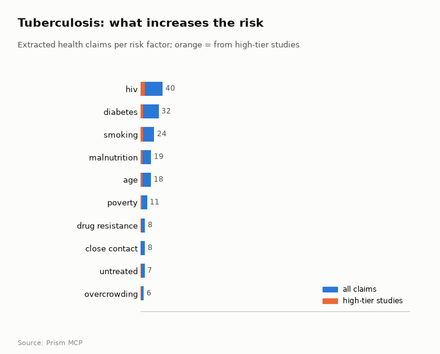

> **Partial index.** Built while part of the news index was offline: counts and shares here are lower bounds (floors), and will be rebuilt in full when the index is complete.

The index holds 157,324 typed research papers on tuberculosis for 2017-2025, with annual output of 10,943 in 2017 and 15,197 in 2025. Framing is mostly positive with a substantial cautionary minority, and a contested share of 24.7%. For diabetes, the evidence base is a hazard ratio (HR) of 1.90 (95% CI 1.51 to 2.40; prediction interval 0.83 to 4.39) for TB risk associated with diabetes. The preventive-therapy claim for people with HIV has no verified document verdict supporting a wording recommendation, so it remains unresolved here. Reporting in the news is led by the United States with 3,447 articles, while research is most often located in China with 44 papers.

## For policy makers

The index holds 157,324 typed research papers for 2017-2025, rising from 10,943 in 2017 to 15,197 in 2025. A linear-drift scenario gives a central figure of 15,729 for 2026, 16,260 for 2027 and 16,792 for 2028, with sensitivity ranges around each. Studies are most often located in China (44), India (27) and the United States (24), while news reporting is led by the United States (3,447), India (2,224) and the United Kingdom (1,254). News coverage cites 1.23 million deaths in 2024 and names antibiotic resistance, under-diagnosis and funding and vaccine-hesitancy challenges. Framing between the recent and earlier windows is broadly unchanged, with cautionary_pct of 24.3 against 24.9. Of the claims compared head to head, chest radiography screening has more evidence behind it than Xpert MTB/RIF, although the Xpert comparison rests on only 4 papers.

- Watch whether research output follows the linear-drift scenario of 15,729 for 2026
- Commission a review of how research geography (China 44, India 27) compares with news-reported burden in countries such as Nigeria (645) and South Africa (514)
- Track drug-resistant transmission and under-diagnosis, which news coverage names as persistent gaps
- Commission evidence synthesis on Xpert MTB/RIF, where only 4 papers sit at both poles
- Monitor funding and vaccine-hesitancy developments flagged in early 2026 coverage

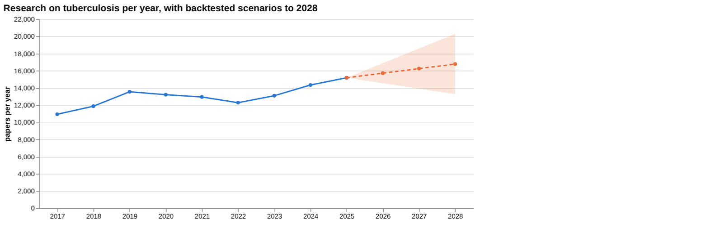

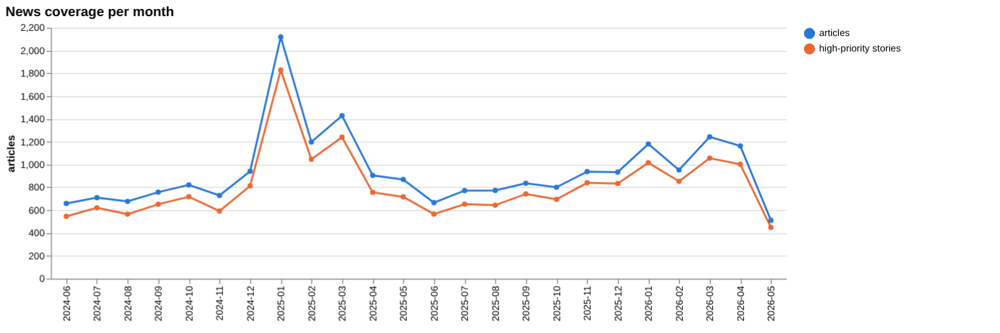

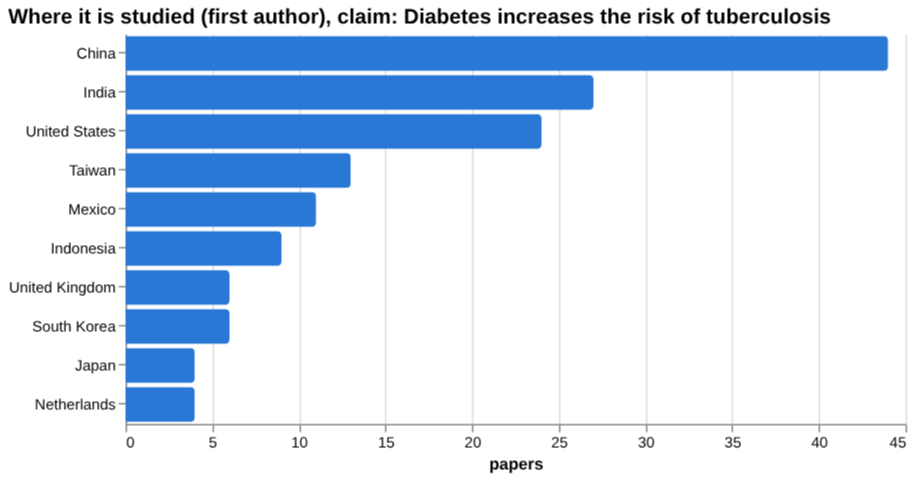

## For doctors

For diabetes as a risk factor, the screening row gives an HR of 1.90 (95% CI 1.51 to 2.40; prediction interval 0.83 to 4.39) for TB risk, in 11,713,023 participants from 8 papers. The prediction interval is wide and its lower bound is below 1, so the pooled estimate does not settle how the effect varies between settings. The sources for this claim span meta-analysis (6), trial (6), review (8) and article (4) tiers. For smoking, a meta-analysis reports odds of TB recurrence 2.10 times higher (95% CI:1.69, 2.61) in smokers than non-smokers, across 14 studies. For isoniazid preventive therapy in people with HIV, the nine documents checked were labelled unrelated and one was unread, so no verified verdict supports a wording recommendation. In the wider clinical corpus of 2,784 papers, a contested share of 34.0%, higher than the 24.7 for the whole literature.

- Diabetes and TB risk: HR 1.90, 95% CI 1.51 to 2.40, prediction interval 0.83 to 4.39 (meta-analysis tier, 11,713,023 participants)
- Smoking and recurrence: odds 2.10 times higher, 95% CI:1.69, 2.61 (systematic review and meta-analysis, 14 studies)
- Parallel testing in adults and adolescents with HIV: pooled sensitivity 77.5% (95% CrI 73.4 to 81.3) and specificity 89.4% (95% CrI 85.8 to 92.3) (Cochrane meta-analysis tier)
- Parallel testing in children without HIV or HIV status unknown: pooled sensitivity 79.9% (95% credible interval (CrI) 67.9 to 89.8) (Cochrane meta-analysis tier)
- Isoniazid preventive therapy in HIV: no verified document verdict supports a recommendation; 9 documents unrelated, 1 unread

**Risk-factor screen:** *Does {row} increase the risk of tuberculosis?*

| Factor | Effect size (quoted) | Measures | Source |
| --- | --- | --- | --- |
| diabetes | HR 1.90, 95% CI 1.51 to 2.40; prediction interval 0.83 to 4.39 | hazard ratio for TB risk associated with diabetes | Diabetes as a risk factor for tuberculosis disease. (2024) |
| smoking | 2.10 times higher (95% CI:1.69, 2.61) | odds of tuberculosis recurrence in smokers vs non‑smokers | Relationship between smoking and tuberculosis recurrence: A systematic review and meta-ana (2023) |
| HIV | no figure found |  | Contact investigation for tuberculosis: a systematic review and meta-analysis (2012) |
| malnutrition | no figure found |  | Infection and immunoglobulin levels in Sudanese children with severe protein-energy malnut (2011) |
| alcohol use | over 8% | proportion of global TB cases attributable to AUD | The Impact of Alcohol Use Disorder on Tuberculosis: A Review of the Epidemiology and Poten (2022) |
| air pollution | no figure found |  | A systematic review and meta-analysis on the association between ambient air pollution and (2022) |

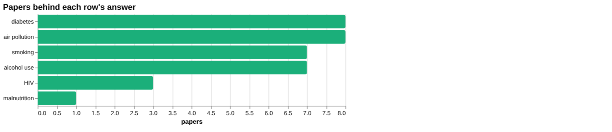

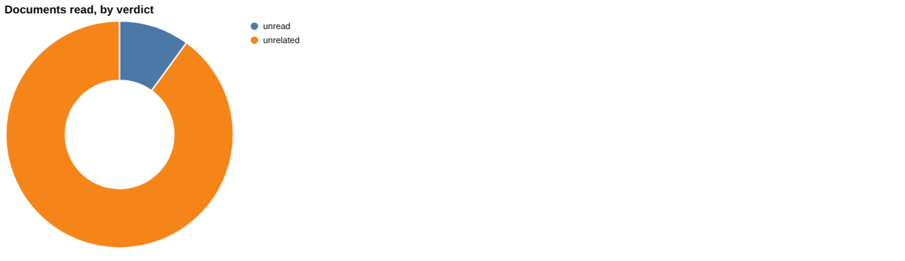

**Clinical claim:** *Isoniazid preventive therapy reduces tuberculosis incidence in people with HIV*. Documents read: unrelated 9, unread 1.

**Head to head:** Xpert MTB/RIF improves the diagnosis of tuberculosis vs Chest radiography screening detects tuberculosis: the second claim has more evidence behind it.

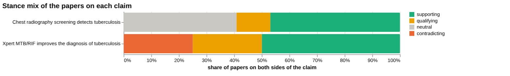

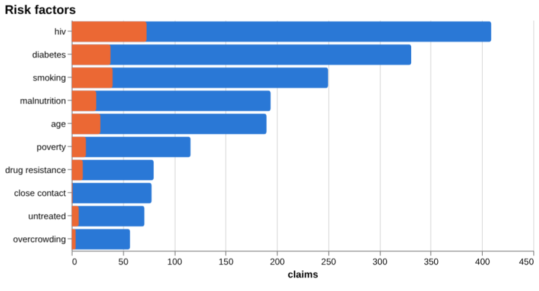

## For scientists

The literature is dominated by descriptive (28,091 papers, 36.0%) and promising (20,620, 26.5%) orientations, with cautionary at 4,621 (5.9%) and critical at 721 (0.9%). By contribution, empirical work numbers 59,057 papers, against 9,292 reviews and 135 theoretical papers. Topic coverage is concentrated in Tuberculosis Research and Epidemiology (38,091 papers), and the claims corpus links risk factors such as HIV (409 claims) and diabetes (331) to the evidence. Several risk rows lack figures: HIV, malnutrition and air pollution have no value in the screening table, which means none was found rather than no effect. Frontier work includes the infant BCG individual participant data meta-analysis (2022, cited by 202), IGRA decision-making (cited by 157) and host-directed therapy (cited by 92). Evidence on Xpert MTB/RIF appears thin in the claims comparison, with 4 papers at both poles and a contested share of 50.0%.

- What explains the wide prediction interval (0.83 to 4.39) around the diabetes hazard ratio of 1.90?
- Can the missing effect sizes for HIV, malnutrition and air pollution be found or generated?
- Why does the isoniazid preventive therapy claim in people with HIV lack a verified supporting document verdict?
- How do 2025 Cochrane parallel-testing results for children (sensitivity 79.9%, 95% credible interval (CrI) 67.9 to 89.8) hold up in practice?
- Does the host-directed therapy and nutritional support work flagged as promising translate into trial evidence?

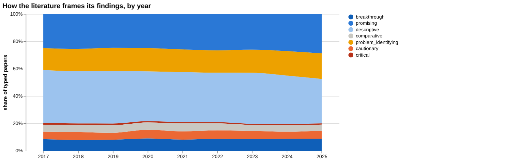

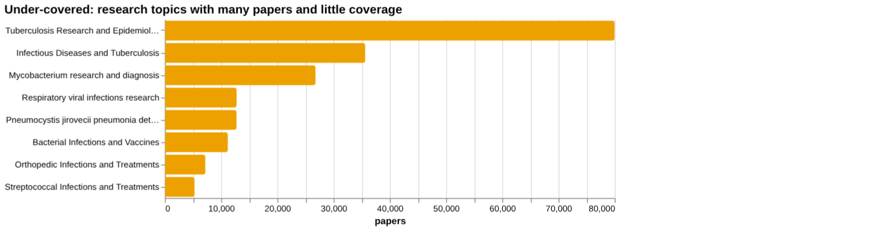

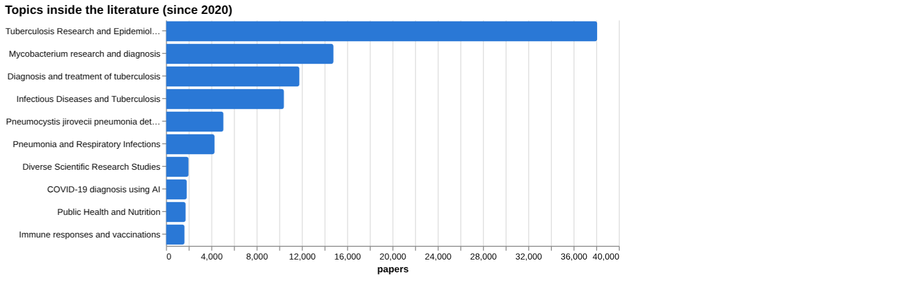

## Research exploration methods

Nine ways to explore the research, each run on this disease. The interactive report shows each call and its result.

**Chaining them.** Start with the facets and history views to see the size and composition of the literature, which is large, mostly empirical and growing, from 10,943 papers in 2017 to 15,197 in 2025. Then use the screening table to find which risk factors carry quoted effect sizes, and note that HIV, malnutrition and air pollution returned none. Follow with gap mapping on the factors that did report figures, such as diabetes, to check which sub-components are covered. For any specific claim, run triangulation and head-to-head comparisons, and treat unrelated or unread document verdicts as a prompt to retrieve better sources, as happened with isoniazid preventive therapy and Xpert. Finally, use the frontier scan, framing drift and geography views to place findings in context: recent high-citation work, steady framing, and where studies are conducted compared with where they are reported.

### Evidence triangulation

*Is a clinical claim supported, and by how strong a design?* `find_evidence` + `find_counter_evidence` + `rank_sources`

For the claim that isoniazid preventive therapy reduces tuberculosis incidence in people with HIV, the document-level check did not confirm anything. Of the ten clinical documents, 9 were judged unrelated and 1 was unread, even though the tiers look strong on paper (7 meta-analyses, 1 trial, 2 reviews). Tier describes the design of a paper, not whether it addressed this claim, so those labels should not be read as support. The counter-evidence search tallied 0 supports, 0 contradicts and 0 qualifies, and the recommendation states that no verified document verdict supports a wording recommendation. The wider corpus of 2,784 papers shows 771 supporting, 907 qualifying, 40 contradicting and 1,066 neutral, with a contested share of 34.0%, described as mostly positive framing with a substantial cautionary minority. That is a mood of the literature, not a test of the claim. The risk-claim sources listed (diabetes and tuberculosis) belong to a different question and say nothing about isoniazid. A careful researcher would retrieve the HIV preventive-therapy trials and meta-analyses directly and read them against the claim.

### Head-to-head claims

*Which of two interventions has more and stronger evidence?* `compare_claims`

Chest radiography screening is backed by more evidence than Xpert MTB/RIF in this comparison, but the two are measured on very different footings. Xpert has 4 papers on both poles, with a mix of 2 supporting, 1 qualifying, 1 contradicting and 0 neutral (a contested share of 50.0%). Chest radiography has 49 papers, with 23 supporting, 6 qualifying, 0 contradicting and 20 neutral (a contested share of 12.2%). On documents read, Xpert had 1 supporting, 4 unrelated and 0 unread, and its strongest source was an article from 2019 that was itself judged unrelated. Chest radiography had 9 supporting, 1 unrelated and 4 unread, with a 2025 review on convolutional neural networks as its strongest source, judged supporting. The Xpert result most likely reflects a thin or poorly matched retrieval, not evidence that the test is weak, and a percentage built on 4 papers is fragile. The comparison also does not say which approach performs better clinically. A careful researcher would search Xpert evidence again with more specific terms before drawing any conclusion.

### Cross-row screening

*Which risk factors carry a measured effect size, and how large?* `research_table`

Only some of the six risk factors came back with a quoted effect size. Diabetes gave an HR of 1.90, 95% CI 1.51 to 2.40, in 11,713,023 participants across 8 papers, but the prediction interval of 0.83 to 4.39 spans 1, so the effect in a new setting is not certain to be harmful. Smoking gave 2.10 times higher odds (95% CI:1.69, 2.61) of tuberculosis recurrence, across 14 studies, which concerns recurrence and not first-time disease. Alcohol use gave over 8% of global TB cases attributable to alcohol use disorder, which is a population share and not a risk ratio, so it is not comparable with the other two. HIV, malnutrition and air pollution returned no figure, despite 3, 1 and 8 papers respectively. For HIV the matched source was a contact investigation review, and for malnutrition a study of Sudanese children's immunoglobulin levels, so neither fits the question well. An absent value means the search did not find a quotable figure, not that no effect exists. A careful researcher would search for these three directly and would not put the three reported figures side by side as a ranking.

### Framing drift

*Is the literature becoming more hopeful or more cautious?* `stance_trends`

Framing is steady across 2017 to 2025. The positive share runs from 16.5 in 2017 to 18.6 in 2025, with small moves in between (for example 16.2 in 2019 and 17.7 in 2022). The contested share stays between 11.5 and 12.6, with the highest value, 12.6, in 2025. A slight upward drift in both lines in the latest year is visible, but the changes are fractions of a percentage point to about two points over the period, and one year does not establish a trend. These figures describe how papers present their own findings, not whether the findings are correct. They also do not separate sub-topics, so a shift in one area such as diagnostics or drug-resistant disease could be hidden in the overall mix. A careful researcher would break the series down by topic before concluding that sentiment is stable in any specific area.

### Frontier scan

*What is new, and what is the research not reaching?* `research_radar`

The most-cited new work since the start year is led by an infant BCG vaccination individual participant data meta-analysis (2022, The Lancet Global Health, cited by 202), followed by a paper on IGRA in diagnosis (157) and an age-period-cohort analysis of incidence in China (121). Also listed are a nutritional support cohort nested within the RATIONS trial (112), interim US guidance on a 4-month rifapentine-moxifloxacin regimen (96) and a paper on inflammation-mediated tissue damage and host-directed therapy (92). Most of the listed items date from 2022, and the one 2023 item is the nutrition cohort. The framing shift between windows is -0.6 percentage points in cautionary share (24.3 in the recent window of 39,530 papers against 24.9 in the earlier window of 39,088), read as broadly unchanged. The caveat applies: orientation labels the paper's own framing, not the truth. The under-covered topics list is led by Tuberculosis Research and Epidemiology at 79,989, but these are broad topic headings with large counts, so they do not point to a specific gap. A careful researcher would treat this list as a reading list and look for narrower gaps within these topics.

### Gap mapping

*Which parts of a claim does the literature actually cover?* `research_gaps`

The risk claim that diabetes increases the risk of tuberculosis was split into two components, and both showed evidence: diabetes as a risk factor for tuberculosis, and increased tuberculosis incidence among diabetics. So no gap was found at this level, which fits the screening result of HR 1.90 for diabetes. However, the two components are close restatements of each other, so the split is coarse and cannot reveal finer gaps. It does not cover questions such as effect by region, by diabetes control, or by type of diabetes, and it says nothing about whether the evidence is strong or consistent. Evidence existing is a lower bar than the claim being settled, and the prediction interval of 0.83 to 4.39 in the screening result suggests that variation between settings remains. A careful researcher would test narrower components, such as population subgroups and glycaemic control, before treating the topic as closed.

### Count history and backtested scenarios

*Is research on this growing, and where could it be in three years?* `historical_analysis` + `trend_scenarios`

Title-matched papers per year rose from 10,943 in 2017 to 13,563 in 2019, then fell to 12,290 in 2022, and recovered to 14,350 in 2024 and 15,197 in 2025. The dip between 2019 and 2022 sits alongside the 2020 to 2021 values of 13,225 and 12,955, so output was not a straight climb. The scenario uses a linear drift baseline and gives central values of 15,729 for 2026, 16,260 for 2027 and 16,792 for 2028. The sensitivity band widens each year, from 14,561 to 16,897 in 2026 and 13,288 to 20,296 in 2028, which shows that confidence falls with distance. These are extrapolations of past counts, not forecasts of funding, disease burden or quality of research. The counts are title matches and may miss relevant work or include off-topic items. A careful researcher would use the 2026 figure as a rough check against actual counts when they are available and give little weight to 2028.

### Geographic triangulation

*Where is it studied, published, reported and patented?* `global_comparison` + `news_geography`

The two lanes shown answer different questions and should not be merged. Studies are led by China (44), then India (27), the United States (24), Taiwan (13), Mexico (11), Indonesia (9), and the United Kingdom and South Korea (6 each). Reporting is led by the United States (3,447), then India (2,224), the United Kingdom (1,254), Nigeria (645), China (586), Canada (526), South Africa (514) and Germany (512). The counts in the two lanes are on different scales, so only the order within each lane carries meaning. Some countries rank differently across lanes: Nigeria and South Africa appear among the reporting countries but not among the places studied, while Taiwan, Mexico and Indonesia appear in the studied list only. That gap does not show a research shortfall, as the lists are truncated at eight and the lanes measure different things. No lanes for publication or patenting were returned, so those questions remain unanswered. A careful researcher would check the full ranked lists for the countries of interest before drawing any conclusion.

### Faceted browsing

*What kind of literature is it: empirical, review, position? Problem-identifying or promising?* `browse_research`

The literature is mainly descriptive and promising in orientation: descriptive 28,091 papers (36.0%), promising 20,620 (26.5%), problem_identifying 13,324 (17.1%), breakthrough 6,704 (8.6%), cautionary 4,621 (5.9%), comparative 3,875 (5.0%) and critical 721 (0.9%). By contribution, empirical work dominates at 59,057, followed by review (9,292), methodological (6,654), position (2,818) and theoretical (135). The topic list is led by Tuberculosis Research and Epidemiology (38,091), then Mycobacterium research and diagnosis (14,789) and Diagnosis and treatment of tuberculosis (11,785). Some topics such as COVID-19 diagnosis using AI (1,840) appear because of keyword overlap, and are not core tuberculosis work. The most-cited-since-2020 list holds only 2025 papers with 0 or 1 citations, so it reflects recency and not influence, and it should not be used to judge what matters. A careful researcher would filter by contribution type and sort for older, well-cited work instead, and would check whether the small critical share reflects the field or the labelling.

## Built with MCP

Every number and chart above comes from these 20 Prism MCP tool calls, made over MCP (streamable HTTP). The list with arguments and timings is in [mcp_calls.json](mcp_calls.json); the responses are in [data.json](data.json).

| MCP tool | Time | Result |
| --- | ---: | --- |
| `disease_profile` | 4.0 s | ok |
| `stance_trends` | 13.8 s | ok |
| `browse_research` | 26.0 s | ok |
| `historical_analysis` | 0.1 s | ok |
| `research_gaps` | 15.1 s | ok |
| `global_comparison` | 4.7 s | ok |
| `news_trends` | 4.9 s | ok |
| `news_geography` | 11.4 s | ok |
| `critical_news` | 26.2 s | ok |
| `research_radar` | 101.7 s | ok |
| `news_factors` | 116.1 s | ok |
| `research_brief` | 163.3 s | ok |
| `rank_sources` | 6.1 s | ok |
| `find_evidence` | 161.6 s | ok |
| `find_counter_evidence` | 123.7 s | ok |
| `deep_timeline` | 0.0 s | ok |
| `research_table` | 227.6 s | ok |
| `find_statistics` | 51.3 s | ok |
| `compare_claims` | 317.8 s | ok |
| `trend_scenarios` | 0.0 s | ok |

> Research intelligence, not medical advice: counts, framings and effect sizes are measured from the research and news index and quoted from their sources; they do not replace clinical guidelines or a clinician's judgement.

