# Type 2 diabetes: disease intelligence

*For policy makers, doctors and scientists* · built from **20 Prism MCP calls** · **[Open the interactive report](https://fliarbi.com/demo/docs/prism-dashboards-3bb43e4c/diseases/type-2-diabetes/)** (tabs: Summary · For policy makers · For doctors · For scientists · Research methods · Month by month · Built with MCP)

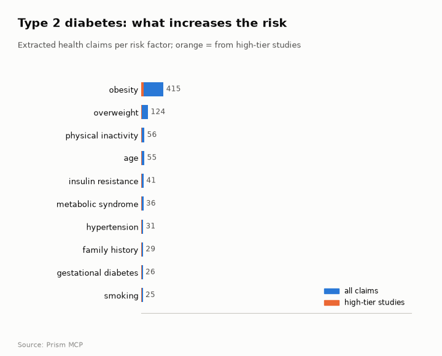

> **Partial index.** Built while part of the news index was offline: counts and shares here are lower bounds (floors), and will be rebuilt in full when the index is complete.

Type 2 diabetes has 174,048 typed research papers for 2017-2025, with annual output rising from 8,772 in 2017 to 18,942 in 2025. The literature framing is mixed with no dominant lean, and a contested share of 19.3%. Obesity is the most frequently cited risk factor among the claims (4,287 claims), and metformin the most frequently cited treatment (2,239 claims). On the clinical claim that SGLT2 inhibitors reduce hospitalisation for heart failure, only one of ten documents read supports it, and the sample does not establish consensus. Research is concentrated in the United States, China and the United Kingdom, while news coverage is led by the United States, the United Kingdom and India. Several broad topic areas, such as diabetes with cardiovascular risks and diet and metabolism, are flagged as under-covered relative to their size.

## For policy makers

The index holds 174,048 typed research papers for 2017-2025, and yearly output has risen from 8,772 in 2017 to 18,942 in 2025. By place of study, the United States (225), China (119) and the United Kingdom (88) lead, whereas news reporting is led by the United States (4,368), the United Kingdom (1,419) and India (814). Wider news coverage describes diagnoses rising in young women, complications such as blindness and renal failure, and the approval of the first oral GLP-1 receptor agonist. Framing across the literature has been broadly unchanged, with a shift of -0.9 percentage points in cautionary share between the earlier and recent windows. Under-covered areas include diabetes and associated disorders (53,427), diabetes with cardiovascular risks and lipoproteins (16,464) and hyperglycaemia in hospitalised patients (11,722).

- Watch whether yearly research output follows the central scenario of 20,213 papers in 2026
- Commission evidence mapping for the under-covered area of hyperglycaemia in critically ill and hospitalised patients (11,722)
- Track the gap between where research is done (United States 225, China 119) and where news is reported, including India (814)
- Monitor safety reporting on oral GLP-1 receptor agonists, given the gastrointestinal and ocular concerns in the news
- Review patient education and follow-up care, which news coverage names as persistent gaps

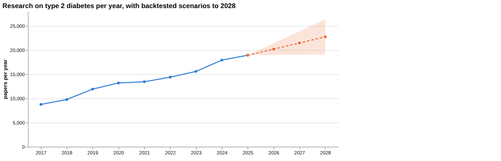

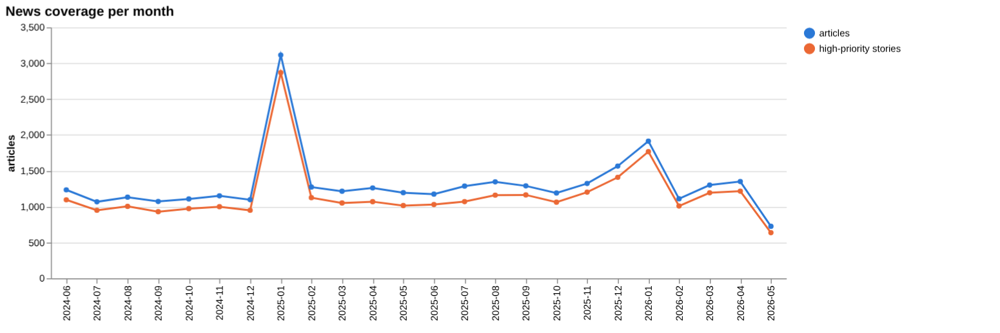

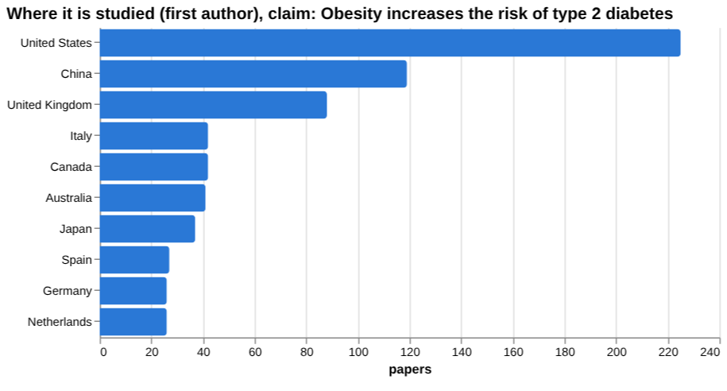

## For doctors

For the claim that SGLT2 inhibitors reduce hospitalisation for heart failure in type 2 diabetes, the clinical corpus holds 3,617 papers, of which 1,551 are supporting, 800 qualifying, 71 contradicting and 1,195 neutral, with a contested share of 24.1%. Of the documents read, one supports the claim, none contradict it and nine are unrelated, so the sample does not establish scientific consensus. One pooled estimate in the facts gives HR 0.79, 95% CI 0.69-0.89 for risk reduction of worsening heart failure or cardiovascular death. For obesity as a risk factor, the sources comprise 5 meta-analyses, 5 trials and 4 reviews, and the gaps check shows evidence for obesity and for higher BMI linked to increased diabetes incidence. Screening estimates include RR, 1.51; 95%CI, 1.15-1.98 for risk of type 2 diabetes with highest versus lowest sugar-sweetened beverage consumption. Smoking in women versus men gave 0.98, 95% confidence interval [CI]: 0.96-1.01, and no figure was found for physical inactivity or air pollution, which does not mean no effect.

- Meta-analysis tier: pooled HR 0.79, 95% CI 0.69-0.89 for risk reduction of worsening heart failure or cardiovascular death
- Systematic review tier: RR, 1.51; 95%CI, 1.15-1.98 for risk of type 2 diabetes, highest versus lowest sugar-sweetened beverage consumption
- Meta-analysis tier: RR 1.63 [1.37; 1.94] for risk of type 2 diabetes in insomnia disorder with objective short sleep compared to normal sleep duration
- Meta-analysis tier: OR = 1.85, 95% CI [1.52, 2.26] for risk of diabetic kidney disease
- Meta-analysis tier: smoking in women compared with men gave 0.98, 95% confidence interval [CI]: 0.96-1.01 for type 2 diabetes

**Risk-factor screen:** *Does {row} increase the risk of type 2 diabetes?*

| Factor | Effect size (quoted) | Measures | Source |
| --- | --- | --- | --- |
| obesity | no figure found |  | Tirzepatide and the 10-year predicted risk of cardiovascular disease and type 2 diabetes i (2025) |
| physical inactivity | no figure found |  |  |
| sugar-sweetened beverages | RR, 1.51; 95%CI, 1.15-1.98 | risk of type 2 diabetes for highest vs lowest SSB consumption | Sugar-sweetened beverage consumption, weight gain, and risk of type 2 diabetes and cardiov (2021) |
| short sleep duration | RR 1.63 [1.37; 1.94] | risk of type 2 diabetes | The association of insomnia disorder characterised by objective short sleep duration with  (2021) |
| smoking | 0.98, 95% confidence interval [CI]: 0.96-1.01 | pooled relative risk ratio for type 2 diabetes associated with smoking in women vs men | Cigarette smoking as a risk factor for type 2 diabetes in women compared with men: a syste (2018) |
| air pollution | no figure found |  | Outdoor air pollutants and asthma risk in adolescents: evidence from a systematic review a (2025) |

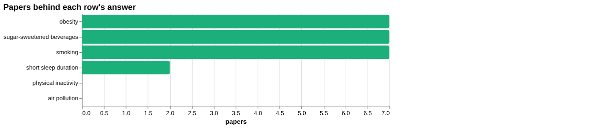

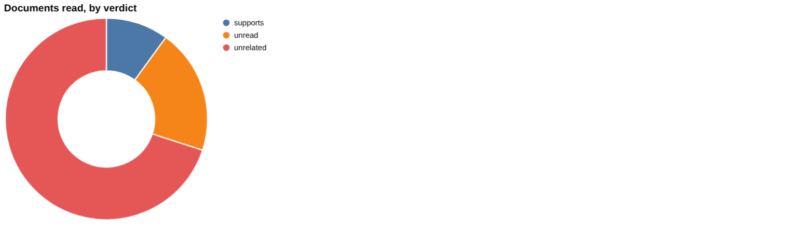

**Clinical claim:** *SGLT2 inhibitors reduce hospitalisation for heart failure in type 2 diabetes*. Documents read: supports 1, unrelated 7, unread 2.

**Head to head:** SGLT2 inhibitors reduce cardiovascular events in type 2 diabetes vs GLP-1 receptor agonists reduce cardiovascular events in type 2 diabetes: the second claim has more evidence behind it.

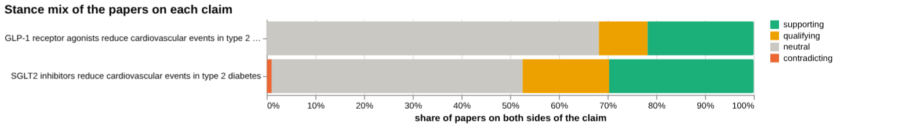

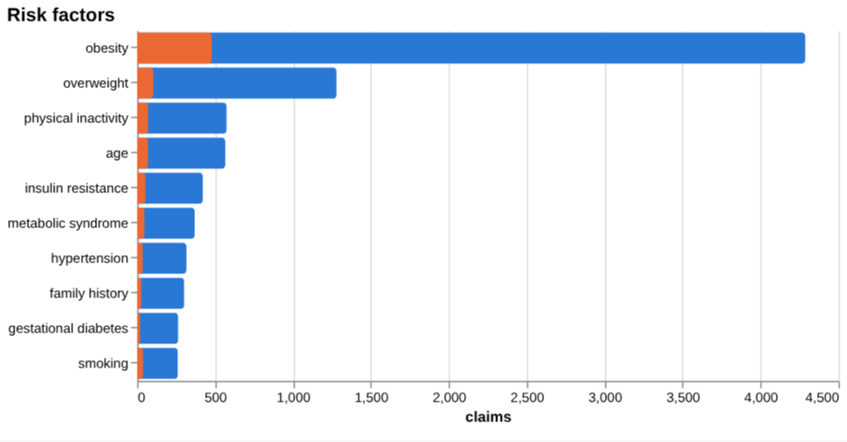

## For scientists

The literature is mostly empirical (93,296 papers), with 20,760 reviews and only 131 theoretical papers. By orientation, promising framing covers 45,204 papers (36.7 per cent) and descriptive 41,383 (33.6 per cent), while cautionary is 7,852 (6.4 per cent) and critical 1,531 (1.2 per cent). Framing is broadly unchanged between earlier (41,113 papers, cautionary_pct 18.8 in the recent window versus 19.7 earlier) windows, and the labels describe a paper's own framing, not the truth. The head-to-head comparison finds more evidence behind GLP-1 receptor agonists reducing cardiovascular events (110 papers at both poles, a contested share of 10.0%) than SGLT2 inhibitors (899 papers, a contested share of 18.8%), though the strongest SGLT2 source read was unrelated to the claim. Among treatments, SGLT2 inhibitors show 581 claims and metformin 2,239, and the claim-level contested shares differ widely. Recent highly cited work includes semaglutide in chronic kidney disease (1,283 citations) and a paper on sex differences in type 2 diabetes (514).

- Why do SGLT2 inhibitor cardiovascular papers show a contested share of 18.8% while the documents read were mostly unrelated?
- What do the sex differences in type 2 diabetes imply for trial design and reporting?
- Can quantified effects be found for risk factors with no figure, such as physical inactivity and air pollution?
- How does the evidence on the kidney outcomes of GLP-1 receptor agonists compare across trials and meta-analyses?
- What explains the rise in positive framing to 23.3 per cent in 2025 while contested share was 9.8?

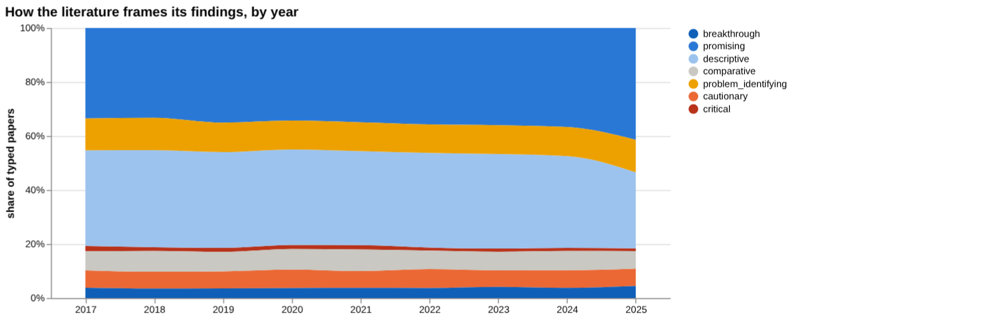

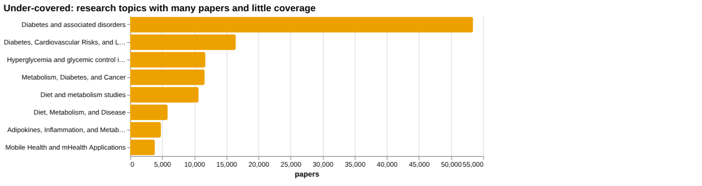

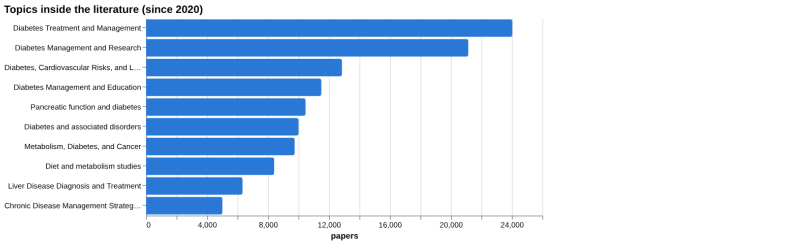

## Research exploration methods

Nine ways to explore the research, each run on this disease. The interactive report shows each call and its result.

**Chaining them.** Begin with triangulation to confirm whether a specific therapeutic claim is supported and to gauge the overall stance of the literature. Use head‑to‑head comparison to evaluate competing interventions and identify the claim with the stronger evidence base. Apply screening to extract quantitative risk estimates for modifiable factors, then employ gap mapping to verify that the identified risk components are adequately covered. Incorporate framing and frontier analyses to understand how the narrative and emerging studies may influence interpretation of the evidence. Finally, integrate geographic, historical, and facet information to contextualise the evidence across regions, track growth trends, and target under‑covered topics for future investigation.

### Evidence triangulation

*Is a clinical claim supported, and by how strong a design?* `find_evidence` + `find_counter_evidence` + `rank_sources`

The claim that SGLT2 inhibitors reduce hospitalisation for heart failure in type 2 diabetes has thin direct support in the documents read: 1 supports, 7 are unrelated and 2 are unread. The tier counts show 9 meta-analyses and 1 trial, but that describes the documents retrieved, not 10 documents that tested the claim. The wider corpus of 3,617 papers is split 1,551 supporting, 800 qualifying, 71 contradicting and 1,195 neutral, with a contested share of 24.1%, which reads as mostly positive framing with a substantial cautionary minority. The counter-evidence search found 1 supporting document, 0 contradicting, 0 qualifying and 9 unrelated, so an absence of disagreement here mostly reflects an absence of relevant documents. The tool itself says this selected sample does not establish scientific consensus. The four top sources listed for the separate obesity risk claim are 2024 papers with 0 citations each, and several concern adiposity or GLP-1 effects on fat, not the heart failure claim. A careful researcher would read the one supporting document in full and search specifically for heart failure hospitalisation outcomes in trials and pooled analyses.

### Head-to-head claims

*Which of two interventions has more and stronger evidence?* `compare_claims`

On the comparison, the GLP-1 receptor agonist claim is reported to have more evidence behind it than the SGLT2 inhibitor claim, but this verdict needs care. The SGLT2 claim has 899 papers on both poles against 110 for GLP-1, so the literature around SGLT2 is far bigger. The verdict rests on documents read: for SGLT2, 0 supports, 9 unrelated and 5 unread; for GLP-1, 1 supports and nothing else. The SGLT2 strongest source is a meta-analysis on depression prevalence in type 2 diabetes in China, marked unrelated, which shows the retrieval missed the target. The GLP-1 strongest source, a 2023 meta-analysis of GLP-1 therapy with and without SGLT2 inhibitors, is marked as supporting. Contested share is 18.8 for SGLT2 and 10.0 for GLP-1, and the GLP-1 mix has 0 contradicting papers against 9. These figures do not show GLP-1 to be the more effective drug. A careful researcher would re-run the SGLT2 reading with better-matched sources and read the unread documents before accepting the verdict.

### Cross-row screening

*Which risk factors carry a measured effect size, and how large?* `research_table`

Only some rows returned a measured effect. Sugar-sweetened beverages gave RR, 1.51; 95%CI, 1.15-1.98 for highest versus lowest consumption, from a 2021 systematic review in Asia. Short sleep duration gave RR 1.63 [1.37; 1.94] in people with insomnia disorder and objective short sleep compared with normal sleep duration, but only 2 papers sit behind it. Smoking returned 0.98, 95% confidence interval [CI]: 0.96-1.01, and this is a comparison of women with men, not smokers with non-smokers, so it says nothing about whether smoking raises risk. Obesity returned no value, and its source is a tirzepatide trial analysis, not a risk estimate. Physical inactivity found 0 papers. Air pollution also found 0 papers, and its listed source concerns asthma in adolescents, so it is a mismatch. The null results mean the extraction failed or the literature was not matched, not that these factors carry no risk. A careful researcher would query obesity, inactivity and air pollution again with sharper phrasing and treat the smoking figure as not answering the question.

### Framing drift

*Is the literature becoming more hopeful or more cautious?* `stance_trends`

Across 2017 to 2025, positive framing rose from 18.6 per cent to 23.3 per cent, with a visible step in 2025 after a slow climb from 19.8 in 2022 to 20.3 in 2024. Contested framing stayed in a narrow band, from 10.1 in 2017 to 9.0 in 2023, and then 9.8 in 2025. So the literature has become somewhat more hopeful in tone without becoming less critical in any marked way. These shares describe how papers present themselves, not whether the treatments work. The 2025 jump is a single year and may reflect a few themes or incomplete indexing of recent papers. A careful researcher would check which topics drive the 2025 rise before reading it as a lasting change.

### Frontier scan

*What is new, and what is the research not reaching?* `research_radar`

The most-cited new work is led by the 2022 ADA/EASD consensus report on hyperglycaemia management with 1,800 citations, followed by the 2024 NEJM paper on semaglutide and chronic kidney disease with 1,283. Two of the six items are consensus or scientific statements, so the list leans toward guidance as well as primary findings. Framing between windows is broadly unchanged: the recent window of 46,129 papers has cautionary_pct 18.8 against 19.7 for the earlier window of 41,113, a delta of -0.9 percentage points. The tool notes that orientation labels the paper's own framing, not the truth. The under-covered list, headed by Diabetes and associated disorders at 53,427 papers and Diabetes, Cardiovascular Risks, and Lipoproteins at 16,464, flags topics with many papers but little coverage, though large counts also mean these are broad topic labels rather than narrow gaps. A careful researcher would look inside those topics for specific unanswered questions.

### Gap mapping

*Which parts of a claim does the literature actually cover?* `research_gaps`

The obesity claim was split into two components, obesity as a risk factor for type 2 diabetes and higher BMI linked to increased diabetes incidence, and both returned evidence: yes. That shows a literature exists for each part. It does not show the size of the effect, the quality of the designs, or whether the relationship is causal. It also sits oddly against the screening result, where obesity returned no quoted value, so existence of a literature and retrieval of a figure are different things. Because the claim is broad and was split into only two parts, the check is coarse, and subgroups, ages, ethnicities and mediators were not tested. A careful researcher would use this as a green light to look for pooled estimates and Mendelian randomisation work, not as a finding.

### Count history and backtested scenarios

*Is research on this growing, and where could it be in three years?* `historical_analysis` + `trend_scenarios`

Title-matched papers per year rose from 8,772 in 2017 to 18,942 in 2025, with every year higher than the one before. The step from 2023 at 15,598 to 2024 at 17,945 is the biggest visible jump in the series. The scenarios use a linear_drift baseline and give a 2026 central value of 20,213 (19,004 to 21,423), 2027 at 21,484 (19,066 to 23,903) and 2028 at 22,756 (19,128 to 26,384). The band widens each year, so the 2028 figure is much less certain than 2026. These are extrapolations of past counts, not forecasts of discovery or quality, and title matching can include papers that are only loosely on topic. A careful researcher would compare the 2026 figure with the actual count when available to judge the baseline.

### Geographic triangulation

*Where is it studied, published, reported and patented?* `global_comparison` + `news_geography`

Studies are led by the United States with 225, then China with 119 and the United Kingdom with 88, followed by Italy and Canada at 42 each, Australia 41, Japan 37 and Spain 27. Reporting is a separate lane and ranks the United States first at 4,368, the United Kingdom at 1,419, India at 814 and China at 537. India appears among the top reported countries but not among the top studied, which suggests coverage of the condition there exceeds the research volume shown. The two lanes answer different questions and should not be added or treated as one measure. Only studied and reported lanes are given, so nothing can be said here about where patents are filed. A careful researcher would check whether the study counts reflect where participants were recruited or only where authors are based.

### Faceted browsing

*What kind of literature is it: empirical, review, position? Problem-identifying or promising?* `browse_research`

Contributions are dominated by empirical work (93,296 papers) followed by reviews (20,760 papers). The most common topics include "Diabetes Treatment and Management" with 24,035 papers and "Diabetes Management and Research" with 21,148 papers. The most‑cited recent titles, such as the 2025 review on obesity and COVID‑19 with one citation, illustrate limited citation impact despite relevance. What is not shown is the citation distribution within each orientation or topic, nor the temporal evolution of these facets. A careful researcher would use these facet counts to prioritise areas for systematic review and to identify under‑explored orientations or topics for future investigation.

## Built with MCP

Every number and chart above comes from these 20 Prism MCP tool calls, made over MCP (streamable HTTP). The list with arguments and timings is in [mcp_calls.json](mcp_calls.json); the responses are in [data.json](data.json).

| MCP tool | Time | Result |
| --- | ---: | --- |
| `disease_profile` | 4.1 s | ok |
| `stance_trends` | 13.0 s | ok |
| `browse_research` | 27.3 s | ok |
| `historical_analysis` | 0.0 s | ok |
| `research_gaps` | 18.2 s | ok |
| `global_comparison` | 5.7 s | ok |
| `news_trends` | 9.0 s | ok |
| `news_geography` | 13.6 s | ok |
| `critical_news` | 19.7 s | ok |
| `research_radar` | 162.6 s | ok |
| `news_factors` | 142.4 s | ok |
| `research_brief` | 382.0 s | ok |
| `rank_sources` | 37.8 s | ok |
| `find_evidence` | 401.6 s | ok |
| `find_counter_evidence` | 395.0 s | ok |
| `deep_timeline` | 0.1 s | ok |
| `research_table` | 555.4 s | ok |
| `find_statistics` | 138.5 s | no data |
| `compare_claims` | 403.2 s | ok |
| `trend_scenarios` | 0.1 s | ok |

> Research intelligence, not medical advice: counts, framings and effect sizes are measured from the research and news index and quoted from their sources; they do not replace clinical guidelines or a clinician's judgement.

