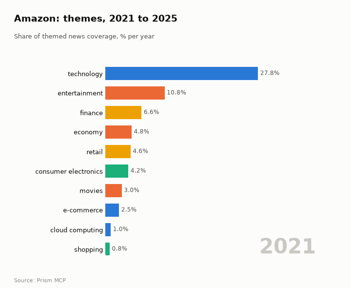
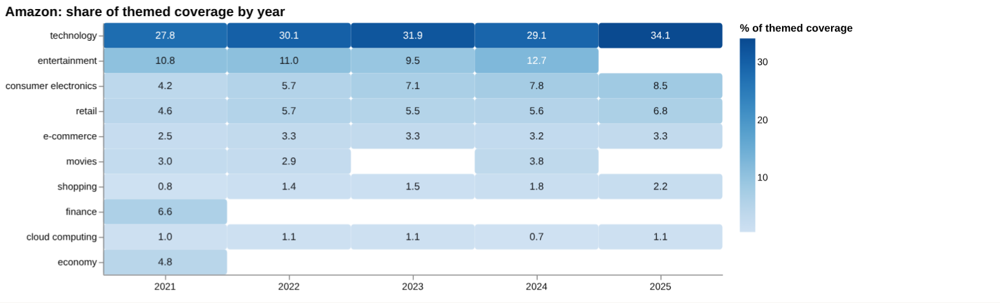
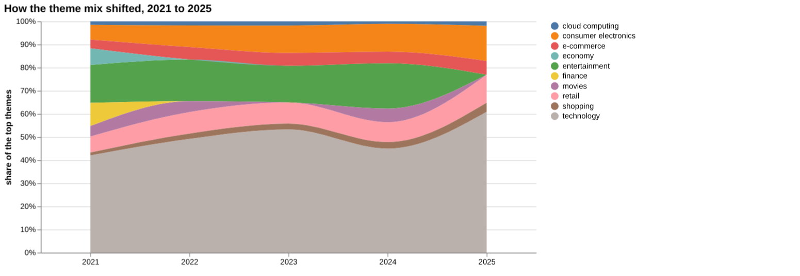
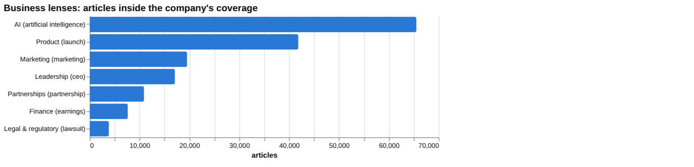
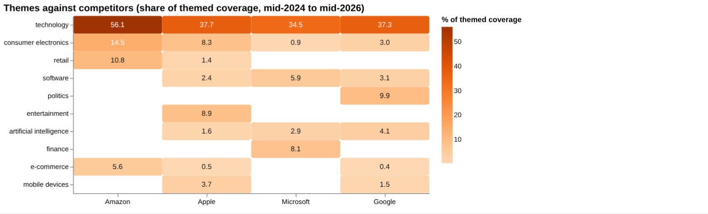
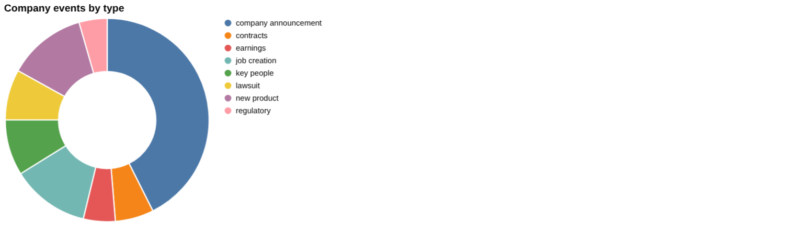
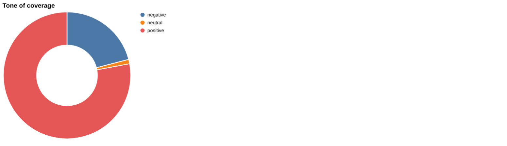
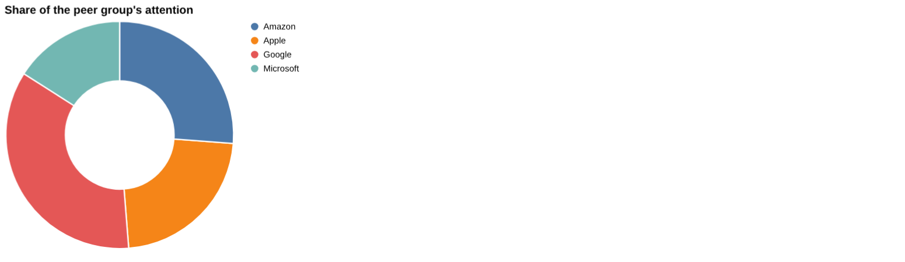
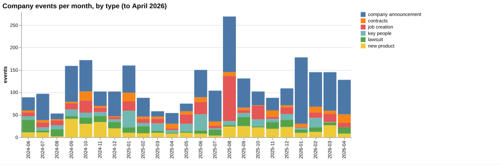

# Amazon: intelligence report

*United States · NASDAQ: AMZN · E-commerce and cloud* · built from **23 Prism MCP calls** · **[Open the interactive report](https://fliarbi.com/demo/docs/prism-dashboards-3bb43e4c/investors/amazon/)** (tabs: Summary · Themes over 5 years · Business lenses · Versus peers · Mix · Events · Risks & catalysts · Coverage & tone · Areas & people · Month by month · Built with MCP)

> **Partial index.** Built while part of the news index was offline: counts and shares here are lower bounds (floors), and will be rebuilt in full when the index is complete.

Amazon generated 721,091 articles in the window from 2024-06 to 2026-05, of which 236,395 fall in the top priority bands. That places it second among the four companies compared on attention, with a 26.2% share against 35.3% for Google. Attention over the latest three months (105,951 articles) was above the previous three months (85,223), a ratio of 1.24. Tone is comparatively mild: negative-to-positive stories stand at 0.3 in the latest three months, against 0.27 for the whole window and 0.58 for all news. Artificial intelligence, at 65,513 articles and 8.44% of company coverage, is the largest catalyst section shown, ahead of AWS at 31,230 articles. Recent coverage has also carried operational and safety stories, including warehouse and delivery incidents.

## Signals

Attention rose, with 105,951 articles in March to May 2026 against 85,223 in the prior three months. Tone stayed close to the company's own norm, at 0.3 negative per positive against 0.29 before. Risk events rose to 166 in the latest six months from 100, while catalyst events fell to 268 from 347.

| Signal | Measured | Direction |
| --- | --- | --- |
| Attention | 105,951 articles in the last 3 months vs 85,223 before (1.24×) | rising |
| Tone | 0.3 negative per positive, vs 0.29 before (all news 0.58) | steady |
| Risk events (lawsuits, regulatory, layoffs) | 166 in the last 6 months vs 100 before | rising |
| Catalyst events (products, contracts, M&A) | 268 in the last 6 months vs 347 before | falling |
| Risk section: layoffs | 0.77% of coverage, last third vs first 5.71× | rising |
| Risk section: antitrust | 0.38% of coverage, last third vs first 0.38× | falling |
| Catalyst section: aws | 4.02% of coverage, last third vs first 1.69× | rising |
| Catalyst section: artificial intelligence | 8.44% of coverage, last third vs first 1.92× | rising |
| Attention rank among peers | #2 of 4 |  |

**What to watch:**

- Whether attention stays above the 105,951 articles of the latest three months
- Whether risk events continue to exceed the 166 of the latest six months
- Outcome and coverage of the 2026 antitrust trial
- Layoffs coverage, given its strongly negative tone
- AI and AWS coverage against the company's 0.27 tone norm
- Leadership changes following the Amazon Health departure

## Themes over five years

Technology rose from 27.8% in 2021 to 34.1% in 2025. Entertainment stood at 10.8% in 2021 and does not appear in the 2025 figures, and movies went from 3.0% in 2021 to no listed share in 2025. Consumer electronics rose from 4.2% to 8.5%, retail from 4.6% to 6.8%, and shopping from 0.8% to 2.2%. E-commerce moved from 2.5% to 3.3%, and cloud computing from 1.0% to 1.1%, while finance (6.6%) and economy (4.8%) appear only in 2021.

| Theme | 2021 | 2022 | 2023 | 2024 | 2025 |
| --- | ---: | ---: | ---: | ---: | ---: |
| technology | 27.8% | 30.1% | 31.9% | 29.1% | 34.1% |
| entertainment | 10.8% | 11.0% | 9.5% | 12.7% | – |
| consumer electronics | 4.2% | 5.7% | 7.1% | 7.8% | 8.5% |
| retail | 4.6% | 5.7% | 5.5% | 5.6% | 6.8% |
| e-commerce | 2.5% | 3.3% | 3.3% | 3.2% | 3.3% |
| movies | 3.0% | 2.9% | – | 3.8% | – |
| shopping | 0.8% | 1.4% | 1.5% | 1.8% | 2.2% |
| finance | 6.6% | – | – | – | – |
| cloud computing | 1.0% | 1.1% | 1.1% | 0.7% | 1.1% |
| economy | 4.8% | – | – | – | – |

## Business lenses

AI is the largest lens by articles at 65,513 (8.44% of coverage), followed by Product at 41,836 (5.8%) and Marketing at 19,539 (2.71%). Finance, at 7,636 articles, grew most between early and late periods (late-versus-early 2.35), with AI next at 1.92. Legal and regulatory is the smallest lens at 3,850 articles but by far the most negative, at 11.7 negative per positive, while Partnerships (0.07) and Product (0.09) are the least negative.

| Lens | Articles | Share of coverage | Last third vs first | Negative per positive | Top tags inside |
| --- | ---: | ---: | ---: | ---: | --- |
| Product (*launch*) | 41,836 | 5.8% | 1.14× | 0.09 | amazon, technology, ai, india |
| Finance (*earnings*) | 7,636 | 1.06% | 2.35× | 0.41 | amazon, ai, investment, microsoft |
| Marketing (*marketing*) | 19,539 | 2.71% | 1.04× | 0.18 | amazon, marketing, ai, google |
| Legal & regulatory (*lawsuit*) | 3,850 | 0.53% | 1.37× | 11.7 | amazon, lawsuit, u.s., california |
| Leadership (*ceo*) | 17,100 | 2.37% | 1.59× | 0.36 | amazon, ai, technology, artificial intelligence |
| Partnerships (*partnership*) | 10,905 | 1.51% | 1.34× | 0.07 | amazon, partnership, ai, technology |
| AI (*artificial intelligence*) | 65,513 | 8.44% | 1.92× | 0.28 | artificial intelligence, amazon, ai, technology |

## Versus peers

Amazon's coverage is more concentrated in technology (56.1%), consumer electronics (14.5%) and retail (10.8%) than that of Apple, Microsoft or Google; its e-commerce share is 5.6% against 0.5% for Apple and 0.4% for Google. Peers show shares in AI (Apple 1.6%, Microsoft 2.9%, Google 4.1%), software and, for Google, politics (9.9%), none of which are listed for Amazon in this comparison. Amazon's attention growth of 1.17 is labelled flat, whereas Google's 1.65 is rising, and Amazon's tone of 0.27 negative per positive is the mildest of the four.

| Theme | Amazon | Apple | Microsoft | Google |
| --- | ---: | ---: | ---: | ---: |
| technology | 56.1% | 37.7% | 34.5% | 37.3% |
| consumer electronics | 14.5% | 8.3% | 0.9% | 3.0% |
| retail | 10.8% | 1.4% | – | – |
| software | – | 2.4% | 5.9% | 3.1% |
| politics | – | – | – | 9.9% |
| entertainment | – | 8.9% | – | – |
| artificial intelligence | – | 1.6% | 2.9% | 4.1% |
| finance | – | – | 8.1% | – |
| e-commerce | 5.6% | 0.5% | – | 0.4% |
| mobile devices | – | 3.7% | – | 1.5% |

## Mix

Risk events in the latest six months centred on lawsuits, regulatory matters and layoffs, while catalyst events centred on new products, contracts, M&A, asset acquisitions and job creation. There were also 50 earnings events and 46 key-people events, and tone runs well below the 0.58 seen across all news.

| | | |
| --- | --- | --- |
|  |  |  |

## Company events

Recent events include the opening of Amazon Supply Chain Services, free same-day grocery delivery for Prime business members on orders over $25, and a fulfilment centre and a $51 million distribution centre expected to bring 500 jobs. On the people side, Neil Lindsay is stepping down as head of Amazon Health. Unsealed filings in a 2026 antitrust trial allege Amazon pressured brands over pricing on other retail sites, and an expanded contract with Sam Altman's lead firm was reported.

## Risks

Layoffs (5,944 articles) and antitrust (2,943 articles) are the tracked risk sections, both strongly negative at 4.1 and 4.87 negative per positive; layoffs coverage grew 5.71 times from the first to last third while antitrust coverage was 0.38. Safety and labour stories, including a fatal fulfilment-centre incident, a warehouse collapse and a fatal delivery-van accident, plus environmental concern over Oregon data centres, add operational scrutiny.

## Catalysts

AI (65,513 articles, 1.92 late-versus-first) and AWS (31,230 articles, 1.69) both grew and sit near the company's tone norm, at 0.28 and 0.22 negative per positive. Contracts, new products and the January 2026 deal to secure AI talent are the visible catalyst types, though catalyst events fell to 268 from 347.

## Areas of activity and people

Activity centres on shopping portals, coupons and discount offers, and product reviews and price comparisons. It also covers small kitchen appliances, media streaming devices and home automation.

## The year, month by month

Coverage in mid-2025 turned to climate and terror-financing concerns for e-commerce platforms, then to a fatal fulfilment-centre incident and Brazilian deforestation in August. Oregon data-centre expansion in December and an AI talent deal in January 2026 followed, and April and May 2026 brought renewed labour-safety stories.

## Built with MCP

Every number and chart above comes from these 23 Prism MCP tool calls, made over MCP (streamable HTTP) as an assistant would make them. The full list with arguments and timings is in [mcp_calls.json](mcp_calls.json); the responses are in [data.json](data.json).

| MCP tool | Calls | What it gave this report |
| --- | ---: | --- |
| `prism_overview` | 1 | coverage, tone, themes, places and people |
| `news_activities` | 1 | areas of activity and company events by month |
| `news_themes` | 8 | themes per year, and each peer's themes |
| `news_drill` | 11 | business lenses, risk and catalyst sections |
| `compare_terms` | 1 | peers on one scale |
| `deep_timeline` | 1 | the month-by-month reading |

> Decision inputs, not investment advice. News attention, tone and event counts describe what is being reported; they are not price forecasts and do not account for valuation, fundamentals or your circumstances.

