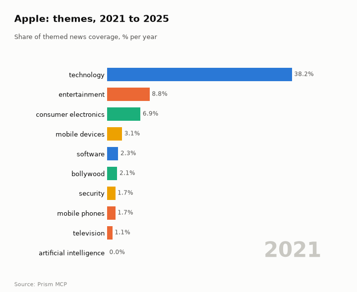
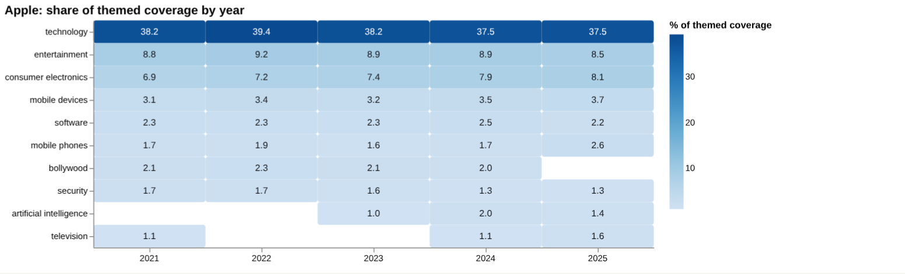
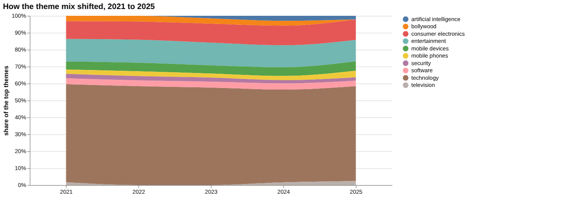
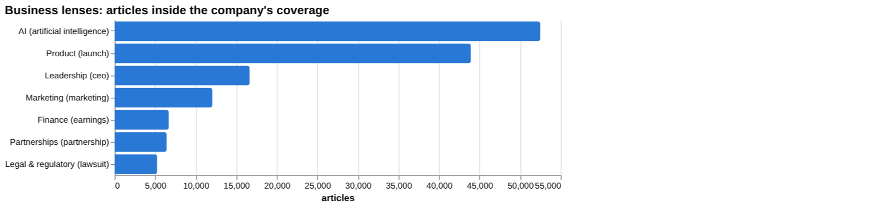
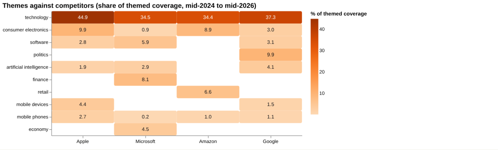
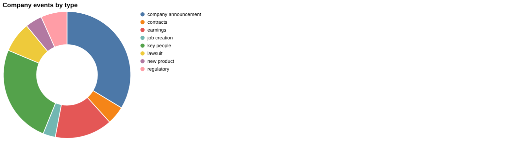
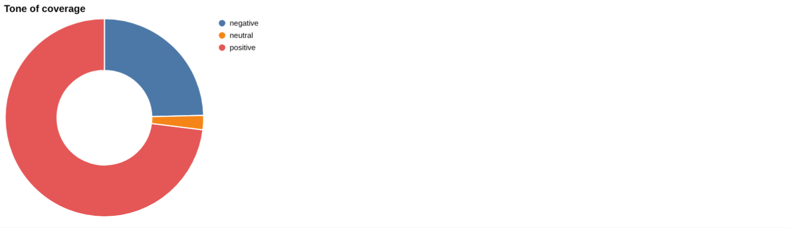
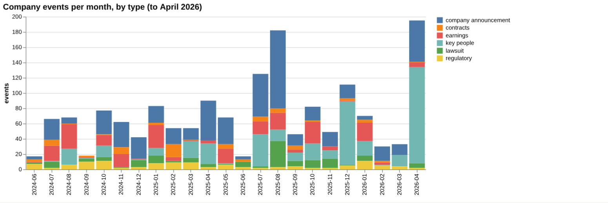

# Apple: intelligence report

*United States · NASDAQ: AAPL · Consumer technology* · built from **23 Prism MCP calls** · **[Open the interactive report](https://fliarbi.com/demo/docs/prism-dashboards-3bb43e4c/investors/apple/)** (tabs: Summary · Themes over 5 years · Business lenses · Versus peers · Mix · Events · Risks & catalysts · Coverage & tone · Areas & people · Month by month · Built with MCP)

> **Partial index.** Built while part of the news index was offline: counts and shares here are lower bounds (floors), and will be rebuilt in full when the index is complete.

Apple has 620,764 articles in the window from 2024-06 to 2026-05, of which 199,076 are high-priority stories. Attention over the last three months was 86,054 articles against 65,422 in the previous three, a ratio of 1.32. Tone is more favourable than for news generally: 0.34 negative stories per positive across the window, against 0.58 for all news. The iPhone is the biggest catalyst section at 147,776 articles (22.12% of company coverage), ahead of artificial intelligence at 52,479 (7.85%). The story has shifted from privacy and security incidents in 2025 towards an AI partnership with Google, an antitrust settlement and geopolitical risk in 2026. The latest earnings item reports record revenue of $111 billion for the March quarter of 2026.

## Signals

Attention rose by a ratio of 1.32 between the two most recent three-month periods, while negative stories per positive moved from 0.3 to 0.35, a small change that remains below the 0.58 seen across all news. Risk events fell from 81 to 62 and catalyst events from 76 to 69 between the two six-month periods. Key-people events numbered 255 and earnings events 39 in the latest six months.

| Signal | Measured | Direction |
| --- | --- | --- |
| Attention | 86,054 articles in the last 3 months vs 65,422 before (1.32×) | rising |
| Tone | 0.35 negative per positive, vs 0.3 before (all news 0.58) | more negative |
| Risk events (lawsuits, regulatory, layoffs) | 62 in the last 6 months vs 81 before | falling |
| Catalyst events (products, contracts, M&A) | 69 in the last 6 months vs 76 before | steady |
| Risk section: antitrust | 0.85% of coverage, last third vs first 0.41× | falling |
| Risk section: tariff | 1.79% of coverage, last third vs first 2.34× | rising |
| Catalyst section: artificial intelligence | 7.85% of coverage, last third vs first 0.98× | steady |
| Catalyst section: iphone | 22.12% of coverage, last third vs first 0.85× | falling |
| Attention rank among peers | #3 of 4 |  |

**What to watch:**

- Whether tariff coverage keeps building after its ratio of 2.34
- Progress of the reported Intel and Samsung Electronics chip talks
- Delivery of the Gemini-powered Siri and the AI share of coverage, at 1.4% in 2025
- Implementation of the alternative app store and external payments settlement
- Labor relations developments after the IAM charge
- Whether the 1.32 attention ratio and 0.35 tone ratio persist

## Themes over five years

Technology stayed dominant, moving from 38.2% in 2021 to 37.5% in 2025, while entertainment moved from 8.8% to 8.5%. Consumer electronics rose from 6.9% to 8.1%, mobile devices from 3.1% to 3.7%, mobile phones from 1.7% to 2.6% and television from 1.1% to 1.6%. Software was broadly steady, from 2.3% to 2.2%, and security eased from 1.7% to 1.3%. Bollywood was 2.1% in 2021 and does not appear among the 2025 themes, while artificial intelligence, absent in 2021, stood at 1.4% in 2025.

| Theme | 2021 | 2022 | 2023 | 2024 | 2025 |
| --- | ---: | ---: | ---: | ---: | ---: |
| technology | 38.2% | 39.4% | 38.2% | 37.5% | 37.5% |
| entertainment | 8.8% | 9.2% | 8.9% | 8.9% | 8.5% |
| consumer electronics | 6.9% | 7.2% | 7.4% | 7.9% | 8.1% |
| mobile devices | 3.1% | 3.4% | 3.2% | 3.5% | 3.7% |
| software | 2.3% | 2.3% | 2.3% | 2.5% | 2.2% |
| mobile phones | 1.7% | 1.9% | 1.6% | 1.7% | 2.6% |
| bollywood | 2.1% | 2.3% | 2.1% | 2.0% | – |
| security | 1.7% | 1.7% | 1.6% | 1.3% | 1.3% |
| artificial intelligence | – | – | 1.0% | 2.0% | 1.4% |
| television | 1.1% | – | – | 1.1% | 1.6% |

## Business lenses

AI (52,479 articles, 7.85%) and Product (43,920, 7.08%) carry the most coverage among the lenses, and Product has the lowest tone ratio at 0.12 negative per positive. Legal & regulatory is small at 5,244 articles (0.84%) but is far more negative, at 14.35 negative per positive. Finance (late versus early 1.52) and Leadership (1.28) have grown over the window, while Marketing (0.8) has faded.

| Lens | Articles | Share of coverage | Last third vs first | Negative per positive | Top tags inside |
| --- | ---: | ---: | ---: | ---: | --- |
| Product (*launch*) | 43,920 | 7.08% | 0.93× | 0.12 | apple, technology, iphone, ai |
| Finance (*earnings*) | 6,681 | 1.08% | 1.52× | 0.37 | apple, ai, investment, microsoft |
| Marketing (*marketing*) | 12,047 | 1.94% | 0.8× | 0.22 | apple, marketing, technology, google |
| Legal & regulatory (*lawsuit*) | 5,244 | 0.84% | 0.96× | 14.35 | apple, lawsuit, google, california |
| Leadership (*ceo*) | 16,639 | 2.68% | 1.28× | 0.38 | apple, technology, tim cook, ai |
| Partnerships (*partnership*) | 6,413 | 1.03% | 0.96× | 0.14 | apple, partnership, ai, technology |
| AI (*artificial intelligence*) | 52,479 | 7.85% | 0.98× | 0.3 | apple, artificial intelligence, ai, technology |

## Versus peers

Apple ranks third for attention among the four companies, with 620,764 articles and a 22.6% share, behind Google at 971,861 (35.3%, rising) and Amazon at 721,091 (26.2%). Apple's attention is flat at a growth figure of 0.98, and its tone of 0.34 negative per positive sits between Amazon at 0.27 and Microsoft at 0.37, with Google at 0.47. Technology makes up 44.9% of Apple's themed coverage against 34.5% for Microsoft, 34.4% for Amazon and 37.3% for Google, while its AI share of 1.9% is below Microsoft at 2.9% and Google at 4.1%.

| Theme | Apple | Microsoft | Amazon | Google |
| --- | ---: | ---: | ---: | ---: |
| technology | 44.9% | 34.5% | 34.4% | 37.3% |
| consumer electronics | 9.9% | 0.9% | 8.9% | 3.0% |
| software | 2.8% | 5.9% | – | 3.1% |
| politics | – | – | – | 9.9% |
| artificial intelligence | 1.9% | 2.9% | – | 4.1% |
| finance | – | 8.1% | – | – |
| retail | – | – | 6.6% | – |
| mobile devices | 4.4% | – | – | 1.5% |
| mobile phones | 2.7% | 0.2% | 1.0% | 1.1% |
| economy | – | 4.5% | – | – |

## Mix

Coverage is led by product and catalyst themes, with 199,076 of 620,764 articles in the top priority bands. Tone is mostly measured at 0.34 negative per positive, with negativity concentrated in the antitrust (5.64) and tariff (3.02) sections.

| | | |
| --- | --- | --- |
|  |  |  |

## Company events

The latest company announcement is a report of exploratory talks with Intel and Samsung Electronics about producing main device processors in the US. A key-people item describes a new 'Ecosystems Platforms and Partnerships' team to be led by Matt Costello and Kevin Lynch. On the legal side, IAM filed an unfair labor practice charge with the National Labor Relations Board, and a US trade tribunal ruled for Apple against Masimo's bid to reinstate an Apple Watch import ban.

## Risks

Tariff coverage totals 11,979 articles (1.79% of company coverage) with a late-versus-early ratio of 2.34, so it is building, while antitrust at 5,677 articles (0.85%) has a ratio of 0.41 and is fading from earlier levels. Lawsuit, regulatory and layoffs events are the main risk types, and the March 2026 warning from Iran's Revolutionary Guards added a geopolitical strand.

## Catalysts

New product, contracts, M&A, asset acquisition, job creation and FDA approval are the catalyst types in the data, with iPhone coverage at a late-versus-early ratio of 0.85 and AI at 0.98. The move to Google's Gemini for Siri and the reported US chip-production talks are the more recent strategic items.

## Areas of activity and people

Activity centres on operating systems, mobile phones and consumer gadgets and portable electronics. Mobile apps, mobile accessories and product reviews and price comparisons complete the main areas.

## The year, month by month

A quiet June 2025 gave way to an iCloud breach in July and spyware alerts and a deep-fake scam in September. In January 2026 a regulatory settlement required alternative app stores and external payments, alongside the shift to Google's Gemini for Siri. March 2026 brought the Iranian warning to US technology firms, including Apple.

## Built with MCP

Every number and chart above comes from these 23 Prism MCP tool calls, made over MCP (streamable HTTP) as an assistant would make them. The full list with arguments and timings is in [mcp_calls.json](mcp_calls.json); the responses are in [data.json](data.json).

| MCP tool | Calls | What it gave this report |
| --- | ---: | --- |
| `prism_overview` | 1 | coverage, tone, themes, places and people |
| `news_activities` | 1 | areas of activity and company events by month |
| `news_themes` | 8 | themes per year, and each peer's themes |
| `news_drill` | 11 | business lenses, risk and catalyst sections |
| `compare_terms` | 1 | peers on one scale |
| `deep_timeline` | 1 | the month-by-month reading |

> Decision inputs, not investment advice. News attention, tone and event counts describe what is being reported; they are not price forecasts and do not account for valuation, fundamentals or your circumstances.

