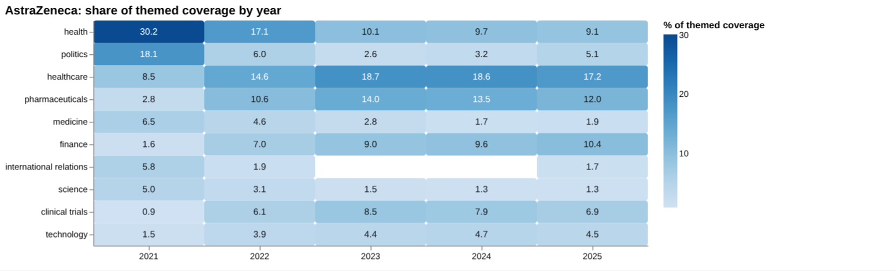
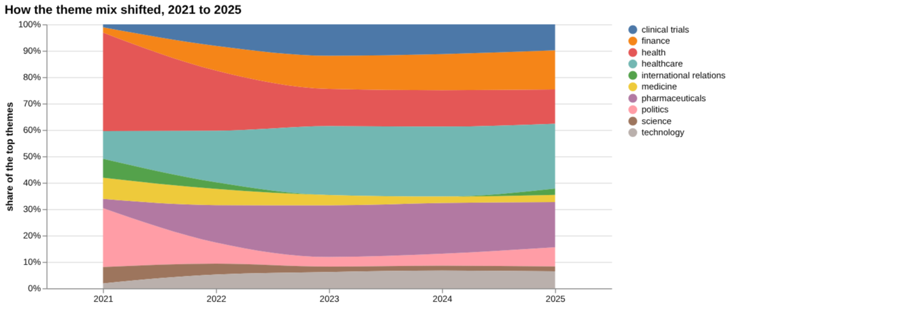
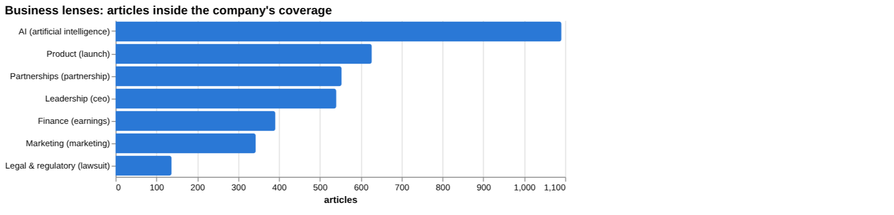
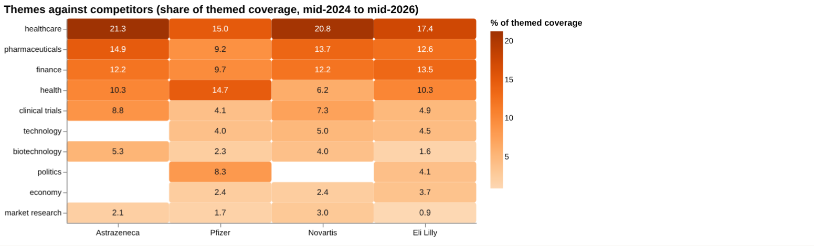
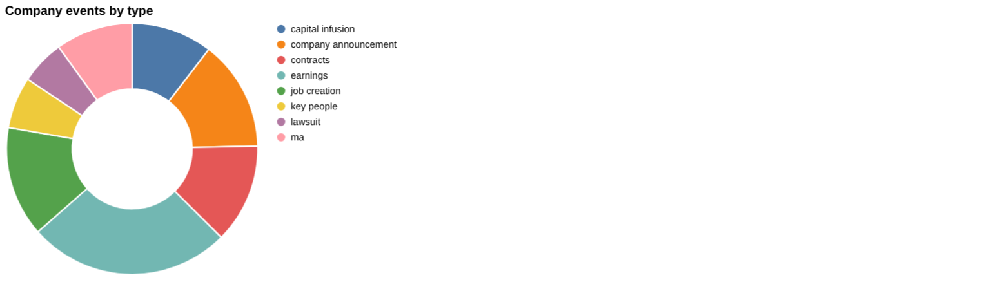
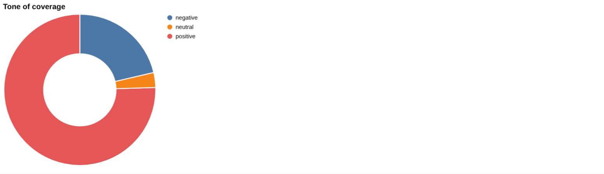
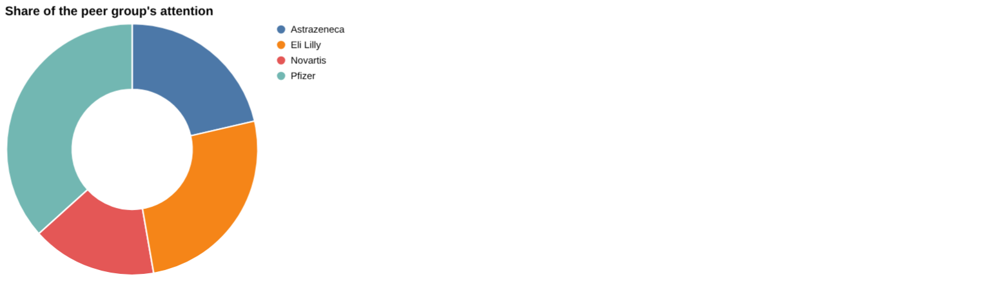
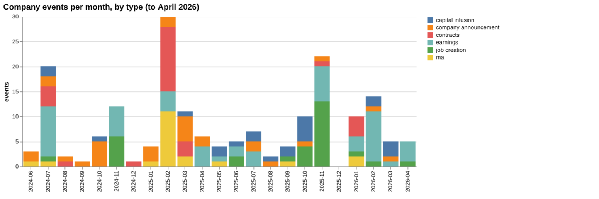

# AstraZeneca: intelligence report

*United Kingdom · LSE: AZN · Pharmaceuticals* · built from **23 Prism MCP calls** · **[Open the interactive report](https://fliarbi.com/demo/docs/prism-dashboards-3bb43e4c/investors/astrazeneca/)** (tabs: Summary · Themes over 5 years · Business lenses · Versus peers · Mix · Events · Risks & catalysts · Coverage & tone · Areas & people · Month by month · Built with MCP)

> **Partial index.** Built while part of the news index was offline: counts and shares here are lower bounds (floors), and will be rebuilt in full when the index is complete.

AstraZeneca is covered by 20,032 articles in the window from 2024-06 to 2026-05, of which 15,471 are high-priority stories, meaning those in the top priority bands rather than a measure of tone. Attention has eased, with 2,542 articles in the last three months against 3,053 in the previous three, a ratio of 0.83. Tone is less negative than for news generally: 0.28 negative stories per positive over the whole window, against 0.58 for all news. Cancer is the largest of the tracked sections at 3,279 articles, or 16.37% of company coverage. The story has moved from clinical setbacks and listing news in late 2025 towards manufacturing investment and regional approvals in 2026. Tariffs are the one tracked section with notably negative tone, at 2.17 negative per positive.

## Signals

Attention fell to 2,542 articles in the last three months from 3,053 in the previous three, while negative per positive stories eased to 0.22 from 0.26. Risk events fell to 1 in the last six months from 3 in the previous six, while catalyst events rose to 23 from 12. Earnings events numbered 25 and key-people events 7 in the latest six months.

| Signal | Measured | Direction |
| --- | --- | --- |
| Attention | 2,542 articles in the last 3 months vs 3,053 before (0.83×) | falling |
| Tone | 0.22 negative per positive, vs 0.26 before (all news 0.58) | less negative |
| Risk events (lawsuits, regulatory, layoffs) | 1 in the last 6 months vs 3 before | falling |
| Catalyst events (products, contracts, M&A) | 23 in the last 6 months vs 12 before | rising |
| Risk section: tariff | 3.29% of coverage, last third vs first 25.89× | rising |
| Risk section: trial | 6.89% of coverage, last third vs first 1.43× | rising |
| Catalyst section: fda approval | 3.08% of coverage, last third vs first 1.1× | steady |
| Catalyst section: cancer | 16.37% of coverage, last third vs first 1.11× | steady |
| Attention rank among peers | #3 of 4 |  |

**What to watch:**

- Whether attention, at 2,542 articles in the last three months, keeps easing
- Tariff coverage and its 2.17 negative-per-positive tone
- Legal and regulatory items, given the 11.0 negative-per-positive ratio
- Progress of the New York listing and US manufacturing investment
- Further approvals following baxfendy in the UAE
- Whether catalyst events stay above risk events

## Themes over five years

Health fell from 30.2% in 2021 to 9.1% in 2025, and politics fell from 18.1% to 5.1%. Healthcare rose from 8.5% in 2021 to 17.2% in 2025, and pharmaceuticals rose from 2.8% to 12.0%. Finance grew from 1.6% to 10.4%, clinical trials from 0.9% to 6.9% and technology from 1.5% to 4.5%. Medicine slipped from 6.5% to 1.9% and science from 5.0% to 1.3%, while international relations went from 5.8% to 1.7%.

| Theme | 2021 | 2022 | 2023 | 2024 | 2025 |
| --- | ---: | ---: | ---: | ---: | ---: |
| health | 30.2% | 17.1% | 10.1% | 9.7% | 9.1% |
| politics | 18.1% | 6.0% | 2.6% | 3.2% | 5.1% |
| healthcare | 8.5% | 14.6% | 18.7% | 18.6% | 17.2% |
| pharmaceuticals | 2.8% | 10.6% | 14.0% | 13.5% | 12.0% |
| medicine | 6.5% | 4.6% | 2.8% | 1.7% | 1.9% |
| finance | 1.6% | 7.0% | 9.0% | 9.6% | 10.4% |
| international relations | 5.8% | 1.9% | – | – | 1.7% |
| science | 5.0% | 3.1% | 1.5% | 1.3% | 1.3% |
| clinical trials | 0.9% | 6.1% | 8.5% | 7.9% | 6.9% |
| technology | 1.5% | 3.9% | 4.4% | 4.7% | 4.5% |

## Business lenses

AI is the largest business lens at 1,091 articles (5.45% of coverage), with 0.05 negative per positive, the same tone as partnerships (553 articles, 2.76%). Product has 627 articles and finance 391, and finance shows a late-versus-early figure of 3.54 against 2.87 for product. Legal and regulatory is the smallest lens at 137 articles (0.68%) and the only clearly negative one, at 11.0 negative per positive, with a late-versus-early figure of 0.27.

| Lens | Articles | Share of coverage | Last third vs first | Negative per positive | Top tags inside |
| --- | ---: | ---: | ---: | ---: | --- |
| Product (*launch*) | 627 | 3.13% | 2.87× | 0.25 | astrazeneca, healthcare, fda, pfizer |
| Finance (*earnings*) | 391 | 1.95% | 3.54× | 0.35 | astrazeneca, investment, us, china |
| Marketing (*marketing*) | 343 | 1.71% | 0.88× | 0.14 | astrazeneca, marketing, europe, healthcare |
| Legal & regulatory (*lawsuit*) | 137 | 0.68% | 0.27× | 11.0 | astrazeneca, lawsuit, astrazeneca plc, china |
| Leadership (*ceo*) | 540 | 2.7% | 1.93× | 0.27 | astrazeneca, us, u.s., pharmaceuticals |
| Partnerships (*partnership*) | 553 | 2.76% | 1.34× | 0.05 | astrazeneca, healthcare, ai, partnership |
| AI (*artificial intelligence*) | 1,091 | 5.45% | 1.72× | 0.05 | astrazeneca, artificial intelligence, ai, healthcare |

## Versus peers

AstraZeneca ranks third of four by attention, with 20,032 articles and a 21.4% share, behind Pfizer (34,379) and Eli Lilly (24,250) and ahead of Novartis (15,046). Its tone of 0.28 negative per positive is more favourable than Pfizer (0.51) and Eli Lilly (0.36) but less so than Novartis (0.22). Its coverage leans towards healthcare (21.3%), pharmaceuticals (14.9%) and clinical trials (8.8%), and shows no share for politics, where Pfizer has 8.3%.

| Theme | Astrazeneca | Pfizer | Novartis | Eli Lilly |
| --- | ---: | ---: | ---: | ---: |
| healthcare | 21.3% | 15.0% | 20.8% | 17.4% |
| pharmaceuticals | 14.9% | 9.2% | 13.7% | 12.6% |
| finance | 12.2% | 9.7% | 12.2% | 13.5% |
| health | 10.3% | 14.7% | 6.2% | 10.3% |
| clinical trials | 8.8% | 4.1% | 7.3% | 4.9% |
| technology | – | 4.0% | 5.0% | 4.5% |
| biotechnology | 5.3% | 2.3% | 4.0% | 1.6% |
| politics | – | 8.3% | – | 4.1% |
| economy | – | 2.4% | 2.4% | 3.7% |
| market research | 2.1% | 1.7% | 3.0% | 0.9% |

## Mix

Catalyst events (23) outnumber risk events (1) in the latest six months, with earnings events at 25. Tone sits at 0.28 negative per positive over the window, well below the 0.58 for all news, and attention is slightly lower than in the prior quarter.

| | | |
| --- | --- | --- |
|  |  |  |

## Company events

The latest earnings item reports first-quarter 2026 results that topped estimates, driven by oncology and rare disease. Other recent events include a founding-partner role in a low-carbon heat initiative, a manufacturing investment of $4.5 billion in Albemarle County, and a US$15 billion commitment to China through 2030. A cell therapy contract with rights outside China was also recorded.

## Risks

Tariff coverage (767 articles, 3.29% of company coverage) has the most negative tone of the tracked sections at 2.17 negative per positive, with a last-third-versus-first figure of 25.89. Trial coverage (1,381 articles, 6.89%) is far less negative at 0.11, though the failed COPD Phase 3 and the Spanish vaccine-liability ruling are part of the recent record.

## Catalysts

Cancer (3,279 articles) and FDA approval (616 articles, 3.08%) both carry low negative-to-positive ratios, 0.08 and 0.07. Recorded catalyst types include new products, contracts, M&A, asset acquisition, job creation and FDA approval, and the DATROWAY ADC survival data in 2025-10 was a clear clinical high point.

## Areas of activity and people

Activity centres on pharmaceuticals and biotech and on drugs and medications. Vaccines and immunisations, cancer, medical research and respiratory conditions complete the main areas.

## The year, month by month

Mid-2025 opened with India revenue growth, and 2025-09 brought the New York listing plan and the COPD Phase 3 failure. DATROWAY data followed in 2025-10, then the Spanish ruling in 2026-02, the $4.5 billion facility commitment in 2026-03 and the baxfendy approval in the UAE in 2026-05.

## Built with MCP

Every number and chart above comes from these 23 Prism MCP tool calls, made over MCP (streamable HTTP) as an assistant would make them. The full list with arguments and timings is in [mcp_calls.json](mcp_calls.json); the responses are in [data.json](data.json).

| MCP tool | Calls | What it gave this report |
| --- | ---: | --- |
| `prism_overview` | 1 | coverage, tone, themes, places and people |
| `news_activities` | 1 | areas of activity and company events by month |
| `news_themes` | 8 | themes per year, and each peer's themes |
| `news_drill` | 11 | business lenses, risk and catalyst sections |
| `compare_terms` | 1 | peers on one scale |
| `deep_timeline` | 1 | the month-by-month reading |

> Decision inputs, not investment advice. News attention, tone and event counts describe what is being reported; they are not price forecasts and do not account for valuation, fundamentals or your circumstances.

