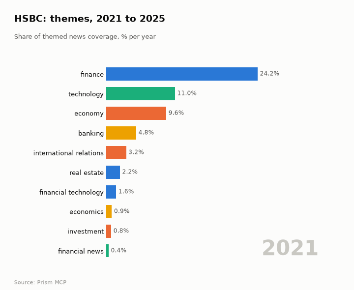
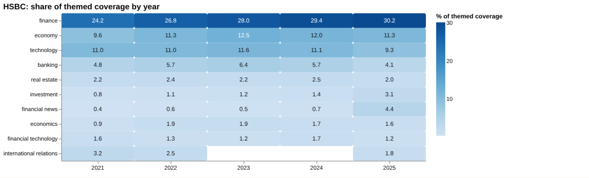
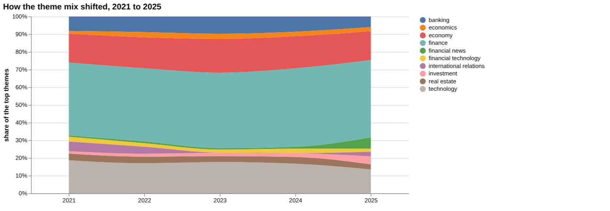
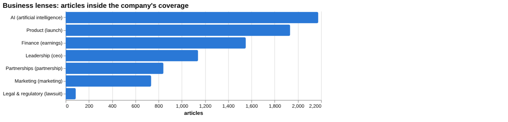
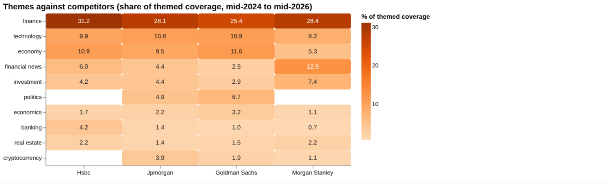
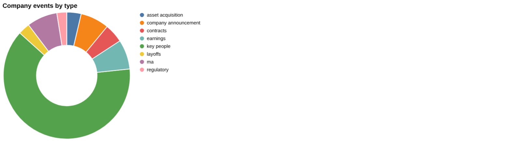
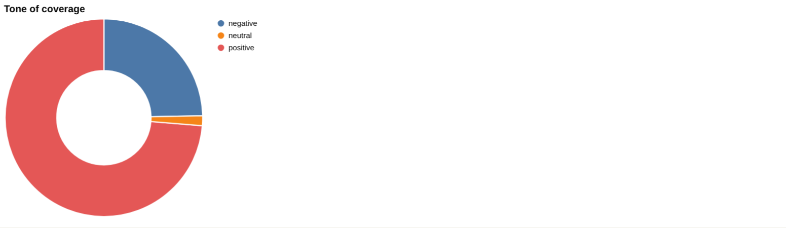
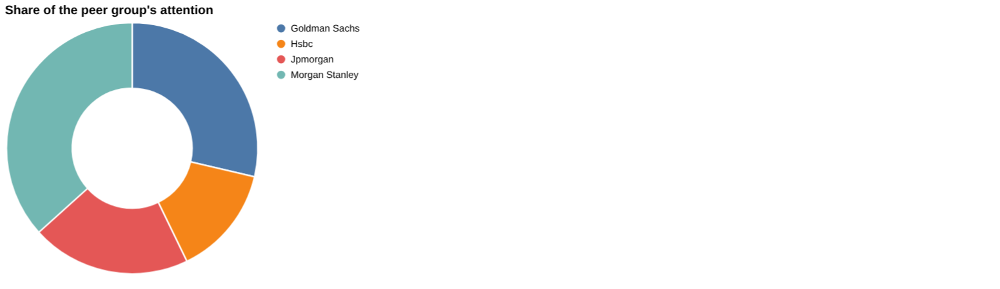
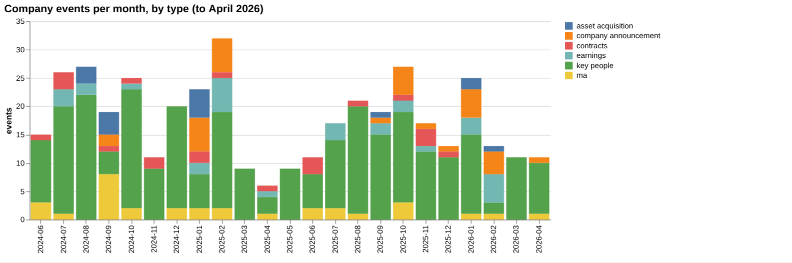

# HSBC: intelligence report

*United Kingdom · LSE: HSBA · Banking* · built from **23 Prism MCP calls** · **[Open the interactive report](https://fliarbi.com/demo/docs/prism-dashboards-3bb43e4c/investors/hsbc/)** (tabs: Summary · Themes over 5 years · Business lenses · Versus peers · Mix · Events · Risks & catalysts · Coverage & tone · Areas & people · Month by month · Built with MCP)

> **Partial index.** Built while part of the news index was offline: counts and shares here are lower bounds (floors), and will be rebuilt in full when the index is complete.

HSBC accounts for 42,421 articles in the window from 2024-06 to 2026-05, of which 21,485 are high-priority stories, meaning those in the top priority bands rather than a measure of tone. Attention has picked up, with 9,080 articles in the last three months against 6,231 in the previous three. The coverage arc moves from an India growth emphasis, through regulatory and legal setbacks in mid-2025, to a push into AI and a renewed India focus. Recent events include the disposal of wealth and private banking and life protection units, a multi-year agreement with Mistral AI, and a first-quarter profit miss after a large credit charge. The latest turning point is a disclosed $400 million loss tied to a fraud case in Britain, which raised concerns over private-credit exposure. HSBC ranks 4 by attention among the four banks compared.

## Signals

Attention in the last three months (2026-03 to 2026-05) stood at 1.46 times the previous three months. Negative-to-positive tone was 0.34 in the last three months, against 0.27 in the previous three and 0.33 across the whole window, all below the 0.58 seen in all news. Risk events numbered 12 in the last six months against 7 in the prior six, while catalyst events were 11 against 16.

| Signal | Measured | Direction |
| --- | --- | --- |
| Attention | 9,080 articles in the last 3 months vs 6,231 before (1.46×) | rising |
| Tone | 0.34 negative per positive, vs 0.27 before (all news 0.58) | more negative |
| Risk events (lawsuits, regulatory, layoffs) | 12 in the last 6 months vs 7 before | rising |
| Catalyst events (products, contracts, M&A) | 11 in the last 6 months vs 16 before | falling |
| Risk section: fine | 0.17% of coverage, last third vs first 0.79× | falling |
| Risk section: restructuring | 0.9% of coverage, last third vs first 0.88× | steady |
| Catalyst section: asia | 12.15% of coverage, last third vs first 1.32× | rising |
| Catalyst section: wealth | 4.3% of coverage, last third vs first 2.16× | rising |
| Attention rank among peers | #4 of 4 |  |

**What to watch:**

- Whether the rise in risk events (12 against 7) continues
- Further detail on the $400 million fraud-related loss and private-credit exposure
- Delivery of the Mistral AI agreement and the chief AI officer remit
- Completion of the wealth and life protection disposals
- Asia and India coverage after the second downgrade of Indian equities
- Whether negative-to-positive tone (0.34) moves toward the all-news 0.58

## Themes over five years

Finance, the leading theme, rose from 24.2% in 2021 to 30.2% in 2025. Economy moved from 9.6% in 2021 to 11.3% in 2025, while technology slipped from 11.0% to 9.3%. Banking eased from 4.8% to 4.1%, investment rose from 0.8% to 3.1%, and financial news climbed from 0.4% to 4.4%. International relations fell from 3.2% in 2021 to 1.8% in 2025, and financial technology moved from 1.6% to 1.2%.

| Theme | 2021 | 2022 | 2023 | 2024 | 2025 |
| --- | ---: | ---: | ---: | ---: | ---: |
| finance | 24.2% | 26.8% | 28.0% | 29.4% | 30.2% |
| economy | 9.6% | 11.3% | 12.5% | 12.0% | 11.3% |
| technology | 11.0% | 11.0% | 11.6% | 11.1% | 9.3% |
| banking | 4.8% | 5.7% | 6.4% | 5.7% | 4.1% |
| real estate | 2.2% | 2.4% | 2.2% | 2.5% | 2.0% |
| investment | 0.8% | 1.1% | 1.2% | 1.4% | 3.1% |
| financial news | 0.4% | 0.6% | 0.5% | 0.7% | 4.4% |
| economics | 0.9% | 1.9% | 1.9% | 1.7% | 1.6% |
| financial technology | 1.6% | 1.3% | 1.2% | 1.7% | 1.2% |
| international relations | 3.2% | 2.5% | – | – | 1.8% |

## Business lenses

AI is the largest lens with 2,175 articles (5.13%), and its late-versus-early ratio of 3.04 is the highest shown, with negative-to-positive tone of 0.37. Product follows with 1933 articles (4.56%) and a very low tone ratio of 0.08, while Finance has 1,551 articles (3.66%), a late-versus-early ratio of 2.57 and a tone ratio of 0.34. Legal & regulatory is small at 87 articles (0.21%) but carries the most negative tone at 9.75, and Partnerships (0.93) and Leadership (0.99) show late-versus-early ratios below or near 1.

| Lens | Articles | Share of coverage | Last third vs first | Negative per positive | Top tags inside |
| --- | ---: | ---: | ---: | ---: | --- |
| Product (*launch*) | 1,933 | 4.56% | 1.65× | 0.08 | hsbc, investment, uk, india |
| Finance (*earnings*) | 1,551 | 3.66% | 2.57× | 0.34 | hsbc, investment, financial performance, stock market |
| Marketing (*marketing*) | 736 | 1.73% | 1.14× | 0.16 | hsbc, marketing, india, uk |
| Legal & regulatory (*lawsuit*) | 87 | 0.21% | 2.0× | 9.75 | hsbc, lawsuit, us, u.s. |
| Leadership (*ceo*) | 1,140 | 2.69% | 0.99× | 0.28 | hsbc, hong kong, uk, investment |
| Partnerships (*partnership*) | 842 | 1.98% | 0.93× | 0.02 | hsbc, partnership, investment, financial services |
| AI (*artificial intelligence*) | 2,175 | 5.13% | 3.04× | 0.37 | artificial intelligence, hsbc, ai, technology |

## Versus peers

HSBC's finance share of 31.2% is above JPMorgan at 28.1%, Goldman Sachs at 25.4% and Morgan Stanley at 28.4%, and its banking share of 4.2% compares with 1.4%, 1.0% and 0.7% respectively. Morgan Stanley has the most coverage with 109,776 articles, followed by Goldman Sachs with 85,757, JPMorgan with 61,414 and HSBC with 42,421 (14.2% share). All four are rising, with HSBC growth at 1.71, and HSBC's tone ratio of 0.33 is the lowest of the group, against 0.56 for JPMorgan, 0.58 for Goldman Sachs and 0.34 for Morgan Stanley.

| Theme | Hsbc | Jpmorgan | Goldman Sachs | Morgan Stanley |
| --- | ---: | ---: | ---: | ---: |
| finance | 31.2% | 28.1% | 25.4% | 28.4% |
| technology | 9.9% | 10.8% | 10.9% | 8.2% |
| economy | 10.9% | 9.5% | 11.6% | 5.3% |
| financial news | 6.0% | 4.4% | 2.5% | 12.9% |
| investment | 4.2% | 4.4% | 2.9% | 7.4% |
| politics | – | 4.9% | 6.7% | – |
| economics | 1.7% | 2.2% | 3.2% | 1.1% |
| banking | 4.2% | 1.4% | 1.0% | 0.7% |
| real estate | 2.2% | 1.4% | 1.5% | 2.2% |
| cryptocurrency | – | 3.9% | 1.9% | 1.1% |

## Mix

Coverage is dominated by high-priority stories, 21,485 of 42,421 articles, with tone at 0.33 negative per positive across the window. Within the last six months, key people events numbered 59, earnings events 9, risk events 12 and catalyst events 11.

| | | |
| --- | --- | --- |
|  |  |  |

## Company events

Latest events include OCBC's acquisition of HSBC's international wealth and private banking business in Indonesia and Chesnara's £260m purchase of the UK life protection arm. HSBC launched an onshore asset management business in the UAE with 10 local funds, signed a multi-year deal with Mistral AI, and missed its first-quarter profit target after a large credit charge. Key people coverage included the former global head of commodities, global trade and receivables finance.

## Risks

Risk event types are lawsuit, regulatory and layoffs, and the timeline records a Swiss money-laundering investigation, Hong Kong fines, a large litigation provision and the $400 million fraud-related loss. Restructuring (444 articles, tone ratio 1.04) and fines (83 articles, 1.22) are negative-leaning sections, both with late-versus-early ratios below 1.

## Catalysts

Catalyst types include new product, contracts, M&A, asset acquisition and job creation. Asia coverage has 6,001 articles (12.15%) with a ratio of 1.32, and wealth has 2,125 articles (4.30%) with a ratio of 2.16 and a low tone ratio of 0.11.

## Areas of activity and people

Activity centres on investment banking, banking, credit and lending including credit cards, life insurance, and asset and portfolio management. Organisations most often appearing alongside HSBC include NatWest, Deutsche Bank, Citibank and Standard Chartered.

## The year, month by month

Coverage began with India growth and a role in a major SBI capital raise, then turned to regulatory and legal setbacks in mid-2025 alongside crypto validation and AI initiatives. A chief AI officer role was created in 2026-03, a second downgrade of Indian equities followed in 2026-04, and the $400 million loss arrived in 2026-05.

## Built with MCP

Every number and chart above comes from these 23 Prism MCP tool calls, made over MCP (streamable HTTP) as an assistant would make them. The full list with arguments and timings is in [mcp_calls.json](mcp_calls.json); the responses are in [data.json](data.json).

| MCP tool | Calls | What it gave this report |
| --- | ---: | --- |
| `prism_overview` | 1 | coverage, tone, themes, places and people |
| `news_activities` | 1 | areas of activity and company events by month |
| `news_themes` | 8 | themes per year, and each peer's themes |
| `news_drill` | 11 | business lenses, risk and catalyst sections |
| `compare_terms` | 1 | peers on one scale |
| `deep_timeline` | 1 | the month-by-month reading |

> Decision inputs, not investment advice. News attention, tone and event counts describe what is being reported; they are not price forecasts and do not account for valuation, fundamentals or your circumstances.

