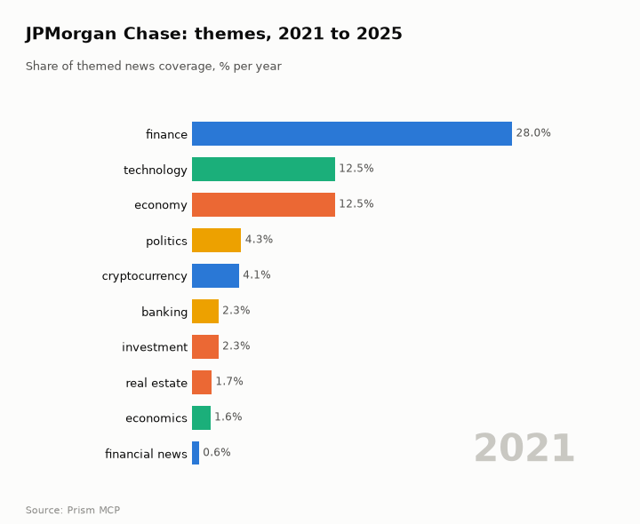
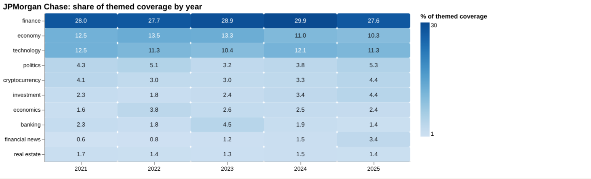
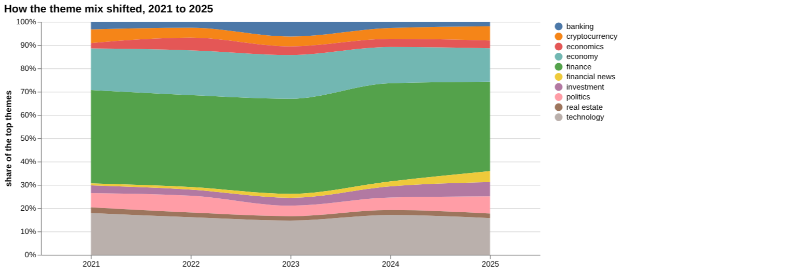
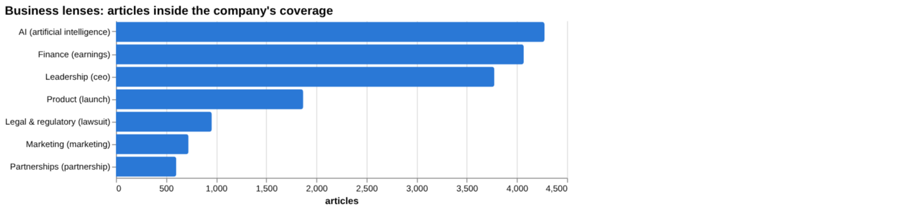
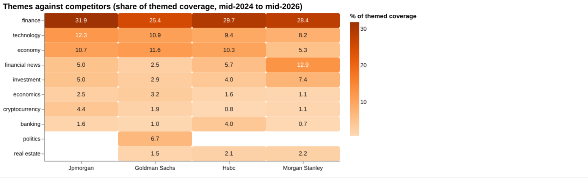
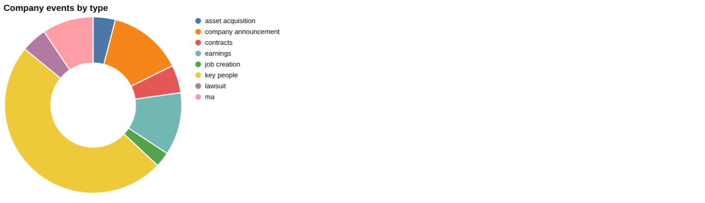
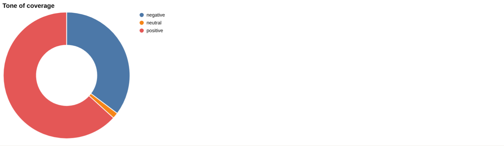
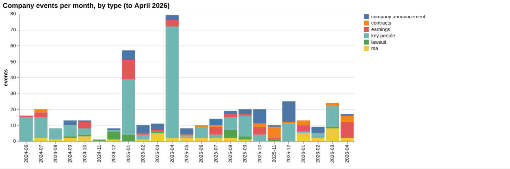

# JPMorgan Chase: intelligence report

*United States · NYSE: JPM · Banking* · built from **23 Prism MCP calls** · **[Open the interactive report](https://fliarbi.com/demo/docs/prism-dashboards-3bb43e4c/investors/jpmorgan/)** (tabs: Summary · Themes over 5 years · Business lenses · Versus peers · Mix · Events · Risks & catalysts · Coverage & tone · Areas & people · Month by month · Built with MCP)

> **Partial index.** Built while part of the news index was offline: counts and shares here are lower bounds (floors), and will be rebuilt in full when the index is complete.

JPMorgan Chase has 66,521 articles in the window from 2024-06 to 2026-05, of which 38,706 are high-priority stories, meaning the top priority bands rather than a measure of tone. Attention rose to 15,280 articles in 2026-03 to 2026-05 from 10,575 in 2025-12 to 2026-02, a ratio of 1.44. Tone is somewhat less negative than the whole window, with 0.54 negative stories per positive in the last three months against 0.56 across the window and 0.58 for all news. The narrative moved through AI becoming central to operations, stablecoin legislation, a $10 billion strategic investment plan, and AI-linked workforce reductions in late 2025. Early 2026 brought political and regulatory pressure, including a $5 billion lawsuit from Trump and a warning from the CEO about a Fed investigation, followed by a focus on AI-related underwriting opportunities. These are measures of news coverage and do not indicate price direction.

## Signals

Attention in the latest three months was 15,280 articles against 10,575 in the prior three, a ratio of 1.44. Catalyst events numbered 49 in the last six months against 26 in the previous six, while risk events were 7 against 10. Negative-to-positive tone was 0.54 in the last three months versus 0.52 in the previous three, so tone was broadly steady while volume rose.

| Signal | Measured | Direction |
| --- | --- | --- |
| Attention | 15,280 articles in the last 3 months vs 10,575 before (1.44×) | rising |
| Tone | 0.54 negative per positive, vs 0.52 before (all news 0.58) | steady |
| Risk events (lawsuits, regulatory, layoffs) | 7 in the last 6 months vs 10 before | falling |
| Catalyst events (products, contracts, M&A) | 49 in the last 6 months vs 26 before | rising |
| Risk section: lawsuit | 1.33% of coverage, last third vs first 4.79× | rising |
| Risk section: regulator | 2.11% of coverage, last third vs first 1.95× | rising |
| Catalyst section: investment banking | 2.29% of coverage, last third vs first 1.77× | rising |
| Catalyst section: acquisition | 2.04% of coverage, last third vs first 2.48× | rising |
| Attention rank among peers | #3 of 4 |  |

**What to watch:**

- Whether attention stays near the 15,280-article level of the latest three months
- Development of lawsuit coverage, including the Epstein-related case
- Progress on the Fed investigation warning and Trump's lawsuit
- Any acquisition following the CEO's comment on a deal of up to $20 billion
- AI-related workforce and underwriting news
- Effects of the investment banking co-head restructuring

## Themes over five years

Finance remained the dominant theme, at 28.0% in 2021 and 27.6% in 2025. Economy eased from 12.5% in 2021 to 10.3% in 2025, and technology moved from 12.5% to 11.3%. Politics rose from 4.3% to 5.3%, cryptocurrency from 4.1% to 4.4%, and investment from 2.3% to 4.4%. Financial news grew from 0.6% to 3.4%, while banking fell from 2.3% to 1.4%.

| Theme | 2021 | 2022 | 2023 | 2024 | 2025 |
| --- | ---: | ---: | ---: | ---: | ---: |
| finance | 28.0% | 27.7% | 28.9% | 29.9% | 27.6% |
| economy | 12.5% | 13.5% | 13.3% | 11.0% | 10.3% |
| technology | 12.5% | 11.3% | 10.4% | 12.1% | 11.3% |
| politics | 4.3% | 5.1% | 3.2% | 3.8% | 5.3% |
| cryptocurrency | 4.1% | 3.0% | 3.0% | 3.3% | 4.4% |
| investment | 2.3% | 1.8% | 2.4% | 3.4% | 4.4% |
| economics | 1.6% | 3.8% | 2.6% | 2.5% | 2.4% |
| banking | 2.3% | 1.8% | 4.5% | 1.9% | 1.4% |
| financial news | 0.6% | 0.8% | 1.2% | 1.5% | 3.4% |
| real estate | 1.7% | 1.4% | 1.3% | 1.5% | 1.4% |

## Business lenses

AI is the largest lens by volume with 4,275 articles (6.96% share), ahead of Finance with 4,068 (6.62%) and Leadership with 3,775 (6.15%). Product shows the strongest late-versus-early rise among the commercial lenses at 3.75, with AI at 3.16, though Legal & regulatory is higher at 4.79 and carries a very high negative-to-positive ratio of 18.9 on 956 articles. Leadership is the next most negative lens at 0.92, while Partnerships is the least at 0.07 on 602 articles.

| Lens | Articles | Share of coverage | Last third vs first | Negative per positive | Top tags inside |
| --- | ---: | ---: | ---: | ---: | --- |
| Product (*launch*) | 1,868 | 3.04% | 3.75× | 0.17 | jpmorgan, investment, u.s., cryptocurrency |
| Finance (*earnings*) | 4,068 | 6.62% | 1.86× | 0.32 | jpmorgan, investment, financial performance, ai |
| Marketing (*marketing*) | 724 | 1.18% | 1.99× | 0.38 | jpmorgan, marketing, ai, investment |
| Legal & regulatory (*lawsuit*) | 956 | 1.33% | 4.79× | 18.9 | jpmorgan, jpmorgan chase, lawsuit, new york |
| Leadership (*ceo*) | 3,775 | 6.15% | 2.27× | 0.92 | jpmorgan, jamie dimon, dimon, jpmorgan chase |
| Partnerships (*partnership*) | 602 | 0.98% | 1.89× | 0.07 | jpmorgan, investment, u.s., partnership |
| AI (*artificial intelligence*) | 4,275 | 6.96% | 3.16× | 0.4 | artificial intelligence, jpmorgan, ai, investment |

## Versus peers

JPMorgan ranks third by attention among the group, with 61,414 articles and a 20.5% share, behind Morgan Stanley at 109,776 (36.7%) and Goldman Sachs at 85,757 (28.6%); HSBC has 42,421 (14.2%). Its theme mix leans to finance at 31.9% and technology at 12.3%, both above each peer shown, while financial news at 5.0% is well below Morgan Stanley's 12.9%. Its tone at 0.56 negative per positive is close to Goldman Sachs at 0.58 but more negative than HSBC at 0.33 and Morgan Stanley at 0.34.

| Theme | Jpmorgan | Goldman Sachs | Hsbc | Morgan Stanley |
| --- | ---: | ---: | ---: | ---: |
| finance | 31.9% | 25.4% | 29.7% | 28.4% |
| technology | 12.3% | 10.9% | 9.4% | 8.2% |
| economy | 10.7% | 11.6% | 10.3% | 5.3% |
| financial news | 5.0% | 2.5% | 5.7% | 12.9% |
| investment | 5.0% | 2.9% | 4.0% | 7.4% |
| economics | 2.5% | 3.2% | 1.6% | 1.1% |
| cryptocurrency | 4.4% | 1.9% | 0.8% | 1.1% |
| banking | 1.6% | 1.0% | 4.0% | 0.7% |
| politics | – | 6.7% | – | – |
| real estate | – | 1.5% | 2.1% | 2.2% |

## Mix

Coverage in the window is dominated by high-priority stories, 38,706 of 66,521 articles, with catalyst events outnumbering risk events in the last six months. Tone is moderately negative overall at 0.56 negative per positive, with legal coverage a sharp outlier.

| | | |
| --- | --- | --- |
|  |  |  |

## Company events

Recent key-people events number 28 and earnings events 15 in the last six months. Latest items include Dorothee Blessing's appointment as one of three new co-heads of global investment banking, the 2025 Annual Report, and reported net income of $16.5 billion, or $5.94 per share. The CEO also said the bank could pursue an acquisition worth up to $20 billion in coming years, and the bank is reportedly in talks to join the IOC's top-tier sponsorship programme.

## Risks

Risk event types are lawsuit, regulatory and layoffs, with lawsuit coverage at 956 articles and a last-third-versus-first ratio of 4.79, and regulator coverage at 1,511 articles with a ratio of 1.95. The latest lawsuit item concerns the bank's client relationship with Epstein, and political risk featured in the timeline through Trump's lawsuit and the Fed investigation warning.

## Catalysts

Catalyst types include new product, contracts, M&A, asset acquisition and job creation, with investment banking at 1,642 articles and acquisition at 1,460. Acquisition coverage has a last-third-versus-first ratio of 2.48 and investment banking 1.77, both with low negative-to-positive ratios of 0.16 and 0.19.

## Areas of activity and people

Activity centres on investment banking, banking and credit cards, with asset and portfolio management also present. Tesla Motors and flexible work arrangements also appear among the listed areas.

## The year, month by month

In June 2025 AI became a core driver and the Genius Act set a national stablecoin framework, and in July a shooting at its flagship tower coincided with crypto lending and Apple credit-card talks. October 2025 brought the $10 billion strategic investment plan and AI-linked headcount reductions. January 2026 saw Trump's $5 billion lawsuit and the Fed investigation warning, and March 2026 saw JPMorgan eyed as lead underwriter for Anthropic's IPO.

## Built with MCP

Every number and chart above comes from these 23 Prism MCP tool calls, made over MCP (streamable HTTP) as an assistant would make them. The full list with arguments and timings is in [mcp_calls.json](mcp_calls.json); the responses are in [data.json](data.json).

| MCP tool | Calls | What it gave this report |
| --- | ---: | --- |
| `prism_overview` | 1 | coverage, tone, themes, places and people |
| `news_activities` | 1 | areas of activity and company events by month |
| `news_themes` | 8 | themes per year, and each peer's themes |
| `news_drill` | 11 | business lenses, risk and catalyst sections |
| `compare_terms` | 1 | peers on one scale |
| `deep_timeline` | 1 | the month-by-month reading |

> Decision inputs, not investment advice. News attention, tone and event counts describe what is being reported; they are not price forecasts and do not account for valuation, fundamentals or your circumstances.

