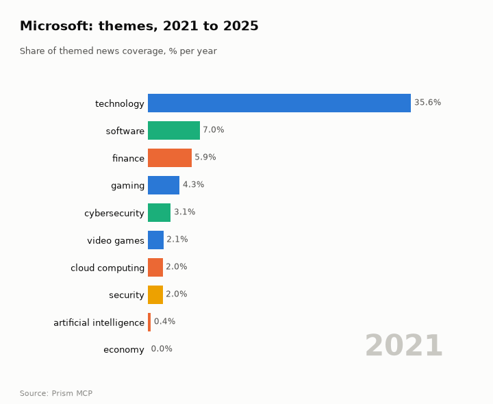
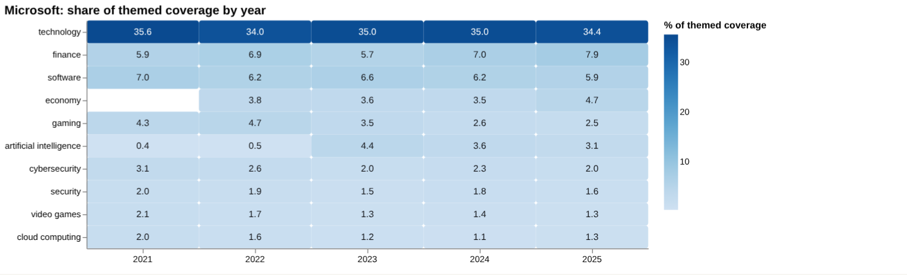
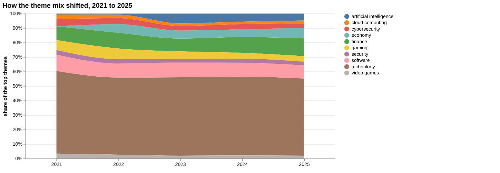
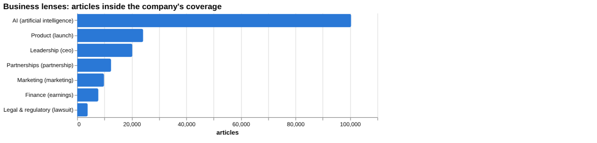
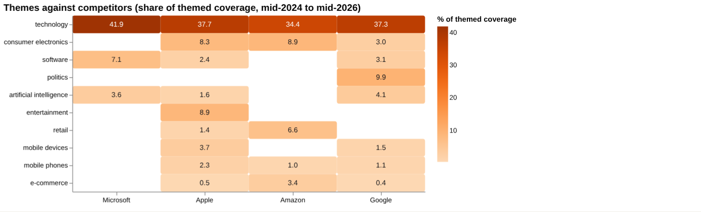
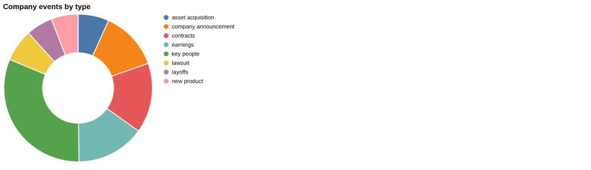
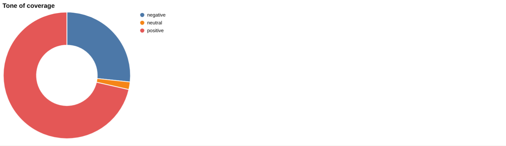
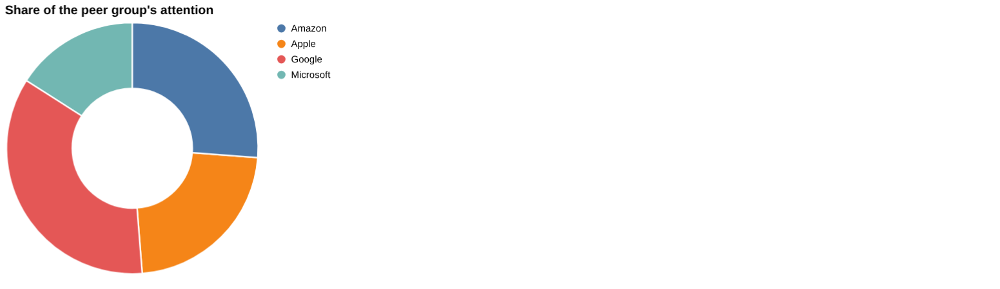
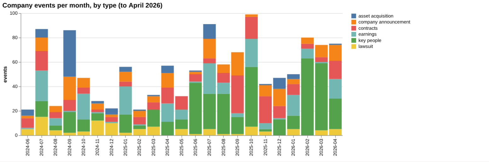

# Microsoft: intelligence report

*United States · NASDAQ: MSFT · Software and cloud* · built from **23 Prism MCP calls** · **[Open the interactive report](https://fliarbi.com/demo/docs/prism-dashboards-3bb43e4c/investors/microsoft/)** (tabs: Summary · Themes over 5 years · Business lenses · Versus peers · Mix · Events · Risks & catalysts · Coverage & tone · Areas & people · Month by month · Built with MCP)

> **Partial index.** Built while part of the news index was offline: counts and shares here are lower bounds (floors), and will be rebuilt in full when the index is complete.

Microsoft drew 438,934 articles in the window from 2024-06 to 2026-05, of which 237,055 were high-priority stories. Coverage is dominated by AI, with OpenAI-related coverage at 13.46% of the company's articles and the AI lens at 22.87%. Attention in 2026-03 to 2026-05 was 61,733 articles against 56,209 in the previous three months, a ratio of 1.1. Tone has turned somewhat more negative recently, at 0.44 negative stories per positive one against 0.33 before, though it remains below the 0.58 seen across all news. The narrative since mid-2025 has moved from a SharePoint hack and political pressure to Windows vulnerabilities, an AI lawsuit and, most recently, a GitHub breach and intensifying cloud rivalry. Against this, the company reported revenue up 18% year over year to $82.89 billion and a reworked OpenAI partnership.

## Signals

Attention rose modestly, from 56,209 articles in 2025-12 to 2026-02 to 61,733 in 2026-03 to 2026-05. Negative stories per positive one were 0.44 in the last three months, 0.33 in the previous three and 0.37 across the whole window. Risk events fell from 81 in the previous six months to 36 in the last six, while catalyst events moved from 127 to 114.

| Signal | Measured | Direction |
| --- | --- | --- |
| Attention | 61,733 articles in the last 3 months vs 56,209 before (1.1×) | steady |
| Tone | 0.44 negative per positive, vs 0.33 before (all news 0.58) | more negative |
| Risk events (lawsuits, regulatory, layoffs) | 36 in the last 6 months vs 81 before | falling |
| Catalyst events (products, contracts, M&A) | 114 in the last 6 months vs 127 before | steady |
| Risk section: antitrust | 0.7% of coverage, last third vs first 0.21× | falling |
| Risk section: outage | 1.06% of coverage, last third vs first 0.25× | falling |
| Catalyst section: openai | 13.46% of coverage, last third vs first 1.46× | rising |
| Catalyst section: azure | 3.2% of coverage, last third vs first 1.06× | steady |
| Attention rank among peers | #4 of 4 |  |

**What to watch:**

- Whether tone stays near 0.44 negative per positive or returns toward the 0.37 window level
- Developments in the OpenAI lawsuit and the reworked partnership
- Follow-up to the GitHub Megalodon breach and other security disclosures
- Whether risk events stay near 36 or rebuild after falling from 81
- Azure and data-centre expansion coverage, including Johor
- Finance coverage, where the late-versus-early ratio is 1.93

## Themes over five years

Technology remained the leading theme, at 35.6% in 2021 and 34.4% in 2025. Artificial intelligence rose from 0.4% in 2021 to 3.1% in 2025, and finance rose from 5.9% to 7.9%. Gaming fell from 4.3% in 2021 to 2.5% in 2025, software from 7.0% to 5.9%, cybersecurity from 3.1% to 2.0%, video games from 2.1% to 1.3%, cloud computing from 2.0% to 1.3% and security from 2.0% to 1.6%. Economy first appears in 2022 at 3.8% and stood at 4.7% in 2025.

| Theme | 2021 | 2022 | 2023 | 2024 | 2025 |
| --- | ---: | ---: | ---: | ---: | ---: |
| technology | 35.6% | 34.0% | 35.0% | 35.0% | 34.4% |
| finance | 5.9% | 6.9% | 5.7% | 7.0% | 7.9% |
| software | 7.0% | 6.2% | 6.6% | 6.2% | 5.9% |
| economy | – | 3.8% | 3.6% | 3.5% | 4.7% |
| gaming | 4.3% | 4.7% | 3.5% | 2.6% | 2.5% |
| artificial intelligence | 0.4% | 0.5% | 4.4% | 3.6% | 3.1% |
| cybersecurity | 3.1% | 2.6% | 2.0% | 2.3% | 2.0% |
| security | 2.0% | 1.9% | 1.5% | 1.8% | 1.6% |
| video games | 2.1% | 1.7% | 1.3% | 1.4% | 1.3% |
| cloud computing | 2.0% | 1.6% | 1.2% | 1.1% | 1.3% |

## Business lenses

The AI lens is far the biggest of the seven, with 100,378 articles (22.87%) and a late-versus-early ratio of 1.41, followed by Product at 24,185 (5.51%) and Leadership at 20,224 (4.61%). Finance is small at 7,751 articles (1.77%) but has the highest late-versus-early ratio at 1.93, while Marketing, at 0.94, is the only lens below 1. Legal & regulatory is the smallest lens at 3,868 articles (0.88%) yet carries by far the most negative tone at 12.62 negative per positive, compared with 0.07 for Partnerships and 0.15 for Product.

| Lens | Articles | Share of coverage | Last third vs first | Negative per positive | Top tags inside |
| --- | ---: | ---: | ---: | ---: | --- |
| Product (*launch*) | 24,185 | 5.51% | 1.06× | 0.15 | microsoft, ai, technology, artificial intelligence |
| Finance (*earnings*) | 7,751 | 1.77% | 1.93× | 0.36 | microsoft, ai, investment, amazon |
| Marketing (*marketing*) | 9,845 | 2.24% | 0.94× | 0.17 | microsoft, marketing, ai, technology |
| Legal & regulatory (*lawsuit*) | 3,868 | 0.88% | 1.31× | 12.62 | microsoft, ai, openai, lawsuit |
| Leadership (*ceo*) | 20,224 | 4.61% | 1.28× | 0.31 | microsoft, ai, technology, artificial intelligence |
| Partnerships (*partnership*) | 12,423 | 2.83% | 1.09× | 0.07 | microsoft, ai, partnership, technology |
| AI (*artificial intelligence*) | 100,378 | 22.87% | 1.41× | 0.27 | microsoft, artificial intelligence, ai, technology |

## Versus peers

Microsoft ranks fourth of the four companies compared for attention, with 438,934 articles and a 15.9% share, behind Google (971,861), Amazon (721,091) and Apple (620,764). Google is the only peer with rising attention, at a growth figure of 1.65, while Microsoft's is 1.16 and described as flat. Microsoft's coverage is more concentrated in technology (41.9%) and software (7.1%) than any peer, and it has no notable consumer electronics, retail or politics share, whereas Google has 9.9% in politics.

| Theme | Microsoft | Apple | Amazon | Google |
| --- | ---: | ---: | ---: | ---: |
| technology | 41.9% | 37.7% | 34.4% | 37.3% |
| consumer electronics | – | 8.3% | 8.9% | 3.0% |
| software | 7.1% | 2.4% | – | 3.1% |
| politics | – | – | – | 9.9% |
| artificial intelligence | 3.6% | 1.6% | – | 4.1% |
| entertainment | – | 8.9% | – | – |
| retail | – | 1.4% | 6.6% | – |
| mobile devices | – | 3.7% | – | 1.5% |
| mobile phones | – | 2.3% | 1.0% | 1.1% |
| e-commerce | – | 0.5% | 3.4% | 0.4% |

## Mix

Key-people events (169) and catalyst events (114) outnumbered risk events (36) and earnings events (48) in the last six months. Tone is moderately negative at 0.37 negative per positive across the window, and more than half of the articles, 237,055 of 438,934, fall into the high-priority bands.

| | | |
| --- | --- | --- |
|  |  |  |

## Company events

Recent events include new agreements with the United States Defense Department alongside Nvidia, Reflection AI and Amazon, and earnings showing revenue up 18% year over year to $82.89 billion with adjusted EPS up 21% to $4.27. Microsoft and OpenAI announced a reworked partnership that ended Microsoft's exclusive access to OpenAI technology, and a lawsuit seeks about $130 billion in damages and the restoration of OpenAI to nonprofit status. Microsoft has also acquired at least four land plots in Johor.

## Risks

Outage coverage (4,993 articles) and antitrust coverage (3,307 articles) are both strongly negative in tone, at 12.71 and 4.08 negative per positive respectively, though both have faded, with last-third-versus-first ratios of 0.25 and 0.21. The live exposure is in security and legal matters, including the SharePoint hack, actively exploited Windows flaws, the GitHub breach and the OpenAI-related lawsuit.

## Catalysts

OpenAI coverage (63,637 articles, ratio 1.46) has grown and carries tone of 0.4 negative per positive. Azure (15,108 articles, ratio 1.06) is steadier and notably less negative, at 0.23, with data-centre expansion such as the Johor land purchases and AI investment in India adding to the picture.

## Areas of activity and people

Activity centres on Windows and .NET programming, operating systems and software utilities. It also covers machine learning and artificial intelligence, computer security and sandbox games. The organisations most often named are Microsoft Azure, Nvidia, Xbox, OpenAI and Google.

## The year, month by month

The arc began in July 2025 with the SharePoint hack and political pressure from the US administration, then moved through federal security alerts and data-centre investment in 2025-09 and actively exploited Windows vulnerabilities in 2025-11. Microsoft became a party to an AI lawsuit in 2025-12, patched 31 legacy bugs in 2026-02 and faced geopolitical cyber threats in 2026-03. The latest turning point, in 2026-05, was intensified cloud rivalry and the Megalodon GitHub breach.

## Built with MCP

Every number and chart above comes from these 23 Prism MCP tool calls, made over MCP (streamable HTTP) as an assistant would make them. The full list with arguments and timings is in [mcp_calls.json](mcp_calls.json); the responses are in [data.json](data.json).

| MCP tool | Calls | What it gave this report |
| --- | ---: | --- |
| `prism_overview` | 1 | coverage, tone, themes, places and people |
| `news_activities` | 1 | areas of activity and company events by month |
| `news_themes` | 8 | themes per year, and each peer's themes |
| `news_drill` | 11 | business lenses, risk and catalyst sections |
| `compare_terms` | 1 | peers on one scale |
| `deep_timeline` | 1 | the month-by-month reading |

> Decision inputs, not investment advice. News attention, tone and event counts describe what is being reported; they are not price forecasts and do not account for valuation, fundamentals or your circumstances.

