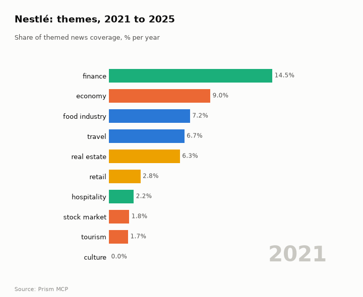
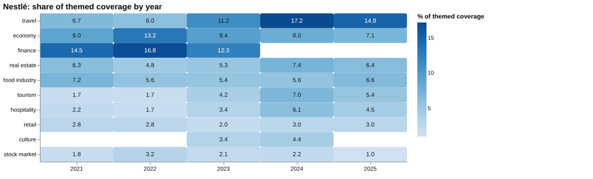
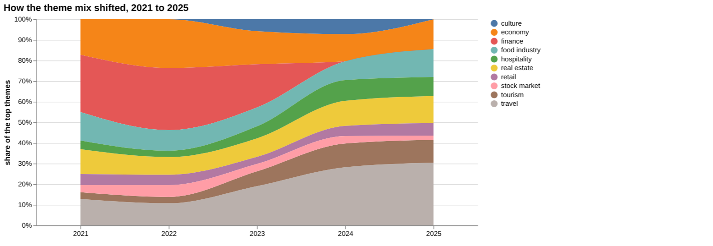
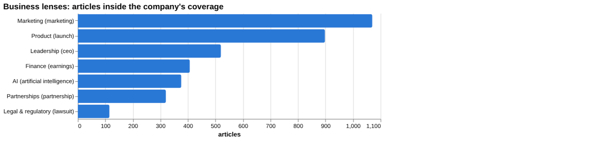
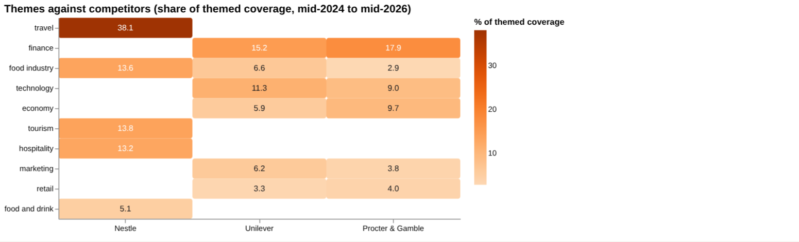
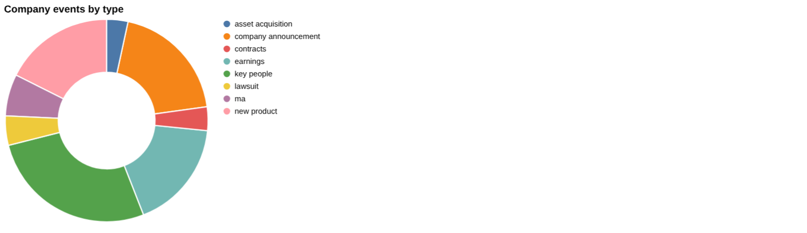
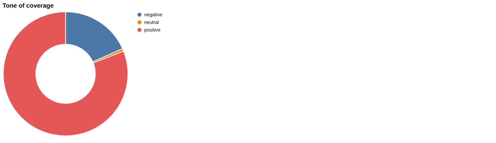
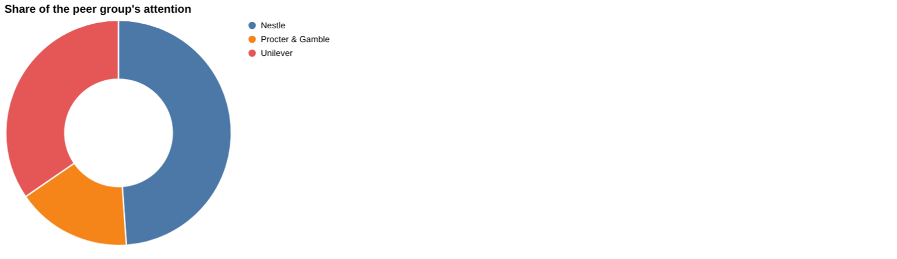
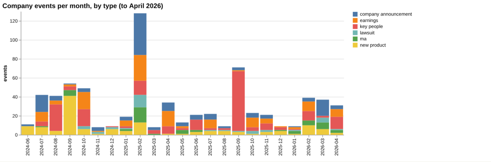

# Nestlé: intelligence report

*Switzerland · SIX: NESN · Food and beverages* · built from **22 Prism MCP calls** · **[Open the interactive report](https://fliarbi.com/demo/docs/prism-dashboards-3bb43e4c/investors/nestle/)** (tabs: Summary · Themes over 5 years · Business lenses · Versus peers · Mix · Events · Risks & catalysts · Coverage & tone · Areas & people · Month by month · Built with MCP)

> **Partial index.** Built while part of the news index was offline: counts and shares here are lower bounds (floors), and will be rebuilt in full when the index is complete.

Nestlé (SIX: NESN, food and beverages) generated 32,708 articles between 2024-06 and 2026-05, of which 8,197 sit in the top priority bands. Attention over the latest three months was 3,066 articles against 3,395 in the prior three months, a ratio of 0.9. The story changed sharply from mid-2025: a CEO removal in September 2025, a 16,000-job layoff announced in October, and an infant-formula recall in January 2026 that drew in safety and supply-chain scrutiny. A KitKat theft and another CEO departure followed in March 2026, and in May a toxin was traced to a Chinese ingredient supplier. Against this, the company reported solid Q1 sales and a profit surprise in April, and it is launching products such as a pistachio Aero bar. The record therefore combines governance and product-safety pressure with operating and product activity.

## Signals

Attention eased, with 3,066 articles in the last three months against 3,395 in the previous three. The negative-to-positive ratio was 0.25 in the last three months, 0.29 in the previous three and 0.23 across the whole window, compared with 0.58 for all news. Catalyst events rose to 66 in the last six months from 26 in the prior six, while risk events were 17 against 16.

| Signal | Measured | Direction |
| --- | --- | --- |
| Attention | 3,066 articles in the last 3 months vs 3,395 before (0.9×) | steady |
| Tone | 0.25 negative per positive, vs 0.29 before (all news 0.58) | less negative |
| Risk events (lawsuits, regulatory, layoffs) | 17 in the last 6 months vs 16 before | steady |
| Catalyst events (products, contracts, M&A) | 66 in the last 6 months vs 26 before | rising |
| Risk section: recall | 1.36% of coverage, last third vs first 26.0× | rising |
| Risk section: ceo | 1.59% of coverage, last third vs first 0.94× | steady |
| Catalyst section: acquisition | 1.05% of coverage, last third vs first 0.61× | falling |
| Catalyst section: coffee | 2.51% of coverage, last third vs first 0.59× | falling |
| Attention rank among peers | #1 of 3 |  |

**What to watch:**

- Whether recall and cereulide coverage keeps growing or fades
- Progress of the leadership succession and any further senior changes
- Whether attention keeps easing from 3,066 articles
- Outcome of the lawsuits and regulatory actions
- Delivery on new products such as the Aero pistachio bar
- Next earnings after the solid Q1 sales

## Themes over five years

Travel rose from 6.7% in 2021 to 14.9% in 2025, and tourism from 1.7% to 5.4%. Hospitality moved from 2.2% to 4.5%, while economy slipped from 9.0% to 7.1% and food industry from 7.2% to 6.6%. Real estate was close to flat, at 6.3% in 2021 and 6.4% in 2025, retail went from 2.8% to 3.0%, and stock market from 1.8% to 1.0%. Finance stood at 14.5% in 2021 but is not among the listed themes for 2025.

| Theme | 2021 | 2022 | 2023 | 2024 | 2025 |
| --- | ---: | ---: | ---: | ---: | ---: |
| travel | 6.7% | 6.0% | 11.2% | 17.2% | 14.9% |
| economy | 9.0% | 13.2% | 9.4% | 8.0% | 7.1% |
| finance | 14.5% | 16.8% | 12.3% | – | – |
| real estate | 6.3% | 4.8% | 5.3% | 7.4% | 6.4% |
| food industry | 7.2% | 5.6% | 5.4% | 5.6% | 6.6% |
| tourism | 1.7% | 1.7% | 4.2% | 7.0% | 5.4% |
| hospitality | 2.2% | 1.7% | 3.4% | 6.1% | 4.5% |
| retail | 2.8% | 2.8% | 2.0% | 3.0% | 3.0% |
| culture | – | – | 3.4% | 4.4% | – |
| stock market | 1.8% | 3.2% | 2.1% | 2.2% | 1.0% |

## Business lenses

Marketing (1,070 articles, 3.27%) and Product (898, 2.75%) carry the most volume among the lenses, with low negative-to-positive ratios of 0.09 and 0.11, though both are lower late in the window than early (0.35 and 0.46). Legal and regulatory is small at 115 articles (0.35%) but extremely negative, with a ratio of 37.33, while Leadership (520 articles, 0.94 late versus early) and Finance (407, 0.8) have held up better. AI is the only lens at about its early level, at 1.01, with 376 articles; Partnerships has 320 articles at 0.59.

| Lens | Articles | Share of coverage | Last third vs first | Negative per positive | Top tags inside |
| --- | ---: | ---: | ---: | ---: | --- |
| Product (*launch*) | 898 | 2.75% | 0.46× | 0.11 | nestle, india, uk, retail |
| Finance (*earnings*) | 407 | 1.24% | 0.8× | 0.41 | nestle, india, investment, financial performance |
| Marketing (*marketing*) | 1,070 | 3.27% | 0.35× | 0.09 | nestle, marketing, digital marketing, seo |
| Legal & regulatory (*lawsuit*) | 115 | 0.35% | 0.87× | 37.33 | nestle, lawsuit, coca-cola, pepsico |
| Leadership (*ceo*) | 520 | 1.59% | 0.94× | 0.53 | nestle, ceo, laurent freixe, philipp navratil |
| Partnerships (*partnership*) | 320 | 0.98% | 0.59× | 0.07 | nestle, partnership, india, sustainability |
| AI (*artificial intelligence*) | 376 | 1.15% | 1.01× | 0.22 | artificial intelligence, nestle, ai, technology |

## Versus peers

Nestlé holds 48.9% of the combined coverage of the peer group, ahead of Unilever at 34.6% and Procter & Gamble at 16.5%, though its attention is falling (0.72) while Unilever is flat (1.09) and Procter & Gamble is rising (1.35). Its themes lean heavily to travel at 38.1%, with tourism at 13.8%, food industry at 13.6% and hospitality at 13.2%. Unilever and Procter & Gamble instead show finance (15.2% and 17.9%) and technology (11.3% and 9.0%), and Procter & Gamble's negative-to-positive ratio of 0.34 is above the 0.23 shown for both Nestlé and Unilever.

| Theme | Nestle | Unilever | Procter & Gamble |
| --- | ---: | ---: | ---: |
| travel | 38.1% | – | – |
| finance | – | 15.2% | 17.9% |
| food industry | 13.6% | 6.6% | 2.9% |
| technology | – | 11.3% | 9.0% |
| economy | – | 5.9% | 9.7% |
| tourism | 13.8% | – | – |
| hospitality | 13.2% | – | – |
| marketing | – | 6.2% | 3.8% |
| retail | – | 3.3% | 4.0% |
| food and drink | 5.1% | – | – |

## Mix

Catalyst events (66) outnumbered risk events (17) in the last six months, alongside 26 earnings events and 36 key-people events. Tone is mostly positive, with 0.23 negative stories per positive across the window, though the recall section stands out at 11.93.

| | | |
| --- | --- | --- |
|  |  |  |

## Company events

Recent events include a leadership succession in which a new executive replaces Bernie Stefan, who moves to a global role within the group. The company also announced an integrated operating base in TEDA, the new Aero pistachio sharing bar, and solid Q1 sales across nearly all sectors. A founders' share buy-back from Nestlé was reported, and a dismissed X advertiser-boycott lawsuit appeared in the legal feed.

## Risks

Risk coverage centres on lawsuits, regulatory matters and layoffs, with the recall section at 518 articles (1.36% of company coverage) and a negative-to-positive ratio of 11.93. The recall section's last-third-versus-first figure is 26.0, so this theme has grown markedly, and the CEO section (520 articles, ratio 0.53) shows continuing leadership attention.

## Catalysts

Catalyst types include new products, contracts, M&A, asset acquisitions, job creation and FDA approval. Coffee (886 articles, 2.51%) and acquisition (343 articles, 1.05%) are the catalyst sections, but both are lower later in the window, at 0.59 and 0.61 of their early levels.

## Areas of activity and people

Activity is led by candy and sweets within food and drink, followed by several travel categories: hotels and accommodation, travel guides, luxury travel and tourist destinations including beaches and islands. The travel entries reflect how coverage is tagged and sit apart from Nestlé's core food business.

## The year, month by month

In September 2025 the CEO Laurent Freixe was ousted after a whistleblower report and shareholders called for the chairman's resignation, followed by the 16,000-job layoff in October. The January 2026 infant-formula recall over possible cereulide toxin brought a public apology and wider safety concerns, and March 2026 added the KitKat theft and a CEO departure. In May 2026 the toxin detection at a Chinese supplier renewed scrutiny of the supply chain.

## Built with MCP

Every number and chart above comes from these 22 Prism MCP tool calls, made over MCP (streamable HTTP) as an assistant would make them. The full list with arguments and timings is in [mcp_calls.json](mcp_calls.json); the responses are in [data.json](data.json).

| MCP tool | Calls | What it gave this report |
| --- | ---: | --- |
| `prism_overview` | 1 | coverage, tone, themes, places and people |
| `news_activities` | 1 | areas of activity and company events by month |
| `news_themes` | 7 | themes per year, and each peer's themes |
| `news_drill` | 11 | business lenses, risk and catalyst sections |
| `compare_terms` | 1 | peers on one scale |
| `deep_timeline` | 1 | the month-by-month reading |

> Decision inputs, not investment advice. News attention, tone and event counts describe what is being reported; they are not price forecasts and do not account for valuation, fundamentals or your circumstances.

