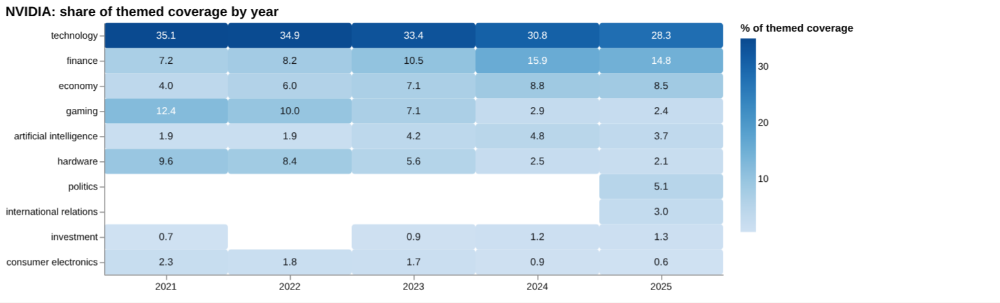
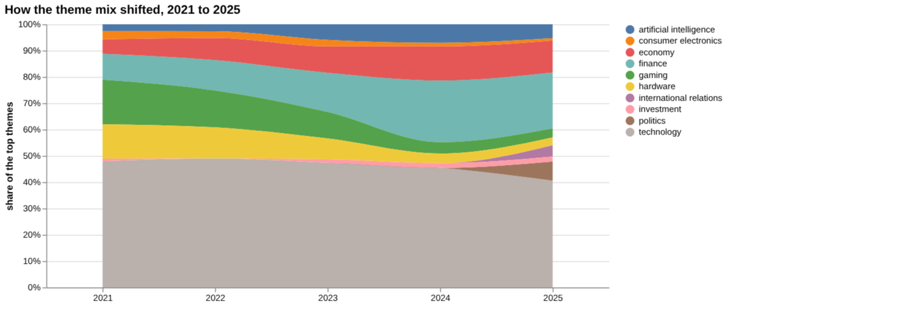
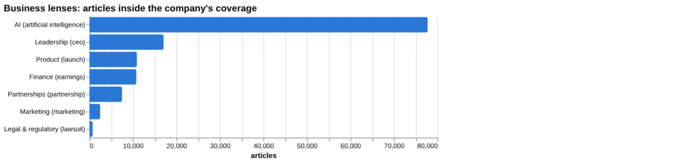
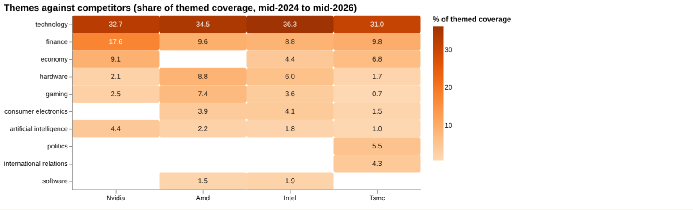
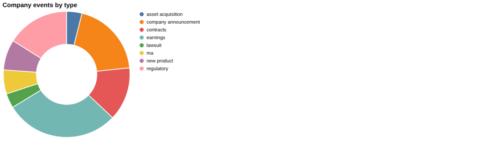
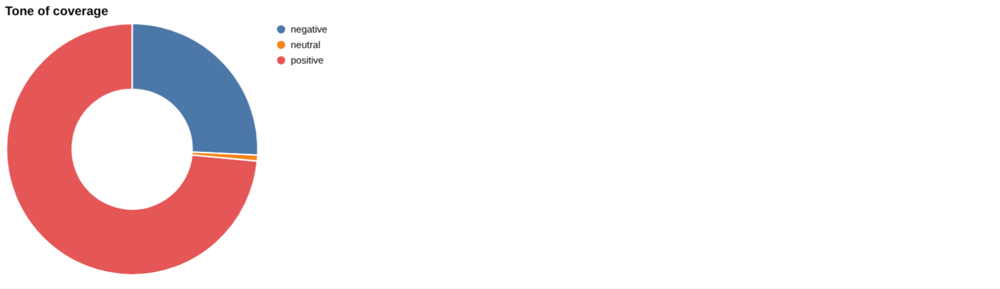
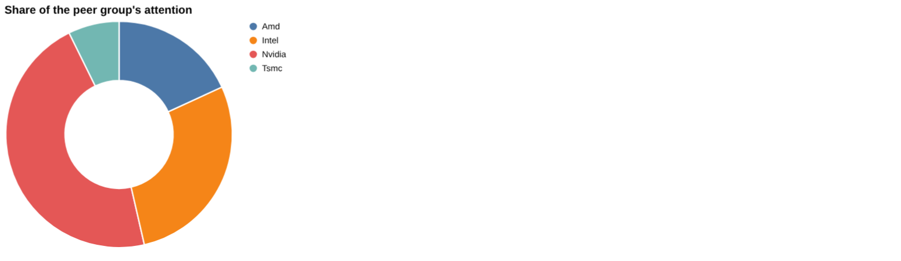
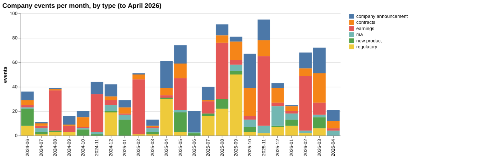

# NVIDIA: intelligence report

*United States · NASDAQ: NVDA · Semiconductors* · built from **23 Prism MCP calls** · **[Open the interactive report](https://fliarbi.com/demo/docs/prism-dashboards-3bb43e4c/investors/nvidia/)** (tabs: Summary · Themes over 5 years · Business lenses · Versus peers · Mix · Events · Risks & catalysts · Coverage & tone · Areas & people · Month by month · Built with MCP)

> **Partial index.** Built while part of the news index was offline: counts and shares here are lower bounds (floors), and will be rebuilt in full when the index is complete.

NVIDIA drew 215,943 articles across the window from 2024-06 to 2026-05, of which 152,441 were high-priority stories. It ranks first among the four companies compared for attention, with 46.3% of peer coverage. Coverage is dominated by technology and finance themes, with AI the largest business lens at 36.0% of articles. The recent record is one of record revenue, an $80 billion buyback, and new partnerships, set against export-licence constraints and China-related coverage. Competition from new wafer-scale AI chip makers such as the model appears in the latest turning points. The story has moved from a gaming and hardware identity towards finance, economy and geopolitics.

## Signals

Attention in the last three months was 37,646 articles against 35,387 in the previous three, a ratio of 1.06. Negative-to-positive tone was 0.32 in the last three months and 0.31 in the previous three, below the 0.35 for the whole window and the 0.58 for all news. Risk events fell to 26 in the last six months from 105 in the previous six, while catalyst events were 129 against 132.

| Signal | Measured | Direction |
| --- | --- | --- |
| Attention | 37,646 articles in the last 3 months vs 35,387 before (1.06×) | steady |
| Tone | 0.32 negative per positive, vs 0.31 before (all news 0.58) | steady |
| Risk events (lawsuits, regulatory, layoffs) | 26 in the last 6 months vs 105 before | falling |
| Catalyst events (products, contracts, M&A) | 129 in the last 6 months vs 132 before | steady |
| Risk section: export controls | 0.77% of coverage, last third vs first 2.2× | rising |
| Risk section: china | 23.7% of coverage, last third vs first 1.81× | rising |
| Catalyst section: data center | 5.44% of coverage, last third vs first 3.03× | rising |
| Catalyst section: blackwell | 6.9% of coverage, last third vs first 1.39× | rising |
| Attention rank among peers | #1 of 4 |  |

**What to watch:**

- Whether China coverage and export-control stories keep rising, given H200 shipment approvals
- Risk event count against the 26 in the latest six months
- Delivery on the $80 billion buyback and dividend
- Competition from wafer-scale entrants such as the model
- Progress of the OpenAI and Intel collaborations
- Whether finance and politics themes keep gaining share against technology

## Themes over five years

Technology fell from 35.1% in 2021 to 28.3% in 2025, and gaming fell from 12.4% in 2021 to 2.4% in 2025. Hardware fell from 9.6% in 2021 to 2.1% in 2025, and consumer electronics from 2.3% to 0.6%. Finance rose from 7.2% in 2021 to 14.8% in 2025, economy from 4.0% to 8.5%, and artificial intelligence from 1.9% to 3.7%. Investment moved from 0.7% to 1.3%, while politics (5.1%) and international relations (3.0%) appear in the 2025 mix.

| Theme | 2021 | 2022 | 2023 | 2024 | 2025 |
| --- | ---: | ---: | ---: | ---: | ---: |
| technology | 35.1% | 34.9% | 33.4% | 30.8% | 28.3% |
| finance | 7.2% | 8.2% | 10.5% | 15.9% | 14.8% |
| economy | 4.0% | 6.0% | 7.1% | 8.8% | 8.5% |
| gaming | 12.4% | 10.0% | 7.1% | 2.9% | 2.4% |
| artificial intelligence | 1.9% | 1.9% | 4.2% | 4.8% | 3.7% |
| hardware | 9.6% | 8.4% | 5.6% | 2.5% | 2.1% |
| politics | – | – | – | – | 5.1% |
| international relations | – | – | – | – | 3.0% |
| investment | 0.7% | – | 0.9% | 1.2% | 1.3% |
| consumer electronics | 2.3% | 1.8% | 1.7% | 0.9% | 0.6% |

## Business lenses

AI is the biggest lens at 77,746 articles (36.0%), followed by Leadership at 17,052 (7.9%) and Product at 10,923 (5.06%). Partnerships has the lowest negative-to-positive ratio at 0.05 and the highest late-versus-early ratio at 2.67 among those listed lenses with a ratio above 2, alongside Finance at 2.17 and Leadership at 2.01. Legal & regulatory is small at 744 articles (0.34%) but carries a negative-to-positive ratio of 7.53, and its late-versus-early ratio of 0.69 is the only one below 1.

| Lens | Articles | Share of coverage | Last third vs first | Negative per positive | Top tags inside |
| --- | ---: | ---: | ---: | ---: | --- |
| Product (*launch*) | 10,923 | 5.06% | 1.37× | 0.16 | nvidia, ai, technology, artificial intelligence |
| Finance (*earnings*) | 10,778 | 4.99% | 2.17× | 0.39 | nvidia, ai, investment, stock market |
| Marketing (*marketing*) | 2,456 | 1.14% | 1.7× | 0.17 | nvidia, ai, marketing, technology |
| Legal & regulatory (*lawsuit*) | 744 | 0.34% | 0.69× | 7.53 | nvidia, ai, lawsuit, u.s. |
| Leadership (*ceo*) | 17,052 | 7.9% | 2.01× | 0.29 | nvidia, ai, technology, artificial intelligence |
| Partnerships (*partnership*) | 7,489 | 3.47% | 2.67× | 0.05 | nvidia, ai, technology, artificial intelligence |
| AI (*artificial intelligence*) | 77,746 | 36.0% | 1.78× | 0.29 | artificial intelligence, nvidia, ai, technology |

## Versus peers

NVIDIA's attention (215,943 articles, 46.3%) is ahead of Intel (131,876, 28.3%), AMD (84,590, 18.1%) and TSMC (33,965, 7.3%). Its growth of 1.83 is rising, against 1.43 for AMD, 1.32 for TSMC and a flat 1.04 for Intel. NVIDIA has a heavier finance share (17.6%) and economy share (9.1%) than the peers, and a lower hardware share (2.1%) than AMD (8.8%) or Intel (6.0%); TSMC is the other company with politics (5.5%) and international relations (4.3%) themes.

| Theme | Nvidia | Amd | Intel | Tsmc |
| --- | ---: | ---: | ---: | ---: |
| technology | 32.7% | 34.5% | 36.3% | 31.0% |
| finance | 17.6% | 9.6% | 8.8% | 9.8% |
| economy | 9.1% | – | 4.4% | 6.8% |
| hardware | 2.1% | 8.8% | 6.0% | 1.7% |
| gaming | 2.5% | 7.4% | 3.6% | 0.7% |
| consumer electronics | – | 3.9% | 4.1% | 1.5% |
| artificial intelligence | 4.4% | 2.2% | 1.8% | 1.0% |
| politics | – | – | – | 5.5% |
| international relations | – | – | – | 4.3% |
| software | – | 1.5% | 1.9% | – |

## Mix

Of the 215,943 articles, 152,441 are high-priority stories, and tone is more favourable than all news, at 0.35 negative per positive against 0.58. Events in the last six months were led by catalysts (129) and earnings (119), with 26 risk events and 14 key-people events.

| | | |
| --- | --- | --- |
|  |  |  |

## Company events

The latest earnings item cites $120 billion in net income on $216 billion in revenue for the fiscal year. A 31 March partnership with Marvell links it to NVIDIA's AI factory and AI-RAN ecosystem through NVLink Fusion. Regulatory coverage notes US approval to ship only a small number of H200 accelerators to China, and contracts coverage cites agreements with the US Defense Department.

## Risks

China is the largest risk section at 55,114 articles (23.7% of company coverage), with a negative-to-positive ratio of 0.86 and a late-versus-first ratio of 1.81. Export controls are smaller at 1,789 articles (0.77%) but more negative at 2.65, with a late-versus-first ratio of 2.2.

## Catalysts

Blackwell has 16,032 articles (6.9%) with a negative-to-positive ratio of 0.24 and a late-versus-first ratio of 1.39. Data center has 12,652 articles (5.44%), a ratio of 0.14 and a late-versus-first ratio of 3.03.

## Areas of activity and people

Activity centres on Computers & Electronics, particularly computer components, followed by machine learning and artificial intelligence. Further areas include hardware modding and tuning, desktop computers, distributed and cloud computing, and laptops.

## The year, month by month

June 2025 brought a record market value and AI partnerships in drug discovery and supercomputing, and July a made-for-China chip. September added the Intel collaboration and an OpenAI partnership for at least 10 GW of data centres. In 2026, February brought an 85% jump in quarterly revenue with an $80 billion buyback, March the Groq 3 LPU, and May Nokia 5G chip supply alongside the model competition.

## Built with MCP

Every number and chart above comes from these 23 Prism MCP tool calls, made over MCP (streamable HTTP) as an assistant would make them. The full list with arguments and timings is in [mcp_calls.json](mcp_calls.json); the responses are in [data.json](data.json).

| MCP tool | Calls | What it gave this report |
| --- | ---: | --- |
| `prism_overview` | 1 | coverage, tone, themes, places and people |
| `news_activities` | 1 | areas of activity and company events by month |
| `news_themes` | 8 | themes per year, and each peer's themes |
| `news_drill` | 11 | business lenses, risk and catalyst sections |
| `compare_terms` | 1 | peers on one scale |
| `deep_timeline` | 1 | the month-by-month reading |

> Decision inputs, not investment advice. News attention, tone and event counts describe what is being reported; they are not price forecasts and do not account for valuation, fundamentals or your circumstances.

