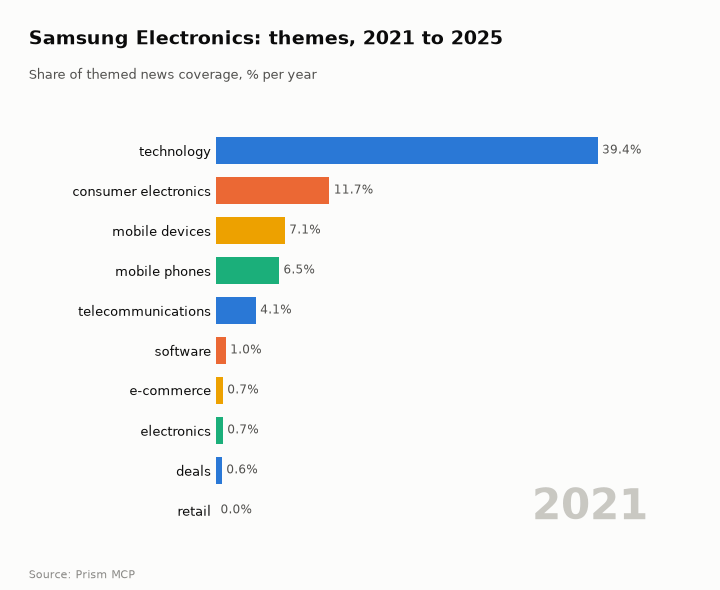
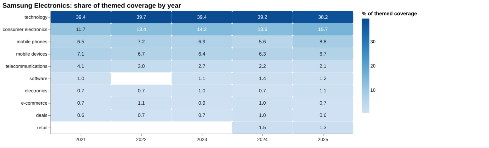
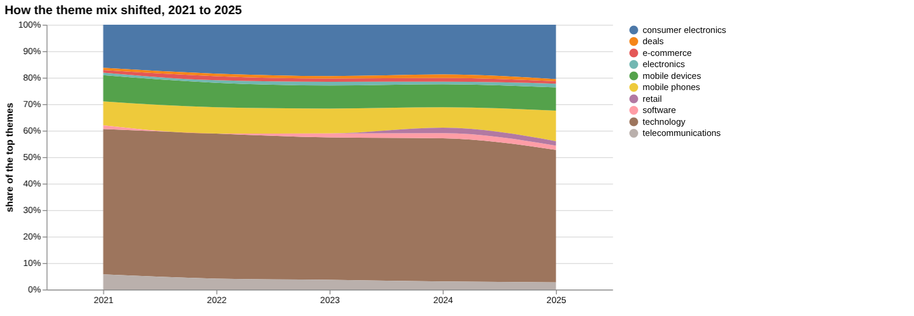
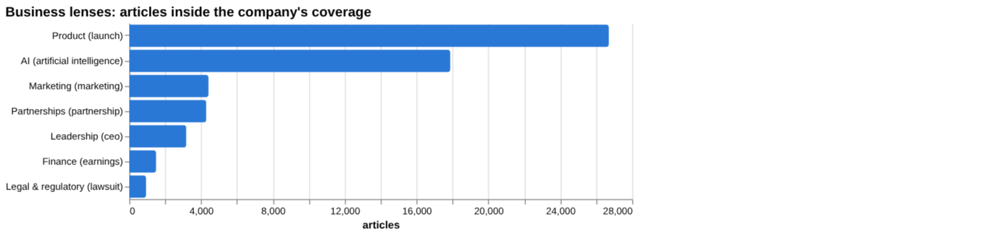
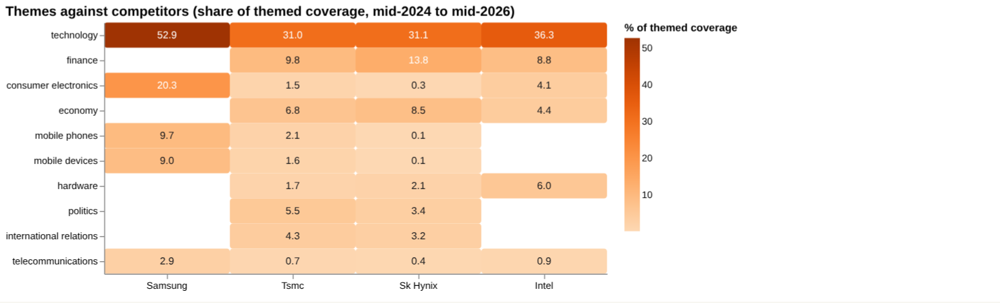
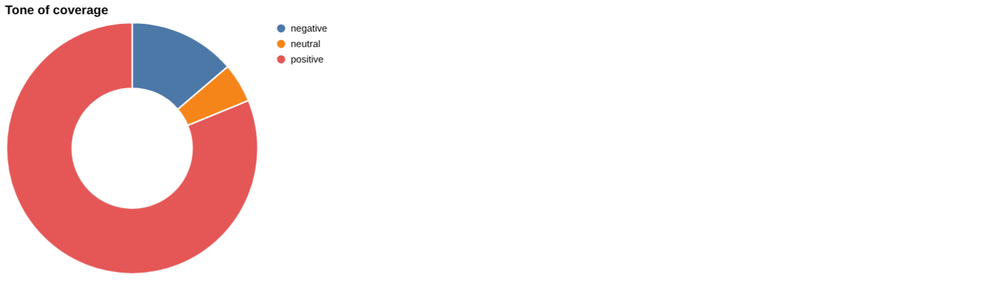
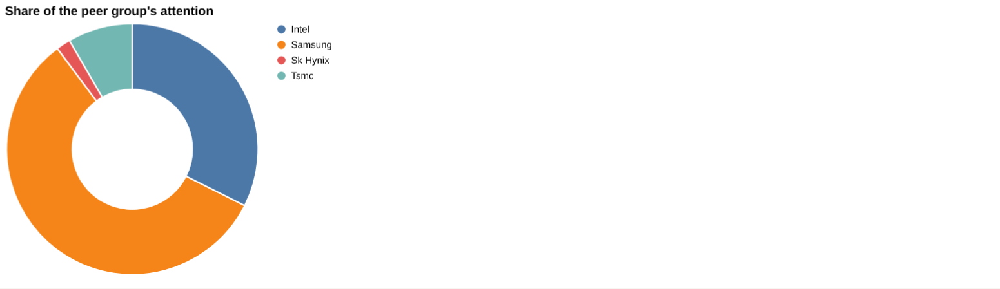

# Samsung Electronics: intelligence report

*South Korea · KRX: 005930 · Electronics and memory* · built from **23 Prism MCP calls** · **[Open the interactive report](https://fliarbi.com/demo/docs/prism-dashboards-3bb43e4c/investors/samsung/)** (tabs: Summary · Themes over 5 years · Business lenses · Versus peers · Mix · Risks & catalysts · Coverage & tone · Areas & people · Month by month · Built with MCP)

> **Partial index.** Built while part of the news index was offline: counts and shares here are lower bounds (floors), and will be rebuilt in full when the index is complete.

Samsung Electronics (KRX: 005930) has 215,715 articles in the window from 2024-06 to 2026-05, of which 52,064 are high-priority stories. Attention in the last three months was 31,179 articles against 26,055 in the previous three, a ratio of 1.2. Coverage is dominated by technology and consumer electronics themes, and the Galaxy section alone accounts for 29.61% of company coverage. The story moved through a multi-front legal and competitive squeeze in mid-2025, US tariff and policy pressure in August, and then a pivot towards AI partnerships and smart-home products. The latest turning points are supply-chain strain and chip-design competition from ARM in March 2026. Tone is mostly favourable relative to all news, though the recent ratio of negative to positive stories has edged up.

## Signals

Attention is rising, with a ratio of 1.2 between the last three months and the previous three. Negative stories per positive story were 0.22 in the last three months, against 0.17 in the previous three and 0.17 across the whole window, while all news sits at 0.58. Tone and attention describe coverage only and are not price signals.

| Signal | Measured | Direction |
| --- | --- | --- |
| Attention | 31,179 articles in the last 3 months vs 26,055 before (1.2×) | rising |
| Tone | 0.22 negative per positive, vs 0.17 before (all news 0.58) | more negative |
| Risk section: strike | 0.62% of coverage, last third vs first 0.94× | steady |
| Risk section: tariff | 0.96% of coverage, last third vs first 1.53× | rising |
| Catalyst section: hbm | 1.82% of coverage, last third vs first 2.11× | rising |
| Catalyst section: galaxy | 29.61% of coverage, last third vs first 0.92× | steady |
| Attention rank among peers | #1 of 4 |  |

**What to watch:**

- Whether the ratio of 1.2 in attention is sustained or fades
- Whether negative per positive stories keep rising from 0.22
- HBM coverage growth and its tone
- Tariff and US policy developments affecting semiconductors
- Legal and regulatory stories, given their heavily negative tone
- Progress of AI partnerships, including the Nvidia megafactory

## Themes over five years

Technology was broadly steady, moving from 39.4% in 2021 to 38.2% in 2025. Consumer electronics rose from 11.7% in 2021 to 15.7% in 2025, and mobile phones from 6.5% to 8.8%, while mobile devices eased from 7.1% to 6.7% and telecommunications fell from 4.1% to 2.1%. Smaller themes were mixed: software went from 1.0% to 1.2%, electronics from 0.7% to 1.1%, and e-commerce and deals stayed at 0.7% and 0.6%. Retail does not appear in 2021 and is shown at 1.3% in 2025.

| Theme | 2021 | 2022 | 2023 | 2024 | 2025 |
| --- | ---: | ---: | ---: | ---: | ---: |
| technology | 39.4% | 39.7% | 39.4% | 39.2% | 38.2% |
| consumer electronics | 11.7% | 13.4% | 14.2% | 13.6% | 15.7% |
| mobile phones | 6.5% | 7.2% | 6.9% | 5.6% | 8.8% |
| mobile devices | 7.1% | 6.7% | 6.4% | 6.3% | 6.7% |
| telecommunications | 4.1% | 3.0% | 2.7% | 2.2% | 2.1% |
| software | 1.0% | – | 1.1% | 1.4% | 1.2% |
| electronics | 0.7% | 0.7% | 1.0% | 0.7% | 1.1% |
| e-commerce | 0.7% | 1.1% | 0.9% | 1.0% | 0.7% |
| deals | 0.6% | 0.7% | 0.7% | 1.0% | 0.6% |
| retail | – | – | – | 1.5% | 1.3% |

## Business lenses

Product coverage stands at 26,703 articles (11.43%) with a very low negative-to-positive ratio of 0.07, and AI follows with 17,873 articles (7.65%) and a late-versus-early ratio of 1.21. Finance is small at 1,498 articles (0.64%) but has a late-versus-early ratio of 2.15, and leadership (1.32) and partnerships (1.26) also grew in the later period. Legal and regulatory is the smallest lens at 937 articles (0.4%) yet carries a negative-to-positive ratio of 17.66, with lawsuit, Apple and Google among its top tags.

| Lens | Articles | Share of coverage | Last third vs first | Negative per positive | Top tags inside |
| --- | ---: | ---: | ---: | ---: | --- |
| Product (*launch*) | 26,703 | 11.43% | 0.98× | 0.07 | samsung, technology, mobile technology, ai |
| Finance (*earnings*) | 1,498 | 0.64% | 2.15× | 0.28 | samsung, ai, technology, china |
| Marketing (*marketing*) | 4,412 | 1.89% | 1.09× | 0.13 | samsung, marketing, technology, apple |
| Legal & regulatory (*lawsuit*) | 937 | 0.4% | 1.22× | 17.66 | samsung, lawsuit, apple, google |
| Leadership (*ceo*) | 3,177 | 1.36% | 1.32× | 0.28 | samsung, ai, technology, apple |
| Partnerships (*partnership*) | 4,291 | 1.84% | 1.26× | 0.04 | samsung, partnership, technology, ai |
| AI (*artificial intelligence*) | 17,873 | 7.65% | 1.21× | 0.16 | artificial intelligence, samsung, ai, technology |

## Versus peers

Samsung's themed coverage is concentrated in technology at 52.9% and consumer electronics at 20.3%, against 31.0% and 1.5% for TSMC and 31.1% and 0.3% for SK Hynix. Peers carry finance, economy and politics themes (for example SK Hynix with finance at 13.8% and economy at 8.5%) that are not shown for Samsung. On attention, Samsung ranks first with 233,607 articles (57.4%) and flat growth of 1.06, ahead of Intel at 131,876 (32.4%), TSMC at 33,965 (8.3%, rising) and SK Hynix at 7,437 (1.8%), whose growth of 2.78 is rising.

| Theme | Samsung | Tsmc | Sk Hynix | Intel |
| --- | ---: | ---: | ---: | ---: |
| technology | 52.9% | 31.0% | 31.1% | 36.3% |
| finance | – | 9.8% | 13.8% | 8.8% |
| consumer electronics | 20.3% | 1.5% | 0.3% | 4.1% |
| economy | – | 6.8% | 8.5% | 4.4% |
| mobile phones | 9.7% | 2.1% | 0.1% | – |
| mobile devices | 9.0% | 1.6% | 0.1% | – |
| hardware | – | 1.7% | 2.1% | 6.0% |
| politics | – | 5.5% | 3.4% | – |
| international relations | – | 4.3% | 3.2% | – |
| telecommunications | 2.9% | 0.7% | 0.4% | 0.9% |

## Mix

Product, AI and the Galaxy section form the bulk of coverage, with smaller finance, legal and leadership lenses. Tone is favourable overall at 0.17 negative per positive story, but risk sections such as strike (2.66) and tariff (2.15) run far more negative than the company average.

| | | |
| --- | --- | --- |
|  |  |  |

## Company events

No separate latest-event records are available, so the event picture rests on the turning points. These run from the June 2025 legal clash over smart-ring technology and the loss of a key foundry client, through the August 2025 US 100% tariff on imported semiconductors and talk of an Intel stake, to the October 2025 joint AI megafactory with Nvidia. November 2025 brought a projection that Apple would overtake Samsung as the global number one smartphone brand.

## Risks

Tariff coverage totals 2,250 articles (0.96% of company coverage) with a late-versus-first ratio of 1.53 and 2.15 negative per positive story, while strike coverage totals 1,457 articles (0.62%) at 2.66. Legal and regulatory stories are heavily negative, and the March 2026 turning point flagged supply-chain strain, ARM chip-design competition and security concerns.

## Catalysts

HBM coverage totals 4,254 articles (1.82%) with a late-versus-first ratio of 2.11 and 0.32 negative per positive story, suggesting growing and mostly constructive attention. The Galaxy section totals 69,182 articles (29.61%) at 0.08 negative per positive story, though its late-versus-first ratio of 0.92 shows no build-up.

## Areas of activity and people

No areas of activity are listed in the data. The organisations most often named are samsung, samsung electronics, mobile technology, lg, national security agency and smartthings, and the people are alexa, mark gurman, jim cramer, jensen huang, tim cook and samantha ruth prabhu.

## The year, month by month

After the mid-2025 legal, competitive and tariff pressures, Samsung's coverage turned to AI from September 2025, with an AI smart-home vision at IFA, the Nvidia megafactory in October and a move into AI eyewear. November 2025 introduced the Apple smartphone-lead projection, and later months brought regulatory scrutiny and supply-chain strain, with March 2026 the latest turning point and a quiet period noted in April.

## Built with MCP

Every number and chart above comes from these 23 Prism MCP tool calls, made over MCP (streamable HTTP) as an assistant would make them. The full list with arguments and timings is in [mcp_calls.json](mcp_calls.json); the responses are in [data.json](data.json).

| MCP tool | Calls | What it gave this report |
| --- | ---: | --- |
| `prism_overview` | 1 | coverage, tone, themes, places and people |
| `news_activities` | 1 | areas of activity and company events by month |
| `news_themes` | 8 | themes per year, and each peer's themes |
| `news_drill` | 11 | business lenses, risk and catalyst sections |
| `compare_terms` | 1 | peers on one scale |
| `deep_timeline` | 1 | the month-by-month reading |

> Decision inputs, not investment advice. News attention, tone and event counts describe what is being reported; they are not price forecasts and do not account for valuation, fundamentals or your circumstances.

