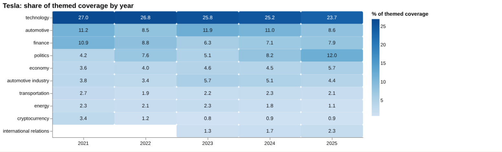
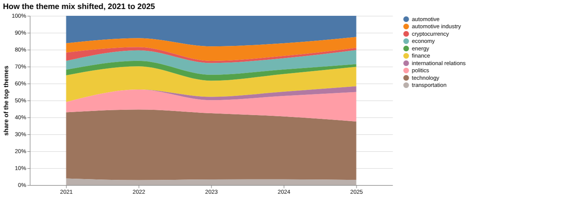
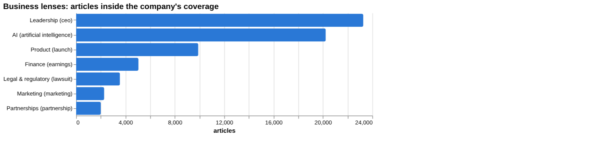
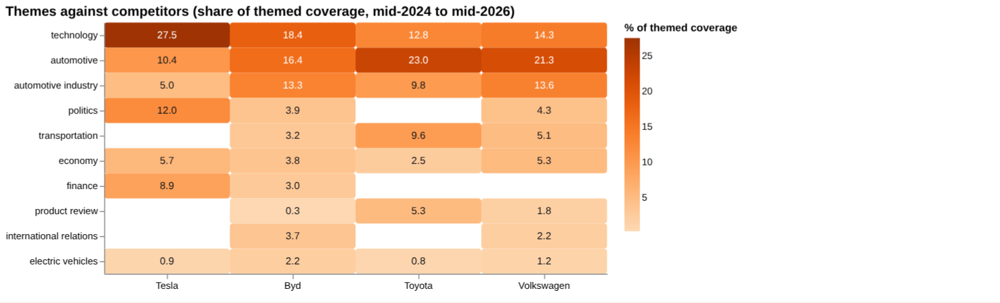
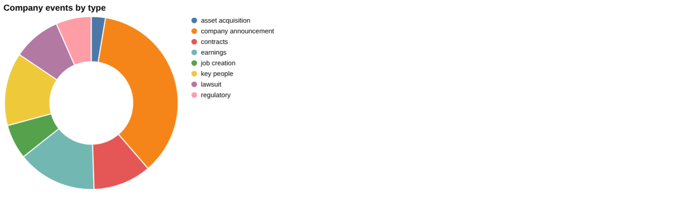
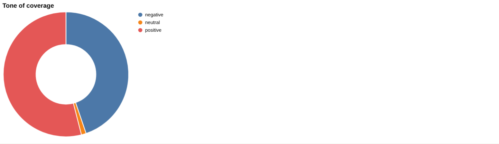
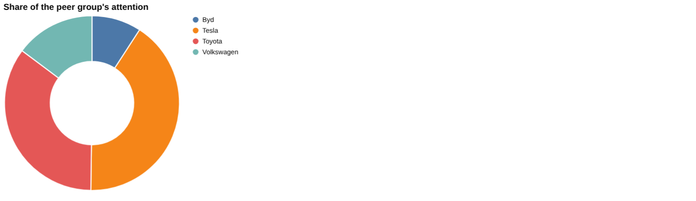
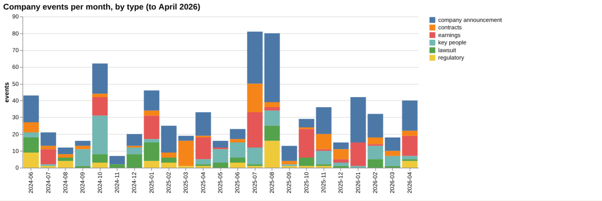

# Tesla: intelligence report

*United States · NASDAQ: TSLA · Automobiles* · built from **23 Prism MCP calls** · **[Open the interactive report](https://fliarbi.com/demo/docs/prism-dashboards-3bb43e4c/investors/tesla/)** (tabs: Summary · Themes over 5 years · Business lenses · Versus peers · Mix · Events · Risks & catalysts · Coverage & tone · Areas & people · Month by month · Built with MCP)

> **Partial index.** Built while part of the news index was offline: counts and shares here are lower bounds (floors), and will be rebuilt in full when the index is complete.

Tesla drew 200,387 articles in the window from 2024-06 to 2026-05, of which 127,895 were high-priority stories, and it ranks first for attention among the four companies compared with a 41.1% share. Attention over the last three months was 23,478 articles against 19,498 in the previous three, a ratio of 1.2. The story has moved from product growth towards political, legal and reputational themes, with politics rising and the technology theme easing. Robotaxi (7,776 articles) and Optimus (7,592 articles) are the two catalyst sections named in the data, while recall and sales decline are the two risk sections. Tone is more negative than the all-news level, with 0.83 negative stories per positive across the window against 0.58 for all news. Company announcements such as the Samsung AI chip deal and the Intel 14A manufacturing plan for Terafab sit alongside lawsuit and regulatory items in the latest events.

## Signals

Attention rose in the latest three months (ratio 1.2), and negative stories per positive were 0.65 against 0.56 in the previous three months. Risk events fell to 16 in the last six months from 44 in the previous six, while catalyst events rose to 62 from 42. Earnings events numbered 30 and key-people events 27 in the latest six-month period.

| Signal | Measured | Direction |
| --- | --- | --- |
| Attention | 23,478 articles in the last 3 months vs 19,498 before (1.2×) | rising |
| Tone | 0.65 negative per positive, vs 0.56 before (all news 0.58) | more negative |
| Risk events (lawsuits, regulatory, layoffs) | 16 in the last 6 months vs 44 before | falling |
| Catalyst events (products, contracts, M&A) | 62 in the last 6 months vs 42 before | rising |
| Risk section: recall | 0.78% of coverage, last third vs first 0.53× | falling |
| Risk section: sales decline | 0.12% of coverage, last third vs first 1.78× | rising |
| Catalyst section: robotaxi | 3.6% of coverage, last third vs first 1.08× | steady |
| Catalyst section: optimus | 3.52% of coverage, last third vs first 2.39× | rising |
| Attention rank among peers | #1 of 4 |  |

**What to watch:**

- Whether attention keeps rising after the 1.2 ratio in the latest three months
- Whether risk events stay at 16 or return towards the earlier 44
- Progress on Optimus and robotaxi coverage
- Delivery of the Samsung and Intel chip arrangements
- Developments in the shareholder lawsuit and Chinese driver-assistance rules
- Whether the politics theme keeps rising from its 12.0% share in 2025

## Themes over five years

Technology fell from 27.0% in 2021 to 23.7% in 2025, and automotive fell from 11.2% to 8.6%. Politics rose from 4.2% in 2021 to 12.0% in 2025, while economy rose from 3.6% to 5.7%. Finance moved from 10.9% to 7.9%, and cryptocurrency fell from 3.4% to 0.9%. Energy eased from 2.3% to 1.1%, and automotive industry moved from 3.8% to 4.4%.

| Theme | 2021 | 2022 | 2023 | 2024 | 2025 |
| --- | ---: | ---: | ---: | ---: | ---: |
| technology | 27.0% | 26.8% | 25.8% | 25.2% | 23.7% |
| automotive | 11.2% | 8.5% | 11.9% | 11.0% | 8.6% |
| finance | 10.9% | 8.8% | 6.3% | 7.1% | 7.9% |
| politics | 4.2% | 7.6% | 5.1% | 8.2% | 12.0% |
| economy | 3.6% | 4.0% | 4.6% | 4.5% | 5.7% |
| automotive industry | 3.8% | 3.4% | 5.7% | 5.1% | 4.4% |
| transportation | 2.7% | 1.9% | 2.2% | 2.3% | 2.1% |
| energy | 2.3% | 2.1% | 2.3% | 1.8% | 1.1% |
| cryptocurrency | 3.4% | 1.2% | 0.8% | 0.9% | 0.9% |
| international relations | – | – | 1.3% | 1.7% | 2.3% |

## Business lenses

Leadership was the largest lens by articles at 23,265 (11.61% share), followed by AI at 20,225 (10.09%) and Product at 9,897 (4.94%). AI showed the strongest late-versus-early ratio at 1.76 with a low negative-to-positive ratio of 0.34, whereas Legal & regulatory had 3,551 articles and a negative-to-positive ratio of 20.02. Partnerships (1,998 articles) and Marketing (2,272) were the smallest lenses, and both had late-versus-early ratios below 1 (0.71 and 0.77).

| Lens | Articles | Share of coverage | Last third vs first | Negative per positive | Top tags inside |
| --- | ---: | ---: | ---: | ---: | --- |
| Product (*launch*) | 9,897 | 4.94% | 1.03× | 0.31 | tesla, elon musk, automotive industry, ev |
| Finance (*earnings*) | 5,046 | 2.52% | 1.31× | 0.56 | tesla, elon musk, ai, investment |
| Marketing (*marketing*) | 2,272 | 1.13% | 0.77× | 0.56 | tesla, marketing, elon musk, technology |
| Legal & regulatory (*lawsuit*) | 3,551 | 1.77% | 1.27× | 20.02 | tesla, lawsuit, elon musk, musk |
| Leadership (*ceo*) | 23,265 | 11.61% | 0.85× | 0.82 | tesla, elon musk, musk, technology |
| Partnerships (*partnership*) | 1,998 | 1.0% | 0.71× | 0.18 | tesla, partnership, elon musk, technology |
| AI (*artificial intelligence*) | 20,225 | 10.09% | 1.76× | 0.34 | artificial intelligence, tesla, ai, elon musk |

## Versus peers

Tesla's coverage leans towards technology (27.5%) and politics (12.0%), whereas Toyota and Volkswagen are weighted towards automotive (23.0% and 21.3%) and BYD towards automotive industry (13.3%). Tesla's attention growth of 0.89 is labelled flat, while BYD (1.43) and Toyota (1.52) are rising and Volkswagen (1.2) is flat. Tesla's negative-to-positive ratio of 0.83 is higher than BYD (0.39), Toyota (0.42) and Volkswagen (0.6).

| Theme | Tesla | Byd | Toyota | Volkswagen |
| --- | ---: | ---: | ---: | ---: |
| technology | 27.5% | 18.4% | 12.8% | 14.3% |
| automotive | 10.4% | 16.4% | 23.0% | 21.3% |
| automotive industry | 5.0% | 13.3% | 9.8% | 13.6% |
| politics | 12.0% | 3.9% | – | 4.3% |
| transportation | – | 3.2% | 9.6% | 5.1% |
| economy | 5.7% | 3.8% | 2.5% | 5.3% |
| finance | 8.9% | 3.0% | – | – |
| product review | – | 0.3% | 5.3% | 1.8% |
| international relations | – | 3.7% | – | 2.2% |
| electric vehicles | 0.9% | 2.2% | 0.8% | 1.2% |

## Mix

Over the last six months catalyst events (62) outnumbered risk events (16), with earnings (30) and key-people (27) events also present. Tone remains more negative than all news, at 0.83 negative per positive against 0.58, and 127,895 of the 200,387 articles fall in the top priority bands.

| | | |
| --- | --- | --- |
|  |  |  |

## Company events

The latest company announcement is a multibillion-dollar deal with Samsung to manufacture AI chips for vehicles and robotics, and a contracts item cites plans to use Intel's 14A process at the Terafab project. The earnings item shows revenue (TTM) of $97.9 billion. Legal and regulatory items include a shareholder lawsuit and a Chinese requirement that SAE Level 2 systems carry the word "assisted" in their branding.

## Risks

Recall coverage totalled 1,687 articles with a negative-to-positive ratio of 6.98, though its last-third-versus-first ratio was 0.53. Sales decline coverage was smaller at 264 articles but had a ratio of 1.78 between the last and first thirds, and lawsuit, regulatory and layoff are the named risk event types.

## Catalysts

Optimus had a last-third-versus-first ratio of 2.39 and robotaxi 1.08, both with low negative-to-positive ratios (0.29 and 0.39). New product, contracts, M&A, asset acquisition, job creation and FDA approval are the named catalyst event types.

## Areas of activity and people

Activity centres on Tesla Motors, autonomous vehicles and hybrid and alternative vehicles, followed by the automotive industry and robotics. Organisations most often linked include Optimus, Neuralink, SpaceX, BYD and General Motors.

## The year, month by month

In mid-2025 the public feud between Elon Musk and Trump and China's export restrictions raised government-contract and supply-chain concerns. By October 2025 a stock rally sat alongside lawsuits alleging door-design flaws, and in November 2025 a new India head was appointed amid sales pressure. In February 2026 two fatal crashes and Musk's appearance in Epstein documents intensified safety scrutiny, and in April 2026 a murder investigation involving a Tesla kept the story on criminal controversy.

## Built with MCP

Every number and chart above comes from these 23 Prism MCP tool calls, made over MCP (streamable HTTP) as an assistant would make them. The full list with arguments and timings is in [mcp_calls.json](mcp_calls.json); the responses are in [data.json](data.json).

| MCP tool | Calls | What it gave this report |
| --- | ---: | --- |
| `prism_overview` | 1 | coverage, tone, themes, places and people |
| `news_activities` | 1 | areas of activity and company events by month |
| `news_themes` | 8 | themes per year, and each peer's themes |
| `news_drill` | 11 | business lenses, risk and catalyst sections |
| `compare_terms` | 1 | peers on one scale |
| `deep_timeline` | 1 | the month-by-month reading |

> Decision inputs, not investment advice. News attention, tone and event counts describe what is being reported; they are not price forecasts and do not account for valuation, fundamentals or your circumstances.

