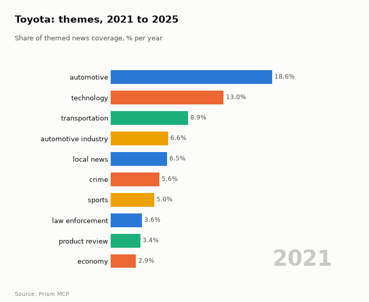
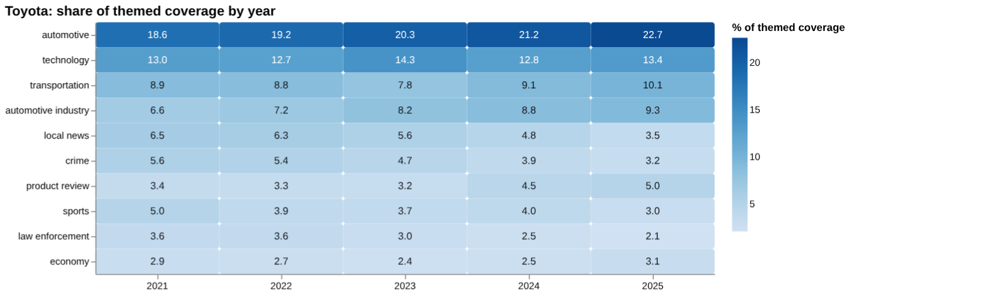
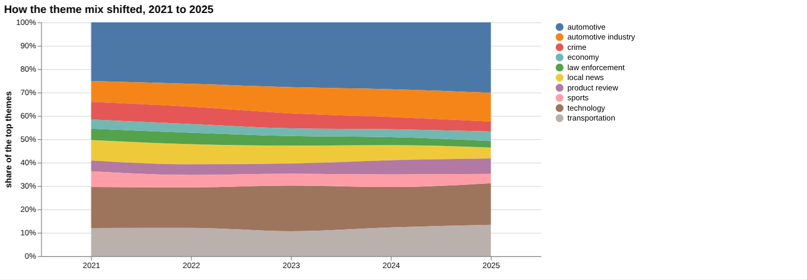
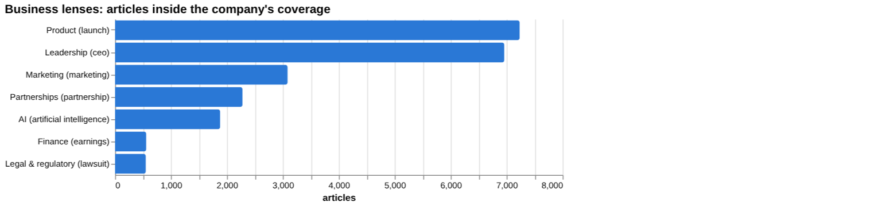
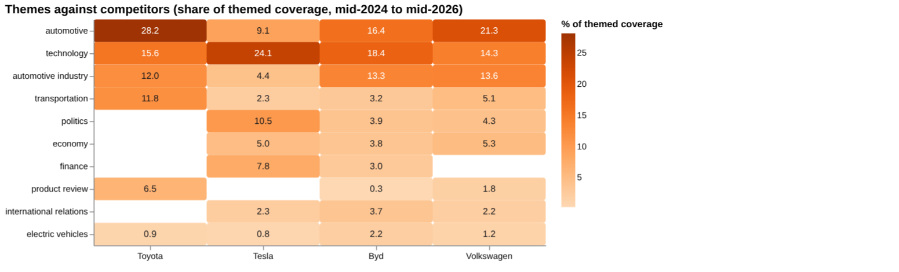
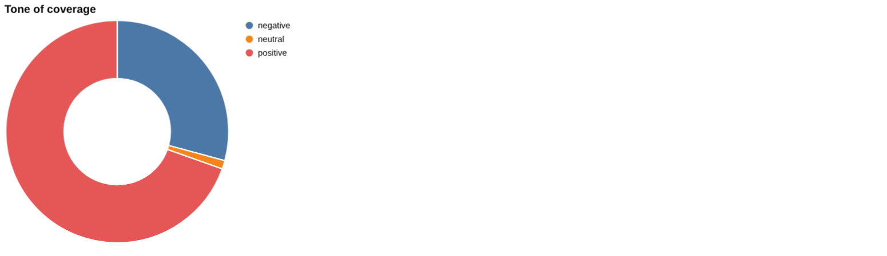
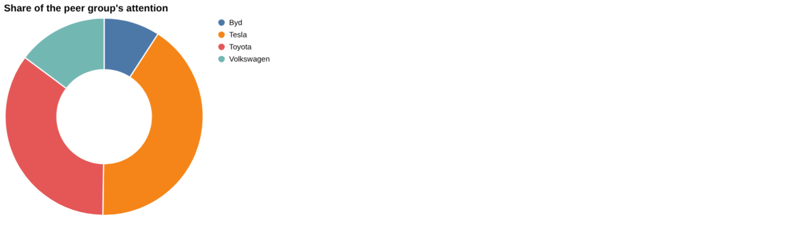

# Toyota: intelligence report

*Japan · TSE: 7203 · Automobiles* · built from **23 Prism MCP calls** · **[Open the interactive report](https://fliarbi.com/demo/docs/prism-dashboards-3bb43e4c/investors/toyota/)** (tabs: Summary · Themes over 5 years · Business lenses · Versus peers · Mix · Risks & catalysts · Coverage & tone · Areas & people · Month by month · Built with MCP)

> **Partial index.** Built while part of the news index was offline: counts and shares here are lower bounds (floors), and will be rebuilt in full when the index is complete.

Toyota generated 170,958 articles in the window from 2024-06 to 2026-05, of which 52,405 were high-priority stories, placing it second among its four-company peer set by attention. Coverage is dominated by automotive, technology, automotive industry and transportation themes. Attention in the last three months, at 33,959 articles, compares with 24,091 in the previous three months, a ratio of 1.41. Tone is comparatively mild: 0.42 negative articles per positive across the whole window, against 0.58 for all news. The story has moved from safety scrutiny in mid-2025 towards electric vehicle and autonomous service expansion in 2026. Recalls and tariffs carry the harshest tone, while hybrid and electric vehicle coverage is the most favourable.

## Signals

Attention rose, with 33,959 articles in March to May 2026 against 24,091 in December 2025 to February 2026. Tone was little changed, at 0.45 negative per positive in the last three months against 0.42 in the previous three. Tariff coverage in the last third of the window ran at 2.22 times the first third, the clearest build among the tracked sections.

| Signal | Measured | Direction |
| --- | --- | --- |
| Attention | 33,959 articles in the last 3 months vs 24,091 before (1.41×) | rising |
| Tone | 0.45 negative per positive, vs 0.42 before (all news 0.58) | steady |
| Risk section: recall | 0.89% of coverage, last third vs first 1.09× | steady |
| Risk section: tariff | 2.01% of coverage, last third vs first 2.22× | rising |
| Catalyst section: hybrid | 7.71% of coverage, last third vs first 1.05× | steady |
| Catalyst section: electric vehicle | 6.21% of coverage, last third vs first 0.99× | steady |
| Attention rank among peers | #2 of 4 |  |

**What to watch:**

- Whether tariff coverage keeps building after the 2.22 ratio
- Recall and legal coverage tone against the 0.42 company baseline
- Whether attention holds near 33,959 articles per quarter
- Hybrid and electric vehicle share of coverage
- Robotaxi and autonomous service developments
- Growth in finance-lens coverage

## Themes over five years

Automotive rose from 18.6% in 2021 to 22.7% in 2025, and technology moved from 13.0% to 13.4%. Transportation went from 8.9% to 10.1%, automotive industry from 6.6% to 9.3%, and product review from 3.4% to 5.0%. Local news fell from 6.5% to 3.5%, crime from 5.6% to 3.2%, sports from 5.0% to 3.0% and law enforcement from 3.6% to 2.1%. Economy moved from 2.9% to 3.1%.

| Theme | 2021 | 2022 | 2023 | 2024 | 2025 |
| --- | ---: | ---: | ---: | ---: | ---: |
| automotive | 18.6% | 19.2% | 20.3% | 21.2% | 22.7% |
| technology | 13.0% | 12.7% | 14.3% | 12.8% | 13.4% |
| transportation | 8.9% | 8.8% | 7.8% | 9.1% | 10.1% |
| automotive industry | 6.6% | 7.2% | 8.2% | 8.8% | 9.3% |
| local news | 6.5% | 6.3% | 5.6% | 4.8% | 3.5% |
| crime | 5.6% | 5.4% | 4.7% | 3.9% | 3.2% |
| product review | 3.4% | 3.3% | 3.2% | 4.5% | 5.0% |
| sports | 5.0% | 3.9% | 3.7% | 4.0% | 3.0% |
| law enforcement | 3.6% | 3.6% | 3.0% | 2.5% | 2.1% |
| economy | 2.9% | 2.7% | 2.4% | 2.5% | 3.1% |

## Business lenses

Product (7,233 articles, 4.23% share) and Leadership (6,959 articles, 4.07%) are the two largest lenses, and both carry very mild tone at 0.07 and 0.09 negative per positive. Finance is small at 559 articles but its late-versus-early ratio of 2.16 is the strongest build, while Marketing (0.42) and Partnerships (0.73) faded. Legal & regulatory is small at 551 articles yet has the harshest tone at 6.14 negative per positive, with AI at 1,880 articles and a ratio of 1.14.

| Lens | Articles | Share of coverage | Last third vs first | Negative per positive | Top tags inside |
| --- | ---: | ---: | ---: | ---: | --- |
| Product (*launch*) | 7,233 | 4.23% | 1.3× | 0.07 | toyota, automotive, india, automotive industry |
| Finance (*earnings*) | 559 | 0.33% | 2.16× | 0.52 | toyota, financial performance, u.s., japan |
| Marketing (*marketing*) | 3,085 | 1.8% | 0.42× | 0.61 | toyota, marketing, hyundai, volkswagen |
| Legal & regulatory (*lawsuit*) | 551 | 0.32% | 0.69× | 6.14 | toyota, lawsuit, tm, nyse |
| Leadership (*ceo*) | 6,959 | 4.07% | 1.01× | 0.09 | toyota, hans greimel, kenta kon, crain communications, inc. |
| Partnerships (*partnership*) | 2,279 | 1.33% | 0.73× | 0.05 | toyota, partnership, automotive industry, japan |
| AI (*artificial intelligence*) | 1,880 | 1.1% | 1.14× | 0.11 | artificial intelligence, toyota, ai, technology |

## Versus peers

Toyota's 35.0% share of peer attention trails Tesla at 41.1% (200,387 articles) but is ahead of Volkswagen at 14.8% and BYD at 9.1%. Toyota's coverage is weighted to automotive (28.2%) and product review (6.5%), whereas Tesla's leans to technology (24.1%), politics (10.5%) and finance (7.8%), themes not recorded for Toyota. Toyota's tone of 0.42 negative per positive is milder than Tesla's 0.83 and Volkswagen's 0.6, and close to BYD's 0.39.

| Theme | Toyota | Tesla | Byd | Volkswagen |
| --- | ---: | ---: | ---: | ---: |
| automotive | 28.2% | 9.1% | 16.4% | 21.3% |
| technology | 15.6% | 24.1% | 18.4% | 14.3% |
| automotive industry | 12.0% | 4.4% | 13.3% | 13.6% |
| transportation | 11.8% | 2.3% | 3.2% | 5.1% |
| politics | – | 10.5% | 3.9% | 4.3% |
| economy | – | 5.0% | 3.8% | 5.3% |
| finance | – | 7.8% | 3.0% | – |
| product review | 6.5% | – | 0.3% | 1.8% |
| international relations | – | 2.3% | 3.7% | 2.2% |
| electric vehicles | 0.9% | 0.8% | 2.2% | 1.2% |

## Mix

Tone is predominantly positive, at 0.42 negative per positive against 0.58 across all news, and 52,405 of the 170,958 articles fall in the high-priority bands. No event breakdown was available for this period, so the mix is described by tone and attention only.

| | | |
| --- | --- | --- |
|  |  |  |

## Company events

No recent company events were recorded in the data for this period. The timeline instead points to a shift from safety-related coverage in June 2025 to electric vehicle and autonomous service stories in 2026.

## Risks

Recall coverage (1,517 articles, 0.89% share) has a tone of 5.99 negative per positive, and tariff coverage (3,433 articles, 2.01%) sits at 3.33, both well above the company figure of 0.42. Legal & regulatory coverage is similarly negative at 6.14, and mid-2025 fatal crash reports raised safety concerns.

## Catalysts

Hybrid (13,189 articles, 7.71% share) and electric vehicle (10,622 articles, 6.21%) coverage is strongly positive in tone, at 0.06 and 0.13 negative per positive, with both broadly steady across the window. Strategic signals included an executive backing rapid EV growth in January 2026 and robotaxi unit growth in March 2026.

## Areas of activity and people

No areas of activity were recorded in the data. Named organisations are Toyota, Lexus, Mazda, Autocar Company, Nissan and Honda, while the people named, such as Joey Logano and Bubba Wallace, reflect motorsport coverage.

## The year, month by month

In June 2025 Toyota was linked to fatal crashes in the US and Nigeria, raising safety concerns. By December 2025 pressure to scale affordable electric vehicles grew as adoption crossed 20%, followed by an executive's backing of rapid EV growth in January 2026. In March 2026 robotaxi unit growth marked a shift towards autonomous electric services.

## Built with MCP

Every number and chart above comes from these 23 Prism MCP tool calls, made over MCP (streamable HTTP) as an assistant would make them. The full list with arguments and timings is in [mcp_calls.json](mcp_calls.json); the responses are in [data.json](data.json).

| MCP tool | Calls | What it gave this report |
| --- | ---: | --- |
| `prism_overview` | 1 | coverage, tone, themes, places and people |
| `news_activities` | 1 | areas of activity and company events by month |
| `news_themes` | 8 | themes per year, and each peer's themes |
| `news_drill` | 11 | business lenses, risk and catalyst sections |
| `compare_terms` | 1 | peers on one scale |
| `deep_timeline` | 1 | the month-by-month reading |

> Decision inputs, not investment advice. News attention, tone and event counts describe what is being reported; they are not price forecasts and do not account for valuation, fundamentals or your circumstances.

