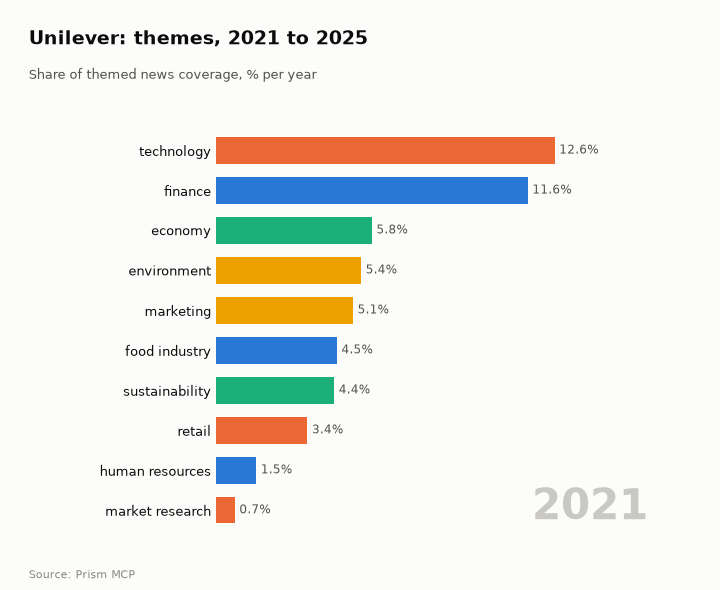
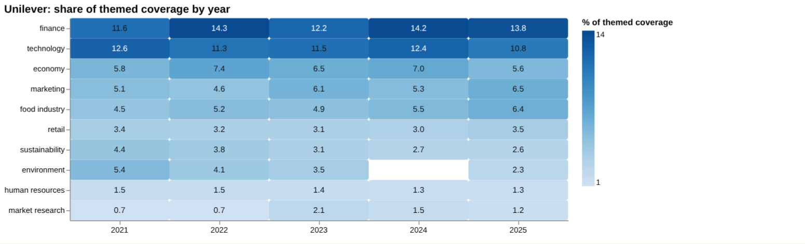
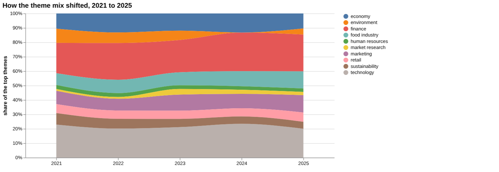
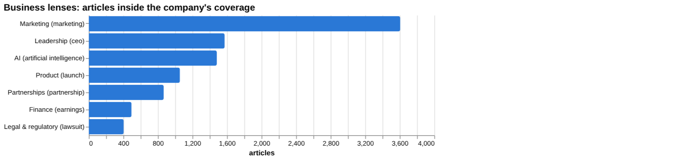
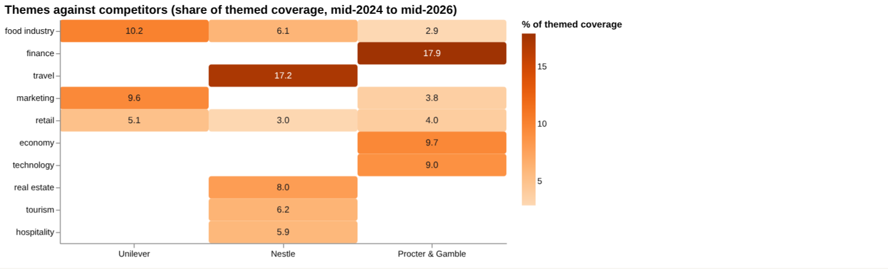
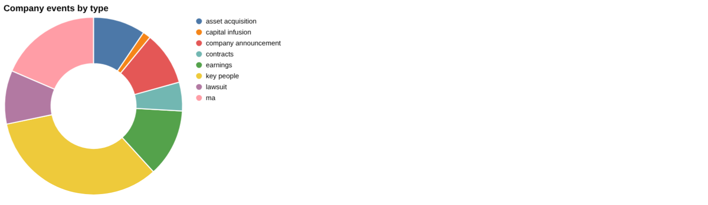
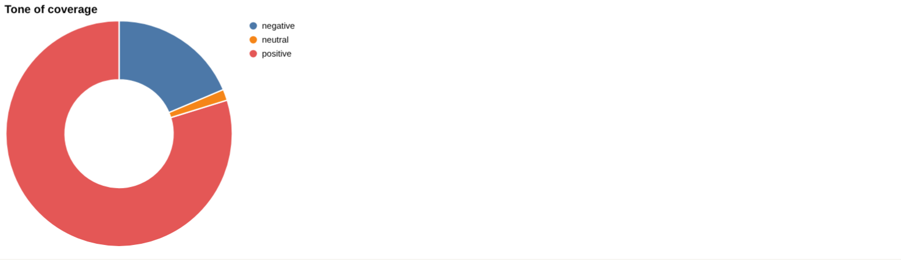
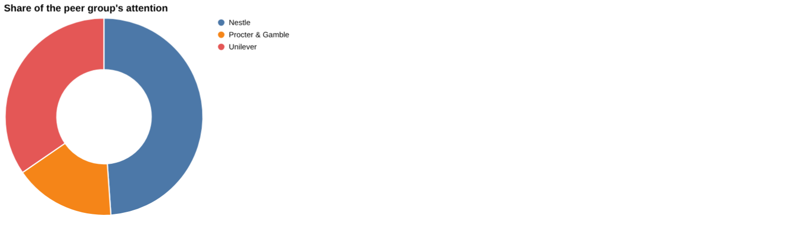
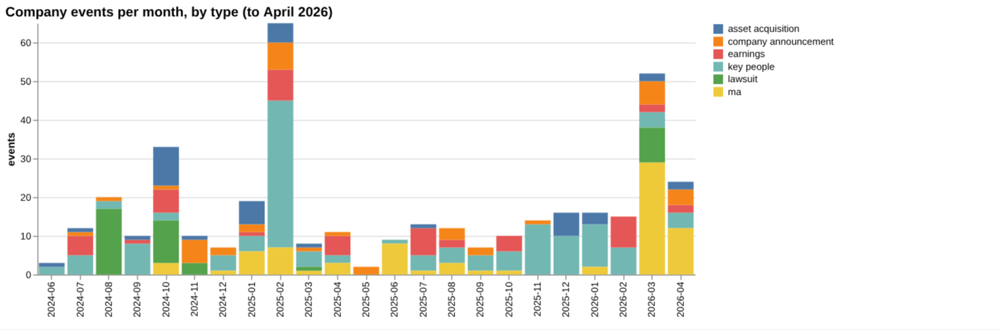

# Unilever: intelligence report

*United Kingdom · LSE: ULVR · Consumer goods* · built from **22 Prism MCP calls** · **[Open the interactive report](https://fliarbi.com/demo/docs/prism-dashboards-3bb43e4c/investors/unilever/)** (tabs: Summary · Themes over 5 years · Business lenses · Versus peers · Mix · Events · Risks & catalysts · Coverage & tone · Areas & people · Month by month · Built with MCP)

> **Partial index.** Built while part of the news index was offline: counts and shares here are lower bounds (floors), and will be rebuilt in full when the index is complete.

Unilever (LSE: ULVR) generated 23,136 articles in the window from 2024-06 to 2026-05, of which 10,399 were high-priority stories. Attention is building: 3,649 articles in 2026-03 to 2026-05 against 2,528 in 2025-12 to 2026-02, a ratio of 1.44. The story has shifted from political and sustainability scrutiny in mid-2025 towards restructuring, with the ice-cream spin-off announced in 2025-09 and a public demerger disclosure in 2025-12. Recent items include the $1.2 billion Grüns acquisition announced on April 4, underlying sales growth of 3.8% and the departure of Stefan Pfeifer. Coverage tone is more negative than the 0.14 negative-per-positive reading of the previous three months, at 0.2, but remains well below the 0.58 for all news. Legal items, notably the dismissed Elon Musk antitrust suit, are the most clearly negative strand.

## Signals

Attention rose to 3,649 articles in the latest three months from 2,528 in the prior three, while tone moved from 0.14 to 0.2 negative per positive, against 0.23 for the whole window. Catalyst events numbered 68 in the latest six months against 15 in the previous six, while risk events rose to 9 from 2. Earnings events numbered 12 and key-people events 49 in the latest six months.

| Signal | Measured | Direction |
| --- | --- | --- |
| Attention | 3,649 articles in the last 3 months vs 2,528 before (1.44×) | rising |
| Tone | 0.2 negative per positive, vs 0.14 before (all news 0.58) | more negative |
| Risk events (lawsuits, regulatory, layoffs) | 9 in the last 6 months vs 2 before | rising |
| Catalyst events (products, contracts, M&A) | 68 in the last 6 months vs 15 before | rising |
| Risk section: layoffs | 0.22% of coverage, last third vs first 0.61× | falling |
| Risk section: lawsuit | 1.5% of coverage, last third vs first 0.23× | falling |
| Catalyst section: demerger | 0.92% of coverage, last third vs first 4.32× | rising |
| Catalyst section: acquisition | 5.33% of coverage, last third vs first 1.16× | rising |
| Attention rank among peers | #2 of 3 |  |

**What to watch:**

- Progress and structure of the demerged entities
- Integration of the $1.2 billion Grüns acquisition
- Whether underlying sales growth of 3.8% and volume growth of 2.9% persist
- Leadership changes following Stefan Pfeifer's departure
- Hindustan Unilever's restructuring and trade reach of about 2.3 million outlets
- Legal and regulatory items, given 32.5 negative per positive

## Themes over five years

Finance moved from 11.6% in 2021 to 13.8% in 2025, and technology from 12.6% to 10.8%. Economy went from 5.8% to 5.6%, marketing from 5.1% to 6.5%, and food industry from 4.5% to 6.4%. Retail moved from 3.4% to 3.5%, while sustainability fell from 4.4% to 2.6% and environment from 5.4% to 2.3%. Human resources went from 1.5% to 1.3%, and market research from 0.7% to 1.2%.

| Theme | 2021 | 2022 | 2023 | 2024 | 2025 |
| --- | ---: | ---: | ---: | ---: | ---: |
| finance | 11.6% | 14.3% | 12.2% | 14.2% | 13.8% |
| technology | 12.6% | 11.3% | 11.5% | 12.4% | 10.8% |
| economy | 5.8% | 7.4% | 6.5% | 7.0% | 5.6% |
| marketing | 5.1% | 4.6% | 6.1% | 5.3% | 6.5% |
| food industry | 4.5% | 5.2% | 4.9% | 5.5% | 6.4% |
| retail | 3.4% | 3.2% | 3.1% | 3.0% | 3.5% |
| sustainability | 4.4% | 3.8% | 3.1% | 2.7% | 2.6% |
| environment | 5.4% | 4.1% | 3.5% | – | 2.3% |
| human resources | 1.5% | 1.5% | 1.4% | 1.3% | 1.3% |
| market research | 0.7% | 0.7% | 2.1% | 1.5% | 1.2% |

## Business lenses

Marketing is the biggest lens by volume at 3,605 articles (15.58%), with a late-versus-early ratio of 0.99 and 0.13 negative per positive. Leadership (1,573 articles, 6.8%), AI (1,482, 6.41%) and Product (1,055, 4.56%) follow, with late-versus-early ratios of 1.4, 1.28 and 1.2, so all are building. Legal and regulatory is small at 404 articles (1.5%) with a ratio of 0.23 but a very negative 32.5 negative per positive, while Finance (495 articles, 2.14%) has a ratio of 1.52 and 0.3 negative per positive.

| Lens | Articles | Share of coverage | Last third vs first | Negative per positive | Top tags inside |
| --- | ---: | ---: | ---: | ---: | --- |
| Product (*launch*) | 1,055 | 4.56% | 1.2× | 0.07 | unilever, uk, ai, india |
| Finance (*earnings*) | 495 | 2.14% | 1.52× | 0.3 | unilever, financial performance, earnings, investment |
| Marketing (*marketing*) | 3,605 | 15.58% | 0.99× | 0.13 | unilever, marketing, ai, india |
| Legal & regulatory (*lawsuit*) | 404 | 1.5% | 0.23× | 32.5 | unilever, elon musk, advertising, mars |
| Leadership (*ceo*) | 1,573 | 6.8% | 1.4× | 0.24 | unilever, ceo, india, us |
| Partnerships (*partnership*) | 867 | 3.75% | 1.01× | 0.04 | unilever, partnership, ai, innovation |
| AI (*artificial intelligence*) | 1,482 | 6.41% | 1.28× | 0.05 | artificial intelligence, unilever, ai, technology |

## Versus peers

Unilever ranks second by attention with 23,136 articles and a 34.6% share, behind Nestlé at 48.9% (32,708 articles, falling) and ahead of Procter & Gamble at 16.5% (11,054, rising); Unilever's own direction is flat. Unilever's coverage leans to food industry (10.2%) and marketing (9.6%), whereas Nestlé's carries travel (17.2%) and real estate (8.0%), and Procter & Gamble's finance (17.9%) and economy (9.7%). Negative-per-positive is 0.23 for Unilever and Nestlé and 0.35 for Procter & Gamble.

| Theme | Unilever | Nestle | Procter & Gamble |
| --- | ---: | ---: | ---: |
| food industry | 10.2% | 6.1% | 2.9% |
| finance | – | – | 17.9% |
| travel | – | 17.2% | – |
| marketing | 9.6% | – | 3.8% |
| retail | 5.1% | 3.0% | 4.0% |
| economy | – | – | 9.7% |
| technology | – | – | 9.0% |
| real estate | – | 8.0% | – |
| tourism | – | 6.2% | – |
| hospitality | – | 5.9% | – |

## Mix

Catalyst events dominate risk events in the latest six months, 68 to 9, with new products, contracts and M&A among the catalyst types and lawsuits, regulatory matters and layoffs among the risk types. Tone is 0.2 negative per positive in the latest three months, and 10,399 of 23,136 articles are in the top priority bands.

| | | |
| --- | --- | --- |
|  |  |  |

## Company events

The latest events include the $1.2 billion Grüns acquisition announced on April 4 and underlying sales growth of 3.8%, with volume growth of 2.9% and price contributing 0.9%. Power Brands grew 5.0%. A US federal judge dismissed Elon Musk's antitrust lawsuit against advertisers, while HUL expanded general trade reach by around 200,000 outlets to approximately 2.3 million, and an Incoming Promoter acquired Sale Shares on 30th March, 2026.

## Risks

Legal and regulatory coverage is the sharpest negative strand at 404 articles with 32.5 negative per positive, though its volume is lower in the last third than the first (ratio 0.23). Layoffs (58 articles, 2.79 negative per positive) and product recalls, a collapsed plastics treaty and cost inflation noted in the timeline are further pressures.

## Catalysts

Demerger coverage (247 articles, ratio 4.32) and acquisition coverage (1,433 articles, ratio 1.16) are building, with both near 0.2 negative per positive or below. The Google Cloud partnership and AI-driven marketing add to the digital and portfolio-change narrative.

## Areas of activity and people

Activity centres on Beauty & Fitness, including Face & Body Care, Clean Beauty and Hygiene & Toiletries. Food & Drink (Desserts) and Business & Industrial advertising and brand management also feature.

## The year, month by month

In 2025-07 a legal win in India removed a regulatory threat, and in 2025-09 the ice-cream spin-off was announced. The 2025-12 demerger disclosure and the 2026-02 five-year Google Cloud partnership with a top sustainability ranking followed. In 2026-05 the restructuring of Hindustan Unilever coincided with a sharp share rally.

## Built with MCP

Every number and chart above comes from these 22 Prism MCP tool calls, made over MCP (streamable HTTP) as an assistant would make them. The full list with arguments and timings is in [mcp_calls.json](mcp_calls.json); the responses are in [data.json](data.json).

| MCP tool | Calls | What it gave this report |
| --- | ---: | --- |
| `prism_overview` | 1 | coverage, tone, themes, places and people |
| `news_activities` | 1 | areas of activity and company events by month |
| `news_themes` | 7 | themes per year, and each peer's themes |
| `news_drill` | 11 | business lenses, risk and catalyst sections |
| `compare_terms` | 1 | peers on one scale |
| `deep_timeline` | 1 | the month-by-month reading |

> Decision inputs, not investment advice. News attention, tone and event counts describe what is being reported; they are not price forecasts and do not account for valuation, fundamentals or your circumstances.

