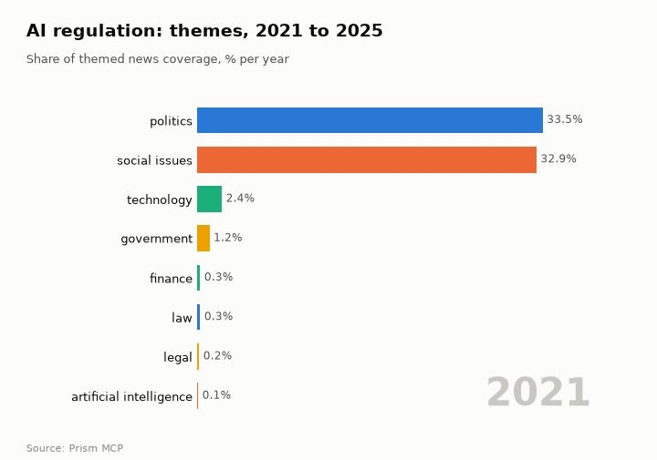
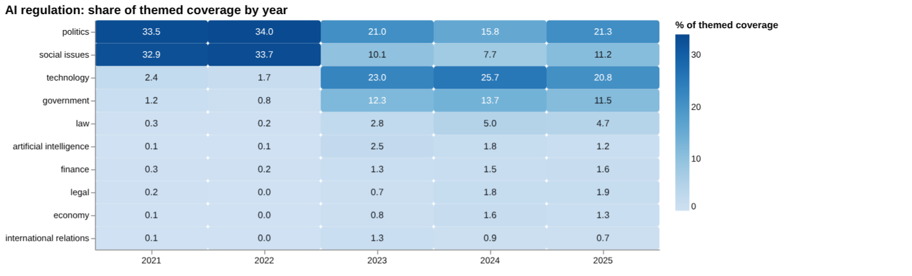
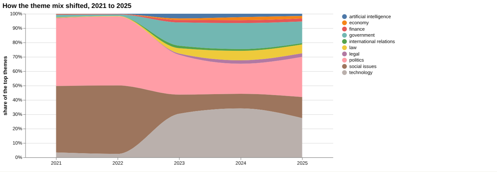
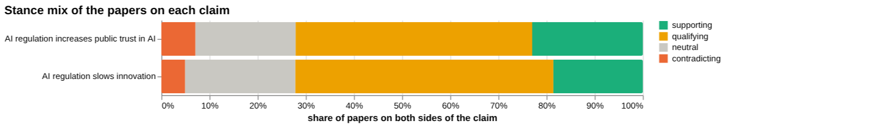
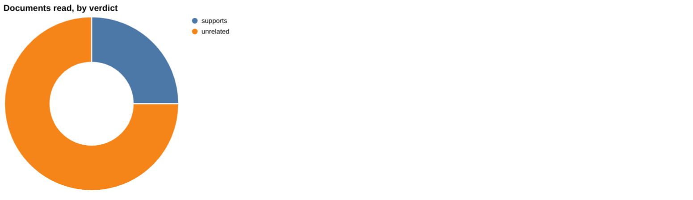
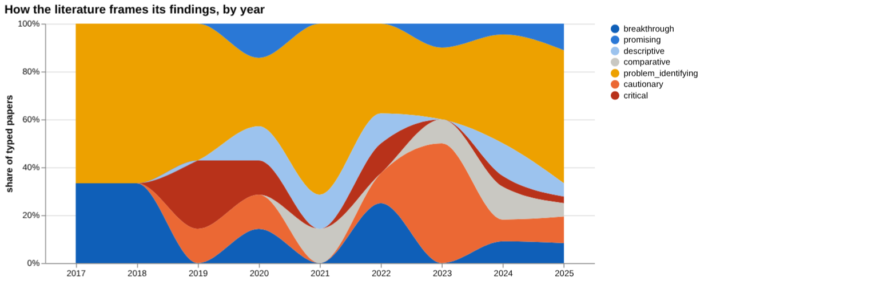
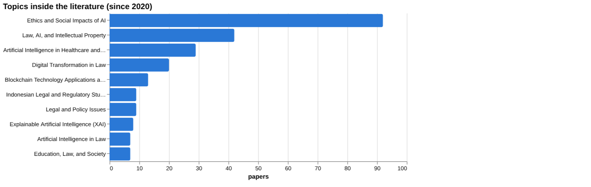
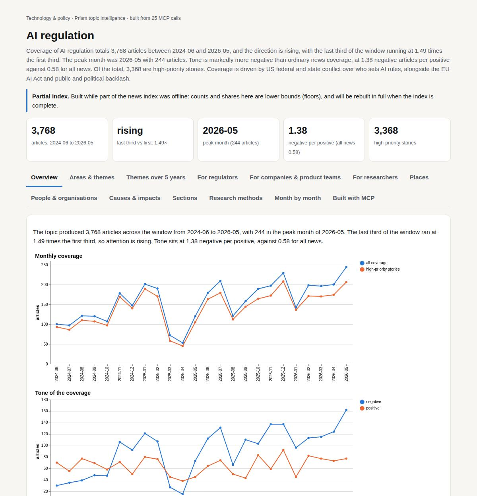

# AI regulation

*Technology & policy · Prism topic intelligence* · **[Open the interactive page](https://fliarbi.com/demo/docs/prism-dashboards-3bb43e4c/topics/ai-regulation/)** (tabs: Overview · Areas & themes · Themes over 5 years · For regulators · For companies & product teams · For researchers · Places · People & organisations · Causes & impacts · Sections · Research methods · Month by month · Built with MCP)

> **Partial index.** Built while part of the news index was offline: counts and shares here are lower bounds (floors), and will be rebuilt in full when the index is complete.

Coverage of AI regulation totals 3,768 articles between 2024-06 and 2026-05, and the direction is rising, with the last third of the window running at 1.49 times the first third. The peak month was 2026-05 with 244 articles. Tone is markedly more negative than ordinary news coverage, at 1.38 negative articles per positive against 0.58 for all news. Of the total, 3,368 are high-priority stories. Coverage is driven by US federal and state conflict over who sets AI rules, alongside the EU AI Act and public and political backlash.

| Articles | Direction (last third vs first) | Peak month | Negative per positive | High-priority stories |
| ---: | --- | --- | ---: | ---: |
| 3,768 (2024-06 to 2026-05) | rising (1.49×) | 2026-05 (244) | 1.38 (all news 0.58) | 3,368 |

## Coverage over time

The topic produced 3,768 articles across the window from 2024-06 to 2026-05, with 244 in the peak month of 2026-05. The last third of the window ran at 1.49 times the first third, so attention is rising. Tone sits at 1.38 negative per positive, against 0.58 for all news.

## Areas of activity and themes

The main area of activity is Science › Computer Science › Machine Learning & Artificial Intelligence, followed by Law & Government › Government with 879 and its Legislative Branch subcategory with 296. Leading themes are tech policy and government regulations, ethical considerations in AI development and AI in cybersecurity applications, while the top tags include white house with 1,408 and georgia with 1,321.

| Area of activity | Articles |
| --- | ---: |
| Science › Computer Science › Machine Learning & Artificial Intelligence | 1,965 |
| Law & Government › Government | 879 |
| Law & Government › Government › Legislative Branch | 296 |
| Business & Industrial › Business Finance › Risk Management | 191 |
| Computers & Electronics › Enterprise Technology | 184 |
| Law & Government › Legal › Intellectual Property | 59 |

**Top tags (what the themes are built from):** white house (1,408), georgia (1,321), missouri (1,315), all newsletters (1,305), all newsletters ap quizzes test your news (1,305), i.q. (1,305), ufc (1,303), español china asia pacific latin america (1,292)

## Where it is reported

The United States leads country placement with 951 articles, followed by the United Kingdom with 308, China with 307, Colombia with 164, India with 160 and France with 135. Among states, California has 287, Pennsylvania 273 and Arizona 178, followed by Washington and Colorado with 115 each.

| Country | Articles | Lift | | Indian state | Articles | Lift |
| --- | ---: | ---: | --- | --- | ---: | ---: |
| United States | 951 | 1.2× | | California | 287 | 3.0× |
| United Kingdom | 308 | 1.8× | | Pennsylvania | 273 | 3.2× |
| China | 307 | 1.8× | | Arizona | 178 | 6.2× |
| Colombia | 164 | 10.0× | | Meta | 165 | 36.8× |
| India | 160 | 0.7× | | Washington | 115 | 1.7× |
| France | 135 | 2.3× | | Colorado | 115 | 2.6× |

## People and organisations

The people most associated with the coverage are Scott Wiener, Marsha Blackburn, Marc Andreessen, Henna Virkkunen, Ted Cruz and Gavin Newsom. Organisations include Andreessen Horowitz, the National Institute of Standards and Technology, OpenAI, the European Parliament, Meta and Ofcom.

## Causes and impacts

Stated causes include Trump's attempt to block state AI regulations, the scrapping of an executive order on AI regulation, Senator Bernie Sanders calling for AI regulation, public frustration with artificial intelligence and the EU AI Act entering into force. Impacts include some states forging ahead, a rift exposed within the White House, growing political and industry tensions, hostile protests at university commencement ceremonies and intensifying backlash.

**Causes named in the coverage:** Trump tried to block state AI regulations, Trump scraps executive order on AI regulation, Public frustration regarding artificial intelligence, Senator Bernie Sanders calls for AI regulation, EU AI Act entered into force, President received millions and manipulated AI regulation

**Impacts:** Some states are forging ahead, Exposed a rift within the White House, Growing political and industry tensions, Hostile protests at university commencement ceremonies, Legislative attempts to halt infrastructure expansion, Intensifying backlash

## Sections inside the topic

The EU AI Act section has 222 articles, 5.89% of the topic, and its tone is far less negative at 0.34 negative per positive against 1.38 for the topic. Its late-versus-early ratio is 0.89. The copyright section is smaller at 40 articles, 1.06% of the topic, with a late-versus-early ratio of 1.0 and a tone of 1.24 negative per positive, close to the topic figure.

| Section | Articles | Share of the topic | Late vs early | Negative per positive |
| --- | ---: | ---: | ---: | ---: |
| ai regulation → eu ai act | 222 | 5.89% | 0.89× | 0.34 (topic 1.38) |
| ai regulation → copyright | 40 | 1.06% | 1.0× | 1.24 (topic 1.38) |

## Research and outlook

Research framing has shifted by -12.0 points, and recent work is markedly more positive than earlier work. The outlook projects 57.375 for 2026, 63.75 for 2027 and 70.125 for 2028, with the 2028 range running from 33.696 to 106.554.

## Month by month

In June 2025 a federal proposal for a sweeping moratorium prompted political backlash and a scaled-back bill, and in July 2025 the Senate lifted the moratorium while the White House unveiled an AI Action Plan. In August 2025 the EU enacted its AI Act, drawing US diplomatic pushback, and by March 2026 the White House released a national framework while states kept pushing their own rules.

- **2025-06:** Federal proposal for a sweeping AI regulation moratorium sparked political backlash and led to a scaled‑back bill.
- **2025-07:** Senate lifted the moratorium, enabling state regulations, and the White House unveiled a comprehensive AI Action Plan.
- **2025-08:** EU enacted the world’s first comprehensive AI Act, setting global standards and triggering diplomatic pushback from the U.S.

## Themes over five years

Coverage moved from a politics and social issues focus to a technology-led mix. In 2021, politics held 33.5% and social issues 32.9%, while technology was 2.4%, government 1.2%, law 0.3%, artificial intelligence 0.1%, finance 0.3%, legal 0.2%, economy 0.1% and international relations 0.1%. By 2025, politics was 21.3%, social issues 11.2%, technology 20.8%, government 11.5%, law 4.7%, artificial intelligence 1.2%, finance 1.6%, legal 1.9%, economy 1.3% and international relations 0.7%. Technology peaked in 2024 at 25.7%, and politics rose again from 15.8% in 2024 to 21.3% in 2025.

| Theme | 2021 | 2022 | 2023 | 2024 | 2025 |
| --- | ---: | ---: | ---: | ---: | ---: |
| politics | 33.5% | 34.0% | 21.0% | 15.8% | 21.3% |
| social issues | 32.9% | 33.7% | 10.1% | 7.7% | 11.2% |
| technology | 2.4% | 1.7% | 23.0% | 25.7% | 20.8% |
| government | 1.2% | 0.8% | 12.3% | 13.7% | 11.5% |
| law | 0.3% | 0.2% | 2.8% | 5.0% | 4.7% |
| artificial intelligence | 0.1% | 0.1% | 2.5% | 1.8% | 1.2% |
| finance | 0.3% | 0.2% | 1.3% | 1.5% | 1.6% |
| legal | 0.2% | – | 0.7% | 1.8% | 1.9% |
| economy | 0.1% | – | 0.8% | 1.6% | 1.3% |
| international relations | 0.1% | – | 1.3% | 0.9% | 0.7% |

## For regulators

Themed coverage has broadened from politics and social issues to include technology, government and law. In 2025 government stood at 11.5% and law at 4.7%, against 1.2% and 0.3% in 2021. The index holds 374 news articles mentioning the topic between 2019-01-01 and 2026-06-01. Two stories stand out: on 2026-02-19 the OpenAI chief executive called for urgent AI regulation at the India AI Impact Summit 2026, and on 2026-04-02 the AI industry was reported mobilising funds for the 2026 midterms amid regulatory scrutiny. The linear-drift scenario gives a central value of 57 for 2026, 64 for 2027 and 70 for 2028, with ranges widening to 34 to 107 in 2028; the facts do not state what the scenario measures. No country-level reporting data was available, so geography cannot be described, though recent papers examine the EU, Vietnam, Indonesia, Ukraine and Ecuador.

- Government (11.5%) and law (4.7%) shares in 2025 coverage
- Industry political spending ahead of the 2026 midterms
- Scenario range for 2028: 34 to 107, central 70
- Calls from industry leaders for regulation, as at the India AI Impact Summit 2026
- Comparative work on the EU risk-based approach being applied to Vietnam and Ukraine

## For companies & product teams

The evidence on whether AI regulation slows innovation is thin. Of four documents read, one supports the claim and three are unrelated; none contradicts or qualifies it, and all four are articles. The supporting source is a 2025 article, 'AI Regulation and Capitalist Growth: Balancing Innovation, Ethics, and Global Governance'. The wider corpus on the claim covers 651 papers: 121 supporting, 349 qualifying, 32 contradicting and 149 neutral, with 58.5% contested. The claim on public trust fared worse: eight documents read, all unrelated. The sample read does not establish scientific consensus, and screening found no figures on compliance costs, public trust or transparency.

- Innovation claim: one of four documents read supports it (article tier); three are unrelated
- Corpus for the innovation claim: 651 papers, 349 qualifying, 58.5% contested
- Public trust claim: eight documents read, none supporting or contradicting (article tier)
- Screening found 360 million as an investment amount by earlybird for startup investment, with no paper attached
- Gaps listed with evidence marked yes: reduced R&D investment, higher compliance costs, slower innovation

**Head to head:** AI regulation slows innovation vs AI regulation increases public trust in AI: the first claim has more evidence behind it.

**Screen:** *What is the effect of AI regulation on …?* (one row per line below)

| Row | Figure (quoted) | Measures | Source |
| --- | --- | --- | --- |
| innovation | no figure found |  | Ideal Approaches to AI Regulation in LATAM Countries: Promoting Technological Advancement  (2025) |
| public trust | no figure found |  |  |
| compliance costs | no figure found |  |  |
| algorithmic bias | no figure found |  | Public Perceptions of Algorithmic Bias and Fairness in Cloud-Based Decision Systems (2025) |
| startup investment | 360 million | investment amount by earlybird |  |
| transparency | no figure found |  |  |

## For researchers

The literature frames itself mostly as a problem or caution. Of 91 research papers, 12 are supporting, 60 qualifying, 5 contradicting and 14 neutral, with 71.4% contested. By orientation, 84 papers (53.5%) are problem-identifying and 21 (13.4%) cautionary. Position papers number 69 and empirical papers 41, with 22 reviews. The leading topics are Ethics and Social Impacts of AI (92 papers) and Law, AI, and Intellectual Property (42). The newest work is mostly from 2025, on the EU AI Act and intellectual property, political deepfakes, and regulation in Indonesia and Vietnam, but all of it shows zero citations. Evidence is thin on quantified effects: the index has 6 the health literature index records, no patents and no preprints, and a framing shift could not be assessed for lack of papers in one window.

- Which quantified effects of regulation exist beyond the key numbers reported, such as a 25% reduction in audit cycle duration, given that screening rows mostly have no value?
- Why do most frontier, highly cited items concern healthcare, education and general AI rather than regulation itself?
- Can empirical designs be found, given 41 empirical papers against 69 position papers?
- Has framing shifted over time, given that the comparison was not possible with the papers available?
- What evidence exists on public trust, transparency and compliance costs, where screening found no papers?

## Research exploration methods

Nine ways to explore the research, each run on this topic; the interactive report shows each call and its result.

### Evidence triangulation

*Is a claim supported, and by how strong a design?* `find_evidence` + `find_counter_evidence` + `rank_sources`

Of the four documents read for the claim 'AI regulation slows innovation', one supports it and three are unrelated; none contradicts or qualifies it. All four sit in the 'article' tier, so none is a trial, systematic review or other higher-ranked design. The corpus view is more informative: of 651 papers, 121 are supporting, 349 qualifying, 32 contradicting and 149 neutral, with contested share at 58.5. That means most papers treat the matter as a problem, caution or criticism, not as a settled finding. The sample of four is too small to establish consensus, and the tool says as much. The top sources have a cited_by of 2, 2, 0 and 0, so none has much citation weight. A careful researcher would read the 349 qualifying papers to find what conditions the claim, and would not treat the single supporting article as an answer.

### Head-to-head claims

*Which of two interventions has more and stronger evidence?* `compare_claims`

The comparison puts 'AI regulation slows innovation' against 'AI regulation increases public trust in AI', and the verdict is that the first claim has more evidence behind it. The first has 651 papers on both poles against 13 for the second, and one supporting document read against none. For the second claim all 8 documents read are unrelated, and its strongest source, on political deepfakes and the 2024 election, is itself marked unrelated. The corpus mix for the second claim (29,065 supporting, 62,173 qualifying, 8,929 contradicting, 26,341 neutral) is on a very different scale from its 13 papers, so the two figures are not directly comparable and the discrepancy needs explaining before relying on either. Contested_pct is 58.5 for the first claim and 56.2 for the second, so both are similarly disputed. The verdict reflects volume and documents read, not whether either claim is true. A careful researcher would check why the second claim's paper counts diverge so widely, and would not read the verdict as a finding on the claims themselves.

### Cross-row screening

*Which rows carry a measured, quoted figure, and how large is it?* `research_table`

Almost no row yields a measured effect. For innovation, two papers were found but no value, measure or population was extracted. Public trust, compliance costs and transparency have 0 papers and no figure. Algorithmic bias has 1 paper, from 2025, with no value. The only number is for startup investment: '360 million', described as an investment amount by Earlybird, with no population and 0 papers behind it. That figure is an amount of money, not an effect of regulation, and it should not be read as a measured regulatory effect. The table therefore shows that quantified effect sizes are mostly not available in what was retrieved, which is different from showing that effects are absent. A careful researcher would go to the cited sources for innovation and algorithmic bias and check whether any estimate exists there, and would look for economic studies outside this corpus on compliance costs.

### Framing drift

*Is the literature becoming more hopeful or more cautious?* `stance_trends`

Positive framing is low throughout, ranging from 0.0 percent in 2019 and 2021 to 25.0 in 2018, and standing at 10.4 in 2025. Contested framing is higher in most years, with a peak of 63.6 in 2019, a low of 28.6 in 2020, 53.3 in 2023 and 37.3 in 2025. The series moves up and down and shows no steady drift toward optimism or caution. Early years, such as 2017 at 16.7 positive and 33.3 contested, probably rest on few papers, so single papers can shift the percentages sharply; the facts give no counts per year to confirm this. A careful researcher would obtain the paper counts behind each year before reading any change as a trend.

### Frontier scan

*What is new, and what is the research not reaching?* `research_radar`

The most-cited new work is largely not about regulation. The list runs from a 2022 arXiv paper on BNAI at 4,210 citations through healthcare, explainable AI, education and foundation-model papers from 2023, the last at 1,405 citations in Nature. These are general AI papers, which suggests the retrieval picked up high-citation work on AI broadly and not on its regulation. The orientations are mixed: breakthrough, problem_identifying, promising and cautionary. The framing shift between windows could not be calculated, because one window had too few papers. So there is no evidence here about whether regulation research is turning more hopeful or more cautious, and the 'gaps' part of this method returned nothing usable. A careful researcher would narrow the scan to regulation-specific terms and rerun it before drawing conclusions.

### Gap mapping

*Which parts of a claim does the literature actually cover?* `research_gaps`

The claim 'AI regulation slows innovation' was split into three components: that regulation reduces R&D investment, that it increases compliance costs, and that it leads to slower innovation. Each is marked 'yes' for evidence, so a literature exists for every part. This only says that papers exist, not how many, how strong they are or which way they point. It sits oddly with the screening result, where compliance costs had 0 papers and no figure, so the two methods disagree and the difference needs resolving. No component is flagged as missing, which means this method identifies no gap. A careful researcher would check what the 'yes' rests on for each component and whether those papers measure the effect or merely discuss it.

### Count history and backtested scenarios

*Is research on this growing, and where could it be in three years?* `historical_analysis` + `scenarios`

The count of papers per year came back empty, so there is no observed history to show whether research is growing. The scenarios therefore rest on a linear_drift baseline with no visible yearly counts to check it against, and that limits how far they can be trusted. They give central values of 57 for 2026, 64 for 2027 and 70 for 2028. The sensitivity bands widen over time: 45 to 70 in 2026, 39 to 88 in 2027 and 34 to 107 in 2028. The widening band shows the uncertainty growing with distance, and by 2028 the range is wide enough to include both decline and substantial growth. The figures are projections of a statistical pattern, not forecasts of events. A careful researcher would recover the underlying yearly counts, confirm the window and title matching, and treat the scenarios as provisional until then.

### Geographic triangulation

*Where is it studied, published, reported and patented?* `global_comparison` + `newsgeo`

Both lanes came back empty: where_studied and where_reported_by_country contain no entries. This means the method gave no information on which countries study, publish or report on AI regulation, and it should not be read as showing that the topic is geographically absent. Other results hint at some regional interest, such as papers on LATAM countries, Ecuador, Vietnam, Indonesia and Ukraine, but those are individual titles and not a geographic count. Without the lanes, no comparison between jurisdictions can be supported. A careful researcher would rerun the geographic query, perhaps with a different claim wording, and tally the countries from the paper metadata directly.

### Faceted browsing

*What kind of literature is it: empirical, review, position? Problem-identifying or promising?* `browse_research`

Of the papers faceted by orientation, 84 are problem_identifying (53.5 percent), 21 cautionary (13.4), 13 breakthrough (8.3), 13 descriptive (8.3), 10 comparative (6.4), 9 promising (5.7) and 7 critical (4.5). The literature is thus mostly about identifying problems, with few promising papers. By contribution type, 69 are position papers, 41 empirical, 22 reviews, 21 methodological and 4 theoretical, so opinion-style work outnumbers empirical work. The leading topics are Ethics and Social Impacts of AI with 92 papers and Law, AI, and Intellectual Property with 42; healthcare and education appear at 29. The most-cited papers since 2020 are all from 2025 and show a cited_by of 0, so citation ranking gives no signal here and the list is effectively recent work. A careful researcher would read the 41 empirical papers first, since they are the most likely to contain measured effects.

## Built with MCP

Every number and chart on this page comes from these 25 Prism MCP tool calls, made over MCP (streamable HTTP). Arguments and timings: [mcp_calls.json](mcp_calls.json); responses: [data.json](data.json).

| MCP tool | Calls |
| --- | ---: |
| `news_activities` | 1 |
| `news_geography` | 1 |
| `news_drill` | 2 |
| `news_themes` | 5 |
| `prism_overview` | 1 |
| `news_factors` | 1 |
| `historical_analysis` | 1 |
| `critical_news` | 1 |
| `stance_trends` | 1 |
| `browse_research` | 1 |
| `research_radar` | 1 |
| `research_gaps` | 1 |
| `research_brief` | 1 |
| `global_comparison` | 1 |
| `rank_sources` | 1 |
| `find_counter_evidence` | 1 |
| `find_evidence` | 1 |
| `deep_timeline` | 1 |
| `compare_claims` | 1 |
| `research_table` | 1 |

Try it: `prism entity "ai regulation"` · `prism call news.drill term='ai regulation' scope='eu ai act'` · `prism call analysis.timeline term='ai regulation'`

