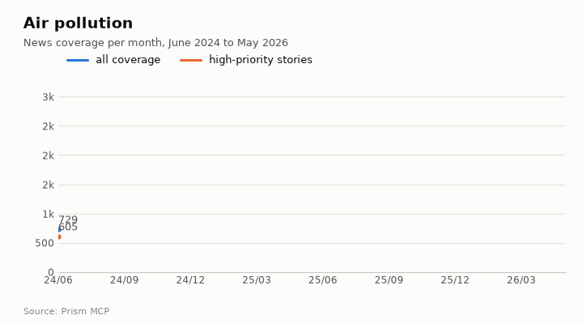
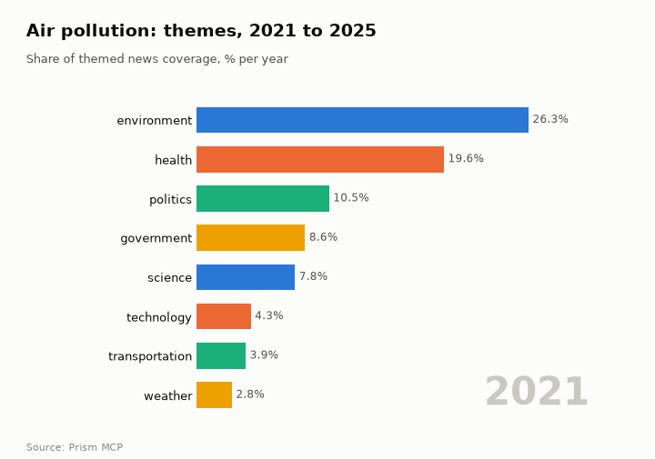
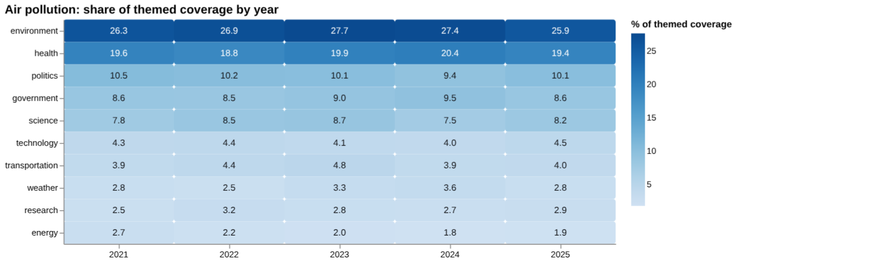
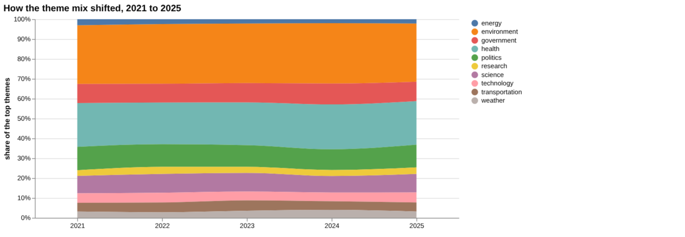
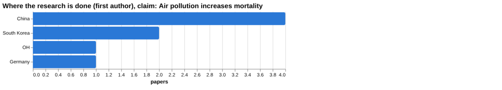
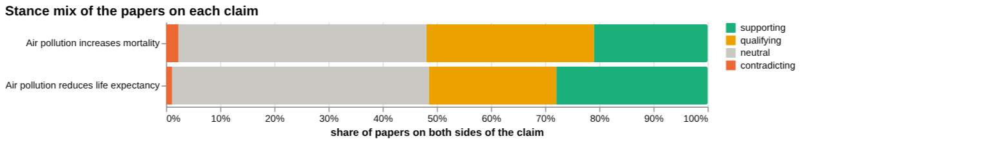
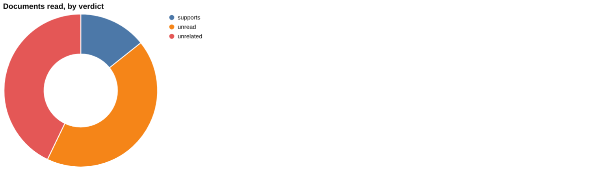
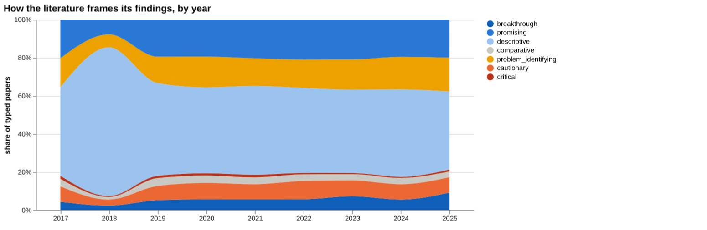
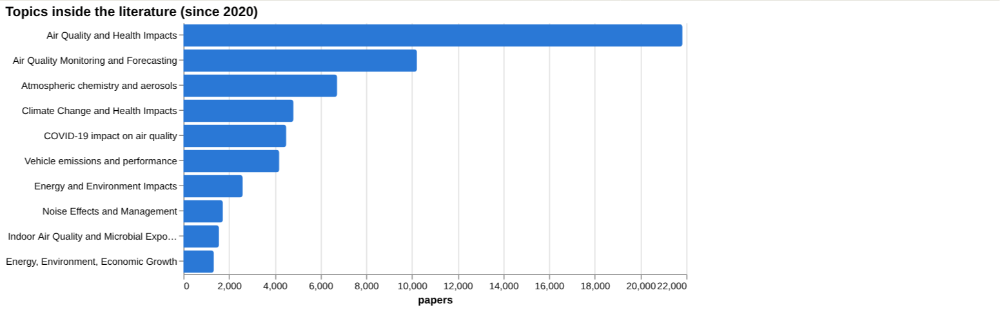
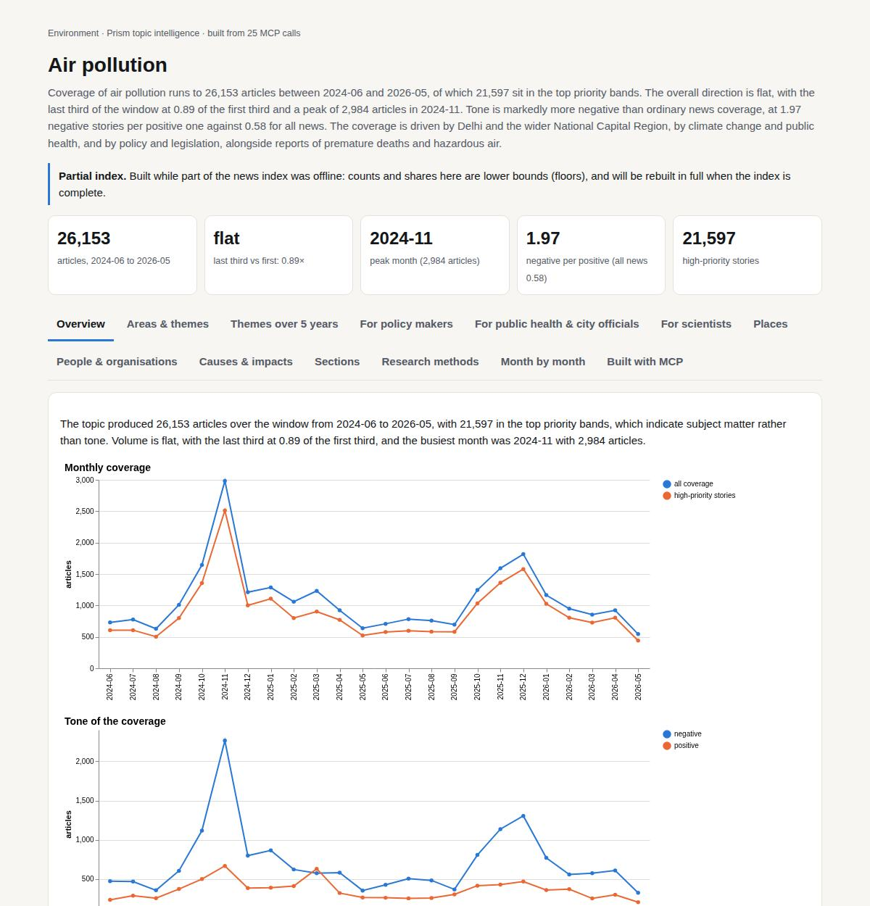

# Air pollution

*Environment · Prism topic intelligence* · **[Open the interactive page](https://fliarbi.com/demo/docs/prism-dashboards-3bb43e4c/topics/air-pollution/)** (tabs: Overview · Areas & themes · Themes over 5 years · For policy makers · For public health & city officials · For scientists · Places · People & organisations · Causes & impacts · Sections · Research methods · Month by month · Built with MCP)

> **Partial index.** Built while part of the news index was offline: counts and shares here are lower bounds (floors), and will be rebuilt in full when the index is complete.

Coverage of air pollution runs to 26,153 articles between 2024-06 and 2026-05, of which 21,597 sit in the top priority bands. The overall direction is flat, with the last third of the window at 0.89 of the first third and a peak of 2,984 articles in 2024-11. Tone is markedly more negative than ordinary news coverage, at 1.97 negative stories per positive one against 0.58 for all news. The coverage is driven by Delhi and the wider National Capital Region, by climate change and public health, and by policy and legislation, alongside reports of premature deaths and hazardous air.

| Articles | Direction (last third vs first) | Peak month | Negative per positive | High-priority stories |
| ---: | --- | --- | ---: | ---: |
| 26,153 (2024-06 to 2026-05) | flat (0.89×) | 2024-11 (2,984) | 1.97 (all news 0.58) | 21,597 |

## Coverage over time

The topic produced 26,153 articles over the window from 2024-06 to 2026-05, with 21,597 in the top priority bands, which indicate subject matter rather than tone. Volume is flat, with the last third at 0.89 of the first third, and the busiest month was 2024-11 with 2,984 articles.

## Areas of activity and themes

The leading tags are delhi (7,234), climate change (5,069) and public health (3,625), and the themes include air quality improvement initiatives, environmental policy and legislation, and eco-friendly transportation alternatives.

| Area of activity | Articles |
| --- | ---: |
| People & Society › Social Issues & Advocacy › Green Living & Environmental Issues | 19,457 |
| Health › Public Health | 5,159 |
| Science › Ecology & Environment | 4,348 |
| Jobs & Education › Education › Academic Conferences & Publications | 1,712 |
| Health › Health Conditions › Respiratory Conditions | 1,602 |
| Home & Garden › HVAC & Climate Control › Air Filters & Purifiers | 679 |

**Top tags (what the themes are built from):** delhi (7,234), climate change (5,069), public health (3,625), environmental impact (1,856), delhi-ncr (1,818), ncr (1,792), emissions (1,572), epa (1,468)

## Where it is reported

India leads the countries with 8,511 articles, ahead of the United States with 5,144, the United Kingdom with 1,114, China with 1,088, Cameroon with 617 and Pakistan with 605. Among states, Delhi has 5,786 articles, followed by Uttar Pradesh with 1,743, Haryana with 1,626 and Maharashtra with 1,151, while California (1,129) and Pennsylvania (996) represent the United States.

| Country | Articles | Lift | | Indian state | Articles | Lift |
| --- | ---: | ---: | --- | --- | ---: | ---: |
| India | 8,511 | 5.0× | | Delhi | 5,786 | 44.9× |
| United States | 5,144 | 0.9× | | Uttar Pradesh | 1,743 | 11.7× |
| United Kingdom | 1,114 | 0.9× | | Haryana | 1,626 | 45.0× |
| China | 1,088 | 0.8× | | Maharashtra | 1,151 | 5.1× |
| Cameroon | 617 | 9.0× | | California | 1,129 | 1.1× |
| Pakistan | 605 | 2.2× | | Pennsylvania | 996 | 1.1× |

## People and organisations

The names that recur include Lee Zeldin, Neil Gorsuch, Saurabh Bhardwaj and Arvind Kejriwal, alongside the WHO and Safdar Jang. The organisations most often cited are the Central Pollution Control Board and the United States Environmental Protection Agency.

## Causes and impacts

Coverage attributes pollution to PM2.5 fine particles, heat-trapping greenhouse gases from fossil fuel consumption, crop burning and forest fires, including persistent illegal forest fires. The impacts cited include nearly 135,000 premature deaths annually, 42,000 annual deaths from air pollution, 33.5 million American children breathing toxic air and hazardous air prompting warnings to stay indoors.

**Causes named in the coverage:** air pollution, pm2.5 fine particles, climate change, heat trapping greenhouse gases from fossil fuel consumption, persistent illegal forest fires, crop burning and forest fires

**Impacts:** premature deaths worldwide, nearly 135,000 premature deaths annually, 42,000 annual deaths from air pollution, 33.5 million american children breathe toxic air, 46% of pediatric population breathe polluted, unhealthy air, hazardous air prompting warnings to stay indoors

## Sections inside the topic

The AQI section has 3,880 articles, or 14.84% of the topic, while stubble burning has 360 articles, or 1.38%. Both are more negative than the topic as a whole, at 5.71 negative stories per positive one for AQI and 5.21 for stubble burning, against 1.97 for the topic. Both have declined, with late-to-early ratios of 0.76 for AQI and 0.47 for stubble burning.

| Section | Articles | Share of the topic | Late vs early | Negative per positive |
| --- | ---: | ---: | ---: | ---: |
| air pollution → stubble burning | 360 | 1.38% | 0.47× | 5.21 (topic 1.97) |
| air pollution → aqi | 3,880 | 14.84% | 0.76× | 5.71 (topic 1.97) |

## Research and outlook

The balance of framing is broadly unchanged, with a shift of 4.9 points.

## Month by month

From June 2025 the narrative centred on health quantification and transboundary smoke, moved in July to Delhi's experimental cloud-seeding and a climate-warming trade-off, and gained global attention in September through the UN-led clean air day and African activism. By April-May 2026 the focus had shifted towards concrete mitigation, such as Delhi's electric three-wheeler ban, amid worsening health impacts.

- **2025-06:** First comprehensive health quantification across continents and the emergence of transboundary wildfire smoke spurred policy advocacy in the EU and re‑evaluation of China’s strategies.
- **2025-07:** Delhi’s experimental cloud‑seeding and research warning of a climate‑warming trade‑off introduced novel interventions and highlighted complex health‑climate interactions.
- **2025-09:** UN Environment Programme’s International Day of Clean Air and high‑profile African activism brought global attention to the economic and mortality toll, catalyzing collective action calls.

## Themes over five years

Environment stayed the leading theme across the period, at 26.3% of themed coverage in 2021 and 25.9% in 2025. Health was second in both years, at 19.6% in 2021 and 19.4% in 2025. Politics moved from 10.5% to 10.1%, government from 8.6% to 8.6%, and science from 7.8% to 8.2%. Technology rose from 4.3% to 4.5%, transportation from 3.9% to 4.0%, weather held at 2.8%, research moved from 2.5% to 2.9%, and energy fell from 2.7% to 1.9%.

| Theme | 2021 | 2022 | 2023 | 2024 | 2025 |
| --- | ---: | ---: | ---: | ---: | ---: |
| environment | 26.3% | 26.9% | 27.7% | 27.4% | 25.9% |
| health | 19.6% | 18.8% | 19.9% | 20.4% | 19.4% |
| politics | 10.5% | 10.2% | 10.1% | 9.4% | 10.1% |
| government | 8.6% | 8.5% | 9.0% | 9.5% | 8.6% |
| science | 7.8% | 8.5% | 8.7% | 7.5% | 8.2% |
| technology | 4.3% | 4.4% | 4.1% | 4.0% | 4.5% |
| transportation | 3.9% | 4.4% | 4.8% | 3.9% | 4.0% |
| weather | 2.8% | 2.5% | 3.3% | 3.6% | 2.8% |
| research | 2.5% | 3.2% | 2.8% | 2.7% | 2.9% |
| energy | 2.7% | 2.2% | 2.0% | 1.8% | 1.9% |

## For policy makers

Coverage of air pollution is stable in its themes, with environment and health dominating from 2021 to 2025, so the public debate has not shifted towards a new frame. The index holds 998 news articles and 149,972 research papers, so the evidence base is large but the news sample is modest. Reported figures include 382,000 annual premature deaths associated with PM2.5 and O3 exposure and 8.10 million years of life lost. Recent stories span Nepal, India, the United States, Switzerland and Latin America, but no country breakdown of reporting is available. In the studied literature, China has four entries and South Korea two among the geographies listed, so evidence on many high-burden places is thinner.

- Environment and health themes remain steady; energy coverage is lower in 2025 (1.9%) than in 2021 (2.7%)
- Scenario central figures: 5,509 in 2026, 5,860 in 2027, 6,212 in 2028, with a widening range
- Reported burden: 382,000 annual premature deaths and 8.10 million years of life lost
- Stories from Nepal (about 42,000 deaths a year) and India (cooking gas alternative) show where attention sits
- No labour productivity or life expectancy papers were found in the screening, so these impacts lack local evidence here

## For public health & city officials

On the claim that air pollution increases mortality, the corpus of 963 papers splits into 202 supporting, 298 qualifying, 22 contradicting and 441 neutral, with 33.2% contested. The framing is mostly positive with a substantial cautionary minority. Among documents read in the head-to-head, 2 support the claim, none contradict it and 4 are unrelated, with 1 unread. The strongest source is a 2016 article on fine particulate matter and cardiovascular mortality, cited by 18, and its stance is unread. The only meta-analysis in the top sources is a 2025 review of sex and gender in the link with cardiovascular mortality. Counter-evidence tallies show no verified document verdict, so no wording recommendation is supported. The claim that air pollution reduces life expectancy has 272 papers and 24.6% contested, but the first claim is judged to have more evidence behind it.

- Meta-analysis tier: one 2025 systematic review on sex/gender and cardiovascular mortality, cited by 5
- Article tier: nine sources, including a 2022 South Korean cohort on particulate matter after a cancer diagnosis and all-cause mortality
- Reported ranges: 16.9%–42.1% decrease in natural-cause mortality in adults (age 30+) and 3%–37.5% reduction in all-cause mortality
- Contested share is 33.2% for mortality and 24.6% for life expectancy
- Screening found 16% prevalence of allergic rhinitis due to air pollution (2025 meta-analysis); no figures were found for cardiovascular disease or cognitive function

**Head to head:** Air pollution increases mortality vs Air pollution reduces life expectancy: the first claim has more evidence behind it.

**Screen:** *What is the effect of air pollution on …?* (one row per line below)

| Row | Figure (quoted) | Measures | Source |
| --- | --- | --- | --- |
| mortality | no figure found |  | Historic air pollution exposure and cause-specific mortality risks in England and Wales (2016) |
| respiratory disease | 16% | prevalence of allergic rhinitis due to air pollution | Association between air pollution and allergic upper respiratory diseases: a meta-analysis (2025) |
| cardiovascular disease | no figure found |  | Impact of Short-Term Exposure to Ozone on Hospital Admissions for Multiple Cardiovascular  (2025) |
| cognitive function | no figure found |  | Exposure to air pollution and cognitive function based on the minimum mental state examina (2025) |
| labour productivity | no figure found |  |  |
| life expectancy | no figure found |  |  |

## For scientists

The literature is mainly descriptive, with 18,824 papers (44.3%), followed by promising at 8,671 (20.4%) and problem-identifying at 6,792 (16.0%). Cautionary papers number 3,581 (8.4%) and critical ones 416 (1.0%). By contribution, empirical work leads with 30,796 papers, then methodological with 6,709 and review with 3,375, while theoretical work has 118. Framing is broadly unchanged, with cautionary papers at 26.3% in the recent window against 26.0% in the earlier one. Newer work centres on low-cost and mobile monitoring, such as the Uganda study and the mobile monitoring review, and the most-cited recent items show few or no citations as yet.

- Which mortality links beyond all-cause, particulate matter cardiovascular and nitrogen dioxide have verified evidence?
- Why are no papers found for labour productivity and life expectancy in screening, while a life expectancy claim corpus of 272 papers exists?
- How far do low-cost and mobile monitoring studies in Uganda, Pakistan and elsewhere support health conclusions?
- Do the 22 contradicting papers on mortality share a method or setting?
- Why are theoretical contributions (118 papers) so few next to empirical work (30,796)?

## Research exploration methods

Nine ways to explore the research, each run on this topic; the interactive report shows each call and its result.

### Evidence triangulation

*Is a claim supported, and by how strong a design?* `find_evidence` + `find_counter_evidence` + `rank_sources`

For the claim "Air pollution increases mortality", only one document was read and judged to support it; three were unrelated and three were unread. By tier, the documents were six articles and one meta-analysis. The wider corpus is large: 963 papers, split into 202 supporting, 298 qualifying, 22 contradicting and 441 neutral, with a contested share of 33.2% and a reading of mostly positive framing with a substantial cautionary minority. The counter-evidence search found nothing that supports, contradicts or qualifies (three unrelated, five unread), so the absence of contradiction here reflects unread material, not a test that the claim survived. The tool itself offers no verified basis for a wording recommendation. The top-ranked source is a 2025 meta-analysis on sex and gender in the association with cardiovascular mortality, which addresses a narrower question than all-cause mortality. A careful researcher would read the unread documents, starting with the 2016 and 2022 cohort-type articles, before treating the claim as verified.

### Head-to-head claims

*Which of two interventions has more and stronger evidence?* `compare_claims`

The comparison measures "Air pollution increases mortality" against "Air pollution reduces life expectancy". The first has 963 papers on both poles against 272 for the second, and its a contested share of 33.2% against 24.6. Of the documents read, the first has 2 supporting, 0 contradicting, 0 qualifying, 4 unrelated and 1 unread; the second has 2 supporting, 1 contradicting, 0 qualifying, 1 unrelated and 2 unread. The verdict is that the first claim has more evidence behind it. So the first claim's volume advantage is clear, but its best-ranked source has not been checked. The comparison does not show that life expectancy is less affected, only that fewer papers are framed that way. The one contradicting read document on the second claim deserves a close look.

### Cross-row screening

*Which rows carry a measured, quoted figure, and how large is it?* `research_table`

Only one of six rows returned a quoted figure: respiratory disease, at 16%, described as the prevalence of allergic rhinitis due to air pollution, from a 2025 meta-analysis, with two papers behind it. That figure is a prevalence, not an effect size, and no population was given, so it should not be read as a risk estimate. Mortality (1 paper), cardiovascular disease (3 papers) and cognitive function (3 papers) have relevant sources, including several 2025 systematic reviews and meta-analyses, but no value was extracted. Labour productivity and life expectancy returned 0 papers. A missing value means the extraction found no quotable figure, not that no effect exists; the reviews cited may well report pooled estimates in places the extraction did not reach. A careful researcher would open those reviews directly and treat the empty productivity and life expectancy rows as gaps in this retrieval, not proof of absence in the literature.

### Framing drift

*Is the literature becoming more hopeful or more cautious?* `stance_trends`

From 2017 to 2025 the positive share runs between 5.1 and 14.5 per cent and the contested share between 5.2 and 13.3 per cent. 2018 is a low point on both (a positive share of 5.1%, a contested share of 5.2%), which looks more like a data artefact or thin typing that year than a real shift in tone. From 2019 onwards both series sit in a narrow band, with positive share at 12.4 in 2019 and 14.5 in 2025, and contested share at 11.2 in 2019 and 13.3 in 2025. The two measures move closely together, so there is no clear sign of the field turning either more hopeful or more cautious. These figures describe how papers frame themselves, not whether the findings are correct. A careful researcher would check what 2018 contains and how many papers were typed each year before reading anything into the small differences.

### Frontier scan

*What is new, and what is the research not reaching?* `research_radar`

The most-cited new work since 2022 is mainly about measurement: low-cost sensing in Uganda (cited by 57), a systematic review of mobile monitoring (35), an opinion piece on the EU Ambient Air Quality Directive (25) and city comparisons in Pakistan and a South Asian city. Only one health paper appears, on childhood asthma (18). Between windows, the recent window has 38,292 papers with cautionary_pct 26.3 and the earlier has 36,895 with 26.0, a delta of 0.3 percentage points, so framing is broadly unchanged. The orientation labels reflect each paper's own framing, not the truth. The list suggests new attention is on monitoring and regional air quality characterisation rather than on mortality effect estimates. The scan returned no topics flagged as under-covered, so what the research is not reaching cannot be read from this result. A careful researcher would check the health-outcome literature separately for recent work.

### Gap mapping

*Which parts of a claim does the literature actually cover?* `research_gaps`

The claim "Air pollution increases mortality" was split into three components: ambient exposure and all-cause mortality, particulate matter and cardiovascular mortality, and nitrogen dioxide and higher mortality rates. All three were marked "yes" for evidence, so a literature exists for each. This shows coverage, not strength, direction or size of effect, and it does not say how many papers or what designs sit behind each component. The decomposition is also narrow: it does not test other pollutants such as ozone, specific causes of death besides cardiovascular, or particular populations and regions. A careful researcher would use it as confirmation that the claim is not resting on an empty area, then go to the triangulation and screening results to judge quality and magnitude.

### Count history and backtested scenarios

*Is research on this growing, and where could it be in three years?* `historical_analysis` + `scenarios`

The per-year count of title-matched papers came back empty, so the historical record is missing and growth cannot be judged from it. What remains is the scenario output, which uses a linear_drift baseline: 2026 central 5,509 (range 4,909 to 6,110), 2027 central 5,860 (4,660 to 7,061) and 2028 central 6,212 (4,411 to 8,013). The sensitivity band widens each year, so the further-out figures are less certain. Without the underlying counts, the reader cannot see the series the baseline was fitted to or judge how well it fits. These are mechanical extrapolations, not forecasts informed by funding, policy or events. A careful researcher would rerun the historical count with an explicit window before relying on any of these numbers.

### Geographic triangulation

*Where is it studied, published, reported and patented?* `global_comparison` + `newsgeo`

Only the where-studied lane returned data, and it is thin: China 4, South Korea 2, OH 1 and Germany 1. These counts are small and probably reflect a handful of documents, so they cannot describe the global distribution of research. "OH" appears to be a US state code rather than a country, which suggests a labelling inconsistency in the source data. The where-reported-by-country lane is empty, so nothing can be said about news coverage. The lanes answer different questions and should not be added together. A careful researcher would not draw conclusions about geographic concentration from this and would repeat the lookup on a larger set, with place names cleaned.

### Faceted browsing

*What kind of literature is it: empirical, review, position? Problem-identifying or promising?* `browse_research`

Of the papers typed by orientation, descriptive work is 18,824 (44.3 per cent), followed by promising at 8,671 (20.4), problem_identifying at 6,792 (16.0), cautionary at 3,581 (8.4), breakthrough at 2,850 (6.7), comparative at 1,383 (3.3) and critical at 416 (1.0). By contribution, empirical papers number 30,796, ahead of methodological (6,709), review (3,375), position (1,519) and theoretical (118). This shows a large, mostly empirical and descriptive literature, with little explicitly critical work. The most-cited-since-2020 list is weak evidence of influence: its top entry has a cited_by of 1 and the rest 0, and all are 2025 papers, so recency, not impact, drives it. A careful researcher would filter to reviews and cautionary or critical papers in the health topic to find where the field's disagreement sits.

## Built with MCP

Every number and chart on this page comes from these 25 Prism MCP tool calls, made over MCP (streamable HTTP). Arguments and timings: [mcp_calls.json](mcp_calls.json); responses: [data.json](data.json).

| MCP tool | Calls |
| --- | ---: |
| `news_activities` | 1 |
| `news_geography` | 1 |
| `news_drill` | 2 |
| `prism_overview` | 1 |
| `news_themes` | 5 |
| `critical_news` | 1 |
| `historical_analysis` | 1 |
| `stance_trends` | 1 |
| `news_factors` | 1 |
| `browse_research` | 1 |
| `global_comparison` | 1 |
| `research_gaps` | 1 |
| `research_radar` | 1 |
| `research_brief` | 1 |
| `rank_sources` | 1 |
| `find_counter_evidence` | 1 |
| `find_evidence` | 1 |
| `deep_timeline` | 1 |
| `compare_claims` | 1 |
| `research_table` | 1 |

Try it: `prism entity "air pollution"` · `prism call news.drill term='air pollution' scope='stubble burning'` · `prism call analysis.timeline term='air pollution'`

