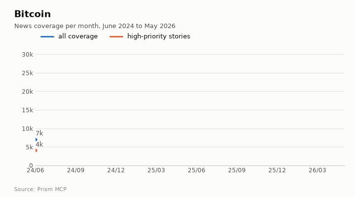
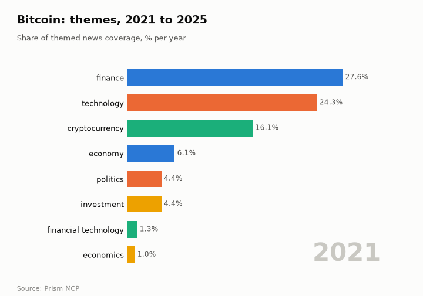
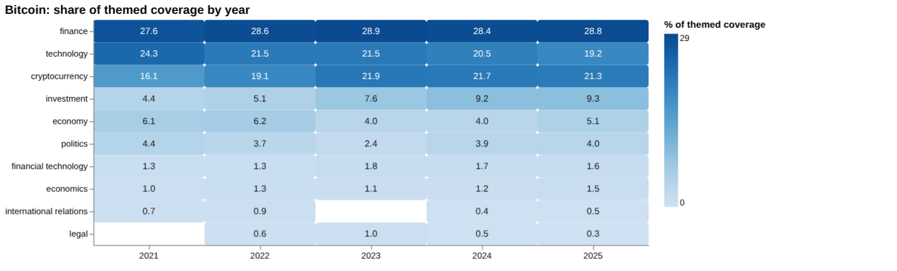
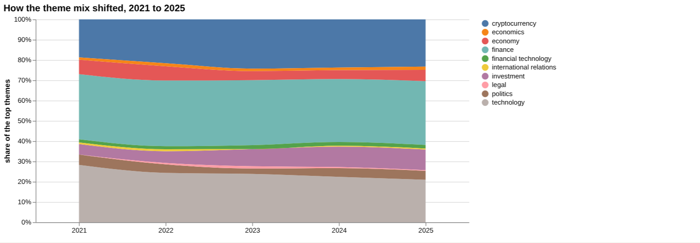
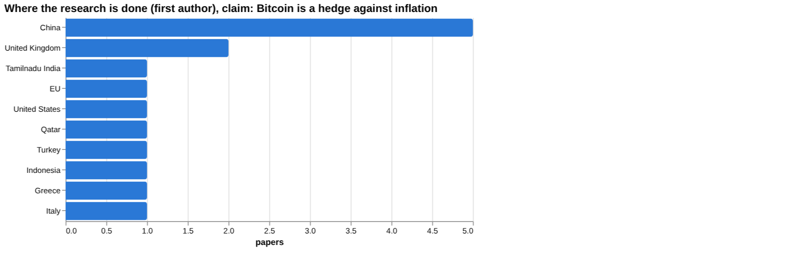
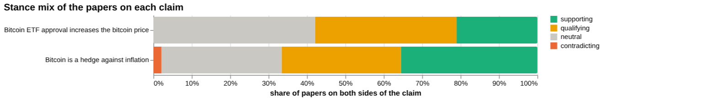
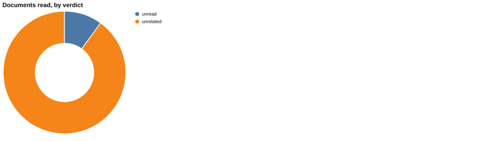
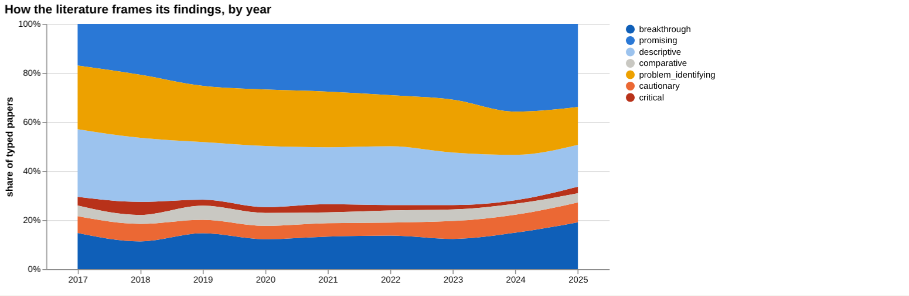
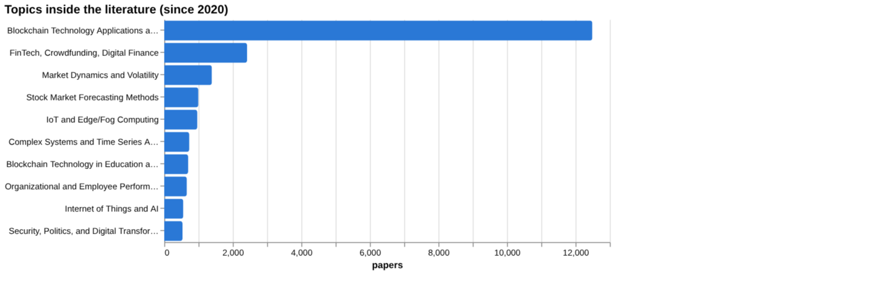
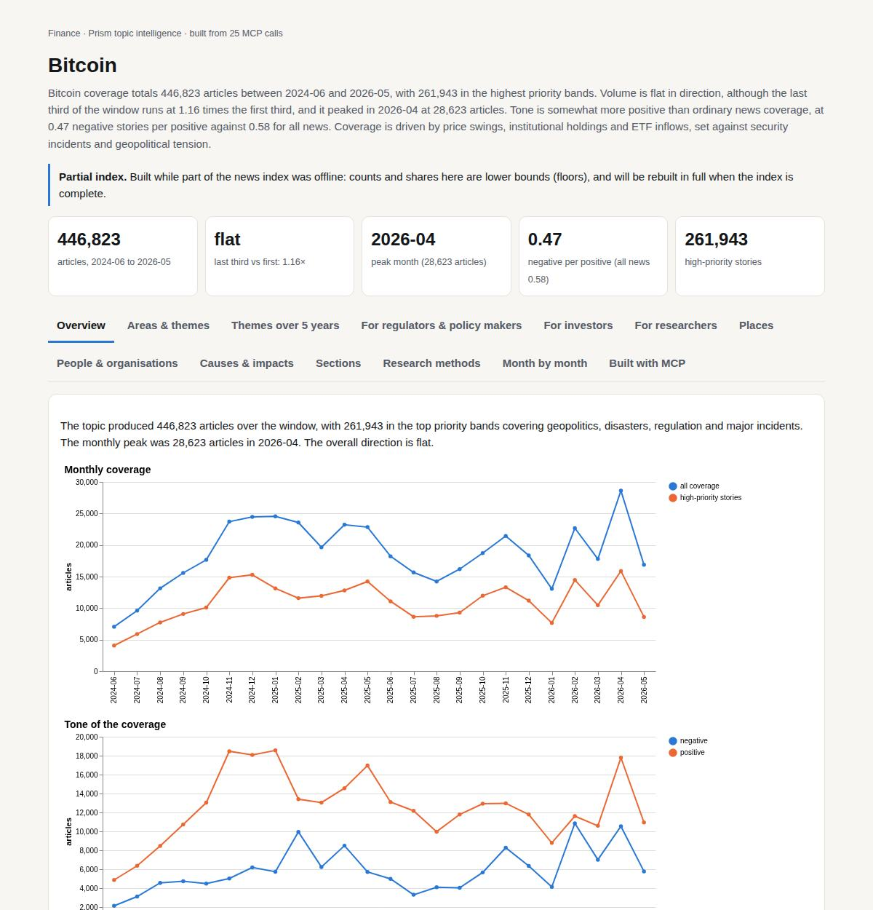

# Bitcoin

*Finance · Prism topic intelligence* · **[Open the interactive page](https://fliarbi.com/demo/docs/prism-dashboards-3bb43e4c/topics/bitcoin/)** (tabs: Overview · Areas & themes · Themes over 5 years · For regulators & policy makers · For investors · For researchers · Places · People & organisations · Causes & impacts · Sections · Research methods · Month by month · Built with MCP)

> **Partial index.** Built while part of the news index was offline: counts and shares here are lower bounds (floors), and will be rebuilt in full when the index is complete.

Bitcoin coverage totals 446,823 articles between 2024-06 and 2026-05, with 261,943 in the highest priority bands. Volume is flat in direction, although the last third of the window runs at 1.16 times the first third, and it peaked in 2026-04 at 28,623 articles. Tone is somewhat more positive than ordinary news coverage, at 0.47 negative stories per positive against 0.58 for all news. Coverage is driven by price swings, institutional holdings and ETF inflows, set against security incidents and geopolitical tension.

| Articles | Direction (last third vs first) | Peak month | Negative per positive | High-priority stories |
| ---: | --- | --- | ---: | ---: |
| 446,823 (2024-06 to 2026-05) | flat (1.16×) | 2026-04 (28,623) | 0.47 (all news 0.58) | 261,943 |

## Coverage over time

The topic produced 446,823 articles over the window, with 261,943 in the top priority bands covering geopolitics, disasters, regulation and major incidents. The monthly peak was 28,623 articles in 2026-04. The overall direction is flat.

## Areas of activity and themes

Activity centres on gambling (3,757), poker and casino games (2,936) and hacking and cracking (2,671), followed by computer science (1,529), physics (1,271) and search engines (885). The top tags are bitcoin (425,131), cryptocurrency (245,366), btc (166,333), ethereum (129,712) and blockchain (92,599), while themes include forex market effects, ETFs, technical analysis and regulatory compliance.

| Area of activity | Articles |
| --- | ---: |
| Games › Gambling | 3,757 |
| Games › Card Games › Poker & Casino Games | 2,936 |
| Computers & Electronics › Computer Security › Hacking & Cracking | 2,671 |
| Science › Computer Science | 1,529 |
| Science › Physics | 1,271 |
| Internet & Telecom › Search Engines | 885 |

**Top tags (what the themes are built from):** bitcoin (425,131), cryptocurrency (245,366), btc (166,333), ethereum (129,712), blockchain (92,599), eth (68,695), solana (67,567), defi (48,010)

## Where it is reported

The United States leads country placement with 162,887 articles, followed by China (24,113), the United Kingdom (18,714), Ireland (18,257), Italy (15,331) and Japan (12,597). Among states and regions, County Louth (18,132) and Trentino Alto Adige (13,241) lead, ahead of Oklahoma (13,135), New York (10,856), California (9,346) and Texas (9,294).

| Country | Articles | Lift | | Indian state | Articles | Lift |
| --- | ---: | ---: | --- | --- | ---: | ---: |
| United States | 162,887 | 1.7× | | County Louth | 18,132 | 81.3× |
| China | 24,113 | 1.1× | | Trentino Alto Adige | 13,241 | 195.3× |
| United Kingdom | 18,714 | 0.9× | | Oklahoma | 13,135 | 3.5× |
| Ireland | 18,257 | 6.0× | | New York | 10,856 | 1.4× |
| Italy | 15,331 | 2.8× | | California | 9,346 | 1.0× |
| Japan | 12,597 | 1.9× | | Texas | 9,294 | 1.2× |

## People and organisations

Coverage names Michael J. Saylor, Robert Kiyosaki, Charles Hoskinson, Satoshi Nakamoto, Cynthia Lummis and Peter Schiff. MicroStrategy features among the leading organisations alongside Ethereum and Dogecoin.

## Causes and impacts

Causes cited include an admin private key breach, three independent defects, weak approval hygiene, fake platforms and social engineering, and a single US-based threat actor. Impacts include authorities seizing more than 8 million, 24 people arrested, twelve protocols hacked, a $333,868 loss and $140 million worth of shorts wrecked.

**Causes named in the coverage:** admin private key breach, three independent defects, weak approval hygiene practices, fake platforms, social engineering, and crypto rails, single us-based threat actor, social engineering theft

**Impacts:** authorities seized more than 8 million, arrested 24 people, twelve protocols have been hacked, $333,868 loss, impacting numerous holders financially, $140 million worth of shorts were wrecked

## Sections inside the topic

The ETF section holds 51,800 articles, 11.59% of the topic, and its late period runs at 1.62 times its early period. The regulation section is much smaller at 6,718 articles, 1.5% of the topic, with a late-to-early ratio of 0.97. Both are more positive than the topic as a whole, at 0.35 and 0.37 negative per positive against 0.47.

| Section | Articles | Share of the topic | Late vs early | Negative per positive |
| --- | ---: | ---: | ---: | ---: |
| bitcoin → etf | 51,800 | 11.59% | 1.62× | 0.35 (topic 0.47) |
| bitcoin → regulation | 6,718 | 1.5% | 0.97× | 0.37 (topic 0.47) |

## Research and outlook

The balance of framing is broadly unchanged, with a shift of -3.0 points. The outlook projects a central level of 2225.0 for each of 2026, 2027 and 2028, with the range widening from 1632.0 to 2818.0 in 2026, to 1039.0 to 3411.0 in 2027 and 446.0 to 4004.0 in 2028.

## Month by month

In 2025-06 Bitcoin was positioned as a safe haven amid macro uncertainty, a gold rally and Middle-East tensions, and in 2025-08 it surged to multi-year highs on record institutional holdings. In 2025-10 it reached a fresh all-time high, then swung on Fed rate-cut expectations and geopolitical tension, before a later decline and a rebound supported by ETF inflows.

- **2025-06:** Macro uncertainty, gold rally, and Middle‑East tensions positioned Bitcoin as a new safe‑haven alternative.
- **2025-08:** Bitcoin surged to multi‑year highs with record institutional holdings, highlighting strong demand.
- **2025-10:** Bitcoin reached a fresh all‑time high then swung amid Fed rate‑cut expectations and geopolitical tension.

## Themes over five years

Finance stayed the leading theme throughout, at 27.6% of themed coverage in 2021 and 28.8% in 2025. Technology moved the other way, from 24.3% in 2021 to 19.2% in 2025. Cryptocurrency rose from 16.1% to 21.3% over the same period, and investment from 4.4% to 9.3%. Smaller themes were steadier: economy went from 6.1% to 5.1%, politics from 4.4% to 4.0%, financial technology from 1.3% to 1.6% and economics from 1.0% to 1.5%. International relations was 0.7% in 2021 and 0.5% in 2025, while legal first appeared in 2022 at 0.6% and stood at 0.3% in 2025.

| Theme | 2021 | 2022 | 2023 | 2024 | 2025 |
| --- | ---: | ---: | ---: | ---: | ---: |
| finance | 27.6% | 28.6% | 28.9% | 28.4% | 28.8% |
| technology | 24.3% | 21.5% | 21.5% | 20.5% | 19.2% |
| cryptocurrency | 16.1% | 19.1% | 21.9% | 21.7% | 21.3% |
| investment | 4.4% | 5.1% | 7.6% | 9.2% | 9.3% |
| economy | 6.1% | 6.2% | 4.0% | 4.0% | 5.1% |
| politics | 4.4% | 3.7% | 2.4% | 3.9% | 4.0% |
| financial technology | 1.3% | 1.3% | 1.8% | 1.7% | 1.6% |
| economics | 1.0% | 1.3% | 1.1% | 1.2% | 1.5% |
| international relations | 0.7% | 0.9% | – | 0.4% | 0.5% |
| legal | – | 0.6% | 1.0% | 0.5% | 0.3% |

## For regulators & policy makers

News coverage of Bitcoin is large, with 97,143 articles in the index for 2019-01-01..2026-06-01, and the research base holds 37,482 papers for 2017-2025. The one headline figure given is a Bitcoin economy worth 10 billions of dollars. Legal coverage is a small part of the themed mix, at 0.3% in 2025, and politics was 4.0% in the same year. The stories flagged for 2026 link Bitcoin to US-Iran tensions and oil, which points to geopolitical sensitivity in market coverage. Where research is geographically located, China appears in 5 entries, the United Kingdom in 2, and the EU, United States, Qatar, Turkey, Indonesia and Tamilnadu India in 1 each, so the location data is thin. The scenario baseline is no change, with a central figure of 2,225 for each of 2026, 2027 and 2028, and sensitivity ranges that widen from 1,632 to 2,818 in 2026 and 446 to 4,004 in 2028.

- Geopolitical headlines (Iran, oil) in March and April 2026 tied to Bitcoin selling pressure
- Legal theme share at 0.3% in 2025, against 9.3% for investment
- Geographic evidence is sparse: China 5 entries, most other places 1
- Scenario range for 2028 runs from 446 to 4,004 around a central 2,225
- Central bank digital currency papers feature among the newest influential work

## For investors

The claim that Bitcoin is a hedge against inflation has no verified document verdict behind it: of the documents read, none supports, contradicts or qualifies it, and 10 are unrelated in the counter-evidence tally. The wider corpus of 78,075 papers shows 27,745 supporting, 24,255 qualifying, 1,640 contradicting and 24,435 neutral, with 33.2% contested. That is positive framing with a substantial cautionary minority, but it does not amount to direct evidence on inflation. The four listed components of the hedge claim, including price appreciation in inflationary periods and storing value over time, each show no evidence. Against the second claim, that ETF approval raises the price, the first claim is judged to have more evidence behind it, though the ETF claim has 57 papers on both poles and 36.8% contested. Screening found no figures for inflation, ETF flows, regulation announcements or interest rates, which means nothing was found rather than no effect.

- Inflation-hedge claim: 0 documents supports, contradicts or qualifies; no wording recommendation supported
- Corpus stance on the hedge claim: 33.2% contested across 78,075 papers
- Top sources are article tier, e.g. Decentralizing Money: Bitcoin Prices and Blockchain Security (2020), cited by 206
- ETF-price claim: corpus of 12 supporting, 21 qualifying, 0 contradicting, 24 neutral; 36.8% contested
- Review tier: 3 documents for the hedge claim, none giving a verdict

**Head to head:** Bitcoin is a hedge against inflation vs Bitcoin ETF approval increases the bitcoin price: the first claim has more evidence behind it.

**Screen:** *How is bitcoin related to …?* (one row per line below)

| Row | Figure (quoted) | Measures | Source |
| --- | --- | --- | --- |
| inflation | no figure found |  |  |
| stock market returns | no figure found |  | The impact of macroeconomic news on Bitcoin returns (2020) |
| regulation announcements | no figure found |  |  |
| energy use | no figure found |  | CARBON EMISSIONS FROM THE HEALTH-CARE SYSTEM AND BITCOIN MINING IN KAZAKHSTAN: COMPARATIVE (2025) |
| ETF flows | no figure found |  |  |
| interest rates | no figure found |  | Short-term bitcoin market prediction via machine learning (2021) |

## For researchers

The literature is dominated by blockchain applications, with Blockchain Technology Applications and Security at 12,491 papers, far above Market Dynamics and Volatility at 1,391. Orientation is led by promising work at 30.8%, followed by descriptive at 21.0% and problem-identifying at 20.1%, with cautionary at 7.0% and critical at 2.2%. Empirical contributions number 7,841 and theoretical ones 716. By year, positive framing was 15.5% in 2017 and 26.7% in 2025, while contested was 17.8% and 13.2%. Newer influential work centres on central bank digital currency and herding or volatility spillover in crypto markets, and the studies listed as most cited since 2020 are 2025 papers with no citations yet. Only 35 the health literature index records and 90 arXiv preprints exist, so study-design evidence is limited.

- What evidence tests Bitcoin as an inflation hedge, given 0 papers found for inflation in screening?
- Do ETF flows or interest rates have measurable links to price, when screening found no figures?
- Why does energy use have only 1 paper in screening, a 2025 Kazakhstan study?
- Is the shift from 40.5% to 34.1% cautionary a real change or an effect of labelling?
- How far do blockchain application papers, 12,491 in total, say anything about Bitcoin itself?

## Research exploration methods

Nine ways to explore the research, each run on this topic; the interactive report shows each call and its result.

### Evidence triangulation

*Is a claim supported, and by how strong a design?* `find_evidence` + `find_counter_evidence` + `rank_sources`

For the claim "Bitcoin is a hedge against inflation", the ten documents read were split into 9 "unrelated" and 1 "unread", with 3 reviews and 7 articles by tier. None was verified as supporting, contradicting or qualifying, so the claim is not tested by any document actually read. The wider corpus of 78,075 papers shows 27,745 supporting, 24,255 qualifying, 1,640 contradicting and 24,435 neutral, with a contested share of 33.2% and a reading of mostly positive framing with a cautionary minority. That is a count of how papers present themselves, not a finding that the claim holds. The counter-evidence search also returned 10 unrelated and nothing in the other categories, and the tool states that no verified document verdict supports a wording recommendation. A careful researcher would treat the claim as unproven here, and would look for studies that directly test bitcoin returns against inflation measures rather than papers that merely mention both terms. The top sources are 12 articles, led by a 2020 paper with 206 citations, and none is a review, so the design strength is weak.

### Head-to-head claims

*Which of two interventions has more and stronger evidence?* `compare_claims`

The comparison puts "Bitcoin is a hedge against inflation" against "Bitcoin ETF approval increases the bitcoin price", and the verdict is that the first claim has more evidence behind it. That verdict rests mainly on corpus volume: the first claim has 27,745 supporting papers in its mix, the second only 12. Neither claim has any document read as supporting, contradicting or qualifying; the first has 12 unrelated and 1 unread, the second 11 unrelated. Papers on both poles are 0 for the first and 57 for the second, so the ETF claim is the only one with any papers that touch both sides. The strongest source named for each is marked unrelated: a 2022 review on central bank digital currency for the first, and a 2002 article on multilevel marketing and pyramid schemes for the second. The verdict therefore says which claim has the larger literature, not which is better established. A careful researcher would not treat either claim as settled and would find direct event-study or return-regression work for each.

### Cross-row screening

*Which rows carry a measured, quoted figure, and how large is it?* `research_table`

The screening asked how bitcoin relates to six factors, and no row returned a quoted value, measure or population. Paper counts were 0 for inflation, stock market returns, regulation announcements, ETF flows and interest rates, and 1 for energy use. Three rows nonetheless name a source: a 2020 paper on macroeconomic news and bitcoin returns, a 2021 paper on short-term bitcoin prediction via machine learning, and a 2025 paper on carbon emissions from the health-care system and bitcoin mining in Kazakhstan. These are named sources without an extracted effect size, so they should not be read as evidence of any particular relationship. The absence means that, for this question, the tool could not find a quotable figure for any factor, which is a gap in extractable evidence rather than proof that no effect exists. A careful researcher would read the three named papers directly and rephrase the question more narrowly for each factor.

### Framing drift

*Is the literature becoming more hopeful or more cautious?* `stance_trends`

Positive framing rose from 15.5 in 2017 to 26.7 in 2025, while contested framing fell from 17.8 to 13.2 over the same years. The shift is not perfectly steady: positive share was 19.9 in 2019 and 19.7 in both 2020 and 2021, then reached 24.9 in 2024. Contested_pct sat at 18.1 in 2018 and was 13.0 in 2024, its lowest point in the series. The pattern suggests the literature has become more hopeful in how papers describe themselves. It does not show that bitcoin has become more reliable, since the labels reflect each paper's own framing and not the truth. Growth in positive framing could also reflect a change in what kinds of papers are being written, for example more technology applications. A careful researcher would check whether the shift holds within the finance-focused subset rather than across the whole field.

### Frontier scan

*What is new, and what is the research not reaching?* `research_radar`

The most-cited new work is dominated by central bank digital currency and cryptocurrency market behaviour, not bitcoin as an inflation hedge. The top item is "Should Central Banks Issue Digital Currency?" (2022, The Review of Economic Studies, 245 citations, cautionary), followed by a 2022 review on central bank digital currency research with 204 citations. The others cover herding and volatility spillover in crypto markets, plus one welfare paper labelled breakthrough. Between windows, cautionary_pct moved from 40.5 across 8,757 earlier papers to 34.1 across 9,974 recent papers, a delta of -6.4 percentage points, yet the tool reads framing as broadly unchanged. The caveat is that orientation labels the paper's own framing, not the truth. No under-covered topics are listed in the result, so it says nothing about what the research is failing to reach. A careful researcher would read the central bank digital currency papers for context and check whether any of the herding work addresses inflation directly.

### Gap mapping

*Which parts of a claim does the literature actually cover?* `research_gaps`

The claim "Bitcoin is a hedge against inflation" was split into four components, and each one came back with evidence "no". The components are price appreciation during inflationary periods, value storage over time, being uncorrelated with fiat currencies, and real asset protection against rising prices. This means the tool found no literature matching any component, even though the wider corpus holds tens of thousands of papers that mention the topic. The likelier reading is that the claim has not been broken down and tested in the indexed literature, or that the matching failed, not that the question has been studied and refuted. It does not show that the claim is false. A careful researcher would test each component separately with narrower searches, for example on bitcoin's correlation with consumer price changes, and would check whether the components themselves are sensible tests of a hedge.

### Count history and backtested scenarios

*Is research on this growing, and where could it be in three years?* `historical_analysis` + `scenarios`

The count of papers per year came back empty, so there is no historical series to read and growth cannot be judged from this output. The scenarios therefore rest on a no_change baseline, which gives a central value of 2,225 for each of 2026, 2027 and 2028. The sensitivity band widens over time: 1,632 to 2,818 in 2026, 1,039 to 3,411 in 2027, and 446 to 4,004 in 2028. The flat central line is an assumption of no change, not a forecast of stability, and the widening band shows how little the method can say three years out. Without the yearly counts the reader cannot tell where 2,225 sits relative to past levels. A careful researcher would rerun the count with an explicit window and check how the title matching behaves before relying on any of these figures.

### Geographic triangulation

*Where is it studied, published, reported and patented?* `global_comparison` + `newsgeo`

Only the study-location lane returned data. China leads the list with 5, followed by the United Kingdom with 2, and then Tamilnadu India, the EU, the United States, Qatar, Turkey and Indonesia with 1 each. These are small counts, so they describe a handful of documents and not the geography of bitcoin research as a whole. The where-reported-by-country lane is empty, so nothing can be said about where news coverage originates or what places it concerns. The lanes answer different questions and are not added together. The absence of coverage data means the comparison between where bitcoin is studied and where it is reported cannot be made here. A careful researcher would treat the ranking as indicative of the sample read and seek a broader count before drawing conclusions about regional emphasis.

### Faceted browsing

*What kind of literature is it: empirical, review, position? Problem-identifying or promising?* `browse_research`

By orientation, promising papers are 5,987 (30.8 per cent), followed by descriptive at 4,075 (21.0), problem_identifying at 3,915 (20.1), breakthrough at 2,747 (14.1), cautionary at 1,369 (7.0), comparative at 929 (4.8) and critical at 426 (2.2). By contribution, empirical papers number 7,841, methodological 5,888, review 2,923, position 2080 and theoretical 716. The leading topic is Blockchain Technology Applications and Security with 12,491 papers, well ahead of FinTech, Crowdfunding, Digital Finance at 2,419 and Market Dynamics and Volatility at 1,391. This shows that the literature is largely about blockchain technology broadly, not bitcoin pricing or inflation, which limits how far the corpus can speak to the hedge claim. The most-cited-since-2020 list is of little use: all six items shown are from 2025 with 0 citations, and most concern blockchain applications such as healthcare and supply chains. A careful researcher would filter to the finance topics and to empirical work before drawing on these counts.

## Built with MCP

Every number and chart on this page comes from these 25 Prism MCP tool calls, made over MCP (streamable HTTP). Arguments and timings: [mcp_calls.json](mcp_calls.json); responses: [data.json](data.json).

| MCP tool | Calls |
| --- | ---: |
| `news_activities` | 1 |
| `news_geography` | 1 |
| `prism_overview` | 1 |
| `news_drill` | 2 |
| `news_themes` | 5 |
| `news_factors` | 1 |
| `historical_analysis` | 1 |
| `critical_news` | 1 |
| `stance_trends` | 1 |
| `browse_research` | 1 |
| `research_radar` | 1 |
| `research_brief` | 1 |
| `research_gaps` | 1 |
| `global_comparison` | 1 |
| `rank_sources` | 1 |
| `find_evidence` | 1 |
| `find_counter_evidence` | 1 |
| `deep_timeline` | 1 |
| `research_table` | 1 |
| `compare_claims` | 1 |

Try it: `prism entity "bitcoin"` · `prism call news.drill term='bitcoin' scope='etf'` · `prism call analysis.timeline term='bitcoin'`

