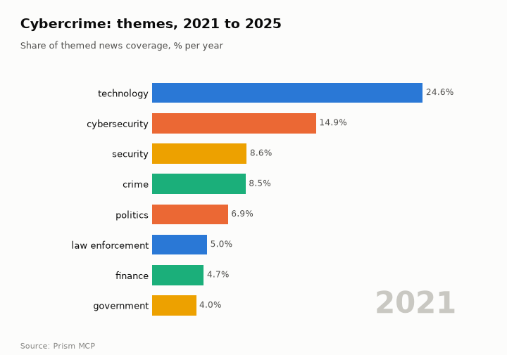
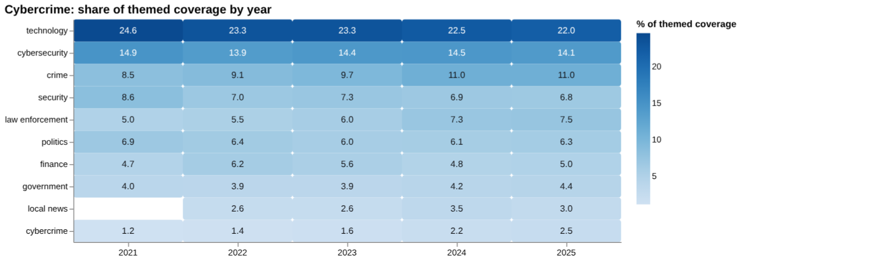
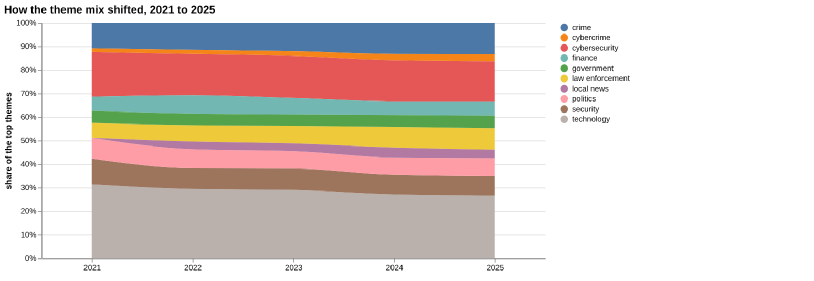
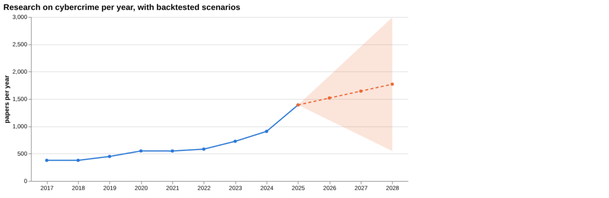
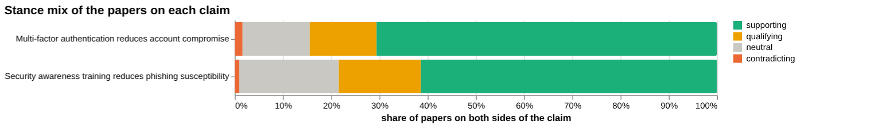
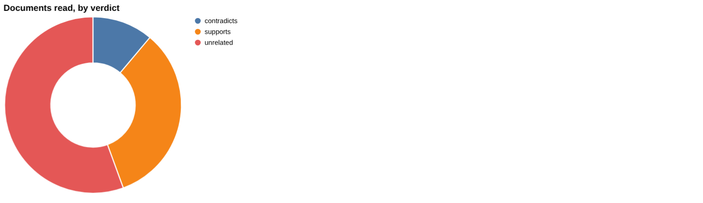
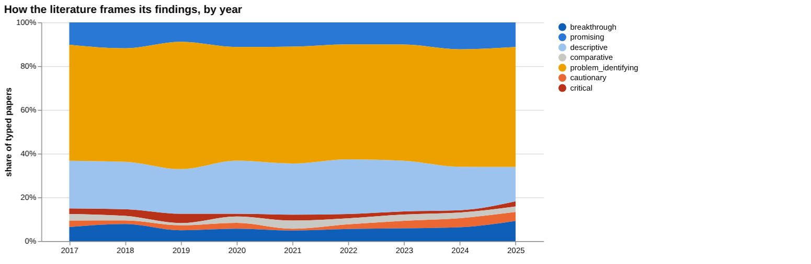
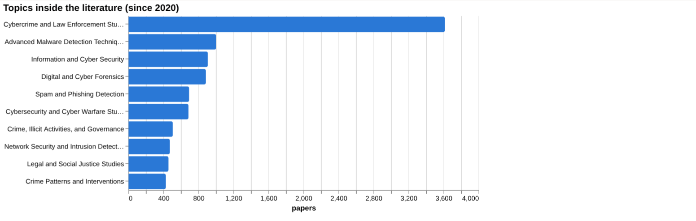
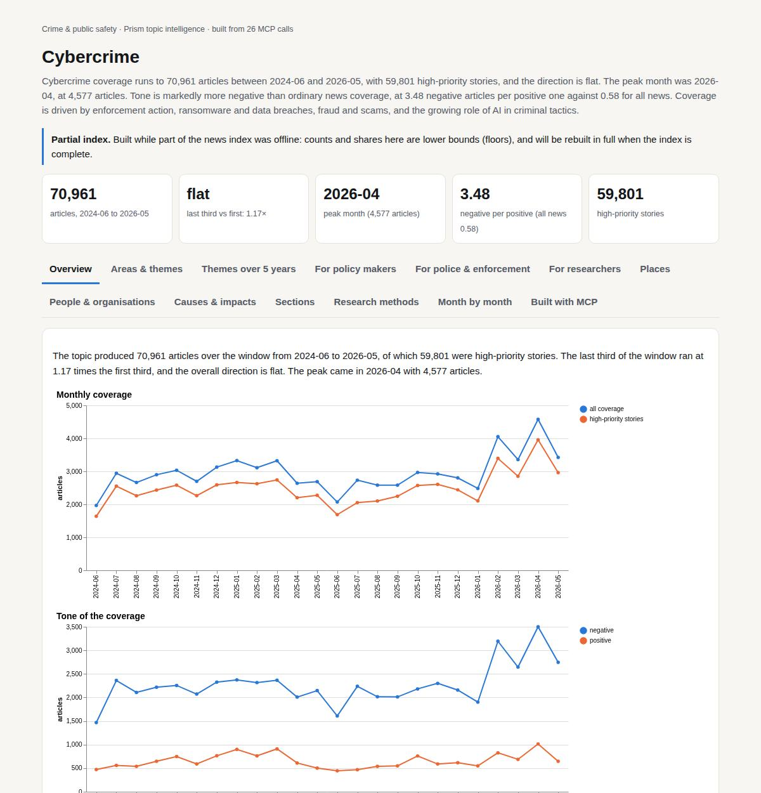

# Cybercrime

*Crime & public safety · Prism topic intelligence* · **[Open the interactive page](https://fliarbi.com/demo/docs/prism-dashboards-3bb43e4c/topics/cybercrime/)** (tabs: Overview · Areas & themes · Themes over 5 years · For policy makers · For police & enforcement · For researchers · Places · People & organisations · Causes & impacts · Sections · Research methods · Month by month · Built with MCP)

> **Partial index.** Built while part of the news index was offline: counts and shares here are lower bounds (floors), and will be rebuilt in full when the index is complete.

Cybercrime coverage runs to 70,961 articles between 2024-06 and 2026-05, with 59,801 high-priority stories, and the direction is flat. The peak month was 2026-04, at 4,577 articles. Tone is markedly more negative than ordinary news coverage, at 3.48 negative articles per positive one against 0.58 for all news. Coverage is driven by enforcement action, ransomware and data breaches, fraud and scams, and the growing role of AI in criminal tactics.

| Articles | Direction (last third vs first) | Peak month | Negative per positive | High-priority stories |
| ---: | --- | --- | ---: | ---: |
| 70,961 (2024-06 to 2026-05) | flat (1.17×) | 2026-04 (4,577) | 3.48 (all news 0.58) | 59,801 |

## Coverage over time

The topic produced 70,961 articles over the window from 2024-06 to 2026-05, of which 59,801 were high-priority stories. The last third of the window ran at 1.17 times the first third, and the overall direction is flat. The peak came in 2026-04 with 4,577 articles.

## Areas of activity and themes

The top tags are cybercrime (68,069), cybersecurity (35,012), fraud (10,045), ransomware (4,012) and data breach (3,871), and the themes cover cybercrime laws and digital forensics, ransomware attack vectors, and phishing and scam prevention guides.

| Area of activity | Articles |
| --- | ---: |
| Law & Government › Public Safety › Crime & Justice | 34,998 |
| Computers & Electronics › Computer Security › Network Security | 17,029 |
| Computers & Electronics › Computer Security › Hacking & Cracking | 16,424 |
| Shopping › Consumer Resources › Identity Theft Protection | 13,909 |
| Shopping › Consumer Resources › Consumer Advocacy & Protection | 3,192 |
| Computers & Electronics › Computer Security › Antivirus & Malware | 1,385 |

**Top tags (what the themes are built from):** cybercrime (68,069), cybersecurity (35,012), fraud (10,045), ransomware (4,012), data breach (3,871), scams (3,353), cyber crime (3,332), data security (3,265)

## Where it is reported

Among countries, the United States leads with 15,017 articles, followed by India with 12,244, the United Kingdom with 4,717, China with 2,648, Nigeria with 2,357 and France with 2,103. Among Indian states, Maharashtra has 2016 articles, then Telangana with 1,695 and Uttar Pradesh with 1,615, while California (1,823), New York (1,757) and Pennsylvania (1,594) are the other places in the leading six.

| Country | Articles | Lift | | Indian state | Articles | Lift |
| --- | ---: | ---: | --- | --- | ---: | ---: |
| United States | 15,017 | 0.9× | | Maharashtra | 2,016 | 5.4× |
| India | 12,244 | 2.6× | | California | 1,823 | 1.1× |
| United Kingdom | 4,717 | 1.3× | | New York | 1,757 | 1.2× |
| China | 2,648 | 0.7× | | Telangana | 1,695 | 14.2× |
| Nigeria | 2,357 | 4.5× | | Uttar Pradesh | 1,615 | 6.6× |
| France | 2,103 | 1.7× | | Pennsylvania | 1,594 | 1.1× |

## People and organisations

The people named most often include Pavel Durov, Naseeruddin Shah, Changpeng Zhao, G. Parameshwara and Elon Musk. Organisations include the United Nations Office on Drugs and Crime, Europol and the Lazarus Group.

## Causes and impacts

Causes cited include a $36 million business email compromise scam, a jailbroken Google Gemini, unauthorised access to internal repositories, and a scareware campaign built to freeze screens. Impacts include the abuse and sexual exploitation of children, credential-theft campaigns targeting supporters, a cyberattack on GitHub, and a 9-nation Interpol-led crackdown.

**Causes named in the coverage:** participating in 764 online extremist collective, using a jailbroken Google Gemini, using the Kik app to share sexual content, duped in a $36 million business email compromise scam, unauthorised access to internal repositories, cypherloc scareware campaign built to freeze screens

**Impacts:** abusing and sexually exploiting children, fraud and credential‑theft campaign targeting supporters, sending explicit messages and images to undercover officers, triggering a 9‑nation Interpol‑led crackdown, target of a cyberattack on GitHub, freezing screens and mimicking security alerts

## Sections inside the topic

The digital arrest section has 1,791 articles, 2.52 per cent of the topic, and it is running at 1.39 times its early level. Its tone is far more negative than the topic as a whole, at 10.43 negative articles per positive one against 3.48. The UPI section is smaller at 538 articles, 0.76 per cent of the topic, but has grown faster at 1.78 times its early level, with a tone of 3.96 negative per positive, close to the topic figure.

| Section | Articles | Share of the topic | Late vs early | Negative per positive |
| --- | ---: | ---: | ---: | ---: |
| cybercrime → digital arrest | 1,791 | 2.52% | 1.39× | 10.43 (topic 3.48) |
| cybercrime → upi | 538 | 0.76% | 1.78× | 3.96 (topic 3.48) |

## Research and outlook

Research framing shows a shift of -0.7 points, and the balance of framing is broadly unchanged. The outlook projects 1,517.625 for 2026, 1,644.25 for 2027 and 1,770.875 for 2028, with a widening range that reaches from 549.018 to 2,992.732 by 2028.

## Month by month

Coverage moved from isolated arrests in mid-2025 to coordinated international crackdowns, such as Operation Serengeti 2.0 in 2025-08, and then to nation-state threats in 2025-10, including the F5 breach in U.S. agencies and the 2.15-terabyte Kenya data theft. Early 2026 brought AI-driven scams and tactics, and the April wave of arrests over AI-generated child sexual abuse material.

- **2025-06:** Wave of high‑profile arrests, physical threats to crypto figures, and a record‑breaking data breach marked an escalation in both enforcement and criminal intimidation.
- **2025-08:** Largest coordinated African crackdown (Operation Serengeti 2.0) and expulsions of foreign nationals highlighted a move toward multinational disruption of cybercrime networks.
- **2025-10:** Nation‑state F5 breach in U.S. agencies and the 2.15‑terabyte Kenya data theft introduced large‑scale state‑level threats and expanded target sectors.

## Themes over five years

Technology stayed the leading theme in the ranking, moving from 24.6% of themed coverage in 2021 to 22.0% in 2025. Cybersecurity went from 14.9% to 14.1%, and security from 8.6% to 6.8%. Crime rose from 8.5% to 11.0%, law enforcement from 5.0% to 7.5%, and the cybercrime theme itself from 1.2% to 2.5%. Politics went from 6.9% to 6.3%, finance from 4.7% to 5.0% and government from 4.0% to 4.4%. Local news first appears in 2022 at 2.6% and stands at 3.0% in 2025.

| Theme | 2021 | 2022 | 2023 | 2024 | 2025 |
| --- | ---: | ---: | ---: | ---: | ---: |
| technology | 24.6% | 23.3% | 23.3% | 22.5% | 22.0% |
| cybersecurity | 14.9% | 13.9% | 14.4% | 14.5% | 14.1% |
| crime | 8.5% | 9.1% | 9.7% | 11.0% | 11.0% |
| security | 8.6% | 7.0% | 7.3% | 6.9% | 6.8% |
| law enforcement | 5.0% | 5.5% | 6.0% | 7.3% | 7.5% |
| politics | 6.9% | 6.4% | 6.0% | 6.1% | 6.3% |
| finance | 4.7% | 6.2% | 5.6% | 4.8% | 5.0% |
| government | 4.0% | 3.9% | 3.9% | 4.2% | 4.4% |
| local news | – | 2.6% | 2.6% | 3.5% | 3.0% |
| cybercrime | 1.2% | 1.4% | 1.6% | 2.2% | 2.5% |

## For policy makers

Research output on cybercrime has grown from 378 papers in 2017 to 1,391 in 2025, within a literature of 96,486 papers. The central linear-drift scenario puts output at 1,518 in 2026, 1,644 in 2027 and 1,771 in 2028, with sensitivity ranges that widen to 549 at the lower end and 2,993 at the upper end by 2028. Cost estimates are headline figures: just under USD 1 trillion to the global economy, with an increase of more than 50% since 2018. No geographic breakdown of where the problem is studied or reported was available, so priorities by country cannot be drawn from this data. Media attention to crime and law enforcement has grown as a share of themed coverage, which is relevant to public expectations. The prevalence screening found a figure only for cyberbullying, at nearly 10% of European children affected monthly, and none for phishing, ransomware, identity theft, online fraud or data breaches.

- Research output of 1,391 papers in 2025 and a central scenario of 1,518 for 2026, with wide sensitivity ranges
- Law enforcement coverage share at 7.5% in 2025, up from 5.0% in 2021
- No country-level data on where cybercrime is studied or reported
- Prevalence figures missing for five of six screened crime types
- Cost figure of just under USD 1 trillion to the global economy is a headline estimate

## For police & enforcement

On the claim that security awareness training reduces phishing susceptibility, the supporting corpus is large: 44,368 papers, of which 27,255 are supporting, 7,556 qualifying, 401 contradicting and 9,156 neutral, with 17.9% contested. That framing is strongly positive, which may reflect consensus or publication bias. Of the documents actually read, 3 support, 1 contradicts and 5 are unrelated; the read set is one review and eight articles. The strongest source is a 2025 review, which supports the claim but has been cited by 3. Older articles carry more citations: a 2019 article on training methodologies has 60 and a 2017 study of click-through rates has 38. In a direct comparison, the claim on multi-factor authentication reducing account compromise has 10,569 supporting papers, but none of the 10 documents read bore on it, so the training claim has more evidence behind it.

- Review tier: a 2025 review supports training reducing phishing susceptibility, cited by 3
- Article tier: a 2019 article on training methods is cited by 60 and a 2017 click-through study by 38
- Documents read on training: 3 support, 1 contradicts, 5 unrelated; the differences between the supporting and contradicting findings need explaining
- Multi-factor authentication claim: 10 documents read were all unrelated, so direct support is untested here
- Corpus stance on training is 17.9% contested, against 43.3% for the topic overall

**Head to head:** Multi-factor authentication reduces account compromise vs Security awareness training reduces phishing susceptibility: the second claim has more evidence behind it.

**Screen:** *How prevalent is …?* (one row per line below)

| Row | Figure (quoted) | Measures | Source |
| --- | --- | --- | --- |
| phishing | no figure found |  | A framework for detection and measurement of phishing attacks (2007) |
| ransomware | no figure found |  | A Recent Assessment for the Ransomware Attacks Against the Internet of Medical Things (IoM (2023) |
| identity theft | no figure found |  |  |
| online fraud | no figure found |  | The Psychology of Internet Fraud Victimisation: a Systematic Review (2019) |
| cyberbullying | nearly 10% | percentage of European children affected monthly |  |
| data breaches | no figure found |  | Data security crisis in universities: identification of key factors affecting data breach  (2023) |

## For researchers

The literature is large and actively contested: of 96,486 papers, 29,582 are supporting, 38,587 qualifying, 3,232 contradicting and 25,085 neutral, with 43.3% contested. By orientation, problem-identifying work accounts for 3,746 papers (53.8%), followed by descriptive at 1,442 (20.7%) and promising at 796 (11.4%). Empirical work is the leading contribution type at 2,918 papers, ahead of position pieces at 1,844 and reviews at 1,018. The largest topic cluster is Cybercrime and Law Enforcement Studies at 3,615 papers. Thin spots include theoretical work at 186 papers, the absence of country data, and recent frontier work that is heavily policy and governance oriented, with the most-cited recent papers all showing zero citations.

- Why are theoretical contributions (186 papers) so few against empirical (2,918) and position (1,844) work?
- Does the unchanged framing hide shifts within sub-topics such as phishing or malware detection?
- Where is cybercrime research conducted and reported, given that no geographic data was available?
- Recent work is too new to have citations: how should influence be judged for 2025 papers?
- Prevalence measurement for ransomware, identity theft, online fraud and data breaches appears to be missing from the literature

## Research exploration methods

Nine ways to explore the research, each run on this topic; the interactive report shows each call and its result.

**Chaining them.** Begin with the triangulation output to gauge the overall support for the training claim and identify key sources. Use the head‑to‑head comparison to confirm that the training claim has a larger evidence base than alternative interventions. Consult the screening results to note the lack of quantitative prevalence data for most risk factors, prompting targeted searches for missing effect sizes. Review the framing and frontier analyses to understand whether the literature's stance is shifting and to locate recent, potentially under‑cited works. Finally, integrate the gap mapping, history, and facets to pinpoint covered components, growth trends, and dominant research orientations, guiding further focused investigations.

### Evidence triangulation

*Is a claim supported, and by how strong a design?* `find_evidence` + `find_counter_evidence` + `rank_sources`

For the claim that security awareness training reduces phishing susceptibility, the nine documents read split into 3 that support, 1 that contradicts and 5 that are unrelated. Only 1 is a review and 8 are articles, so the direct evidence is thin and mostly single studies. The wider corpus of 44,368 papers is framed as 27,255 supporting, 7,556 qualifying, 401 contradicting and 9,156 neutral, with contested share at 17.9. That positive framing can reflect consensus or publication bias, and the data cannot say which. The counter-evidence search found 1 supporting and 1 contradicting document, with 4 unrelated and 1 unread, so the disagreement is real but barely examined. A careful researcher would read the contradicting document against the 2025 review and the 2019, 2017 and 2022 articles, and establish whether differences in design, population or outcome measure explain the split.

### Head-to-head claims

*Which of two interventions has more and stronger evidence?* `compare_claims`

The comparison covers multi-factor authentication reducing account compromise (a) and security awareness training reducing phishing susceptibility (b). The verdict is that the second claim has more evidence behind it, with 44,368 papers on both poles against 9 for the first. The corpus mix for a is 10,569 supporting, 2075 qualifying, 236 contradicting and 2085 neutral, with contested share at 15.4, against 17.9 for b. The comparison has a gap: all 10 documents read for a were judged unrelated, so none of them tested the claim directly, and its strongest source, a 2021 article on financial transactions in a cloud environment, was also marked unrelated. The verdict therefore reflects volume and the presence of a relevant review for b, not a demonstrated difference in how well either intervention works. The two contested percentages are close and do not separate the claims. A careful researcher would rerun a with a better-matched query before treating it as weakly evidenced.

### Cross-row screening

*Which rows carry a measured, quoted figure, and how large is it?* `research_table`

The screening asked how prevalent each of six risk factors is, and only one returned a figure: cyberbullying at nearly 10%, measured as the percentage of European children affected monthly. That figure has no stated population beyond that description and no source or year attached, so it cannot be checked or compared. Phishing, ransomware, identity theft, online fraud and data breaches returned no value. Phishing had 2 papers and the others 0, even though several had a named source, such as the 2023 review of ransomware against the Internet of Medical Things and the 2019 systematic review of internet fraud victimisation. The absence means the extraction found no quotable prevalence statement, not that prevalence is unmeasured. These sources may report figures in a different form or may address victimisation and mechanisms rather than prevalence. A careful researcher would read those named sources directly and reframe the question per risk factor, for example as incidence, victimisation rate or loss.

### Framing drift

*Is the literature becoming more hopeful or more cautious?* `stance_trends`

Across 2017 to 2025, positive share stays in a narrow band, from 6.5 in 2019 to 10.2 in 2018, and ends at 10.0 in 2025. Contested_pct also holds steady, from 28.5 in 2021 to 30.5 in 2019, with 29.8 in 2025. The picture is of a literature whose balance of hopeful and contested framing has hardly moved, with no clear drift towards optimism or caution. Small year-to-year movements, such as positive share rising from 7.9 in 2023 to 9.0 in 2024 and 10.0 in 2025, are not enough to call a trend. The series records how papers frame themselves, not whether interventions work or threats are growing. A careful researcher would check how many typed papers sit behind each year and whether the 2025 uptick persists.

### Frontier scan

*What is new, and what is the research not reaching?* `research_radar`

The most-cited new work list returned five items, but none has a cited_by count or an orientation label, so it cannot be ranked by influence. They are also a mixed set: Nigerian banking cyberfraud (2024), attacks on cyber physical systems (2022), digital governance in Qatar (2025), Palantir and the tech oligarchy (2025) and Nepal's national AI policy (2025). Several look only loosely connected to cybercrime, which suggests the radar picked up adjacent policy work. The framing shift compares 57,354 recent papers at 41.7 cautionary_pct with 39,132 earlier papers at 45.8, a delta_pct_points of -4.1, read as broadly unchanged. The caveat applies: orientation labels the paper's own framing, not the truth. No under-covered topics were returned, so the scan says nothing about where research is not reaching. A careful researcher would screen the five titles for relevance and look for gaps by another route.

### Gap mapping

*Which parts of a claim does the literature actually cover?* `research_gaps`

The claim was split into three components: the claim itself, phishing awareness training lowering click rates, and employee training improving detection of phishing emails. All three are marked as having evidence. This shows that a literature exists for each component, which fits the 44,368 papers and the click-rate studies seen elsewhere. It does not show how strong that evidence is, how recent, or whether it holds beyond the short-term settings typical of such studies. The components also overlap heavily, so the check is a coarse test of coverage rather than of depth. It does not test other parts of the claim, such as how long effects last, differences between organisations or what happens to real incidents. A careful researcher would add components of that kind and check each against study design and follow-up length.

### Count history and backtested scenarios

*Is research on this growing, and where could it be in three years?* `historical_analysis` + `trend_scenarios`

Title-matched papers per year rise from 378 in 2017 and 378 in 2018 to 449 in 2019, 550 in 2020, 549 in 2021, 583 in 2022, 726 in 2023, 908 in 2024 and 1,391 in 2025. Growth is gradual until 2022 and steeper afterwards. The linear_drift baseline projects a central 1,518 for 2026, 1,644 for 2027 and 1,771 for 2028. The sensitivity band widens from 1,110 to 1925 in 2026 to 830 to 2,459 in 2027 and 549 to 2,993 in 2028, so the later years are highly uncertain. The 2028 lower bound of 549 is close to the 2021 level, which shows how much room the band leaves. The scenarios extrapolate counts and do not explain the 2025 jump, which might reflect real growth, wider indexing or a change in title wording. A careful researcher would check what drove 2025 before leaning on the central path.

### Geographic triangulation

*Where is it studied, published, reported and patented?* `global_comparison` + `newsgeo`

Both lanes came back empty: where_studied and where_reported_by_country contain no entries. The result therefore gives no information on which countries produce, report or are the subject of cybercrime research. It should not be read as showing that the topic is geographically even or absent from any place. The likeliest meaning is that the country lookup returned nothing for this claim, whether because of the query, missing location data or a failure in the lookup. Other results hint at geography, for instance titles on Nigeria, Ukraine and India, but these are not a geographic count. A careful researcher would rerun the comparison with a differently worded claim or use another source of country data before drawing any geographic conclusion.

### Faceted browsing

*What kind of literature is it: empirical, review, position? Problem-identifying or promising?* `browse_research`

Among the papers faceted by orientation, problem_identifying accounts for 3,746 papers (53.8%), descriptive 1,442 (20.7%), promising 796 (11.4%), breakthrough 436 (6.3%), cautionary 224 (3.2%), comparative 188 (2.7%) and critical 126 (1.8%). The literature is therefore mostly about naming problems rather than testing solutions. By contribution, empirical leads with 2,918, then position 1,844, review 1,018, methodological 992 and theoretical 186. The top topic is Cybercrime and Law Enforcement Studies with 3,615 papers, followed by Advanced Malware Detection Techniques with 1,003. The most-cited-since-2020 list is uninformative because every item shows cited_by of 0 and all are from 2025, so it reflects recency and not influence. Facet counts show composition, not quality, and the orientation label records framing, not whether findings are sound. A careful researcher would read the empirical subset directly and look at how the 1,844 position papers are distributed across topics.

## Built with MCP

Every number and chart on this page comes from these 26 Prism MCP tool calls, made over MCP (streamable HTTP). Arguments and timings: [mcp_calls.json](mcp_calls.json); responses: [data.json](data.json).

| MCP tool | Calls |
| --- | ---: |
| `news_activities` | 1 |
| `news_geography` | 1 |
| `prism_overview` | 1 |
| `news_drill` | 2 |
| `news_themes` | 5 |
| `news_factors` | 1 |
| `critical_news` | 1 |
| `historical_analysis` | 1 |
| `stance_trends` | 1 |
| `browse_research` | 1 |
| `research_radar` | 1 |
| `research_gaps` | 1 |
| `research_brief` | 1 |
| `global_comparison` | 1 |
| `find_evidence` | 1 |
| `rank_sources` | 1 |
| `find_counter_evidence` | 1 |
| `deep_timeline` | 1 |
| `research_table` | 1 |
| `compare_claims` | 1 |
| `trend_scenarios` | 1 |

Try it: `prism entity "cybercrime"` · `prism call news.drill term='cybercrime' scope='digital arrest'` · `prism call analysis.timeline term='cybercrime'`

