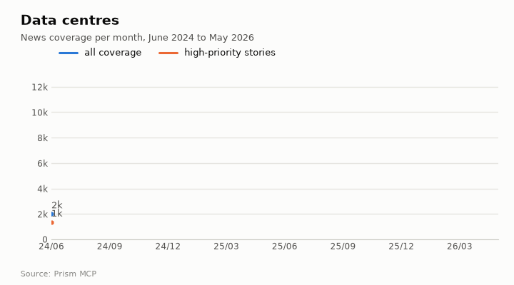
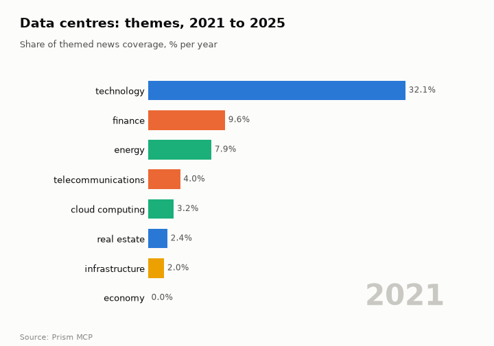
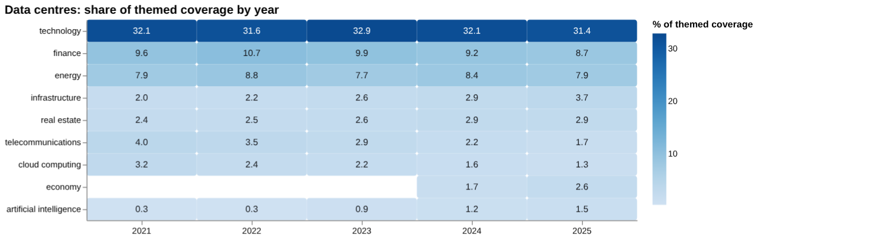
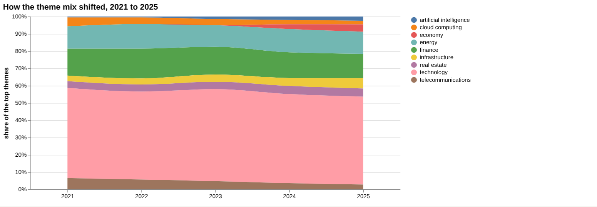
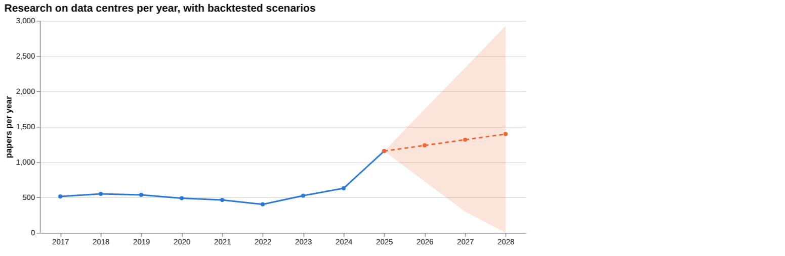
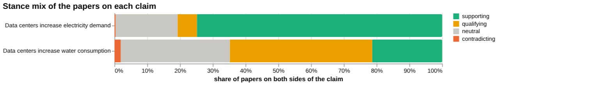
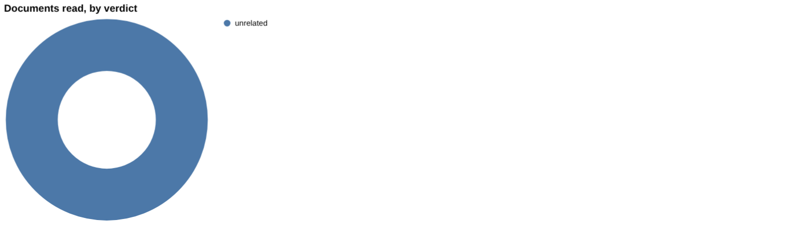
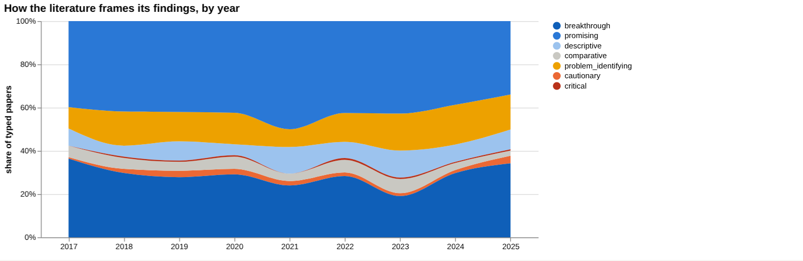
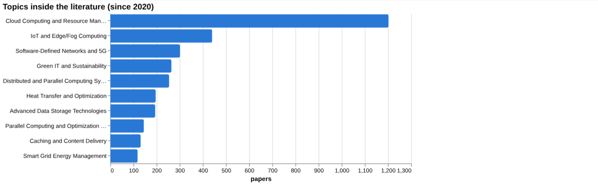
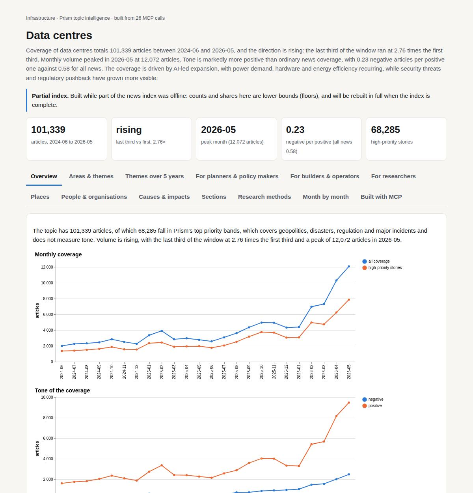

# Data centres

*Infrastructure · Prism topic intelligence* · **[Open the interactive page](https://fliarbi.com/demo/docs/prism-dashboards-3bb43e4c/topics/data-centres/)** (tabs: Overview · Areas & themes · Themes over 5 years · For planners & policy makers · For builders & operators · For researchers · Places · People & organisations · Causes & impacts · Sections · Research methods · Month by month · Built with MCP)

> **Partial index.** Built while part of the news index was offline: counts and shares here are lower bounds (floors), and will be rebuilt in full when the index is complete.

Coverage of data centres totals 101,339 articles between 2024-06 and 2026-05, and the direction is rising: the last third of the window ran at 2.76 times the first third. Monthly volume peaked in 2026-05 at 12,072 articles. Tone is markedly more positive than ordinary news coverage, with 0.23 negative articles per positive one against 0.58 for all news. The coverage is driven by AI-led expansion, with power demand, hardware and energy efficiency recurring, while security threats and regulatory pushback have grown more visible.

| Articles | Direction (last third vs first) | Peak month | Negative per positive | High-priority stories |
| ---: | --- | --- | ---: | ---: |
| 101,339 (2024-06 to 2026-05) | rising (2.76×) | 2026-05 (12,072) | 0.23 (all news 0.58) | 68,285 |

## Coverage over time

The topic has 101,339 articles, of which 68,285 fall in Prism's top priority bands, which covers geopolitics, disasters, regulation and major incidents and does not measure tone. Volume is rising, with the last third of the window at 2.76 times the first third and a peak of 12,072 articles in 2026-05.

## Areas of activity and themes

Cloud storage is the main area of activity with 30,721 articles, followed by Energy & Utilities with 12,171 and its Electricity subcategory with 10,226. The leading tags are ai (52,360), data centers (40,064) and data center (36,590), with microsoft (11,867), nvidia (10,870), energy efficiency (8,753) and gpu (7,738) also prominent.

| Area of activity | Articles |
| --- | ---: |
| Internet & Telecom › Web Services › Cloud Storage | 30,721 |
| Business & Industrial › Energy & Utilities | 12,171 |
| Business & Industrial › Energy & Utilities › Electricity | 10,226 |
| Computers & Electronics › Computer Hardware › Computer Components | 10,009 |
| Computers & Electronics › Enterprise Technology › Data Management | 6,371 |
| Computers & Electronics › Networking › Distributed & Cloud Computing | 5,702 |

**Top tags (what the themes are built from):** ai (52,360), data centers (40,064), data center (36,590), microsoft (11,867), nvidia (10,870), energy efficiency (8,753), cloud computing (8,272), gpu (7,738)

## Where it is reported

The United States leads country coverage with 32,562 articles, followed by China (6,717), India (4,505), the United Kingdom (4,340), Colombia (3,925) and Japan (2,468).

| Country | Articles | Lift | | Indian state | Articles | Lift |
| --- | ---: | ---: | --- | --- | ---: | ---: |
| United States | 32,562 | 1.5× | | Texas | 6,264 | 2.3× |
| China | 6,717 | 1.4× | | Pennsylvania | 4,990 | 1.8× |
| India | 4,505 | 0.7× | | California | 4,695 | 1.5× |
| United Kingdom | 4,340 | 0.9× | | Meta | 3,834 | 26.7× |
| Colombia | 3,925 | 8.7× | | New York | 2,998 | 1.2× |
| Japan | 2,468 | 1.7× | | Virginia | 2,860 | 2.3× |

## People and organisations

Jensen Huang, Marc Levy, Vera Rubin, Larry Fink, Sam Altman and Lip-Bu Tan are the people most associated with the coverage. Organisations include Equinix, Digital Realty, Stargate, Vertiv, Nvidia and Supermicro.

## Causes and impacts

Stories cite drone strikes, US and Israel bombings, an expanding data centre footprint, elevated electricity bills, dynamite blasting and an Iran threat to attack tech companies as causes. Reported impacts include a threat to the Potomac River, employees and residents urged to leave, halted government services, consumer backlash, damaged homes and potential control over servers.

**Causes named in the coverage:** drone strikes, US and Israel bombings, expanding data center footprint, elevated electricity bills, dynamite blasting, Iran threat to attack tech companies

**Impacts:** Potomac River endangered, employees and residents urged to leave, government services halted, consumer backlash, homes damaged, potential control over servers

## Sections inside the topic

The artificial intelligence section has 28,666 articles, or 28.29 per cent of the topic, and the power section has 19,306, or 19.05 per cent. AI coverage is growing faster, with a late-versus-early ratio of 3.43 against 2.14 for power. AI is also more positive at 0.15 negative per positive, while power is more negative at 0.47, against 0.23 for the topic as a whole.

| Section | Articles | Share of the topic | Late vs early | Negative per positive |
| --- | ---: | ---: | ---: | ---: |
| data center → power | 19,306 | 19.05% | 2.14× | 0.47 (topic 0.23) |
| data center → artificial intelligence | 28,666 | 28.29% | 3.43× | 0.15 (topic 0.23) |

## Research and outlook

The research framing shifted by 2.5 points, and the balance of framing is broadly unchanged. The outlook figures are 1236.25 for 2026, 1316.5 for 2027 and 1396.75 for 2028, with the range widening from 726.821 to 1745.679 in 2026 to 0.0 to 2925.036 in 2028.

## Month by month

From June 2025 the coverage tracked an AI-driven expansion, and in 2025-07 US policy removed regulatory barriers and secured clean-power deals that catalysed large AI-focused builds. Record investments and hardware partnerships followed in 2025-09, and in 2025-10 multi-billion announcements tied AI data centres to green energy and raised sustainability concerns. A state ban in April and geopolitical attacks by May 2026 added regulatory and security risk.

- **2025-07:** US policy removed regulatory barriers and secured clean‑power deals, catalyzing massive AI‑focused data‑center builds.
- **2025-09:** Record AI‑driven investments and strategic hardware partnerships expanded the scale of data‑center infrastructure globally.
- **2025-10:** Multi‑billion announcements linked AI data centers with green energy initiatives and new open‑chip standards, highlighting sustainability concerns.

## Themes over five years

Technology stayed the leading theme throughout, at 32.1% of themed coverage in 2021 and 31.4% in 2025. Finance moved from 9.6% to 8.7% and energy from 7.9% to 7.9%. Infrastructure rose from 2.0% to 3.7%, real estate from 2.4% to 2.9% and artificial intelligence from 0.3% to 1.5%. Telecommunications fell from 4.0% to 1.7% and cloud computing from 3.2% to 1.3%. Economy appears from 2024 (1.7%, then 2.6% in 2025) and government appears in 2025 at 4.0%, so neither has a 2021 share.

| Theme | 2021 | 2022 | 2023 | 2024 | 2025 |
| --- | ---: | ---: | ---: | ---: | ---: |
| technology | 32.1% | 31.6% | 32.9% | 32.1% | 31.4% |
| finance | 9.6% | 10.7% | 9.9% | 9.2% | 8.7% |
| energy | 7.9% | 8.8% | 7.7% | 8.4% | 7.9% |
| infrastructure | 2.0% | 2.2% | 2.6% | 2.9% | 3.7% |
| real estate | 2.4% | 2.5% | 2.6% | 2.9% | 2.9% |
| telecommunications | 4.0% | 3.5% | 2.9% | 2.2% | 1.7% |
| cloud computing | 3.2% | 2.4% | 2.2% | 1.6% | 1.3% |
| economy | – | – | – | 1.7% | 2.6% |
| artificial intelligence | 0.3% | 0.3% | 0.9% | 1.2% | 1.5% |

## For planners & policy makers

Research output in the index rose from 464 in 2021 to 1,156 in 2025, after 630 in 2024. The linear-drift scenario puts the central figure at 1,236 for 2026, 1,316 for 2027 and 1,397 for 2028, but the sensitivity range widens from 727 to 1,746 in 2026 and from 0 to 2,925 in 2028, so it is a loose guide. The news index holds 670 articles from 2019-01-01 to 2026-06-01, and the stories that matter are about chip makers' AI data centre demand, including NVIDIA's earnings in February 2026. No country-level data on where data centres are studied or reported was found, so geography cannot be assessed here. Government coverage appears as a theme in 2025 at 4.0% and infrastructure coverage rose to 3.7%, which suggests public-sector attention is building. Screening found no figures on local employment, grid stability, carbon emissions or water use.

- Research volume of 1,156 in 2025 against 630 in 2024
- Scenario range for 2028 spans 0 to 2,925, so treat projections cautiously
- Government theme at 4.0% of coverage in 2025, new that year
- No geographic data available; local evidence gaps on employment and grid stability
- Chip-maker earnings stories are the main news signal on AI data centre demand

## For builders & operators

On the claim that data centres increase electricity demand, the wider corpus holds 67,259 papers, of which 50,339 are supporting, 3,981 qualifying, 215 contradicting and 12,724 neutral, with 6.2% contested. That framing is overwhelmingly positive, which can mean consensus or publication bias. However, the two documents read directly for this claim were both article-tier and both judged unrelated, so no verified document verdict supports a wording recommendation. For water consumption the corpus is smaller at 1,003 papers and more contested at 45.4%, with 214 supporting, 436 qualifying, 19 contradicting and 334 neutral. One article-tier source from 2018, on water use in hybrid evaporative cooling, supports the water claim, and the head-to-head says the second claim has more evidence behind it. Screening found a figure only for cooling energy: about 2% as a share of global electricity consumption, from a 2023 source.

- Electricity claim: 50,339 of 67,259 corpus papers supporting, 6.2% contested
- Electricity claim: both documents read were article tier and unrelated, so no verdict
- Water claim: 45.4% contested across 1,003 papers; one article-tier source from 2018 supports
- Cooling energy: about 2% of global electricity consumption, one 2023 source
- No figures found for carbon emissions, water use, local employment or grid stability

**Head to head:** Data centers increase electricity demand vs Data centers increase water consumption: the second claim has more evidence behind it.

**Screen:** *What is the impact of data centers on …?* (one row per line below)

| Row | Figure (quoted) | Measures | Source |
| --- | --- | --- | --- |
| electricity use | no figure found |  | D-Pro: Dynamic Data Center Operations With Demand-Responsive Electricity Prices in Smart G (2012) |
| water use | no figure found |  | Adsorption Technology in Water Treatment (2012) |
| carbon emissions | no figure found |  | Artificial intelligence for calculating and predicting building carbon emissions: a review (2025) |
| cooling energy | about 2% | share of global electricity consumption | Three Key-Elements for Data Center Facilities Sizing in Early Stage of Design (2023) |
| local employment | no figure found |  |  |
| grid stability | no figure found |  | A Comprehensive Review on the Role of Artificial Intelligence in Power System Stability, C (2024) |

## For researchers

The literature is dominated by orientation labelled promising (880 papers, 39.6%) and breakthrough (685, 30.8%), while cautionary work is 49 papers (2.2%) and critical work 7 (0.3%). Contribution is mostly methodological, at 1,440 papers, against 427 empirical and 215 review. The leading topic is Cloud Computing and Resource Management with 1,202 papers, followed by IoT and Edge/Fog Computing with 440, while Green IT and Sustainability has 264 and Smart Grid Energy Management 118. Contested framing in the research set ran from 5.0% in 2017 to 10.1% in 2025, with 10.8% in 2024, and a framing shift comparison was not possible because one window had too few papers. Recent frontier work centres on server farm telemetry, energy metering and job assignment, and the most cited recent items have few citations, the highest being 1.

- Why are cautionary (49) and critical (7) papers so few against promising and breakthrough work?
- Can empirical studies (427) catch up with methodological ones (1,440) on electricity, water and carbon?
- Is the positive framing of the electricity claim consensus or publication bias?
- Why do screening rows for water use, carbon emissions, local employment and grid stability return no figures?
- Will the recent 2025 papers on AI data centres, mostly uncited so far, prove influential?

## Research exploration methods

Nine ways to explore the research, each run on this topic; the interactive report shows each call and its result.

**Chaining them.** Begin with triangulation to establish the overall stance and identify the most cited sources, then use head‑to‑head to compare the electricity claim with the water claim and assess relative evidence strength. Apply screening to extract any quantified effect sizes, noting the lack of data for most risk factors. Examine framing to understand how optimism and contestedness have varied over time, and consult the frontier scan for emerging methodological breakthroughs. Use gaps to confirm that all claim components are covered, and consult history to gauge future research volume. Finally, integrate facets to locate the most relevant orientation and contribution types for deeper investigation.

### Evidence triangulation

*Is a claim supported, and by how strong a design?* `find_evidence` + `find_counter_evidence` + `rank_sources`

The evidence tiering shows two documents classified as articles, both unrelated to the claim. The citation‑weighted corpus contains 67,259 papers, with 50,339 supporting, 3,981 qualifying, 215 contradicting and 12,724 neutral, giving a contested percentage of 6.2. The reading notes an overwhelmingly positive framing, which may indicate consensus or publication bias. No counter‑evidence documents were found, and the recommendation states no verified document verdict supports a wording recommendation. The top sources are two recent articles from 2024 and 2025 with cited‑by counts of 4 and 0 respectively. A careful researcher would need to locate primary empirical studies that directly measure electricity demand attributable to data centres.

### Head-to-head claims

*Which of two interventions has more and stronger evidence?* `compare_claims`

Claim a (electricity demand) is linked to 67,259 papers with a corpus mix identical to the triangulation result and a contested percentage of 6.2, but the documents read tally shows zero supports, contradicts or qualifies and two unrelated items. The strongest source for claim a is an article from 2024 whose stance is unrelated. Claim b (water consumption) is linked to 1,003 papers, with a corpus mix of 214 supporting, 436 qualifying, 19 contradicting and 334 neutral, and a contested percentage of 45.4. The documents read for claim b include one supporting document and one unread, and the strongest source is a 2018 article that supports the claim. The verdict indicates the second claim has more evidence behind it. A careful researcher would examine the supporting document for water consumption and seek additional primary data to compare the two impacts.

### Cross-row screening

*Which rows carry a measured, quoted figure, and how large is it?* `research_table`

The cross‑row screening returned no quantitative effect for electricity use, water use, carbon emissions, local employment or grid stability. Only the row for cooling energy provided a value of “about 2%” described as a share of global electricity consumption, based on one paper from 2023. The other rows list paper counts but no measures, populations or values. The absence of effect sizes for most risk factors indicates a gap in the literature captured by this method. A careful researcher would retrieve the cited 2023 study to assess the robustness of the 2% figure and search for primary measurements of the other factors.

### Framing drift

*Is the literature becoming more hopeful or more cautious?* `stance_trends`

The framing drift analysis shows positive percentages ranging from 28.1 to 38.6 across years 2017 to 2025. Contested percentages vary between 5.0 and 10.8 in the same period. The data do not reveal a clear monotonic trend in optimism or caution, as the positive share fluctuates year to year. The analysis also does not indicate how the contested proportion relates to the overall volume of literature. A careful researcher would compare these percentages with the total number of papers each year to gauge whether changes in framing are driven by volume or by shifts in discourse.

### Frontier scan

*What is new, and what is the research not reaching?* `research_radar`

The frontier scan identified six recent works, three labelled as breakthrough with citation counts of 13, 11 and 6, and two labelled as promising with citation counts of 6 and 2. The earliest listed work from 2022 has zero citations, while the most recent from 2025 has zero citations. The orientation categories suggest emerging methodological advances and novel applications. The framing shift could not be computed because there were not enough papers in one of the windows. A careful researcher would examine the breakthrough papers for novel techniques and monitor citation growth over the coming months.

### Gap mapping

*Which parts of a claim does the literature actually cover?* `research_gaps`

The gap mapping for the claim “Data centres increase electricity demand” lists three components, each marked with evidence “yes”. The components cover data centre electricity consumption rising, overall electricity demand increasing due to data centres, and grid load escalation from data centre operations. The result does not quantify the strength or quality of the evidence for each component. It also does not indicate any missing sub‑components of the claim. A careful researcher would locate the underlying studies for each component to evaluate their methodological rigour.

### Count history and backtested scenarios

*Is research on this growing, and where could it be in three years?* `historical_analysis` + `trend_scenarios`

The count history shows research outputs rising from 514 in 2017 to 1,156 in 2025. Scenario modelling projects a central estimate of 1,236 papers for 2026, 1,316 for 2027 and 1,397 for 2028, with lower and upper sensitivity bounds ranging from 727 to 1,746 in 2026, 298 to 2,335 in 2027 and 0 to 2,925 in 2028. The baseline for the scenarios is described as linear_drift. The data do not reveal the drivers behind the increase or the distribution of topics over time. A careful researcher would track the emergence of specific sub‑fields to see whether the projected growth aligns with thematic developments.

### Geographic triangulation

*Where is it studied, published, reported and patented?* `global_comparison` + `newsgeo`

The geographic triangulation returned empty lists for both “where studied” and “where reported by country”. This absence indicates that the method did not locate any location‑specific evidence for the claim. No information is provided about regional research activity, publication venues or patent filings. Consequently, geographic gaps cannot be assessed from this output. A careful researcher would conduct a targeted search for country‑level studies or reports to fill this void.

### Faceted browsing

*What kind of literature is it: empirical, review, position? Problem-identifying or promising?* `browse_research`

Faceted browsing shows the orientation distribution with 880 papers (39.6 %) labelled promising, 685 (30.8 %) breakthrough, 328 (14.7 %) problem_identifying, 180 (8.1 %) descriptive, 95 (4.3 %) comparative, 49 (2.2 %) cautionary and 7 (0.3 %) critical. Contributions are dominated by methodological papers (1,440) followed by empirical (427), review (215), position (125) and theoretical (17). The top topics include Cloud Computing and Resource Management (1,202 papers) and IoT and Edge/Fog Computing (440 papers). The most‑cited works since 2020 are six titles, each from 2025, with citation counts ranging from 0 to 1 and orientations ranging from problem_identifying to breakthrough. The output does not indicate how these facets intersect with the specific claim about electricity demand. A careful researcher would map the orientation and contribution facets onto the claim components to identify which types of studies address the electricity impact.

## Built with MCP

Every number and chart on this page comes from these 26 Prism MCP tool calls, made over MCP (streamable HTTP). Arguments and timings: [mcp_calls.json](mcp_calls.json); responses: [data.json](data.json).

| MCP tool | Calls |
| --- | ---: |
| `news_activities` | 1 |
| `prism_overview` | 1 |
| `news_geography` | 1 |
| `news_drill` | 2 |
| `news_factors` | 1 |
| `news_themes` | 5 |
| `historical_analysis` | 1 |
| `critical_news` | 1 |
| `stance_trends` | 1 |
| `browse_research` | 1 |
| `global_comparison` | 1 |
| `research_gaps` | 1 |
| `research_radar` | 1 |
| `research_brief` | 1 |
| `rank_sources` | 1 |
| `find_evidence` | 1 |
| `find_counter_evidence` | 1 |
| `deep_timeline` | 1 |
| `compare_claims` | 1 |
| `research_table` | 1 |
| `trend_scenarios` | 1 |

Try it: `prism entity "data center"` · `prism call news.drill term='data center' scope='power'` · `prism call analysis.timeline term='data center'`

