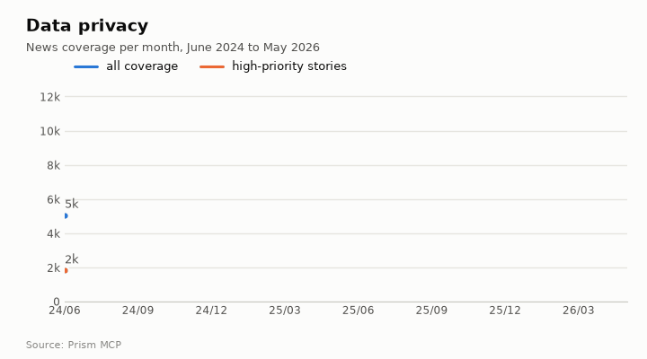
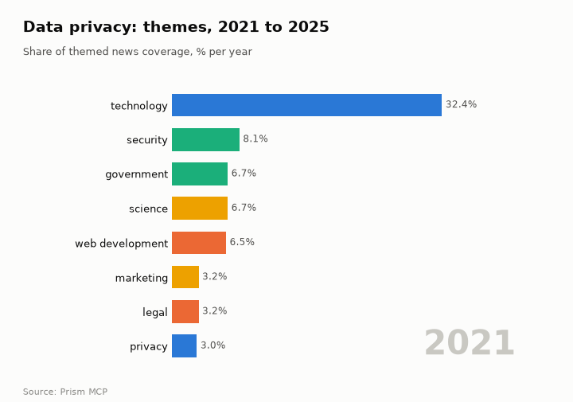
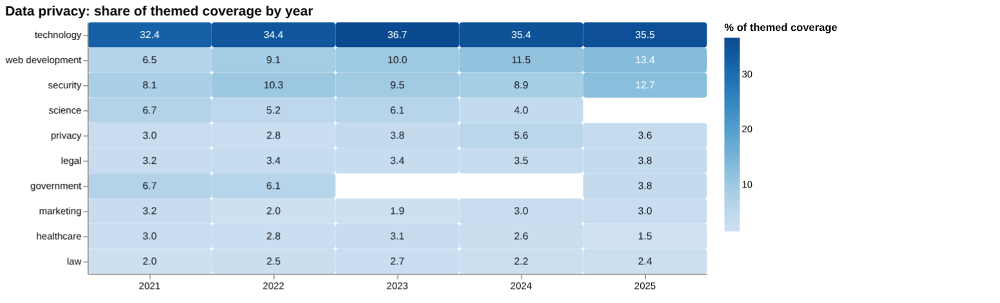
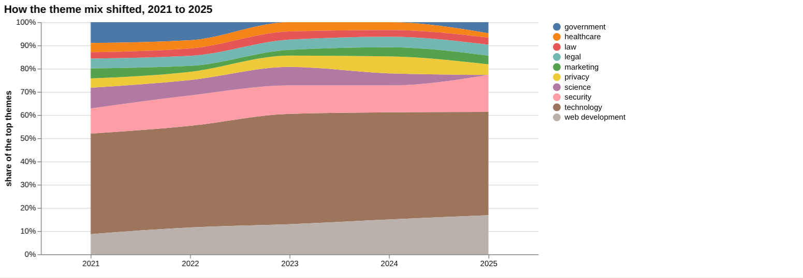
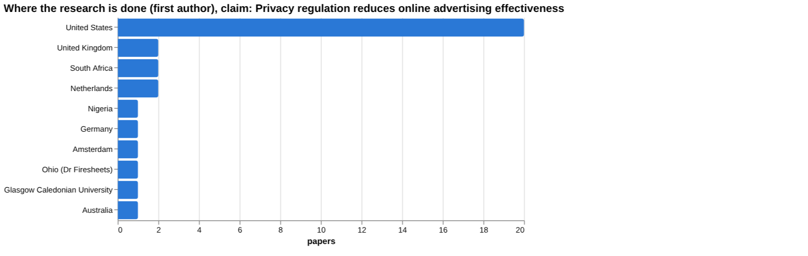
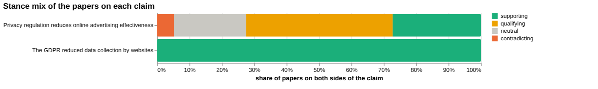
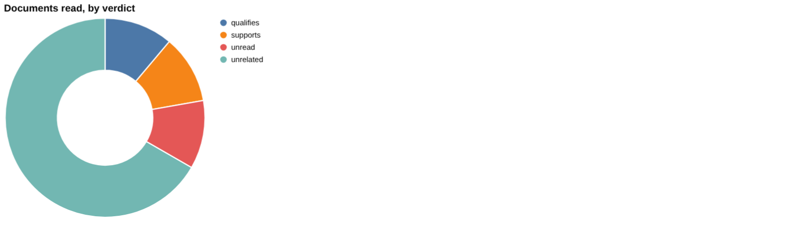
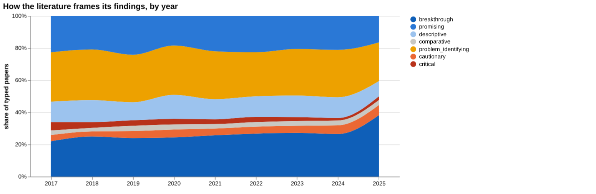
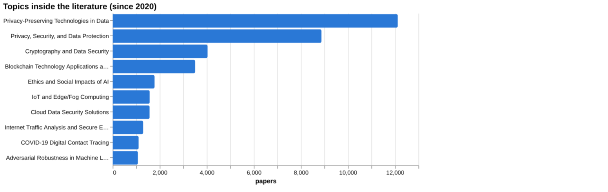
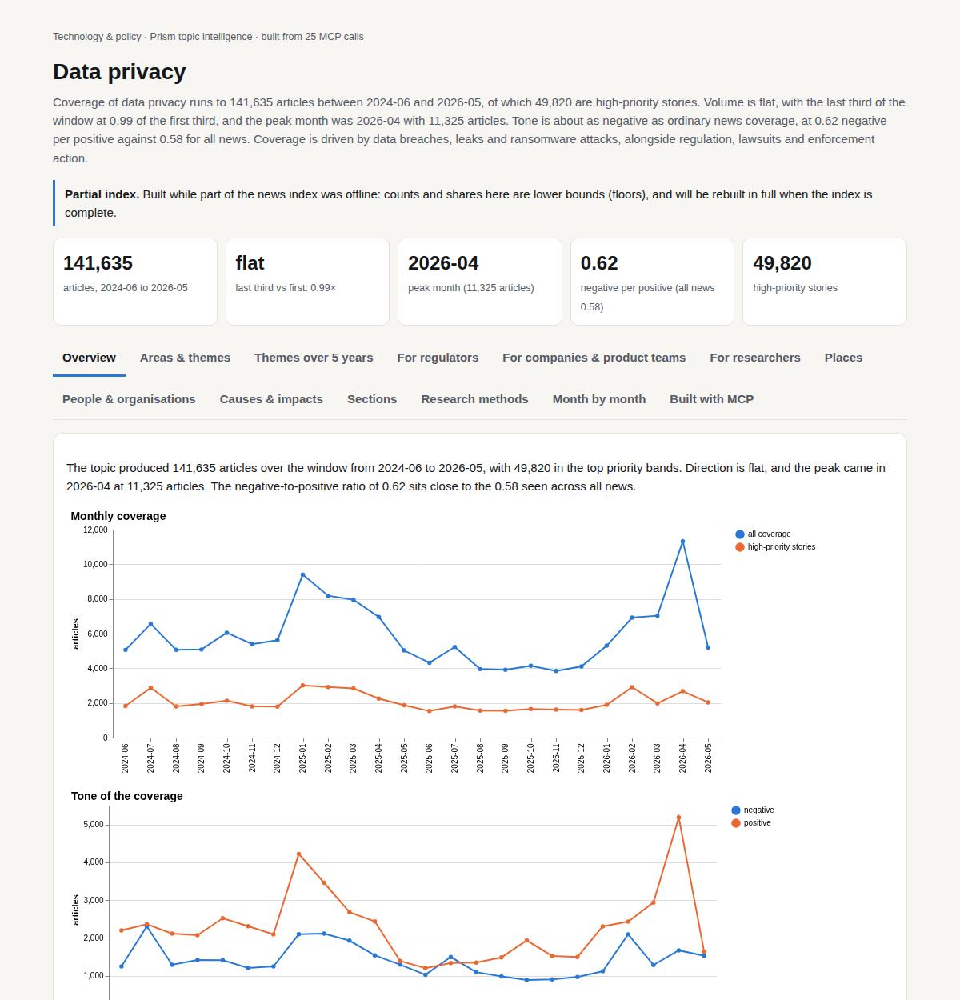

# Data privacy

*Technology & policy · Prism topic intelligence* · **[Open the interactive page](https://fliarbi.com/demo/docs/prism-dashboards-3bb43e4c/topics/data-privacy/)** (tabs: Overview · Areas & themes · Themes over 5 years · For regulators · For companies & product teams · For researchers · Places · People & organisations · Causes & impacts · Sections · Research methods · Month by month · Built with MCP)

> **Partial index.** Built while part of the news index was offline: counts and shares here are lower bounds (floors), and will be rebuilt in full when the index is complete.

Coverage of data privacy runs to 141,635 articles between 2024-06 and 2026-05, of which 49,820 are high-priority stories. Volume is flat, with the last third of the window at 0.99 of the first third, and the peak month was 2026-04 with 11,325 articles. Tone is about as negative as ordinary news coverage, at 0.62 negative per positive against 0.58 for all news. Coverage is driven by data breaches, leaks and ransomware attacks, alongside regulation, lawsuits and enforcement action.

| Articles | Direction (last third vs first) | Peak month | Negative per positive | High-priority stories |
| ---: | --- | --- | ---: | ---: |
| 141,635 (2024-06 to 2026-05) | flat (0.99×) | 2026-04 (11,325) | 0.62 (all news 0.58) | 49,820 |

## Coverage over time

The topic produced 141,635 articles over the window from 2024-06 to 2026-05, with 49,820 in the top priority bands. Direction is flat, and the peak came in 2026-04 at 11,325 articles. The negative-to-positive ratio of 0.62 sits close to the 0.58 seen across all news.

## Areas of activity and themes

The largest area of activity is People & Society › Social Issues & Advocacy with 25,134 articles, followed by Network Security with 14,057 and Data Management with 7,932. The leading tags are data privacy at 140,012, cookies at 49,616 and data protection at 47,865, with advertising at 40,090 and data storage at 35,241 close behind.

| Area of activity | Articles |
| --- | ---: |
| People & Society › Social Issues & Advocacy | 25,134 |
| Computers & Electronics › Computer Security › Network Security | 14,057 |
| Computers & Electronics › Enterprise Technology › Data Management | 7,932 |
| Online Communities › Social Networks | 4,632 |
| Shopping › Consumer Resources › Identity Theft Protection | 4,015 |
| Real Estate › Real Estate Listings | 2,858 |

**Top tags (what the themes are built from):** data privacy (140,012), cookies (49,616), data protection (47,865), advertising (40,090), data storage (35,241), websites (33,307), trackers (25,188), customization (24,871)

## Where it is reported

| Country | Articles | Lift | | Indian state | Articles | Lift |
| --- | ---: | ---: | --- | --- | ---: | ---: |
| United States | 24,375 | 1.3× | | California | 5,622 | 2.8× |
| United Kingdom | 6,620 | 1.6× | | Pennsylvania | 4,632 | 2.6× |
| India | 4,782 | 0.9× | | Meta | 3,517 | 37.4× |
| China | 3,910 | 0.9× | | Bio Bio | 2,872 | 996.6× |
| Colombia | 3,593 | 9.0× | | New York | 2,508 | 1.5× |
| France | 2,747 | 1.9× | | Texas | 2,468 | 1.4× |

## People and organisations

Mark Zuckerberg, Elon Musk, Ron Wyden, Pavel Durov, Josh Hawley and Ken Paxton are the individuals most associated with the coverage. Organisations named include ByteDance, Meta and the Federal Trade Commission.

## Causes and impacts

Coverage attributes events to data breaches, massive database leaking, unsecured databases, a ShinyHunters vishing attack, ransomware and cyberattacks. Reported impacts include unauthorized access to the sensitive information of nine million individuals, one billion personal records found in an unsecured database, and stolen 1.7 million records.

**Causes named in the coverage:** data breach, massive database leaking, unsecured database, shinyhunters vishing attack, ransomware attack, cyberattack

**Impacts:** unauthorized access to the sensitive information of nine million individuals, hackers stole data about user, victims' identities being mistakenly revealed, massive social security data leak, one billion personal records were found in an unsecured database, stolen 1.7 million records

## Sections inside the topic

The consent section has 17,528 articles, a 12.38 per cent share of the topic, and is more positive in tone than the topic overall at 0.36 negative per positive against 0.62. The breach section is much smaller at 3,491 articles, a 2.46 per cent share, and is far more negative at 5.47 negative per positive. Both sections are quieter late in the window than early, with late-to-early ratios of 0.87 for consent and 0.7 for breach.

| Section | Articles | Share of the topic | Late vs early | Negative per positive |
| --- | ---: | ---: | ---: | ---: |
| data privacy → breach | 3,491 | 2.46% | 0.7× | 5.47 (topic 0.62) |
| data privacy → consent | 17,528 | 12.38% | 0.87× | 0.36 (topic 0.62) |

## Research and outlook

The balance of framing is broadly unchanged, with a shift of -1.8 points. The outlook projects 1,377.75 for 2026, 1,508.5 for 2027 and 1,639.25 for 2028, with ranges that widen from 1,063.583 to 1,691.917 in 2026 to 696.75 to 2,581.75 in 2028.

## Month by month

The arc began in 2025-06 with breaches across health, municipal and electoral sectors, and 2025-07 brought high-profile lawsuits, including an $8 billion class-action against Meta. In 2025-09 a massive child data breach and an executive order on TikTok tied privacy to minors' protection and geopolitical data-flow disputes, and later coverage turned towards enforcement.

- **2025-06:** Initial spate of breaches across health, municipal and electoral sectors revealed systemic privacy weaknesses.
- **2025-07:** High‑profile lawsuits and activist pushback, including an $8 billion class‑action against Meta, amplified legal pressure on data handlers.
- **2025-09:** Massive child data breach and executive order on TikTok highlighted the intersection of privacy, minors’ protection, and geopolitical data‑flow disputes.

## Themes over five years

Technology was the leading theme throughout, moving from a 32.4% share in 2021 to 35.5% in 2025. Web development rose from 6.5% in 2021 to 13.4% in 2025, and security rose from 8.1% to 12.7%. Privacy as a named theme was 3.0% in 2021 and 3.6% in 2025, with a peak of 5.6% in 2024. Healthcare fell from 3.0% to 1.5%, law moved from 2.0% to 2.4%, legal from 3.2% to 3.8%, and marketing from 3.2% to 3.0%. Science (6.7% in 2021) has no share listed for 2025, and government went from 6.7% to 3.8%.

| Theme | 2021 | 2022 | 2023 | 2024 | 2025 |
| --- | ---: | ---: | ---: | ---: | ---: |
| technology | 32.4% | 34.4% | 36.7% | 35.4% | 35.5% |
| web development | 6.5% | 9.1% | 10.0% | 11.5% | 13.4% |
| security | 8.1% | 10.3% | 9.5% | 8.9% | 12.7% |
| science | 6.7% | 5.2% | 6.1% | 4.0% | – |
| privacy | 3.0% | 2.8% | 3.8% | 5.6% | 3.6% |
| legal | 3.2% | 3.4% | 3.4% | 3.5% | 3.8% |
| government | 6.7% | 6.1% | – | – | 3.8% |
| marketing | 3.2% | 2.0% | 1.9% | 3.0% | 3.0% |
| healthcare | 3.0% | 2.8% | 3.1% | 2.6% | 1.5% |
| law | 2.0% | 2.5% | 2.7% | 2.2% | 2.4% |

## For regulators

The index holds 25,775 news articles on data privacy for 2019-01-01..2026-06-01, alongside 131,902 research papers for 2017-2025. Coverage is weighted towards technology, web development and security themes, with legal at 3.8% and government at 3.8% in 2025. Where studied, the United States has 20 papers, while the United Kingdom, South Africa and the Netherlands have 2 each, so evidence from outside the US is thin. Recent news includes Reddit receiving a $20 million UK data privacy fine over child safety failings (2026-02-24) and Ghana walking away from a US health pact citing data access risks (2026-05-02). The patent count is 1,403 for 2005-2024. The linear-drift scenario for 2026 gives a central figure of 1,378, with a sensitivity range from 1,064 to 1,692, widening to 880 to 2,137 for 2027 (central 1,508) and 697 to 2,582 for 2028 (central 1,639).

- Enforcement against platforms over child safety, such as the Reddit UK fine of $20 million
- Cross-border health data access disputes, as in Ghana's withdrawal from the US health pact
- Geographic gap: 20 studied papers in the United States against 2 each for the UK, South Africa and the Netherlands
- Scenario range for 2028: central 1,639, from 697 to 2,582
- Rising security share, 12.7% in 2025, and web development share, 13.4%

## For companies & product teams

On the claim that privacy regulation reduces online advertising effectiveness, the wider literature is actively contested: of 50,568 papers, 13,795 support, 22,897 qualify, 2,649 contradict and 11,227 are neutral, with 50.5% contested. Of the documents actually read, 1 supports, 1 qualifies, 6 are unrelated and 1 is unread, and none contradicts. The counter-evidence check found no verified document verdict supporting a wording recommendation for this claim. The strongest source is an article from 2025, Event-Driven Compliance: Reconciling Privacy Regulation with Real-Time Advertising Infrastructure, which supports the claim. The three links in the causal chain (regulation limits data collection, less data lowers targeting precision, lower precision reduces advertising effectiveness) are each marked as having evidence, but screening found no figures on advertising effectiveness, data collection, innovation or compliance costs. The comparison claim that the GDPR reduced data collection by websites has only one document, which is unrelated.

- Claim on advertising effectiveness: 50.5% of 50,568 papers are contested (corpus-wide)
- Documents read: 1 supports, 1 qualifies, 6 unrelated, 1 unread (article and review tiers)
- Strongest source is a 2025 article that supports the claim
- No screening figure found for advertising effectiveness, data collection, innovation or compliance costs
- Consumer trust and data breaches each have 1 paper, both from 2024

**Head to head:** Privacy regulation reduces online advertising effectiveness vs The GDPR reduced data collection by websites: the first claim has more evidence behind it.

**Screen:** *What is the effect of privacy regulation on …?* (one row per line below)

| Row | Figure (quoted) | Measures | Source |
| --- | --- | --- | --- |
| advertising effectiveness | no figure found |  |  |
| data collection | no figure found |  |  |
| consumer trust | no figure found |  | Relationship between Data Privacy Regulations and Consumer Trust in E-Commerce Platforms i (2024) |
| data breaches | no figure found |  | Understanding Data Breach from a Global Perspective: Incident Visualization and Data Prote (2024) |
| innovation | no figure found |  |  |
| compliance costs | no figure found |  |  |

## For researchers

The literature is largely positive in framing, with 64,918 supporting, 42,991 qualifying, 3,710 contradicting and 20,283 neutral papers, and 35.4% contested. By orientation, breakthrough papers number 9,573 (29.9%) and problem-identifying 8,839 (27.6%), while cautionary papers number 1,627 (5.1%) and critical 759 (2.4%). The earlier window has 28,414 papers with 39.8% cautionary and the recent window 37,673 with 32.1%, which the data reads as broadly unchanged framing. Contribution types are dominated by methodological work (15,180), then empirical (7,646), position (5,051), review (3,477) and theoretical (678). The leading topic is Privacy-Preserving Technologies in Data with 12,121 papers, then Privacy, Security, and Data Protection with 8,878. The 2025 papers listed as most cited since 2020 show 0 citations each, and the health literature index holds only 265 records, so clinical and study-design evidence looks thin.

- Why empirical work (7,646) is far smaller than methodological work (15,180)
- Whether the regulatory effect on advertising has been measured directly, given no screening values
- Theoretical contributions number only 678 papers
- Whether the shift in cautionary framing (39.8% earlier, 32.1% recent) reflects real change
- Limited geographic coverage and 265 the health literature index records for health-related questions

## Research exploration methods

Nine ways to explore the research, each run on this topic; the interactive report shows each call and its result.

**Chaining them.** Start with the gap map to confirm that each step of the claim has a literature, then run the triangulation to see how many documents actually support or qualify it. Use the head-to-head comparison only once both claims are phrased so that the search reaches relevant papers, since the GDPR claim here returned almost nothing. Follow with the cross-row screening to look for quoted effect sizes, noting that none were found for this topic and that two papers on consumer trust and data breaches are the only leads. Use framing drift, the frontier scan and faceted browsing to place the claim within a field that is mostly technical and moderately contested. Treat the count scenarios and the country lanes as context only, because the yearly history and the reporting lane were empty.

### Evidence triangulation

*Is a claim supported, and by how strong a design?* `find_evidence` + `find_counter_evidence` + `rank_sources`

Of the nine documents read for the claim that privacy regulation reduces online advertising effectiveness, one supports it, one qualifies it, six are unrelated and one was unread. The wider corpus of 50,568 papers splits into 13,795 supporting, 22,897 qualifying, 2,649 contradicting and 11,227 neutral, with 50.5 contested, so the field treats the claim as disputed rather than settled. The counter-evidence search found nothing that supports, contradicts or qualifies the claim: 7 documents were unrelated and 3 unread, so the absence of contradiction reflects a thin search and not a clean bill. The listed top sources are one 2024 review (cited by 1) and articles on COVID-19 contact tracing, social media use and tracking walls. None of them measures advertising outcomes, so the citation counts say little about this claim. The result does not show a size or direction of effect, and no design stronger than articles and one review was reached. A careful reader would look for studies that actually measure advertising outcomes before and after a rule change.

### Head-to-head claims

*Which of two interventions has more and stronger evidence?* `compare_claims`

The advertising claim has 4 papers on both poles, a corpus mix of 13,795 supporting, 22,897 qualifying, 2,649 contradicting and 11,227 neutral, and a strongest source from 2025 on event-driven compliance and real-time advertising that supports it. The rival claim, that the GDPR reduced data collection by websites, shows a corpus mix of 1 supporting and nothing else, and its only document read was unrelated. Its strongest source is a paper on vehicle and vessel detection in satellite imagery, which has no bearing on the question. The verdict that the first claim has more evidence is therefore correct but uninformative, because the second claim was barely tested rather than weighed and found weaker. The comparison does not show that the GDPR claim is false or that the advertising claim is well supported; the latter still has only one supporting document read. A fairer comparison would need the second claim rephrased so that the search reaches relevant literature.

### Cross-row screening

*Which rows carry a measured, quoted figure, and how large is it?* `research_table`

Across six outcomes (advertising effectiveness, data collection, consumer trust, data breaches, innovation and compliance costs), no row returned a quoted effect size, measure or population. Four rows (advertising effectiveness, data collection, innovation and compliance costs) found 0 papers. Consumer trust and data breaches each found 1 paper, a 2024 Vietnam e-commerce study and a 2024 global data breach and law review, but neither yielded a figure. The table therefore shows that measured, quotable effects of privacy regulation are hard to extract for these outcomes. It does not show that the effects are absent or small. The two named papers are the only leads, and a researcher would need to read them directly to see whether they report any quantified effect.

### Framing drift

*Is the literature becoming more hopeful or more cautious?* `stance_trends`

Between 2017 and 2025 the positive share moves within a narrow band, from 21.8 in 2017 to 27.7 in 2025, with 2025 the highest of the nine years shown. The contested share runs from 19.5 in 2017 to 16.6 in 2025, with 2025 the lowest. Intermediate years wobble, for example 20.0 contested in 2020 and 17.5 in both 2022 and 2023, so the movement is gradual rather than a clear break. The pattern suggests a slight drift towards a more hopeful tone, but the figures describe how papers frame themselves, not whether their conclusions are correct. They also cover privacy research broadly, not the advertising claim specifically, and 2025 may be incomplete. The series cannot show why the tone shifted.

### Frontier scan

*What is new, and what is the research not reaching?* `research_radar`

The most-cited recent work is led by a 2022 blockchain and cybersecurity review (cited by 222), followed by papers on healthcare and AI privacy (150), a comparison of EU GDPR and US rules (133) and privacy in machine learning (119). Most are labelled problem-identifying, with one comparative, one critical and one promising, and none concerns advertising effectiveness. The framing shift compares 37,673 recent papers at 32.1 cautionary with 28,414 earlier papers at 39.8, a change of -7.7 percentage points, which the tool still reads as broadly unchanged. That label sits awkwardly beside a drop of that size, so the reading deserves scrutiny rather than acceptance. Orientation records the paper's own framing, not the truth. No under-covered topics were returned, so this scan does not show what the research is failing to reach.

### Gap mapping

*Which parts of a claim does the literature actually cover?* `research_gaps`

The claim was split into three links: privacy regulation limits data collection, reduced data collection lowers ad targeting precision, and lower targeting precision reduces advertising effectiveness. All three were marked as having a literature. This shows that each step has been written about, which is reassuring for coverage. It does not show that the literature agrees, that the studies are strong, or that the full chain has been tested end to end. The document-level results already show only one supporting document among those read, so a topic existing is a weaker finding than evidence existing. The next check is whether any single study follows the whole chain, and which link has the thinnest evidence.

### Count history and backtested scenarios

*Is research on this growing, and where could it be in three years?* `historical_analysis` + `scenarios`

No yearly counts came back, so the past trend cannot be seen and the projection has no visible base. The scenarios use a linear drift baseline and give central values of 1,378 for 2026, 1,508 for 2027 and 1,639 for 2028. The sensitivity band widens over time, from 1,064 to 1,692 in 2026, to 880 to 2,137 in 2027 and 697 to 2,582 in 2028. The drift is upward in the central line, but the widening band means the later years are much less certain than the first. Because the historical series is empty, the reader cannot judge how well the baseline fitted or what the counts measure beyond title-matched papers. The figures are a mechanical extrapolation and say nothing about why research output would change.

### Geographic triangulation

*Where is it studied, published, reported and patented?* `global_comparison` + `newsgeo`

The study-location lane is led by the United States with 20, then the United Kingdom, South Africa and the Netherlands with 2 each, and Nigeria, Germany, Amsterdam and Ohio (Dr Firesheets) with 1 each. The counts are small and the list mixes countries with a city and a person-linked entry, so it looks like a rough extraction rather than a clean country tally. The reporting lane by country is empty, so nothing can be said about where news coverage originates or what it concerns. The list suggests US-centred study, but it does not show where advertising effects of privacy rules have been measured, nor does it cover publication or patent locations. Conclusions about regional coverage would need a cleaner country field.

### Faceted browsing

*What kind of literature is it: empirical, review, position? Problem-identifying or promising?* `browse_research`

By orientation, breakthrough papers are first at 9,573 (29.9 share), then problem_identifying at 8,839 (27.6), promising at 6,340 (19.8), descriptive at 3,932 (12.3), cautionary at 1,627 (5.1), comparative at 962 (3.0) and critical at 759 (2.4). By contribution, methodological work leads with 15,180, followed by empirical at 7,646, position at 5,051, review at 3,477 and theoretical at 678. The leading topics are privacy-preserving technologies (12,121) and privacy, security and data protection (8,878), so the corpus is dominated by technical and security material, not advertising economics. The six most-cited papers since 2020 are all from 2025 with cited_by 0, so that list reflects recency, not influence. The facets describe the broad privacy field and do not show what is known about regulation and advertising.

## Built with MCP

Every number and chart on this page comes from these 25 Prism MCP tool calls, made over MCP (streamable HTTP). Arguments and timings: [mcp_calls.json](mcp_calls.json); responses: [data.json](data.json).

| MCP tool | Calls |
| --- | ---: |
| `news_activities` | 1 |
| `news_geography` | 1 |
| `news_drill` | 2 |
| `prism_overview` | 1 |
| `news_themes` | 5 |
| `critical_news` | 1 |
| `historical_analysis` | 1 |
| `stance_trends` | 1 |
| `news_factors` | 1 |
| `browse_research` | 1 |
| `research_radar` | 1 |
| `research_gaps` | 1 |
| `global_comparison` | 1 |
| `research_brief` | 1 |
| `rank_sources` | 1 |
| `find_evidence` | 1 |
| `find_counter_evidence` | 1 |
| `deep_timeline` | 1 |
| `compare_claims` | 1 |
| `research_table` | 1 |

Try it: `prism entity "data privacy"` · `prism call news.drill term='data privacy' scope='breach'` · `prism call analysis.timeline term='data privacy'`

