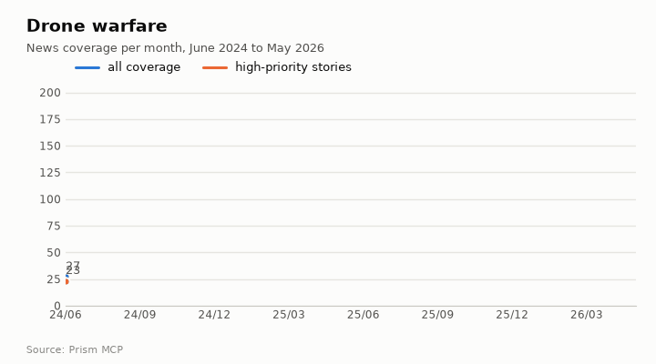
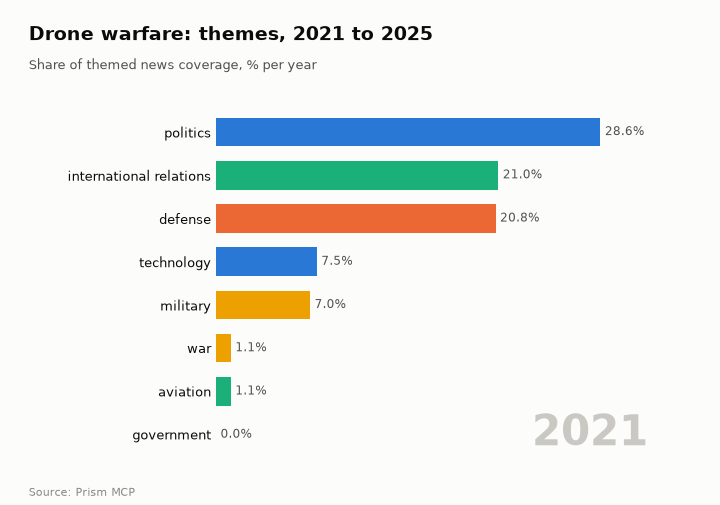
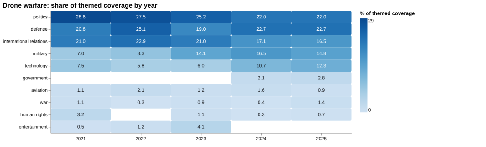
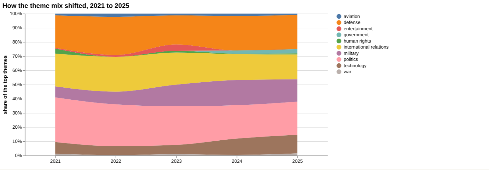
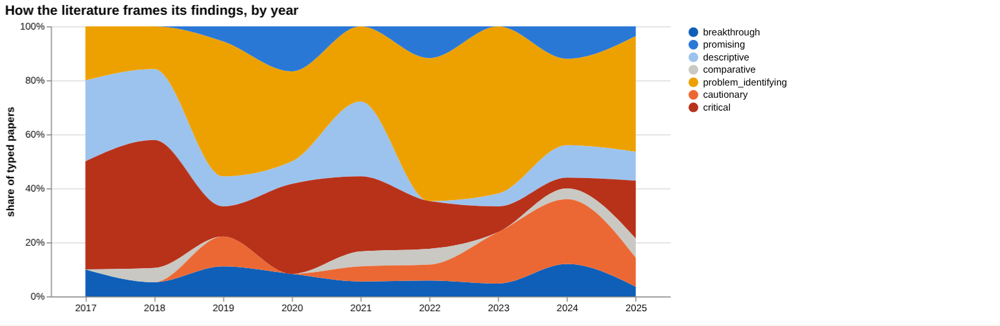
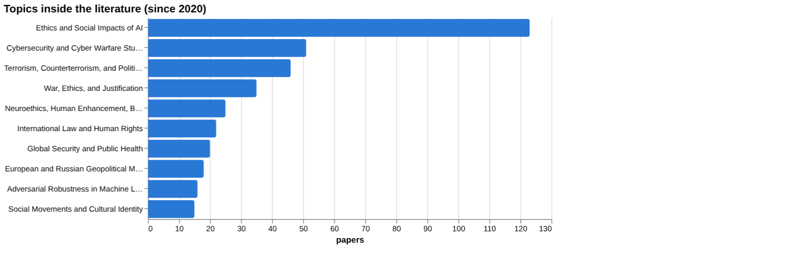
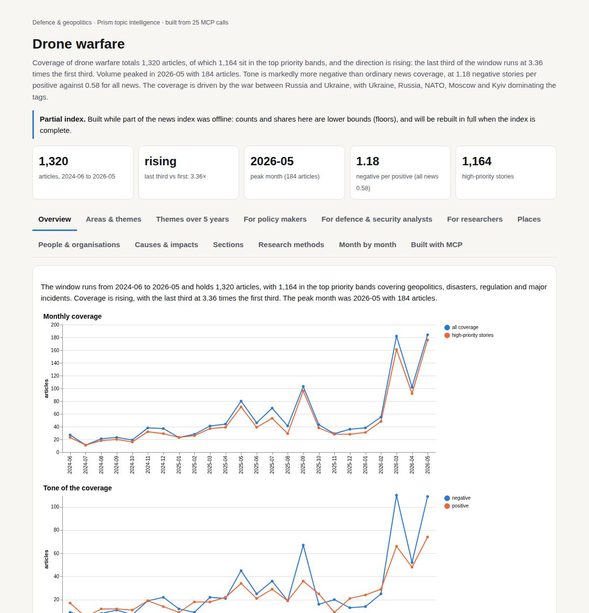

# Drone warfare

*Defence & geopolitics · Prism topic intelligence* · **[Open the interactive page](https://fliarbi.com/demo/docs/prism-dashboards-3bb43e4c/topics/drone-warfare/)** (tabs: Overview · Areas & themes · Themes over 5 years · For policy makers · For defence & security analysts · For researchers · Places · People & organisations · Causes & impacts · Sections · Research methods · Month by month · Built with MCP)

> **Partial index.** Built while part of the news index was offline: counts and shares here are lower bounds (floors), and will be rebuilt in full when the index is complete.

Coverage of drone warfare totals 1,320 articles, of which 1,164 sit in the top priority bands, and the direction is rising: the last third of the window runs at 3.36 times the first third. Volume peaked in 2026-05 with 184 articles. Tone is markedly more negative than ordinary news coverage, at 1.18 negative stories per positive against 0.58 for all news. The coverage is driven by the war between Russia and Ukraine, with Ukraine, Russia, NATO, Moscow and Kyiv dominating the tags.

| Articles | Direction (last third vs first) | Peak month | Negative per positive | High-priority stories |
| ---: | --- | --- | ---: | ---: |
| 1,320 (2024-06 to 2026-05) | rising (3.36×) | 2026-05 (184) | 1.18 (all news 0.58) | 1,164 |

## Coverage over time

The window runs from 2024-06 to 2026-05 and holds 1,320 articles, with 1,164 in the top priority bands covering geopolitics, disasters, regulation and major incidents. Coverage is rising, with the last third at 3.36 times the first third. The peak month was 2026-05 with 184 articles.

## Areas of activity and themes

Activity is concentrated in Law & Government › Military with 1,010 articles and Business & Industrial › Aerospace & Defense with 960, followed by Drones & RC Aircraft with 491. The leading tags are ukraine (891), russia (726), ukrainian (357), drones (322) and nato (257), while themes range from emerging drone technology and military robotics to space warfare and cyber warfare.

| Area of activity | Articles |
| --- | ---: |
| Law & Government › Military | 1,010 |
| Business & Industrial › Aerospace & Defense | 960 |
| Computers & Electronics › Consumer Electronics › Drones & RC Aircraft | 491 |
| People & Society › Social Sciences › Political Science | 188 |
| Law & Government › Military › Air Force | 140 |
| Law & Government › Military › Army | 23 |

**Top tags (what the themes are built from):** ukraine (891), russia (726), ukrainian (357), drones (322), nato (257), moscow (248), kyiv (219), military technology (107)

## Where it is reported

Ukraine leads country placement with 499 articles, ahead of the United States with 445 and Russia with 442, then China with 144, Iran with 130 and India with 122. At sub-national level Moscow has 144 and Kyiv Oblast 131, followed by Washington with 57, England with 54, Donetsk Oblast with 41 and Beijing with 33.

| Country | Articles | Lift | | Indian state | Articles | Lift |
| --- | ---: | ---: | --- | --- | ---: | ---: |
| Ukraine | 499 | 34.2× | | Moscow | 144 | 68.9× |
| United States | 445 | 0.6× | | Kyiv Oblast | 131 | 155.3× |
| Russia | 442 | 17.4× | | Washington | 57 | 1.6× |
| China | 144 | 0.9× | | England | 54 | 1.9× |
| Iran | 130 | 1.4× | | Donetsk Oblast | 41 | 526.2× |
| India | 122 | 0.6× | | Beijing | 33 | 2.6× |

## People and organisations

Coverage names Volodymyr Zelenskyy, Vladimir Putin, Mykhailo Fedorov, Andrey Belousov and Anil Chauhan. Organisations include the Armed Forces of Ukraine, the British Army, NATO, the Indian Army and Raytheon.

## Causes and impacts

Stories attribute events to drone warfare targeting energy and logistics networks, Russian drone and missile strikes, and Kyiv's superiority in drone warfare and air defence, including reports that air defences shot down over 370 Ukrainian drones. Reported impacts include damage to critical Danube port infrastructure, a power sub station damaged, airports briefly shut down, and six killed and at least 46 injured.

**Causes named in the coverage:** drone warfare targets energy and logistics networks, Kyiv's superiority in drone warfare and air defence, military and paramilitary forces supplied by foreign countries, russian drone and missile strike, air defences shot down over 370 ukrainian drones, russian drones hunt from above

**Impacts:** damage to critical Danube port infrastructure, deadliest threat to civilians, strongest frontline position in a year, six killed and at least 46 injured, power sub station damaged, airports briefly shut down

## Sections inside the topic

The Ukraine section holds 895 articles, a 67.8% share of the topic, and its late-versus-early ratio is 3.48. Its tone is more negative than the topic overall, at 1.7 negative per positive against 1.18. The India section holds 192 articles, a 14.55% share, and is growing faster at 4.59, with a milder tone of 0.66 negative per positive.

| Section | Articles | Share of the topic | Late vs early | Negative per positive |
| --- | ---: | ---: | ---: | ---: |
| drone warfare → ukraine | 895 | 67.8% | 3.48× | 1.7 (topic 1.18) |
| drone warfare → india | 192 | 14.55% | 4.59× | 0.66 (topic 1.18) |

## Research and outlook

The balance of research framing is broadly unchanged, with a shift of -4.8 points. No typed paper count is available for this topic.

## Month by month

Coverage moved from drones dominating battlefields and a surging counter-drone industry in 2025-06 to the spread of Ukrainian drone expertise to allies and energy targets in 2025-09. By 2026-01 India and China were rapidly expanding swarm and AI-controlled drone regiments, and by spring 2026 drones were frontline tools in a phase where drone superiority increasingly shapes battlefield outcomes.

- **2025-06:** Drones dominate battlefields and the counter‑drone industry surges, establishing drones as central weapons.
- **2025-09:** Ukraine’s drone expertise spreads to allies and energy targets, marking global diffusion and an arms‑race warning.
- **2026-01:** India and China rapidly expand swarm and AI‑controlled drone regiments, showing state‑level scaling of capabilities.

## Themes over five years

Politics fell from 28.6% of themed coverage in 2021 to 22.0% in 2025, and international relations from 21.0% to 16.5%. Defense rose from 20.8% to 22.7%, and military from 7.0% to 14.8%, having been 16.5% in 2024. Technology rose from 7.5% to 12.3%. Smaller themes were aviation (1.1% to 0.9%), war (1.1% to 1.4%) and human rights (3.2% to 0.7%); entertainment appeared at 0.5% in 2021 and was absent in 2025, while government appeared only from 2024 and reached 2.8% in 2025.

| Theme | 2021 | 2022 | 2023 | 2024 | 2025 |
| --- | ---: | ---: | ---: | ---: | ---: |
| politics | 28.6% | 27.5% | 25.2% | 22.0% | 22.0% |
| defense | 20.8% | 25.1% | 19.0% | 22.7% | 22.7% |
| international relations | 21.0% | 22.9% | 21.0% | 17.1% | 16.5% |
| military | 7.0% | 8.3% | 14.1% | 16.5% | 14.8% |
| technology | 7.5% | 5.8% | 6.0% | 10.7% | 12.3% |
| government | – | – | – | 2.1% | 2.8% |
| aviation | 1.1% | 2.1% | 1.2% | 1.6% | 0.9% |
| war | 1.1% | 0.3% | 0.9% | 0.4% | 1.4% |
| human rights | 3.2% | – | 1.1% | 0.3% | 0.7% |
| entertainment | 0.5% | 1.2% | 4.1% | – | – |

## For policy makers

Coverage of drone warfare is dominated by politics and defense, at 22.0% and 22.7% of themed coverage in 2025, while technology has grown to 12.3%. The news index holds 1,092 articles from 2019-01-01 to 2026-06-01, and recent stories centre on Ukraine, including a new integrated drone-infantry system reported on 2026-04-16 and a headline of 33,000 Russian drones downed in March. One analysis argues that drones have not won the fight in Ukraine, which matters for how the West plans. Key figures in the data include 119,100 deaths in organized violence and a 46% increase from the previous year, though the population for the latter is not stated. The scenario baseline of no change gives a central value of 39 for each of 2026, 2027 and 2028, with sensitivity ranges of 15 to 63, 0 to 87 and 0 to 111; the facts do not say what this value measures. No country-level reporting breakdown was available, so geography beyond Ukraine, Afghanistan and Pakistan cannot be drawn from this data.

- Ukraine-related reporting on integrated drone-infantry systems and drone volumes
- Technology theme at 12.3% of themed coverage in 2025
- Scenario range widening from 15 to 63 in 2026 to 0 to 111 in 2028
- Absence of country-level reporting data
- Policy debate on whether NATO should draw on Ukraine's battle-tested forces

## For defence & security analysts

On the claim that drone strikes reduce militant violence, the evidence is thin and contested. Of 42 papers, 3 are supporting, 10 qualifying, 13 contradicting and 16 neutral, giving a contested share of 54.8%. Of the documents read directly, 1 supports and 1 contradicts, with 8 unrelated, all at article tier. The most cited sources are article-tier work on Pakistan: The Impact of US Drone Strikes on Terrorism in Pakistan (2016, cited by 162) and Do U.S. Drone Strikes Cause Blowback? (2018, cited by 95). The competing claim that strikes increase civilian casualties has a contested share of 55.8% and one supporting article read, from 2025, so the comparison judges it to have more evidence behind it. Screening found no figures on militant violence, military costs, public opinion, escalation or territorial control, which means none was found rather than no effect.

- Claim that strikes reduce militant violence: 42 papers, 54.8% contested (article tier)
- Counter-evidence tally: 1 supports, 2 contradict, 7 unrelated
- Strongest source, The Impact of US Drone Strikes on Terrorism in Pakistan (2016), was unread in the head-to-head
- Civilian casualties claim: 55.8% contested; 2025 article on Pakistan supports it
- Evidence gaps flagged for decreased militant violence, reduced insurgent attacks and lower terrorist activity

**Head to head:** Drone strikes reduce militant violence vs Drone strikes increase civilian casualties: the second claim has more evidence behind it.

**Screen:** *What is the effect of drone warfare on …?* (one row per line below)

| Row | Figure (quoted) | Measures | Source |
| --- | --- | --- | --- |
| civilian casualties | no figure found |  | Assembling Israeli drone warfare: Loitering surveillance and operational sustainability (2020) |
| militant violence | no figure found |  |  |
| military costs | no figure found |  |  |
| public opinion | no figure found |  |  |
| escalation | no figure found |  |  |
| territorial control | no figure found |  |  |

## For researchers

The broad literature of 45,441 research papers is framed overwhelmingly positively: 33,751 supporting, 5,167 qualifying, 629 contradicting and 5,894 neutral, with a contested share of 12.8%. The reading notes this can mean consensus or publication bias. Among the narrower set labelled by orientation, problem-identifying work accounts for 141 papers (54.0%) and critical work for 42 (16.1%), and position papers (135) outnumber empirical ones (60). Framing is broadly unchanged between windows, with cautionary shares of 11.5% recently (14,577 papers) and 14.8% earlier (8,209 papers). Newer work includes studies of Turkey's drone activism and regime survival (2023), The Legitimacy of Drone Warfare (2024) and laser weapons for anti-drone warfare (2023). The index holds 5 the health literature index records, and no patents or arXiv preprints were found.

- Why are position papers (135) far more numerous than empirical ones (60)?
- Does the 12.8% contested share in the full corpus reflect consensus or publication bias?
- What direct empirical evidence exists on militant violence, escalation and public opinion, where screening found no papers?
- How do the 2025 papers on autonomous weapons, all with 0 citations, shape the field once cited?
- Why do contested shares by year swing, for example 61.3% in 2023 and 23.1% in 2024?

## Research exploration methods

Nine ways to explore the research, each run on this topic; the interactive report shows each call and its result.

**Chaining them.** Start with the facets and frontier scan to see the shape of the field: mostly position and problem-identifying papers, with thin citations on recent work. Then use triangulation and head-to-head to test the specific claims, noting that both are about equally contested and rest on few documents read. Treat the empty or contradictory outputs, namely the screening, gap map, history and geography, as signs the queries need rewording, and rerun them before drawing any conclusion. Use the framing series to check whether the 2023 peak in contested share is real by looking at yearly counts. Finish by reading in full the empirical Pakistan studies identified in triangulation, since they are the strongest cited evidence available.

### Evidence triangulation

*Is a claim supported, and by how strong a design?* `find_evidence` + `find_counter_evidence` + `rank_sources`

Of the ten documents read for the claim "Drone strikes reduce militant violence", one supports it, one contradicts it and eight are unrelated, and all ten are articles, so no stronger design such as a trial or systematic review was found. The wider corpus of 42 papers splits into 3 supporting, 10 qualifying, 13 contradicting and 16 neutral, with a contested share of 54.8%, which the method reads as an actively contested literature. The counter-evidence pass found 1 supporting and 2 contradicting documents, and its recommendation is to explain the differences between them. The top-cited sources are all articles: "The Impact of US Drone Strikes on Terrorism in Pakistan" (2016, cited by 162), then papers from 2016, 2018 and 2013. What this does not show is which finding is right, since eight of ten documents were unrelated and the sample read is tiny. A careful researcher would read the highly cited Pakistan studies in full and compare their data, time periods and outcome measures to see why they diverge.

### Head-to-head claims

*Which of two interventions has more and stronger evidence?* `compare_claims`

The two claims were measured the same way, and the verdict is that the second, "Drone strikes increase civilian casualties", has more evidence behind it. Its corpus mix is 6 supporting, 25 qualifying, 23 contradicting and 32 neutral, with a contested share of 55.8%, against 3, 10, 13 and 16 and 54.8 for the first claim. Yet papers_both_poles is "0" for the second claim and "42" for the first, an inconsistency that makes the verdict hard to interpret without checking how it was reached. Of documents read, the second claim has 1 supporting, 7 unrelated and 1 unread; the first has 7 unrelated and 3 unread, with none classed as supporting or contradicting. The strongest source for the second is a 2025 article that supports it; for the first it is the 2016 Pakistan article, still unread. Both claims are about equally contested, so the verdict reflects volume and a single supporting read, not settled findings. The next step is to read the unread strongest source for the first claim and establish why the pole counts differ.

### Cross-row screening

*Which rows carry a measured, quoted figure, and how large is it?* `research_table`

The screening asked for the effect of drone warfare on six outcomes, and no row returned a quoted figure: every value, measure and population is empty. Only "civilian casualties" had any papers (3), tied to a 2020 paper on Israeli drone warfare and loitering surveillance, but no effect size was extracted from it. The other five rows (militant violence, military costs, public opinion, escalation, territorial control) show "0" papers. This absence means the screening found no measured effect sizes in what it could reach; it does not mean no effects exist, as the question wording or the corpus may simply not fit. It is also notable that militant violence shows no papers here although other methods found dozens on that claim. A careful researcher would rephrase the question per outcome and search the quantitative studies directly.

### Framing drift

*Is the literature becoming more hopeful or more cautious?* `stance_trends`

From 2017 to 2025 the share of papers with positive framing stays low, between 2.9 and 11.1 percent, with the highest in 2019 (11.1) and the lowest in 2025 (2.9). The contested share is more volatile: 27.3 in 2017, 48.1 in 2019, 25.0 in 2020, a peak of 61.3 in 2023, then 23.1 in 2024 and 30.9 in 2025. There is no steady drift towards either hope or caution; the series moves up and down from year to year. The swings may reflect small yearly counts or a few prominent papers, which these figures do not reveal. Framing also describes how papers present themselves, not whether their claims are true. A careful researcher would check the paper counts behind each year and see what drove the 2023 peak and the 2024 fall.

### Frontier scan

*What is new, and what is the research not reaching?* `research_radar`

The most-cited new work is led by a 2023 Third World Quarterly paper on Turkey's drone warfare and regime survival (cited by 30), followed by items cited by 9, 8, 6, 6 and 5, so recent work is thinly cited. Orientations are mixed: problem_identifying, breakthrough, descriptive and critical, and the topics concern Turkey, Libya, anti-drone lasers and US presidents. Framing between windows is described as broadly unchanged: the recent window has 14,577 papers with cautionary_pct of 11.5, and the earlier has 8,209 with 14.8, a delta of -3.3 percentage points. The caveat given is that orientation labels the paper's own framing, not the truth. No under-covered topics were returned, so the scan says nothing about neglected areas. A careful researcher would read the Turkish and Libyan work as a possible shift towards state-level and regional studies, and test that against the full set.

### Gap mapping

*Which parts of a claim does the literature actually cover?* `research_gaps`

The gap map split the claim "Drone strikes reduce militant violence" into three components: drone strikes decrease militant violence, targeted drone strikes reduce insurgent attacks, and drone strikes lead to lower terrorist activity. Each is marked "no" for evidence. This sits oddly beside the triangulation, which found papers on the same claim, including a supporting and a contradicting document. The likeliest explanation is that the check required a close match to each phrasing, so it shows a failure to find matching literature, not a proven void. It should not be read as meaning nobody has studied the question. A careful researcher would treat the result as a prompt to try alternative wording, such as blowback, terrorism or propaganda output, and compare it with the triangulation findings.

### Count history and backtested scenarios

*Is research on this growing, and where could it be in three years?* `historical_analysis` + `scenarios`

The yearly count of title-matched papers is empty, so there is no observed history to show growth or decline. The scenarios therefore rest on something unseen: the chosen baseline is no_change, with a central value of "39" for each of 2026, 2027 and 2028. The sensitivity band widens from 15 to 63 in 2026, to 0 to 87 in 2027 and 0 to 111 in 2028. The flat central line is an assumption of no change, not a forecast of stability, and the widening band shows how little can be said about later years. The missing history means the backtest cannot be checked here. A careful researcher would rerun the counts with an explicit window and broader title terms before relying on any of these numbers.

### Geographic triangulation

*Where is it studied, published, reported and patented?* `global_comparison` + `newsgeo`

Both geographic lanes came back empty: where_studied and where_reported_by_country contain nothing. The method is meant to give separate country lanes for study, publication, reporting and patents, but none is available here. This tells us nothing about where drone warfare is researched or covered; it only means the lookup returned no results. Other methods hint at places, with Pakistan in the top-cited sources and Turkey, Libya, Israel and India in recent titles, but these are title observations, not a geographic count. A careful researcher would not draw conclusions about geography from this output and would rerun the lookup or tally countries from the papers directly.

### Faceted browsing

*What kind of literature is it: empirical, review, position? Problem-identifying or promising?* `browse_research`

Of the papers faceted by orientation, problem_identifying is 141 (54.0 percent), then critical 42 (16.1), descriptive 35 (13.4), cautionary 17 (6.5), breakthrough 10 (3.8), and comparative and promising 8 each (3.1). By contribution, position papers number 135, empirical 60, review 30, theoretical 23 and methodological 13, so the literature is mostly argument and problem-framing rather than measurement. The leading topics are Ethics and Social Impacts of AI (123), Cybersecurity and Cyber Warfare Studies (51), and Terrorism, Counterterrorism, and Political Violence (46), which suggests much of the material is about autonomy and ethics rather than strike effectiveness. The most-cited since 2020 list is all 2025 papers with cited_by of "0", so it shows recency, not influence. These facets do not show the quality or findings of the 60 empirical papers. A careful researcher would filter to that empirical group and the terrorism topic and read from there.

## Built with MCP

Every number and chart on this page comes from these 25 Prism MCP tool calls, made over MCP (streamable HTTP). Arguments and timings: [mcp_calls.json](mcp_calls.json); responses: [data.json](data.json).

| MCP tool | Calls |
| --- | ---: |
| `news_activities` | 1 |
| `news_geography` | 1 |
| `news_drill` | 2 |
| `news_themes` | 5 |
| `prism_overview` | 1 |
| `news_factors` | 1 |
| `critical_news` | 1 |
| `historical_analysis` | 1 |
| `stance_trends` | 1 |
| `browse_research` | 1 |
| `research_radar` | 1 |
| `research_brief` | 1 |
| `research_gaps` | 1 |
| `global_comparison` | 1 |
| `rank_sources` | 1 |
| `find_evidence` | 1 |
| `find_counter_evidence` | 1 |
| `deep_timeline` | 1 |
| `research_table` | 1 |
| `compare_claims` | 1 |

Try it: `prism entity "drone warfare"` · `prism call news.drill term='drone warfare' scope='ukraine'` · `prism call analysis.timeline term='drone warfare'`

