# Drug trafficking

*Crime & public safety · Prism topic intelligence* · **[Open the interactive page](https://fliarbi.com/demo/docs/prism-dashboards-3bb43e4c/topics/drug-trafficking/)** (tabs: Overview · Areas & themes · Themes over 5 years · For policy makers · For police & enforcement · For researchers · Places · People & organisations · Causes & impacts · Sections · Research methods · Month by month · Built with MCP)

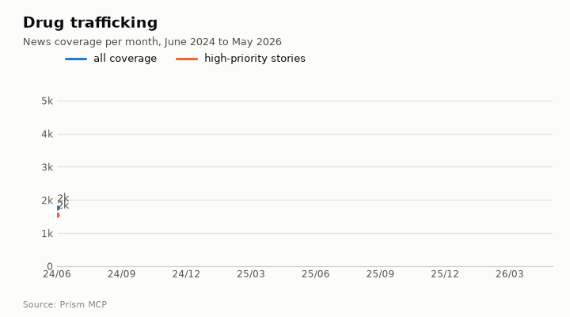

> **Partial index.** Built while part of the news index was offline: counts and shares here are lower bounds (floors), and will be rebuilt in full when the index is complete.

Coverage of drug trafficking runs to 77,156 articles between 2024-06 and 2026-05, and the direction is rising, with the last third of the window at 2.05 times the first third. The peak came in 2026-04 with 5,150 articles. Tone is markedly more negative than ordinary news coverage, at 12.97 negative articles per positive one against 0.58 for all news. The most frequent tags point to Venezuela, the Caribbean, Colombia and Nicolás Maduro, which indicates that US maritime strikes and the Venezuela confrontation are central to the coverage. Fentanyl trafficking and organised criminals also appear among the causes.

| Articles | Direction (last third vs first) | Peak month | Negative per positive | High-priority stories |
| ---: | --- | --- | ---: | ---: |
| 77,156 (2024-06 to 2026-05) | rising (2.05×) | 2026-04 (5,150) | 12.97 (all news 0.58) | 68,038 |

## Coverage over time

Of the 77,156 articles, 68,038 fall in the top priority bands covering geopolitics, disasters, regulation and major incidents; this is not a measure of tone. The peak month, 2026-04, reached 5,150 articles. Coverage in the final third of the window ran at 2.05 times the first third.

## Areas of activity and themes

Themes centre on penalties and cross-border enforcement, trafficking networks and narcotics investigations, and the top tags after "drug trafficking" (72,829) are venezuela (11,202), caribbean (7,193), colombia (6,594) and nicolás maduro (5,580).

| Area of activity | Articles |
| --- | ---: |
| Law & Government › Public Safety › Crime & Justice | 47,910 |
| Law & Government › Public Safety › Law Enforcement | 28,298 |
| People & Society › Social Issues & Advocacy › Drug Laws & Policy | 25,369 |
| Law & Government › Legal | 13,688 |
| Law & Government › Government › Executive Branch | 11,997 |
| Law & Government › Military | 2,978 |

**Top tags (what the themes are built from):** drug trafficking (72,829), venezuela (11,202), caribbean (7,193), colombia (6,594), nicolás maduro (5,580), maduro (5,434), caracas (3,469), dea (2,765)

## Where it is reported

| Country | Articles | Lift | | Indian state | Articles | Lift |
| --- | ---: | ---: | --- | --- | ---: | ---: |
| United States | 18,757 | 1.1× | | Washington | 4,163 | 2.9× |
| Mexico | 5,597 | 12.3× | | Caribbean | 3,445 | 53.2× |
| Venezuela | 4,906 | 30.8× | | New York | 3,226 | 1.9× |
| India | 3,909 | 0.8× | | California | 2,904 | 1.4× |
| Canada | 2,890 | 1.1× | | Arizona | 2,268 | 3.7× |
| Colombia | 2,829 | 7.7× | | Pennsylvania | 2,078 | 1.1× |

## People and organisations

The people most named include Cilia Flores, Gustavo Petro, Claudia Sheinbaum, Nemesio Oseguera Cervantes, María Corina Machado and Pavel Durov. Organisations include the national drug law enforcement agency, United States Southern Command, the United Nations Office on Drugs and Crime and Europol.

## Causes and impacts

Causes cited include US military strikes on alleged drug-trafficking boats and vessels transiting known trafficking routes, alongside fentanyl trafficking and organised criminals. Reported impacts include deaths, with "Over 200 people killed" and "Killed at least 194 people" among them, as well as a survivor left and people stranded at sea.

**Causes named in the coverage:** US military strike on alleged drug-trafficking boat, US military strike on suspected drug trafficking vessel, US military lethal strike on boat, Vessel transiting known drug trafficking routes, Fentanyl trafficking, Organized criminals

**Impacts:** Killed two men, Killed three men, Over 200 people killed, Left one survivor, Stranded at sea, Killed at least 194 people

## Sections inside the topic

The cartel section has 5,172 articles and the border section 3,134, equal to 6.7% and 4.06% of the topic respectively. Both grew over the window, with the cartel section at 1.92 times its early level and the border section at 1.58. The cartel section is far more negative, at 26.53 negative per positive article, while the border section, at 8.84, sits below the topic figure of 12.97.

| Section | Articles | Share of the topic | Late vs early | Negative per positive |
| --- | ---: | ---: | ---: | ---: |
| drug trafficking → border | 3,134 | 4.06% | 1.58× | 8.84 (topic 12.97) |
| drug trafficking → cartel | 5,172 | 6.7% | 1.92× | 26.53 (topic 12.97) |

## Research and outlook

The balance of framing is broadly unchanged, with a framing shift of 1.7 points. The outlook gives 164.875 for 2026, with a range of 131.675 to 198.075, rising to 171.75 in 2027 and 178.625 in 2028 with widening ranges.

## Month by month

From mid-2025 the coverage moved from new smuggling methods towards a militarised response, with turning points in 2025-07 (a guilty plea by a Guzmán heir and fentanyl reclassified to Schedule I), 2025-08 (coordinated busts and US military pressure on Venezuela) and 2025-09 (publicised strikes on Venezuelan drug boats). Early 2026 brought a large-scale strike on Venezuela and the killing of Mexico's top cartel boss.

- **2025-07:** First guilty plea by a Guzmán heir and U.S. reclassification of fentanyl to Schedule I marked a legal and enforcement watershed.
- **2025-08:** Coordinated international busts and the launch of U.S. military pressure on Venezuela signaled a shift to overt militarized anti‑trafficking actions.
- **2025-09:** Publicized U.S. strikes on Venezuelan drug boats introduced direct kinetic force against traffickers.

## Themes over five years

Between 2021 and 2025 the themed coverage shifted from crime and law enforcement towards politics and international relations. Crime moved from 26.5% in 2021 to 20.6% in 2025, and law enforcement from 19.7% to 14.9%. Politics rose from 15.3% to 22.6% and international relations from 8.4% to 15.1%. Local news fell from 9.4% to 6.6%, government rose from 3.3% to 4.9%, and the smaller themes stayed close to where they began: social issues 2.4% to 2.1%, law 2.5% to 2.1%, human rights 2.1% to 2.2%, and health 2.1% to 1.8%.

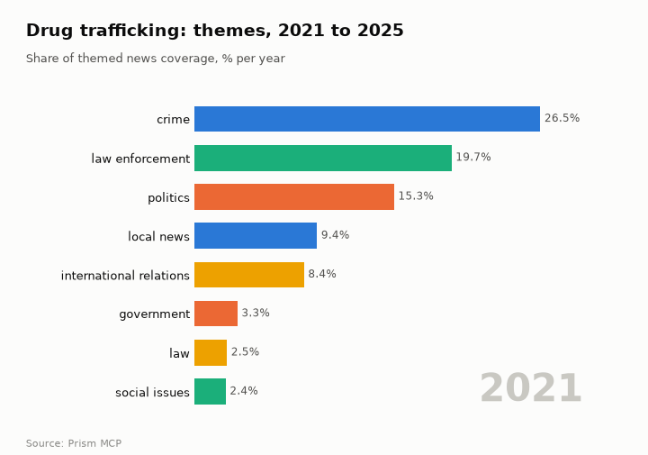

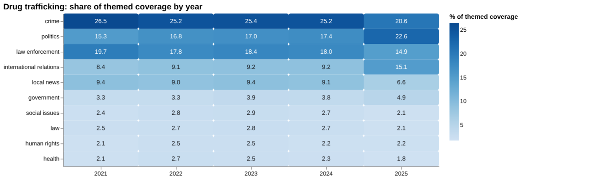

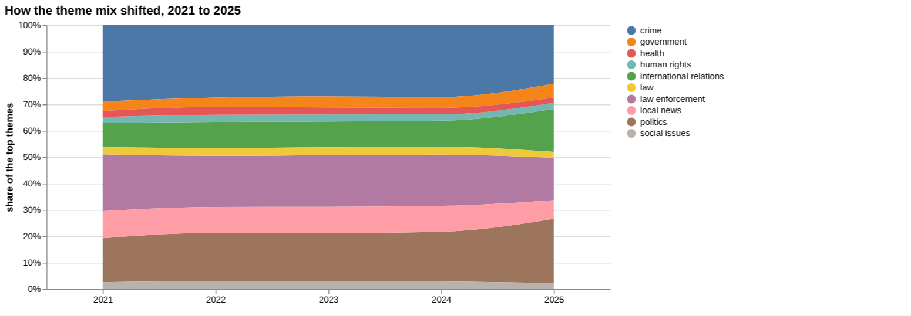

| Theme | 2021 | 2022 | 2023 | 2024 | 2025 |
| --- | ---: | ---: | ---: | ---: | ---: |
| crime | 26.5% | 25.2% | 25.4% | 25.2% | 20.6% |
| politics | 15.3% | 16.8% | 17.0% | 17.4% | 22.6% |
| law enforcement | 19.7% | 17.8% | 18.4% | 18.0% | 14.9% |
| international relations | 8.4% | 9.1% | 9.2% | 9.2% | 15.1% |
| local news | 9.4% | 9.0% | 9.4% | 9.1% | 6.6% |
| government | 3.3% | 3.3% | 3.9% | 3.8% | 4.9% |
| social issues | 2.4% | 2.8% | 2.9% | 2.7% | 2.1% |
| law | 2.5% | 2.7% | 2.8% | 2.7% | 2.1% |
| human rights | 2.1% | 2.5% | 2.5% | 2.2% | 2.2% |
| health | 2.1% | 2.7% | 2.5% | 2.3% | 1.8% |

## For policy makers

Coverage of drug trafficking has become more political and more international in its framing. Politics reached 22.6% of themed coverage in 2025 and international relations 15.1%, while crime fell to 20.6% and local news to 6.6%. Research output in the index stood at 158 papers in 2025, up from 105 in 2021, and the linear-drift baseline gives a central figure of 165 for 2026, 172 for 2027 and 179 for 2028, with a sensitivity range of 79 to 278 by 2028. Of the countries listed for where the work is studied, Australia has 4 papers, the United States 3, the United Kingdom 2, Canada 2 and the Czech Republic 1, so the evidence base is concentrated in a few places. No country breakdown of reporting was available. The one story flagged for 2026-05-07 concerns pressure on the Catalan regional leader over a wave of insecurity, which shows the issue reaching regional politics.

- Rising weight of politics and international relations in coverage
- Research output projected at a central 165 for 2026, with a range of 132 to 198
- Evidence concentrated in Australia, the United States, the United Kingdom and Canada
- Fentanyl has only 1 paper in the screening, 'Fentanyl Trafficking in Mexico' (2025)
- Regional political pressure over insecurity, as in the Catalan story of 2026-05-07

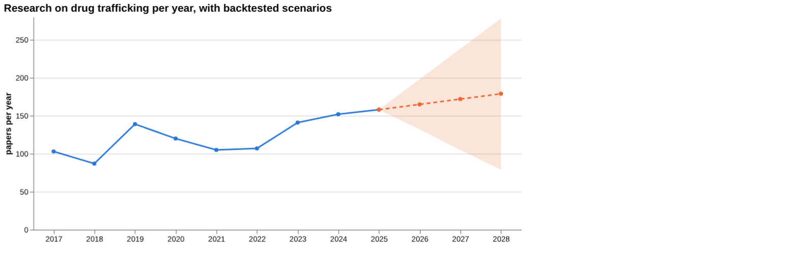

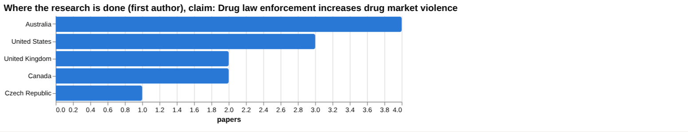

## For police & enforcement

On the claim that drug law enforcement increases drug market violence, the literature is actively contested: of 14,161 papers, 1,595 support, 6,240 qualify, 1,026 contradict and 5,300 are neutral, with 51.3% contested. Of the documents read directly, none supports the claim as written, 1 contradicts it and 0 qualify it. The strongest source is a 2007 meta-analytic review of street-level enforcement (review tier), which contradicts the claim; a 2020 updated systematic review is also in the review tier. The recommendation from the reading is to revise or withhold the claim as written. The gap check finds evidence for three components (enforcement actions, supply-chain disruption, and retaliation after raids) but none for increased police presence leading to more violent confrontations. For the supply-side interdiction claim, the 5 documents read were all unrelated, so it remains unsupported by direct reading.

- Review tier: the 2007 meta-analytic review of street-level enforcement contradicts the claim
- Review tier: a 2020 updated systematic review is among the top sources
- Corpus stance: 51.3% contested across 14,161 papers
- Article tier: 'Drug Law Enforcement' (2007) is cited by 94, but no document read supports the claim
- No evidence found for police presence leading to more violent confrontations; supply-side interdiction has only unrelated documents read

**Head to head:** Drug law enforcement increases drug market violence vs Supply-side interdiction reduces drug availability: the first claim has more evidence behind it.

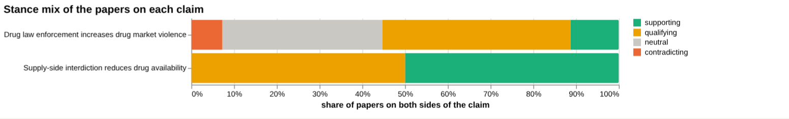

**Screen:** *How large is the illicit market for …?* (one row per line below)

| Row | Figure (quoted) | Measures | Source |
| --- | --- | --- | --- |
| cocaine | no figure found |  | Guns and Violence: The Enduring Impact of Crack Cocaine Markets on Young Black Males (2018) |
| heroin | 10% | increase in market share of Colombian-sourced heroin | The relationship between <scp>US</scp> heroin market dynamics and heroin‐related overdose, (2014) |
| methamphetamine | no figure found |  |  |
| cannabis | no figure found |  | Beyond THC: The New Generation of Cannabinoid Designer Drugs (2011) |
| fentanyl | no figure found |  | Fentanyl Trafficking in Mexico (2025) |
| opium | no figure found |  |  |

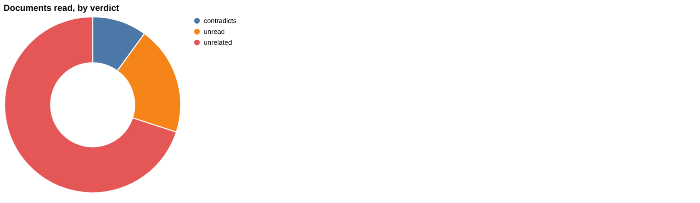

## For researchers

The wider literature of 35,898 papers is described as mixed with no dominant lean: 20,247 supporting, 5,187 qualifying, 682 contradicting and 9,782 neutral, with 16.3% contested. Framing is broadly unchanged between windows, with cautionary shares of 16.8% earlier and 16.3% recently. By orientation, problem-identifying papers account for 1,362 (54.3%) and descriptive for 734 (29.3%), while promising work is 116 (4.6%) and breakthrough work 45 (1.8%). Empirical contributions number 1,594 against 120 reviews. The thin areas are visible: the screening of market size gives a figure only for heroin (a 10% increase in market share of Colombian-sourced heroin), methamphetamine and opium have 0 papers, and the index holds 1 patent and 4 arXiv preprints. Recent work centres on cryptomarkets, county lines and online monitoring.

- What are the market sizes for cocaine, cannabis, fentanyl, methamphetamine and opium, where no figure was found?
- Why do methamphetamine and opium have 0 papers in the screening?
- Does evidence exist on police presence and violent confrontations in drug markets?
- How far do cryptomarket and social-media studies extend a literature that is mostly problem-identifying?
- Why are the most-cited-since-2020 entries mostly off-topic with 0 citations, and what does that say about indexing of recent work?

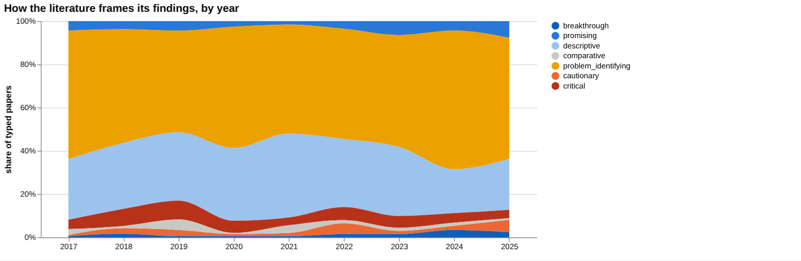

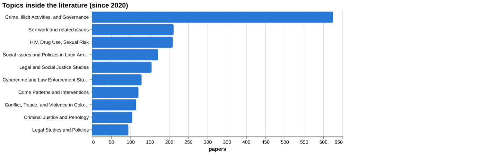

## Research exploration methods

Nine ways to explore the research, each run on this topic; the interactive report shows each call and its result.

**Chaining them.** Begin with triangulation to assess the overall support for the central claim and identify the contested nature of the literature. Use gap mapping to pinpoint which components of the claim lack evidence and direct further searches. Apply head‑to‑head comparison to evaluate alternative interventions and their evidential bases. Supplement with screening to obtain quantitative effect sizes for specific substances, and employ framing and frontier analyses to understand how the literature's orientation is evolving. Finally, integrate geographic, historical and faceted insights to guide targeted data collection and future monitoring.

### Evidence triangulation

*Is a claim supported, and by how strong a design?* `find_evidence` + `find_counter_evidence` + `rank_sources`

The claim that drug law enforcement increases drug market violence is contested, with the corpus stance showing 1,595 supporting, 6,240 qualifying, 1,026 contradicting and 5,300 neutral papers. The a contested share of 51.3% indicates that just over half of the literature frames the issue as a problem, caution or criticism. No document read directly supports the claim as written; one contradicts it and none require qualifications, leading to the recommendation to revise or withhold the claim. What is not shown is the methodological quality of the qualifying papers or any causal inference beyond the tier classification. A careful researcher would seek higher‑tier evidence that directly addresses the claim and evaluate the nature of the qualifying studies.

### Head-to-head claims

*Which of two interventions has more and stronger evidence?* `compare_claims`

The comparison shows that the claim about drug law enforcement increasing market violence has more evidence behind it than the supply‑side interdiction claim. The first claim has five papers on both poles, a contested share of 51.3% and one contradicting document, with the strongest source being a 2007 review that contradicts the claim. The second claim has only one paper on both poles, a contested share of 50.0% and its strongest source from 2020 is unrelated. The result does not reveal the depth of evidence for each pole beyond the tier of the strongest source. A careful researcher would examine the 2007 review in detail and attempt to locate any supporting evidence for the supply‑side claim.

### Cross-row screening

*Which rows carry a measured, quoted figure, and how large is it?* `research_table`

For heroin the screening returns a quantified effect: a 10% increase in market share of Colombian‑sourced heroin, based on six papers. All other rows (cocaine, methamphetamine, cannabis, fentanyl, opium) return null values, indicating no measured effect size was found. The result shows a specific market shift for heroin but does not provide any effect size for the other substances. It also does not indicate the population or context of the reported increase. A careful researcher would verify the heroin figure and search for comparable data on the remaining drugs.

### Framing drift

*Is the literature becoming more hopeful or more cautious?* `stance_trends`

The framing analysis records positive share rising from 2.4% in 2017 to 5.1% in 2025, while contested share fluctuates between 27.7% and 37.8% over the same period. This suggests a modest increase in hopeful or positive orientation alongside a consistently high level of contested literature. The data do not explain why the positive orientation is changing nor what drives the contested share. It also does not differentiate between sub‑fields or topics. A careful researcher would investigate the underlying reasons for the shift in positive framing.

### Frontier scan

*What is new, and what is the research not reaching?* `research_radar`

The frontier scan lists six recent works, the most cited being a 2022 article with 44 citations describing drug trafficking violence in Central America. The framing shift between recent and earlier windows shows cautionary_pct moving from 16.8% to 16.3%, a delta of -0.5 points, leading to the reading that framing is broadly unchanged. The result does not assess the impact of these new works on policy or practice. It also does not quantify how the orientation labels relate to the actual stance of the papers. A careful researcher would review the highlighted new works to identify emerging themes not yet reflected in the broader literature.

### Gap mapping

*Which parts of a claim does the literature actually cover?* `research_gaps`

The gap mapping breaks the claim into four components; three components have evidence (law enforcement actions increase violence, disruption of supply chains fuels competition, targeted raids provoke retaliation) while the component linking increased police presence to more violent confrontations has no evidence. This shows where the literature currently addresses the claim and where a gap exists. The result does not indicate the quality or depth of the evidence for the components that are covered. A careful researcher would target a literature search at the missing component and assess the robustness of the existing evidence.

### Count history and backtested scenarios

*Is research on this growing, and where could it be in three years?* `historical_analysis` + `trend_scenarios`

The count history records annual paper totals ranging from 87 in 2018 to 158 in 2025, indicating a generally upward trend. Scenario modelling projects central values of 165 for 2026, 172 for 2027 and 179 for 2028, with lower and upper sensitivity bounds provided for each year. The baseline is described as linear_drift. The data do not reveal the drivers behind the increase in publications. A careful researcher would monitor future publication counts against these scenarios to detect any deviation from the projected drift.

### Geographic triangulation

*Where is it studied, published, reported and patented?* `global_comparison` + `newsgeo`

Geographic triangulation shows that the claim has been studied in Australia (4), United States (3), United Kingdom (2), Canada (2) and Czech Republic (1). No countries are listed for where the claim is reported by news sources. This indicates a limited geographic spread of academic study and no apparent media reporting captured. The result does not show coverage in other regions or any patent activity. A careful researcher would seek additional studies from under‑represented regions to broaden the geographic evidence base.

### Faceted browsing

*What kind of literature is it: empirical, review, position? Problem-identifying or promising?* `browse_research`

Faceted browsing reveals that problem_identifying orientation dominates with 1,362 papers (share_pct 54.3) and descriptive orientation follows with 734 papers (share_pct 29.3). Empirical contributions are the most common with 1,594 papers, while review contributions number 120. The top topics include Crime, Illicit Activities, and Governance (626 papers) and HIV, Drug Use, Sexual Risk (210 papers). The most cited works since 2020 all have zero citations, indicating they are very recent or not yet influential. The result does not assess the methodological rigour of the papers within each facet. A careful researcher would examine the highly cited problem_identifying works for emerging insights and consider under‑represented orientations.

## Built with MCP

Every number and chart on this page comes from these 26 Prism MCP tool calls, made over MCP (streamable HTTP). Arguments and timings: [mcp_calls.json](mcp_calls.json); responses: [data.json](data.json).

| MCP tool | Calls |
| --- | ---: |
| `news_activities` | 1 |
| `news_geography` | 1 |
| `prism_overview` | 1 |
| `news_drill` | 2 |
| `news_themes` | 5 |
| `news_factors` | 1 |
| `historical_analysis` | 1 |
| `stance_trends` | 1 |
| `critical_news` | 1 |
| `browse_research` | 1 |
| `research_radar` | 1 |
| `research_brief` | 1 |
| `research_gaps` | 1 |
| `global_comparison` | 1 |
| `rank_sources` | 1 |
| `find_evidence` | 1 |
| `find_counter_evidence` | 1 |
| `deep_timeline` | 1 |
| `compare_claims` | 1 |
| `research_table` | 1 |
| `trend_scenarios` | 1 |

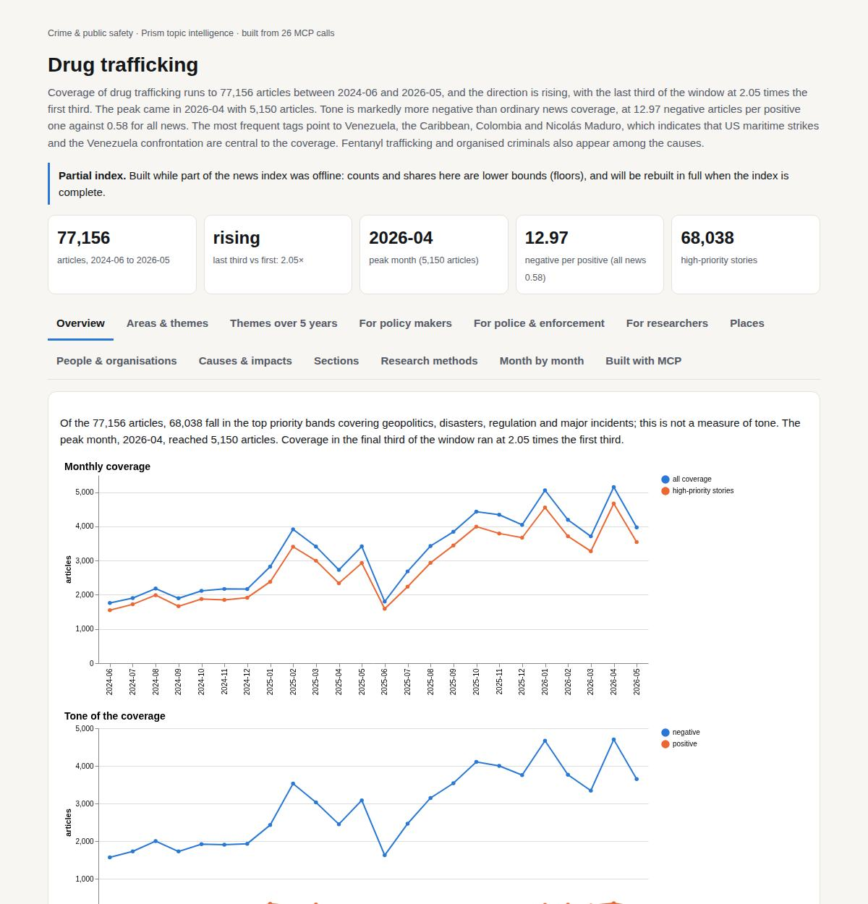

Try it: `prism entity "drug trafficking"` · `prism call news.drill term='drug trafficking' scope='border'` · `prism call analysis.timeline term='drug trafficking'`

