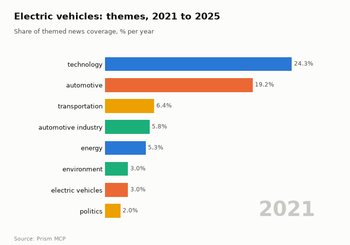
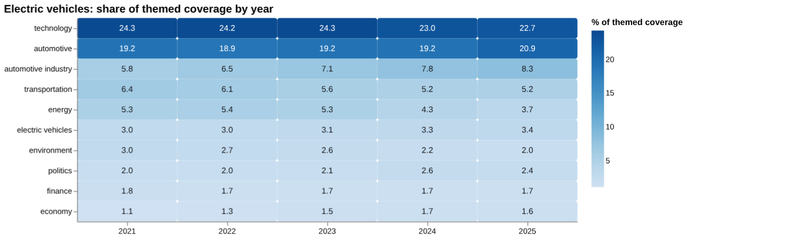
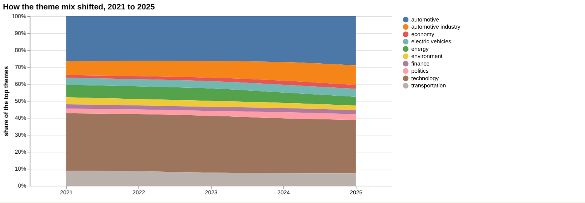
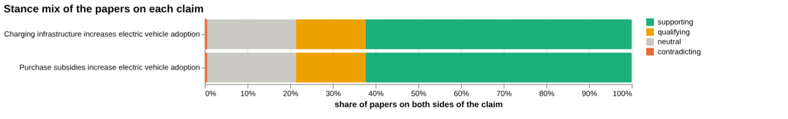
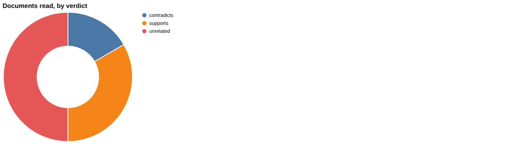
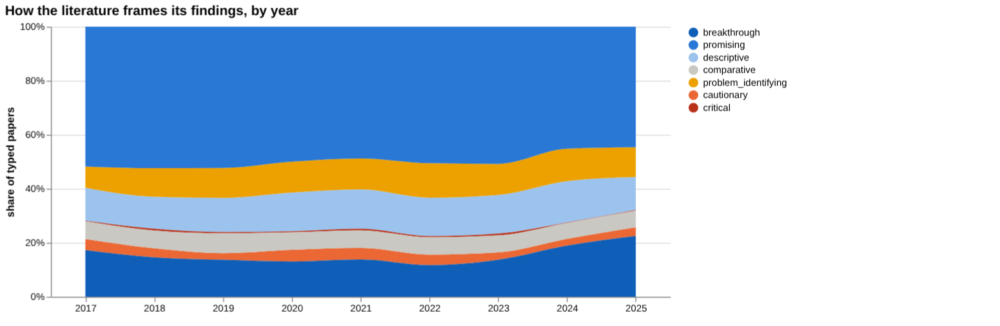
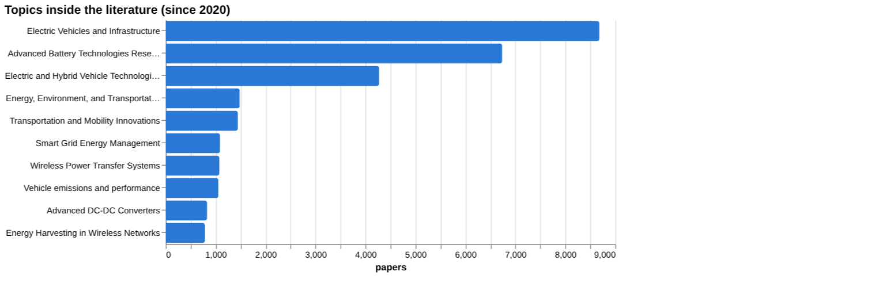
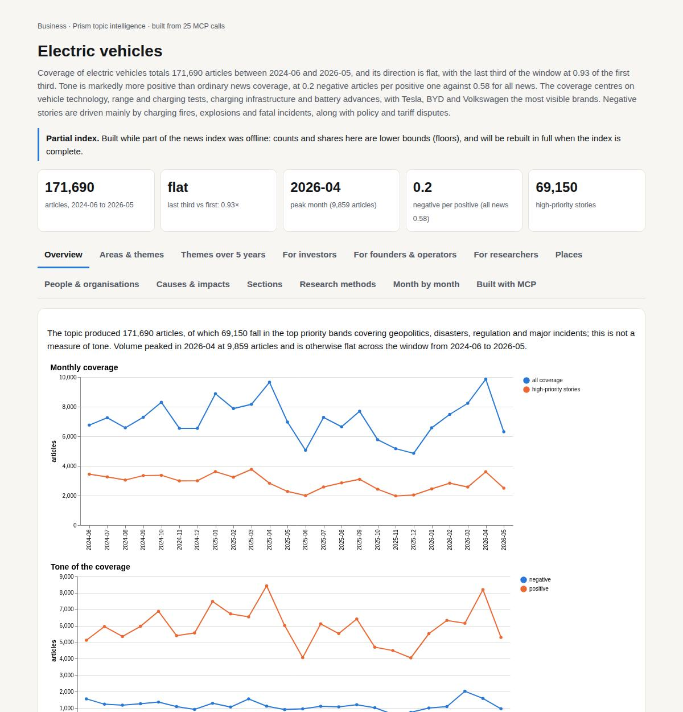

# Electric vehicles

*Business · Prism topic intelligence* · **[Open the interactive page](https://fliarbi.com/demo/docs/prism-dashboards-3bb43e4c/topics/electric-vehicles/)** (tabs: Overview · Areas & themes · Themes over 5 years · For investors · For founders & operators · For researchers · Places · People & organisations · Causes & impacts · Sections · Research methods · Month by month · Built with MCP)

> **Partial index.** Built while part of the news index was offline: counts and shares here are lower bounds (floors), and will be rebuilt in full when the index is complete.

Coverage of electric vehicles totals 171,690 articles between 2024-06 and 2026-05, and its direction is flat, with the last third of the window at 0.93 of the first third. Tone is markedly more positive than ordinary news coverage, at 0.2 negative articles per positive one against 0.58 for all news. The coverage centres on vehicle technology, range and charging tests, charging infrastructure and battery advances, with Tesla, BYD and Volkswagen the most visible brands. Negative stories are driven mainly by charging fires, explosions and fatal incidents, along with policy and tariff disputes.

| Articles | Direction (last third vs first) | Peak month | Negative per positive | High-priority stories |
| ---: | --- | --- | ---: | ---: |
| 171,690 (2024-06 to 2026-05) | flat (0.93×) | 2026-04 (9,859) | 0.2 (all news 0.58) | 69,150 |

## Coverage over time

The topic produced 171,690 articles, of which 69,150 fall in the top priority bands covering geopolitics, disasters, regulation and major incidents; this is not a measure of tone. Volume peaked in 2026-04 at 9,859 articles and is otherwise flat across the window from 2024-06 to 2026-05.

## Areas of activity and themes

The top tags are ev (93,458), electric vehicles (79,560) and electric vehicle (77,394), followed by automotive industry (47,089), automotive (34,469), tesla (22,416), byd (11,725) and volkswagen (8,706).

| Area of activity | Articles |
| --- | ---: |
| Autos & Vehicles › Motor Vehicles (By Type) › Hybrid & Alternative Vehicles | 121,755 |
| Autos & Vehicles › Vehicle Shopping › Vehicle Specs, Reviews & Comparisons | 57,679 |
| Business & Industrial › Automotive Industry | 44,541 |
| Autos & Vehicles › Motor Vehicles (By Type) › Trucks, Vans & SUVs | 36,148 |
| Autos & Vehicles › Motor Vehicles (By Brand) › Tesla Motors | 15,596 |
| Autos & Vehicles › Motor Vehicles (By Brand) › Kia | 4,020 |

**Top tags (what the themes are built from):** ev (93,458), electric vehicles (79,560), electric vehicle (77,394), automotive industry (47,089), automotive (34,469), tesla (22,416), byd (11,725), volkswagen (8,706)

## Where it is reported

The United States leads country coverage with 40,313 articles, followed by India with 23,820, China with 18,550, Japan with 10,321, the United Kingdom with 9,747 and Germany with 6,798. Among states, California (8,399), Texas (7,352), Aichi (6,897), Pennsylvania (6,675), Maharashtra (5,483) and Michigan (4,627) rank highest, and Maharashtra is the only Indian state in that list.

| Country | Articles | Lift | | Indian state | Articles | Lift |
| --- | ---: | ---: | --- | --- | ---: | ---: |
| United States | 40,313 | 1.0× | | California | 8,399 | 2.0× |
| India | 23,820 | 2.1× | | Texas | 7,352 | 2.0× |
| China | 18,550 | 2.1× | | Aichi | 6,897 | 29.4× |
| Japan | 10,321 | 3.8× | | Pennsylvania | 6,675 | 1.7× |
| United Kingdom | 9,747 | 1.1× | | Maharashtra | 5,483 | 5.8× |
| Germany | 6,798 | 3.1× | | Michigan | 4,627 | 1.9× |

## People and organisations

Elon Musk is the most prominent person in the coverage, followed by Tesla co-founders Martin Eberhard and Marc Tarpenning. Kathleen Wilson-Thompson, Joe Biden and Chrystia Freeland also appear.

## Causes and impacts

The negative causes are explosions at charging points and in cars being charged, a stabbing while charging, vehicles lit aflame, an electronic door design that trapped an occupant, and a failure to properly incentivise the switch to EVs. The impacts include seven persons killed, eight people killed, one person dead and seven injured, and car owners facing big petrol/diesel price increases.

**Causes named in the coverage:** explosion at electric car charging point, explosion in electric car being charged, failure to properly incentivise switch to EVs, stabbing while charging electric car, electric vehicles lit aflame, electronic door design trapped occupant

**Impacts:** seven persons killed, eight people killed, car owners facing big petrol/diesel price increases, one person dead and seven injured, man stabbed to death while charging car, chaos with electric vehicles lit aflame

## Sections inside the topic

The battery section holds 20,374 articles, or 11.87% of the topic, and is more positive than the topic as a whole, at 0.12 negative per positive against 0.2. Its volume is close to steady, with late against early at 0.96. The subsidy section is far smaller at 699 articles, or 0.41% of the topic, and it is the more negative of the two at 0.97 negative per positive. Its late against early figure of 0.46 shows a marked fall in attention.

| Section | Articles | Share of the topic | Late vs early | Negative per positive |
| --- | ---: | ---: | ---: | ---: |
| electric vehicle → battery | 20,374 | 11.87% | 0.96× | 0.12 (topic 0.2) |
| electric vehicle → subsidy | 699 | 0.41% | 0.46× | 0.97 (topic 0.2) |

## Research and outlook

No typed papers are recorded, and the shift in framing is 0.7 points, so the balance of framing is broadly unchanged. The outlook rises each year: 6034.375 for 2026 (range 5528.708 to 6540.042), 6501.75 for 2027 (5490.417 to 7513.083) and 6969.125 for 2028 (5452.125 to 8486.125).

## Month by month

Mid-2025 coverage moved from political clashes over EV tax credits and supply-chain strains in 2025-06, through an executive order on federal EV purchases and an Xpeng autonomous demonstration in 2025-08, to the EU's 35% import tax on Chinese EVs and Tesla's eight-year low market share in 2025-09. By January 2026 Chinese manufacturers had overtaken Tesla as the top-selling EV brand, and the coverage then turned to supply-chain self-reliance and global expansion, with safety incidents still recurring.

- **2025-06:** Political clashes over EV tax credits and supply‑chain strains highlighted material constraints and set a contentious policy backdrop.
- **2025-08:** President Biden’s executive order to purchase federal EVs and Xpeng’s autonomous demo signaled strong policy support and rapid tech progress.
- **2025-09:** EU’s 35% import tax on Chinese EVs and Tesla’s eight‑year low market share underscored rising geopolitical tension and competitive pressure.

## Themes over five years

Between 2021 and 2025 the themed coverage shifted modestly toward the car industry and away from energy and environment. Technology moved from 24.3% to 22.7%, while automotive rose from 19.2% to 20.9% and automotive industry from 5.8% to 8.3%. Energy fell from 5.3% to 3.7%, environment from 3.0% to 2.0% and transportation from 6.4% to 5.2%. Smaller themes were steadier or edged up: electric vehicles from 3.0% to 3.4%, politics from 2.0% to 2.4%, economy from 1.1% to 1.6%, and finance stayed at 1.8% in 2021 and 1.7% in 2025.

| Theme | 2021 | 2022 | 2023 | 2024 | 2025 |
| --- | ---: | ---: | ---: | ---: | ---: |
| technology | 24.3% | 24.2% | 24.3% | 23.0% | 22.7% |
| automotive | 19.2% | 18.9% | 19.2% | 19.2% | 20.9% |
| automotive industry | 5.8% | 6.5% | 7.1% | 7.8% | 8.3% |
| transportation | 6.4% | 6.1% | 5.6% | 5.2% | 5.2% |
| energy | 5.3% | 5.4% | 5.3% | 4.3% | 3.7% |
| electric vehicles | 3.0% | 3.0% | 3.1% | 3.3% | 3.4% |
| environment | 3.0% | 2.7% | 2.6% | 2.2% | 2.0% |
| politics | 2.0% | 2.0% | 2.1% | 2.6% | 2.4% |
| finance | 1.8% | 1.7% | 1.7% | 1.7% | 1.7% |
| economy | 1.1% | 1.3% | 1.5% | 1.7% | 1.6% |

## For investors

The index holds 144,576 news articles (2019-01-01..2026-06-01), 101,501 research papers (2017-2025) and 6,512 patents (2005-2024), so the topic is broad and well covered. Coverage has drifted toward the industry itself, with automotive industry at 8.3% of themed coverage in 2025, while energy sits at 3.7%. The central scenario for 2026 is 6,034, with a sensitivity range of 5,529 to 6,540, rising to 6,969 in 2028 (range 5,452 to 8,486) under a linear-drift baseline. Recent stories point to autonomy and regional adoption: Cybercab production footage on 2026-04-24, and Telangana recording 91K registrations in 2025–26. Reported sales figures come from studies without a stated place: a 30% increase in EV sales for private cars and a 70% increase for commercial vehicles. No country breakdown of research or reporting was available, so geography cannot be read from this data.

- Automotive industry theme at 8.3% of coverage in 2025
- Energy theme at 3.7% in 2025, down from 5.3% in 2021
- Scenario for 2026: 6,034 (range 5,529 to 6,540)
- Telangana's 91K registrations in 2025–26 as a regional signal
- Robotaxi and Cybercab developments reported on 2026-04-24

## For founders & operators

On the claim that purchase subsidies increase EV adoption, the corpus of 69,506 papers shows 43,363 supporting, 11,320 qualifying, 367 contradicting and 14,456 neutral, with 16.8% contested. That framing is overwhelmingly positive, which on a citation-weighted corpus can reflect consensus or publication bias. Of the documents read directly, 2 support, 1 contradicts and 3 are unrelated, so the differences between them need explaining. The strongest source is a 2025 journal article on incentives and registration rates across California, which supports the claim. By comparison, the claim that charging infrastructure increases adoption has 4 supporting documents and none contradicting, and the comparison concludes it has more evidence behind it. For other drivers, only battery cost carries a figure: over 35% increase in adoption rates, from a single 2024 paper on battery electric and V2G vehicles.

- Subsidies claim: 2 supporting, 1 contradicting, 3 unrelated documents read (article and preprint tiers)
- Strongest subsidy source: 2025 article on California incentives and registration rates, supports
- Charging infrastructure: 4 supporting documents, strongest a 2019 review
- Battery cost: over 35% increase in adoption rates, one 2024 paper
- Fuel prices and model availability: 0 papers found, which is not evidence of no effect

**Head to head:** Purchase subsidies increase electric vehicle adoption vs Charging infrastructure increases electric vehicle adoption: the second claim has more evidence behind it.

**Screen:** *How does … affect electric vehicle adoption?* (one row per line below)

| Row | Figure (quoted) | Measures | Source |
| --- | --- | --- | --- |
| purchase subsidies | no figure found |  | Purchase subsidies for 100% zero-emissions vehicle sales goals: Effectiveness, government  (2024) |
| charging infrastructure | no figure found |  | How much charging infrastructure do electric vehicles need? 
A review of the evidence and  (2019) |
| battery cost | over 35% | increase in adoption rates | Optimizing Electric Vehicle Integration with Vehicle-to-Grid Technology: The Influence of  (2024) |
| fuel prices | no figure found |  | Fuel price changes and their impacts on urban transport – a literature review using biblio (2018) |
| range anxiety | no figure found |  | Electric Vehicles acceptance and Range Anxiety mitigation: a Scoping Review towards HMI an (2021) |
| model availability | no figure found |  | Use of nested renewals to model availability under opportunistic maintenance policies (2003) |

## For researchers

The literature is framed positively: of the orientation labels, promising accounts for 7,493 papers (47.2%) and breakthrough 2,622 (16.5%), against cautionary at 553 (3.5%) and critical at 61 (0.4%). Contributions are mostly methodological (9,002), then empirical (4,628) and review (1,612), with theoretical work at 93. Framing is broadly unchanged between windows, with cautionary papers at 14.1% earlier and 13.9% recently. The leading topics are Electric Vehicles and Infrastructure (8,683 papers) and Advanced Battery Technologies Research (6,736), with policy at 1,481. The most-cited recent work is about batteries, raw materials and vehicle-to-grid, while the gaps list flags no evidence found for three subsidy-related phrasings: purchase subsidies increase EV adoption, subsidies boost EV sales, and incentives raise electric vehicle market share. Orientation labels describe a paper's own framing, not the truth.

- Why do three subsidy-effect phrasings show no evidence, despite 2 papers on purchase subsidies in screening?
- Is the positive framing consensus or publication bias?
- Only 93 theoretical papers against 9,002 methodological: what theory is missing?
- No figures found for range anxiety, fuel prices or model availability effects on adoption
- Only 61 papers labelled critical: is critique under-published or indexed elsewhere?

## Research exploration methods

Nine ways to explore the research, each run on this topic; the interactive report shows each call and its result.

**Chaining them.** Start with the facets to see that the literature is mostly methodological and promising, with a small policy share. Use triangulation and head-to-head on the specific adoption claims, noting that the corpus mix is near-identical for both, so the documents read carry the comparison. Follow with screening to find which drivers have a quotable effect size, and gap mapping rewritten into distinct components to test where coverage is missing. Use framing drift and the frontier scan to check whether tone or topics are changing. Treat the history and geography results as incomplete until the yearly counts and country lanes are recovered.

### Evidence triangulation

*Is a claim supported, and by how strong a design?* `find_evidence` + `find_counter_evidence` + `rank_sources`

Of the six documents read for the claim that purchase subsidies increase electric vehicle adoption, 2 support it, 1 contradicts it and 3 are unrelated; four are articles and two are preprints. The wider corpus of 69,506 papers splits into 43,363 supporting, 11,320 qualifying, 367 contradicting and 14,456 neutral, with contested share at 16.8. The tool itself notes that such positive framing can mean consensus or publication bias, and these figures cannot separate the two. The counter-evidence pass found no qualifying documents and none unread, so the one contradictory finding stands unexplained until its design and setting are compared with the supporting ones. The top-ranked source is a 2025 article on incentives and equity in California registration rates, cited by 4; the list is mostly articles with one preprint, and none is a review, so the ladder gives little above single studies. A careful researcher would read the contradicting document beside the supporting two and ask whether differences in market, subsidy design or period explain the split.

### Head-to-head claims

*Which of two interventions has more and stronger evidence?* `compare_claims`

Both claims are measured the same way, and the verdict is that charging infrastructure has more evidence behind it than purchase subsidies. For subsidies, the documents read were 2 supporting, 1 contradicting and 3 unrelated; for charging infrastructure they were 4 supporting, 0 contradicting and 7 unrelated. The strongest source for charging is a 2019 review, while the strongest for subsidies is a 2025 article, so the charging side also reaches a higher tier on the evidence ladder. The corpus figures are almost identical: 69,506 papers against 69,509, with the same supporting count of 43,363 and the same a contested share of 16.8%. That near-identity means the corpus stance mix does not discriminate between the two claims, and the verdict rests on the documents read. The read sets are small, and the 7 unrelated documents for charging show how loosely retrieval matched the claim. The comparison shows relative volume and strength of support, not the size of either effect.

### Cross-row screening

*Which rows carry a measured, quoted figure, and how large is it?* `research_table`

Only one of six rows returned a quoted figure: battery cost, with 'over 35%' described as an increase in adoption rates, for battery electric vehicles and V2G electric vehicles, from a single 2024 paper. That figure comes from one study of a particular vehicle-to-grid setting and should not be read as a general effect of battery cost. Purchase subsidies (2 papers), charging infrastructure (4) and range anxiety (3) had papers but no extractable value, so literature exists without a stated effect size. Fuel prices and model availability show 0 papers, and their listed sources look off-topic, notably a 2003 paper on nested renewals under opportunistic maintenance. The absence of numbers does not show that effects are small or missing; it shows that these papers did not state a quotable figure in answer to the question. A careful researcher would treat the table as a map of where quantified evidence is absent and look for econometric or modelling studies on the blank rows.

### Framing drift

*Is the literature becoming more hopeful or more cautious?* `stance_trends`

Positive framing stays in a narrow band from 2017 to 2025, between 30.6 percent in 2020 and 33.7 percent in 2025, starting at 33.4 in 2017. Contested framing is lower and moves within a small range, from 5.9 in 2017 to a high of 8.6 in 2022, then 7.2 in 2023 and 7.3 in both 2024 and 2025. The picture is of a literature whose tone has changed little, with a modest rise in contestation through 2022 that did not continue. These are shares of typed papers by the paper's own orientation, so they describe how authors present their work rather than whether the findings are right. Year-to-year differences of a point or so are small and the series gives no basis for reading a turning point. A careful researcher would check whether the shift in 2020 to 2022 corresponds to particular sub-topics before drawing any conclusion.

### Frontier scan

*What is new, and what is the research not reaching?* `research_radar`

The most-cited new work since the start year is dominated by technology reviews: a 2022 overview of batteries and battery management in Energy Reports (cited by 655), a 2023 Applied Sciences paper on benefits, challenges and solutions (626), and a 2023 forecast of lithium-ion raw material demand and recycling (325). Policy and adoption questions do not appear in this top group, which fits the earlier finding that subsidy evidence is thin. The framing shift is small: cautionary share was 13.9 percent in the recent window of 29,144 papers against 14.1 percent in the earlier window of 21,272 papers, a delta of -0.2 percentage points, which the tool reads as broadly unchanged. The caveat that orientation labels a paper's own framing, not the truth, applies. Citation counts favour older papers within the window, so the list says what has been read most rather than what is soundest. The result does not include the under-covered topics the method can return, so what the research is not reaching is not shown here.

### Gap mapping

*Which parts of a claim does the literature actually cover?* `research_gaps`

Each of the three components of the subsidy claim, 'purchase subsidies increase EV adoption', 'subsidies boost EV sales' and 'incentives raise electric vehicle market share', is marked 'no' for evidence. This sits oddly beside the 2 supporting documents found elsewhere and the corpus of 69,506 papers, so it most likely reflects how strictly the components were matched rather than a true absence of research. The three components are close paraphrases of one another, so they do not test different parts of the claim such as price sensitivity, income groups or subsidy design. The result should not be read as proof that no literature exists. A careful researcher would rephrase the components into distinct, testable parts and search each directly, and treat the 'no' marks as a prompt to check the matching rather than as a finding.

### Count history and backtested scenarios

*Is research on this growing, and where could it be in three years?* `historical_analysis` + `scenarios`

The count of papers per year came back empty, so there is no observed history to read and the growth question is not answered directly. The scenarios use a linear drift baseline and give central values of 6,034 for 2026, 6,502 for 2027 and 6,969 for 2028. The sensitivity band widens over time, from 5,529 to 6,540 in 2026 to 5,452 to 8,486 in 2028. Without the underlying yearly counts the reader cannot check the backtest or see whether the drift fits recent years. The projections extend a trend and say nothing about causes, funding or changes in indexing. A careful researcher would first obtain the yearly counts, confirm the window and title-matching rule, and then judge whether the band is credible.

### Geographic triangulation

*Where is it studied, published, reported and patented?* `global_comparison` + `newsgeo`

Both country lanes came back empty, with nothing for where the topic is studied and nothing for where it is reported. This means the method gave no geographic evidence, not that research is evenly spread or absent anywhere. The result therefore cannot say whether findings from places such as California, Seoul or China apply elsewhere, though those places appear in other results. That matters for the subsidy claim, where local policy design may drive outcomes. A careful researcher would rerun the lanes or tabulate country by hand from the documents read before generalising across markets.

### Faceted browsing

*What kind of literature is it: empirical, review, position? Problem-identifying or promising?* `browse_research`

Orientation is led by promising at 7,493 papers (47.2 percent), then breakthrough at 2,622 (16.5), descriptive at 2,229 (14.1), problem_identifying at 1,868 (11.8) and comparative at 1,035 (6.5). Cautionary has 553 papers (3.5 percent) and critical 61 (0.4). By contribution, methodological work leads with 9,002 papers, followed by empirical at 4,628, review at 1,612, position at 526 and theoretical at 93. The topic list is headed by Electric Vehicles and Infrastructure (8,683) and Advanced Battery Technologies Research (6,736), with Energy, Environment, and Transportation Policies at 1,481. The literature is therefore mostly engineering-oriented and optimistic in framing, with comparatively little policy-focused or critical work. The most-cited-since-2020 list shows cited_by of 1 or 0, so it reflects recency and not influence. A careful researcher would filter to empirical and policy-topic papers before assessing adoption drivers.

## Built with MCP

Every number and chart on this page comes from these 25 Prism MCP tool calls, made over MCP (streamable HTTP). Arguments and timings: [mcp_calls.json](mcp_calls.json); responses: [data.json](data.json).

| MCP tool | Calls |
| --- | ---: |
| `news_activities` | 1 |
| `news_geography` | 1 |
| `prism_overview` | 1 |
| `news_drill` | 2 |
| `news_themes` | 5 |
| `critical_news` | 1 |
| `historical_analysis` | 1 |
| `stance_trends` | 1 |
| `news_factors` | 1 |
| `browse_research` | 1 |
| `global_comparison` | 1 |
| `research_gaps` | 1 |
| `research_radar` | 1 |
| `research_brief` | 1 |
| `rank_sources` | 1 |
| `find_evidence` | 1 |
| `find_counter_evidence` | 1 |
| `deep_timeline` | 1 |
| `compare_claims` | 1 |
| `research_table` | 1 |

Try it: `prism entity "electric vehicle"` · `prism call news.drill term='electric vehicle' scope='battery'` · `prism call analysis.timeline term='electric vehicle'`

