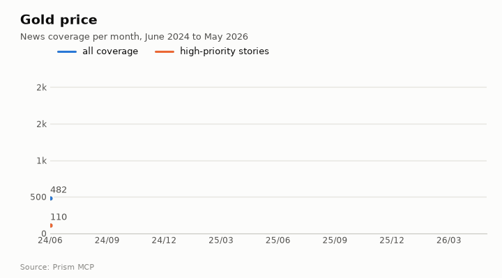
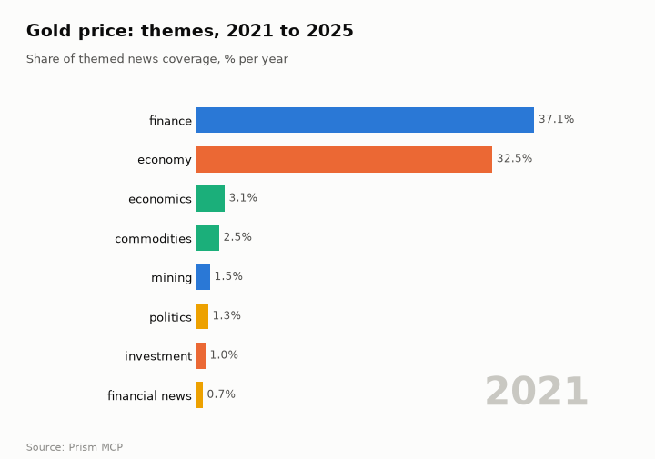
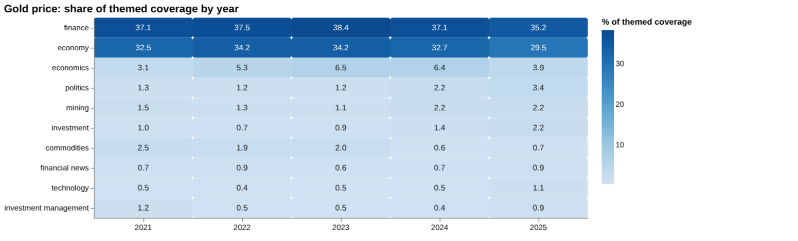
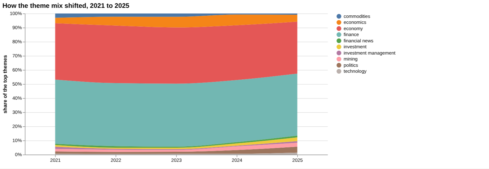
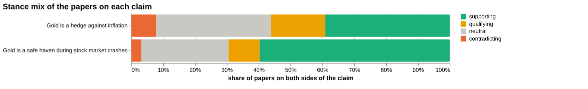
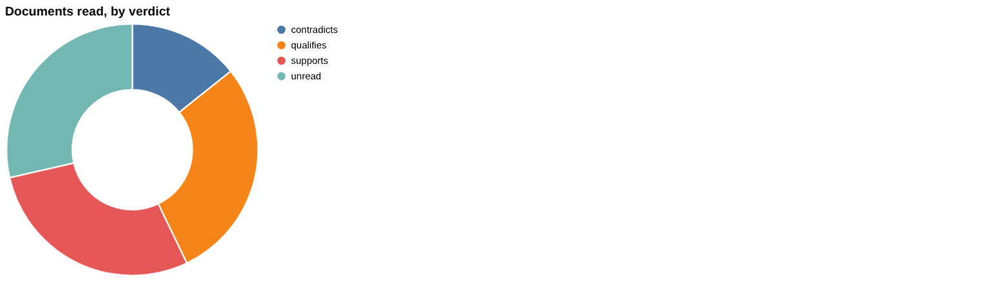
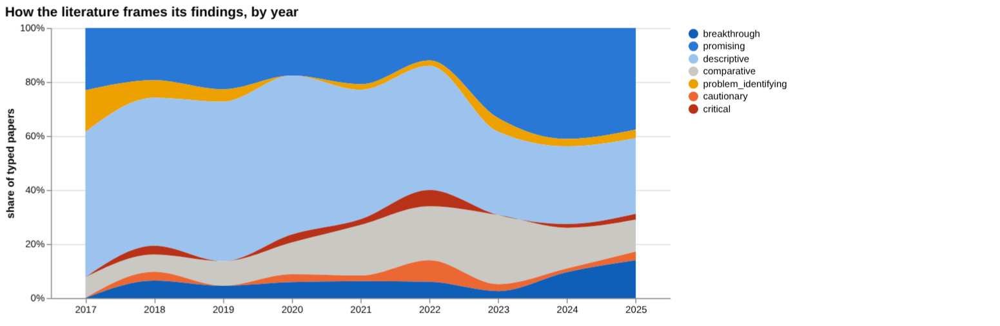
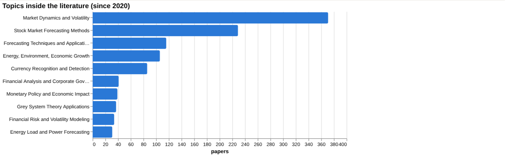
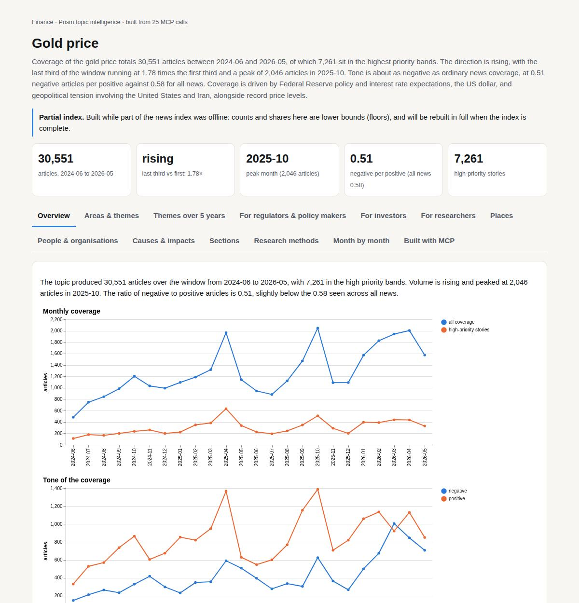

# Gold price

*Finance · Prism topic intelligence* · **[Open the interactive page](https://fliarbi.com/demo/docs/prism-dashboards-3bb43e4c/topics/gold-price/)** (tabs: Overview · Areas & themes · Themes over 5 years · For regulators & policy makers · For investors · For researchers · Places · People & organisations · Causes & impacts · Sections · Research methods · Month by month · Built with MCP)

> **Partial index.** Built while part of the news index was offline: counts and shares here are lower bounds (floors), and will be rebuilt in full when the index is complete.

Coverage of the gold price totals 30,551 articles between 2024-06 and 2026-05, of which 7,261 sit in the highest priority bands. The direction is rising, with the last third of the window running at 1.78 times the first third and a peak of 2,046 articles in 2025-10. Tone is about as negative as ordinary news coverage, at 0.51 negative articles per positive against 0.58 for all news. Coverage is driven by Federal Reserve policy and interest rate expectations, the US dollar, and geopolitical tension involving the United States and Iran, alongside record price levels.

| Articles | Direction (last third vs first) | Peak month | Negative per positive | High-priority stories |
| ---: | --- | --- | ---: | ---: |
| 30,551 (2024-06 to 2026-05) | rising (1.78×) | 2025-10 (2,046) | 0.51 (all news 0.58) | 7,261 |

## Coverage over time

The topic produced 30,551 articles over the window from 2024-06 to 2026-05, with 7,261 in the high priority bands. Volume is rising and peaked at 2,046 articles in 2025-10. The ratio of negative to positive articles is 0.51, slightly below the 0.58 seen across all news.

## Areas of activity and themes

Precious Metals is the dominant area of activity with 27,059 articles, well ahead of Clothing Accessories with 1,476 and general Metals & Mining with 1,276. The leading themes are precious metal spot prices, precious metals trading trends and commodity price changes, and the top tags are gold with 13,608, federal reserve with 7,309 and fed with 6,252.

| Area of activity | Articles |
| --- | ---: |
| Business & Industrial › Metals & Mining › Precious Metals | 27,059 |
| Shopping › Apparel › Clothing Accessories | 1,476 |
| Business & Industrial › Metals & Mining | 1,276 |
| Business & Industrial › Energy & Utilities › Oil & Gas | 336 |
| Business & Industrial › Shipping & Logistics › Import & Export | 164 |
| Shopping › Luxury Goods | 108 |

**Top tags (what the themes are built from):** gold (13,608), federal reserve (7,309), fed (6,252), silver (5,531), interest rates (4,064), us dollar (3,814), the federal reserve (2,875), usd (2,638)

## Where it is reported

The United States leads country coverage with 12,451 articles, followed by India with 7,539, China with 4,373, the United Kingdom with 2,567, Iran with 2018 and Russia with 1,383. Among Indian states, Maharashtra has 2,474 articles and Delhi 2,389, followed by Tamil Nadu with 1,859, Karnataka with 1,703 and West Bengal with 1,419.

| Country | Articles | Lift | | Indian state | Articles | Lift |
| --- | ---: | ---: | --- | --- | ---: | ---: |
| United States | 12,451 | 1.2× | | Maharashtra | 2,474 | 12.5× |
| India | 7,539 | 2.5× | | Delhi | 2,389 | 21.2× |
| China | 4,373 | 1.8× | | Tamil Nadu | 1,859 | 19.1× |
| United Kingdom | 2,567 | 1.1× | | Karnataka | 1,703 | 20.5× |
| Iran | 2,018 | 1.4× | | Scotland | 1,650 | 18.7× |
| Russia | 1,383 | 3.6× | | West Bengal | 1,419 | 15.2× |

## People and organisations

Coverage centres on Federal Reserve figures, led by Jerome Powell, Christopher Waller and Lisa D. Cook, followed by Austan Goolsbee and Kevin Hassett. Peter Schiff also appears among the named people.

## Causes and impacts

Stated causes include the dismissal of Fed governor Cook over mortgage fraud charges, escalating tensions between the United States and Iran, escalation of the war, gold prices at an all-time high and a weakening rupee. Reported impacts include gold prices fell sharply, a 40 dollar jump in the gold price, gold prices climbing more than 1%, a 17% decline in prices, and nervous markets and a stock market hit.

**Causes named in the coverage:** trump fires fed-governeur cook for mortgage fraud charges, escalating tensions between the united states and iran, escalation of the war, gold prices at an all-time high, weakening rupee

**Impacts:** gold price explodes by 40 dollars, markets are nervous about the escalation, gold prices fell sharply, gold prices climbed more than 1%, gold prices plummeting 17% decline, stock market has taken a hit

## Sections inside the topic

The central bank section has 1,227 articles, 4.02% of the topic, and the rupee section has 303 articles, 0.99%. Both are growing, with late-period volume at 1.87 times early volume for central bank and 4.29 times for the rupee. Tone in both is slightly less negative than the topic overall at 0.51, with 0.46 negative per positive for central bank and 0.49 for the rupee.

| Section | Articles | Share of the topic | Late vs early | Negative per positive |
| --- | ---: | ---: | ---: | ---: |
| gold price → central bank | 1,227 | 4.02% | 1.87× | 0.46 (topic 0.51) |
| gold price → rupee | 303 | 0.99% | 4.29× | 0.49 (topic 0.51) |

## Research and outlook

The balance of framing is broadly unchanged, with a shift of -1.7 points. The outlook shows 719.125 for 2026, 792.25 for 2027 and 865.375 for 2028, with the range widening from 393.725 to 1044.525 in 2026 to 0.0 to 1841.575 in 2028.

## Month by month

Gold rallied in June 2025 on geopolitical risk before a Middle East cease-fire pulled prices lower, then reached successive record highs from September 2025 on Fed rate cut expectations and a weaker dollar. A surge to historic highs in January 2026 was followed by a collapse in March 2026, and prices moved sideways in April and May 2026.

- **2025-06:** Geopolitical tensions and a Middle East cease‑fire drove a sharp rally followed by a rapid slip as risk appetite improved.
- **2025-09:** Investors bet on Fed rate cuts and a weaker dollar, sending gold to record highs and highlighting its sensitivity to short‑term macro news.
- **2026-01:** Geopolitical turmoil, including the US capture of Venezuela’s leader, and policy uncertainty spurred a surge to historic highs.

## Themes over five years

Finance stayed the leading theme throughout, moving from 37.1% of themed coverage in 2021 to 35.2% in 2025, with economy second at 32.5% in 2021 and 29.5% in 2025. Economics rose from 3.1% in 2021 to a peak of 6.5% in 2023 before falling to 3.9% in 2025. Politics grew from 1.3% to 3.4%, investment from 1.0% to 2.2%, and technology from 0.5% to 1.1%. Commodities fell from 2.5% in 2021 to 0.7% in 2025, while mining moved from 1.5% to 2.2% and investment management from 1.2% to 0.9%.

| Theme | 2021 | 2022 | 2023 | 2024 | 2025 |
| --- | ---: | ---: | ---: | ---: | ---: |
| finance | 37.1% | 37.5% | 38.4% | 37.1% | 35.2% |
| economy | 32.5% | 34.2% | 34.2% | 32.7% | 29.5% |
| economics | 3.1% | 5.3% | 6.5% | 6.4% | 3.9% |
| politics | 1.3% | 1.2% | 1.2% | 2.2% | 3.4% |
| mining | 1.5% | 1.3% | 1.1% | 2.2% | 2.2% |
| investment | 1.0% | 0.7% | 0.9% | 1.4% | 2.2% |
| commodities | 2.5% | 1.9% | 2.0% | 0.6% | 0.7% |
| financial news | 0.7% | 0.9% | 0.6% | 0.7% | 0.9% |
| technology | 0.5% | 0.4% | 0.5% | 0.5% | 1.1% |
| investment management | 1.2% | 0.5% | 0.5% | 0.4% | 0.9% |

## For regulators & policy makers

News coverage of the gold price totals 940 articles between 2019-01-01 and 2026-06-01, and the themed coverage stays concentrated in finance and economy. Politics has risen from 1.3% of themed coverage in 2021 to 3.4% in 2025, which fits the April 2026 stories linking gold to the US-Iran deadline and a hawkish Fed outlook. The central scenario on a linear drift baseline is 719 for 2026, 792 for 2027 and 865 for 2028, but the sensitivity band widens from 394 to 1,045 in 2026 to 0 to 1,842 in 2028. The facts give no country-level breakdown of where gold coverage or research is reported, so geography cannot be assessed. Screening found no measured effect for geopolitical risk, central bank purchases, interest rates or the US dollar, which means no figure was found rather than no effect.

- Politics theme at 3.4% in 2025, up from 1.3% in 2021
- US-Iran deadline and hawkish Fed stories from April 2026
- Scenario range for 2028 spans 0 to 1,842, so planning should allow for wide uncertainty
- No country-level data on where gold coverage originates
- Central bank purchases and geopolitical risk have only 3 and 1 screened papers respectively

## For investors

On the claim that gold is a hedge against inflation, the wider corpus holds 54,582 papers: 21,338 supporting, 9,327 qualifying, 4,260 contradicting and 19,657 neutral, with 24.9% contested. That is described as mostly positive framing with a substantial cautionary minority. Of the documents read directly, 2 support, 1 contradicts and 2 qualify the claim, and the counter-evidence check advises narrower wording and a statement of limitations. The strongest source is a 2007 article on cointegration with structural breaks, which supports the claim and has been cited by 27. The competing claim that gold is a safe haven in stock market crashes has 2,351 papers at both poles and 12.9% contested, but the one document read was unrelated, so the head-to-head verdict favours the inflation claim on volume of evidence only.

- Inflation hedge claim: 21,338 supporting and 4,260 contradicting papers in the corpus, 24.9% contested
- Article tier: the 2007 cointegration study (cited by 27) supports the claim
- Article tier: a 2019 five-country study on protection against stock market losses has 23 citations
- Counter-evidence check: 2 support, 1 qualifies, 7 unrelated, so wording should be narrowed
- Safe-haven claim: 1,404 supporting and 74 contradicting papers, but no directly read document confirms it

**Head to head:** Gold is a hedge against inflation vs Gold is a safe haven during stock market crashes: the first claim has more evidence behind it.

**Screen:** *What is the effect of … on the gold price?* (one row per line below)

| Row | Figure (quoted) | Measures | Source |
| --- | --- | --- | --- |
| inflation | no figure found |  | Impact of inflation rate on construction projects budget: A review (2020) |
| interest rates | no figure found |  | The impact of Central Bank policy interest rates on macroeconomic indicators in Türkiye (2 (2025) |
| the US dollar | no figure found |  | A Review of Gold Pricing: Real Interest Rate and U.S. Dollar Index (2023) |
| stock market volatility | no figure found |  | Stock market volatility: a systematic review (2023) |
| central bank purchases | no figure found |  | COMMENTARY: The Returns on Government and Corporate Securities with Prices Propped Up by C (2020) |
| geopolitical risk | no figure found |  | Mind the Tides: A Systematic Review of the Geopolitical Risk Literature (2025) |

## For researchers

The literature indexed here is small for direct gold-price work: 3 research papers, 4 readable papers, and no the health literature index records, patents or preprints. Orientation across the wider set is led by descriptive work at 37.6% (238 papers) and promising work at 31.9% (202 papers), with cautionary at 3.0% and critical at 1.6%. Contributions are mostly empirical (444 papers) and methodological (168), with 13 reviews and 7 theoretical papers. Positive framing rose from 8.1% in 2017 to 25.9% in 2025, while contested framing was 5.4% in 2017 and 4.3% in 2025, with a 9.9% value in 2022. A framing-shift comparison was not possible because one window had too few papers, and the most cited work since 2020 shows 1 citation at most.

- Why did contested framing reach 9.9% in 2022 and then fall to 3.8% in 2023?
- Recent forecasting work (ARIMA, Transformer, VAR) has almost no citations yet; will it be tested out of sample?
- Screening rows for inflation, interest rates and the US dollar link to reviews that are not gold-specific, so direct measures are missing
- Only 13 reviews and 7 theoretical papers against 444 empirical ones: is synthesis thin?
- Does the high positive framing, 25.9% in 2025, reflect consensus or publication bias?

## Research exploration methods

Nine ways to explore the research, each run on this topic; the interactive report shows each call and its result.

**Chaining them.** Start with the facets to see what kind of literature this is: mostly empirical and forecasting-heavy, with few reviews. Then use gap mapping to confirm that each part of the inflation-hedge claim has a literature, and triangulation to read the supporting, qualifying and contradicting documents behind it. Use the head-to-head comparison to set the claim against the safe-haven alternative, remembering that the safe-haven side has almost no documents read. Screening, geography and history returned little or nothing, so they need re-running with gold-specific terms or direct extraction before they can inform a decision. Finish with framing drift and the frontier scan to see whether the tone is shifting, treating the thin frontier result as a prompt to widen the search.

### Evidence triangulation

*Is a claim supported, and by how strong a design?* `find_evidence` + `find_counter_evidence` + `rank_sources`

The claim that gold is a hedge against inflation has a mixed but leaning-positive record. Of the documents read, 2 support it, 1 contradicts it and 2 qualify it, with 2 unread; all 7 are articles, so no stronger design tier appears. Across the wider corpus of 54,582 papers, 21,338 are supporting, 9,327 qualifying, 4,260 contradicting and 19,657 neutral, giving a contested share of 24.9 per cent and a reading of mostly positive framing with a cautionary minority. The counter-evidence search found no contradicting documents (0), 1 qualifying and 7 unrelated, which suggests the contrary case is thin in what was retrieved, not that it is absent from the corpus. The top source, a 2007 cointegration study with 27 citations, is a single-method article. A careful researcher would read the qualifying papers to establish under which periods, countries or horizons the hedge holds, since the stance counts say nothing about effect size.

### Head-to-head claims

*Which of two interventions has more and stronger evidence?* `compare_claims`

The comparison puts the inflation-hedge claim against the claim that gold is a safe haven during stock market crashes. The inflation claim has 13 papers on both poles, against 2,351 for the safe-haven claim, so the headline verdict that the first claim has more evidence rests on the documents read and the strongest source, not on that count. The safe-haven corpus is 1,404 supporting, 230 qualifying, 74 contradicting and 643 neutral, with a contested share of 12.9 per cent against 24.9 per cent for the inflation claim. For the safe-haven claim, no documents read supported or contradicted it; one was unrelated and one unread. Its strongest source is itself marked unrelated, as it concerns Malaysian inflation. The verdict therefore reflects thin reading on the second claim, not a demonstrated weakness. A careful researcher would read more of the safe-haven papers before treating the verdict as settled.

### Cross-row screening

*Which rows carry a measured, quoted figure, and how large is it?* `research_table`

The screening returned no measured value for any of the six rows: inflation, interest rates, the US dollar, stock market volatility, central bank purchases and geopolitical risk. Paper counts per row were 5, 5, 8, 4, 3 and 1 respectively, so some literature was found, but no quotable effect size on the gold price came out of it. Several of the sources named are off-target: a review of construction project budgets for inflation, a Türkiye macroeconomic study for interest rates, and general reviews for volatility and geopolitical risk. The one directly relevant title, a 2023 review of gold pricing with real interest rate and the US dollar index, still yielded no figure. This absence means the screen cannot rank risk factors by size. A careful researcher would go to the gold-specific econometric papers directly and extract coefficients with their sample periods.

### Framing drift

*Is the literature becoming more hopeful or more cautious?* `stance_trends`

Positive framing rose from 8.1 per cent in 2017 to 27.2 per cent in 2024 and 25.9 per cent in 2025, with dips and recoveries between (for example 11.1 in 2022 and 17.5 in 2023). Contested framing stayed low in most years, between 2.6 and 9.9 per cent, with its highest value of 9.9 in 2022. The pattern reads as a literature becoming more hopeful in tone, with no sustained cautionary turn. It does not show that gold behaved better or that the evidence improved; framing reflects how authors present findings, and the percentages are of typed papers, whose number per year is not given. The 2022 spike in contested share coincides with a dip in positive share and may merit a look at what those papers covered. A careful researcher would check whether the recent rise is driven by forecasting-method papers, which tend to be framed as promising.

### Frontier scan

*What is new, and what is the research not reaching?* `research_radar`

The scan found one new work: a 2023 comparison of ARIMA and GARCH models for forecasting spot gold prices and volatility, with 6 citations and a comparative orientation. No venue was recorded. The framing shift between windows could not be computed because one of the windows had too few papers. This means the scan gives no evidence on whether newer work is more or less cautious, and a single item is not a pattern. It does suggest that recent, cited work leans towards forecasting technique, not towards the hedge question. A careful researcher would widen the start year or lower the citation threshold to obtain a usable set of recent papers, and would then rerun the framing comparison.

### Gap mapping

*Which parts of a claim does the literature actually cover?* `research_gaps`

The claim was split into four components: gold preserves purchasing power, gold price moves independently of inflation, gold provides protection against rising consumer prices, and gold acts as a store of value during inflationary periods. All four are marked as having evidence. The result shows that each component has some literature behind it, so there is no obvious uncovered branch. It does not show how deep or how consistent that literature is, nor whether the findings agree. The second component, independence from inflation, is the opposite of the hedge claim, so a literature there signals real disagreement. A careful researcher would read each component's papers separately, noting the direction of findings and the time period and country studied.

### Count history and backtested scenarios

*Is research on this growing, and where could it be in three years?* `historical_analysis` + `scenarios`

The count of papers per year came back empty, so there is no observed history to judge growth from. The scenarios use a linear drift baseline and give a central figure of 719 for 2026, 792 for 2027 and 865 for 2028. The sensitivity bands widen from 394 to 1,045 in 2026, 141 to 1,443 in 2027, and 0 to 1,842 in 2028. A lower bound of 0 by 2028 means the band cannot rule out a flat or falling path. With no yearly counts shown, these figures cannot be checked against the past, and the unit being projected is not stated. A careful researcher would regain the yearly counts and confirm the window and matching rule before using any of the scenario numbers.

### Geographic triangulation

*Where is it studied, published, reported and patented?* `global_comparison` + `newsgeo`

Both geographic lanes came back empty: nothing was returned for where the topic is studied and nothing for where it is reported by country. This means the method cannot say which countries produce the gold research or which are covered in the news. It is an absence of output, not evidence that the research is geographically concentrated or dispersed. Some clues exist elsewhere, such as the Malaysian and Indonesian titles among the sources, but these are anecdotal. A careful researcher would obtain author affiliations or study-country fields directly from the key papers before drawing any conclusion on geography.

### Faceted browsing

*What kind of literature is it: empirical, review, position? Problem-identifying or promising?* `browse_research`

The set of typed papers is mostly descriptive (238 papers, 37.6 per cent) and promising (202, 31.9 per cent), followed by comparative (94, 14.8), breakthrough (53, 8.4), cautionary (19, 3.0), problem_identifying (17, 2.7) and critical (10, 1.6). By contribution, 444 are empirical and 168 methodological, with only 13 reviews, 7 theoretical and 1 position paper. The leading topics are Market Dynamics and Volatility (371) and Stock Market Forecasting Methods (229), with Forecasting Techniques and Applications at 116, which indicates a literature oriented around forecasting and volatility more than around the hedge question. Some topic labels, such as Currency Recognition and Detection (86) and Energy Load and Power Forecasting (31), suggest loosely related papers are included. The most cited since 2020 list shows 0 or 1 citations for every entry, so citations cannot yet separate them. A careful researcher would filter out off-topic clusters and read the 13 reviews first.

## Built with MCP

Every number and chart on this page comes from these 25 Prism MCP tool calls, made over MCP (streamable HTTP). Arguments and timings: [mcp_calls.json](mcp_calls.json); responses: [data.json](data.json).

| MCP tool | Calls |
| --- | ---: |
| `news_activities` | 1 |
| `news_geography` | 1 |
| `news_drill` | 2 |
| `prism_overview` | 1 |
| `news_themes` | 5 |
| `critical_news` | 1 |
| `news_factors` | 1 |
| `historical_analysis` | 1 |
| `stance_trends` | 1 |
| `browse_research` | 1 |
| `research_radar` | 1 |
| `research_brief` | 1 |
| `research_gaps` | 1 |
| `global_comparison` | 1 |
| `rank_sources` | 1 |
| `find_evidence` | 1 |
| `find_counter_evidence` | 1 |
| `deep_timeline` | 1 |
| `compare_claims` | 1 |
| `research_table` | 1 |

Try it: `prism entity "gold price"` · `prism call news.drill term='gold price' scope='central bank'` · `prism call analysis.timeline term='gold price'`

