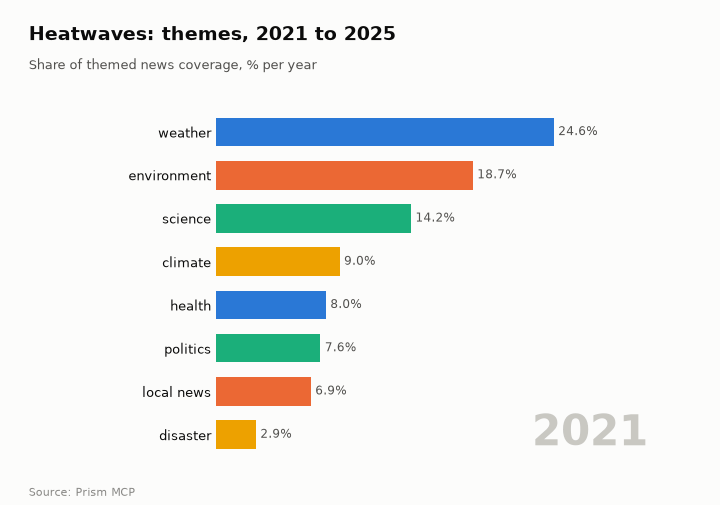
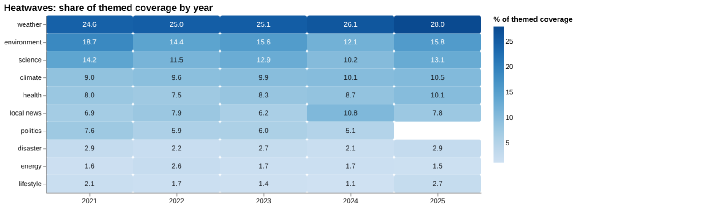
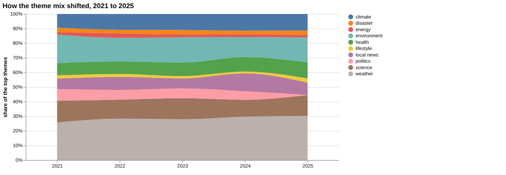
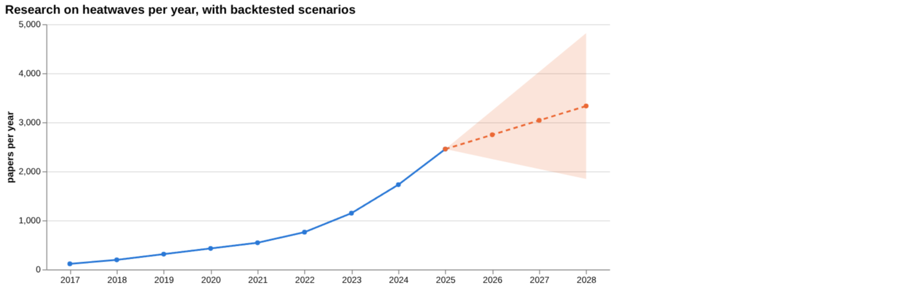
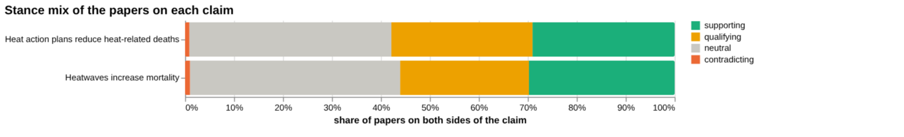
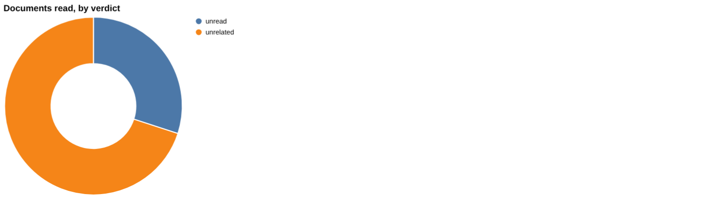
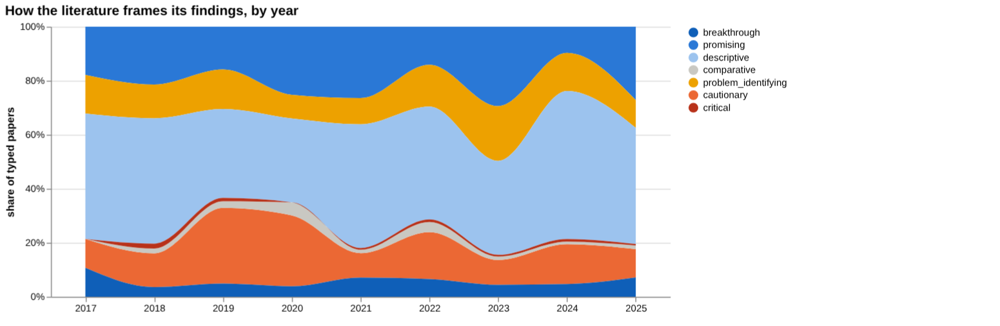
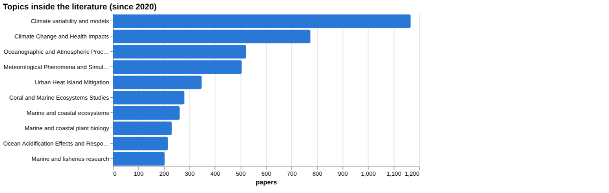
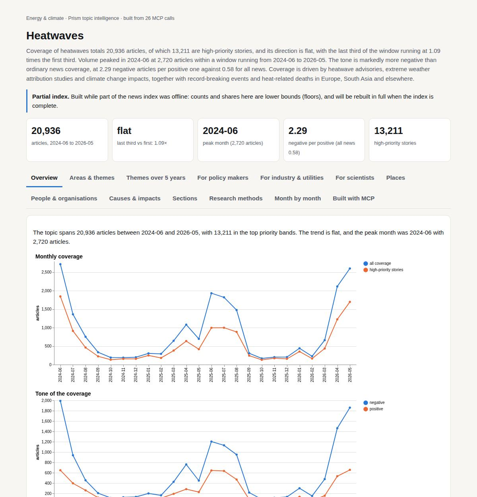

# Heatwaves

*Energy & climate · Prism topic intelligence* · **[Open the interactive page](https://fliarbi.com/demo/docs/prism-dashboards-3bb43e4c/topics/heatwaves/)** (tabs: Overview · Areas & themes · Themes over 5 years · For policy makers · For industry & utilities · For scientists · Places · People & organisations · Causes & impacts · Sections · Research methods · Month by month · Built with MCP)

> **Partial index.** Built while part of the news index was offline: counts and shares here are lower bounds (floors), and will be rebuilt in full when the index is complete.

Coverage of heatwaves totals 20,936 articles, of which 13,211 are high-priority stories, and its direction is flat, with the last third of the window running at 1.09 times the first third. Volume peaked in 2024-06 at 2,720 articles within a window running from 2024-06 to 2026-05. The tone is markedly more negative than ordinary news coverage, at 2.29 negative articles per positive one against 0.58 for all news. Coverage is driven by heatwave advisories, extreme weather attribution studies and climate change impacts, together with record-breaking events and heat-related deaths in Europe, South Asia and elsewhere.

| Articles | Direction (last third vs first) | Peak month | Negative per positive | High-priority stories |
| ---: | --- | --- | ---: | ---: |
| 20,936 (2024-06 to 2026-05) | flat (1.09×) | 2024-06 (2,720) | 2.29 (all news 0.58) | 13,211 |

## Coverage over time

The topic spans 20,936 articles between 2024-06 and 2026-05, with 13,211 in the top priority bands. The trend is flat, and the peak month was 2024-06 with 2,720 articles.

## Areas of activity and themes

The top tags are heatwave (9,787), climate change (6,758), imd (3,599), weather (2,995) and temperature (2,892), and the themes include heatwave advisories, attribution studies and wildfire risk predictions.

| Area of activity | Articles |
| --- | ---: |
| People & Society › Social Issues & Advocacy › Green Living & Environmental Issues | 3,051 |
| Science › Ecology & Environment › Climate Change & Global Warming | 2,709 |
| Science › Earth Sciences › Atmospheric Science | 1,443 |
| Science › Earth Sciences | 611 |
| Science › Ecology & Environment | 586 |
| Home & Garden › HVAC & Climate Control › Air Conditioners | 410 |

**Top tags (what the themes are built from):** heatwave (9,787), climate change (6,758), imd (3,599), weather (2,995), temperature (2,892), the india meteorological department (2,762), india meteorological department (1,853), odisha (1,295)

## Where it is reported

| Country | Articles | Lift | | Indian state | Articles | Lift |
| --- | ---: | ---: | --- | --- | ---: | ---: |
| United States | 5,285 | 0.8× | | Delhi | 2,630 | 13.2× |
| India | 4,886 | 2.7× | | Rajasthan | 1,763 | 17.0× |
| United Kingdom | 2,703 | 2.0× | | Uttar Pradesh | 1,674 | 7.3× |
| France | 1,183 | 2.5× | | England | 1,616 | 1.8× |
| Australia | 1,140 | 0.9× | | Haryana | 1,438 | 25.8× |
| Spain | 1,065 | 3.3× | | Odisha | 1,221 | 26.3× |

## People and organisations

The people named most often include Safdar Jang, Nicolaus Copernicus, Saurabh Bhardwaj, J. P. Nadda, Mostafa Madbouly and Paul Mescal. Organisations include the Met Office, the IMD, the India Meteorological Department, the UK Health Security Agency and the World Meteorological Organization.

## Causes and impacts

Causes cited include a record-breaking May heatwave, extreme heat, temperatures 10-15°C higher than normal and severe thunderstorms. The impacts named are water-related deaths, excess deaths and drownings.

**Causes named in the coverage:** record-breaking May heatwave, extreme heat, temperatures 10-15°C higher than normal, severe thunderstorms

**Impacts:** water-related deaths, excess deaths, drownings

## Sections inside the topic

The deaths section has 506 articles, 2.42 per cent of the topic, and is far more negative at 25.47 negative articles per positive one against 2.29 for the topic as a whole. Its coverage is weaker late in the window, with a late-versus-early ratio of 0.45. The power demand section is smaller at 176 articles, 0.84 per cent of the topic, with a tone of 2.16 negative per positive, close to the topic figure, and a late-versus-early ratio of 1.29.

| Section | Articles | Share of the topic | Late vs early | Negative per positive |
| --- | ---: | ---: | ---: | ---: |
| heatwave → power demand | 176 | 0.84% | 1.29× | 2.16 (topic 2.29) |
| heatwave → deaths | 506 | 2.42% | 0.45× | 25.47 (topic 2.29) |

## Research and outlook

The balance of framing is broadly unchanged, with a framing shift of -7.6 points. The outlook gives 2,746.5 for 2026 (range 2,251.071 to 3,241.929), 3,039.0 for 2027 (2,048.143 to 4,029.857) and 3,331.5 for 2028 (1,845.214 to 4,817.786).

## Month by month

Coverage moved from a continent-spanning heatwave in June 2025 to lethal escalation in July 2025, with at least 2,300 heat-related deaths and a nuclear plant shutdown, then to wildfires in August burning roughly 440,000 hectares. In December 2025 an unprecedented global heatwave ignited record fires and led to more than $120 billion in economic losses, and by May 2026 the heat was unseasonal and lethal across Western Europe and South Asia.

- **2025-07:** Heatwave escalated to lethal levels with at least 2,300 heat‑related deaths, a nuclear plant shutdown, and widespread heat alerts across Europe and the US.
- **2025-08:** Massive wildfires erupted across southern Europe, burning roughly 440,000 hectares, while an extreme marine heatwave threatened Mediterranean octocoral habitats.
- **2025-12:** Unprecedented global heatwave ignited record fires from Australia to Europe, leading to more than $120 billion in economic losses and deepening humanitarian crises.

## Themes over five years

Weather coverage moved from 24.6% of themed coverage in 2021 to 28.0% in 2025, and climate rose from 9.0% to 10.5%. Health rose from 8.0% to 10.1%. Environment went from 18.7% to 15.8% and science from 14.2% to 13.1%, with local news at 6.9% in 2021 and 7.8% in 2025 after a figure of 10.8% in 2024. Energy was 1.6% in 2021 and 1.5% in 2025, disaster 2.9% in both years, and lifestyle 2.1% then 2.7%. Politics was 7.6% in 2021 and has no share given for 2025.

| Theme | 2021 | 2022 | 2023 | 2024 | 2025 |
| --- | ---: | ---: | ---: | ---: | ---: |
| weather | 24.6% | 25.0% | 25.1% | 26.1% | 28.0% |
| environment | 18.7% | 14.4% | 15.6% | 12.1% | 15.8% |
| science | 14.2% | 11.5% | 12.9% | 10.2% | 13.1% |
| climate | 9.0% | 9.6% | 9.9% | 10.1% | 10.5% |
| health | 8.0% | 7.5% | 8.3% | 8.7% | 10.1% |
| local news | 6.9% | 7.9% | 6.2% | 10.8% | 7.8% |
| politics | 7.6% | 5.9% | 6.0% | 5.1% | – |
| disaster | 2.9% | 2.2% | 2.7% | 2.1% | 2.9% |
| energy | 1.6% | 2.6% | 1.7% | 1.7% | 1.5% |
| lifestyle | 2.1% | 1.7% | 1.4% | 1.1% | 2.7% |

## For policy makers

Research output on heatwaves has grown each year, from 114 papers in 2017 to 2,454 in 2025. The scenario baseline (linear drift) gives a central figure of 2,746 for 2026, 3,039 for 2027 and 3,332 for 2028, with a wide sensitivity range by 2028 of 1,845 to 4,818. Compound drought and heatwave work is prominent among recent studies, including one on cropland exposure and one on South Asian population risk. A 2026 news story reported that almost 30% of US residents face 5x more heat-drought extremes by end of century. One figure given is that compound drought and heatwave events accounted for 55% of the burned area of 2020. No country-level breakdown of where heatwaves are studied or reported is available, so geographic priorities cannot be read from these data. Energy accounts for 1.5% of themed news coverage in 2025, and no papers were found on electricity demand, labour productivity or crop yields in the screening.

- Compound drought and heatwave studies, including the 55% burned-area figure for 2020
- Health share of coverage at 10.1% in 2025 against 8.0% in 2021
- Energy coverage at 1.5% in 2025: a thin public conversation
- Scenario range for 2028 research volume of 1,845 to 4,818 shows how uncertain the trajectory is
- No geographic data: check local exposure from other sources

## For industry & utilities

On the claim that heatwaves increase mortality, the wider corpus of 2,681 papers has 798 supporting, 705 qualifying, 27 contradicting and 1,151 neutral, with 27.3% contested. The reading is mostly positive framing with a substantial cautionary minority. Of the documents read directly, 3 support the claim and none contradict it, but the sample is selected and does not establish scientific consensus. The one screening figure for mortality is an odds ratio of 1.08 (95% CI: 1.01-1.15) to 1.32 (95% CI: 1.17-1.48), from three papers. Hospital admissions have one paper and no figure, and labour productivity, electricity demand, crop yields and violent crime have no papers found, which means no figure was found rather than no effect. For the related claim that heat action plans reduce heat-related deaths, the 14 documents read were all unrelated, so the first claim has more evidence behind it.

- Meta-analysis tier: a 2024 meta-analysis of extreme heat in pregnancy and congenital heart disease, cited by 9
- Review tier: indoor overheating review (2024), cited by 81, covers vulnerabilities and prevention strategies
- Article tier: the strongest source on mortality is a 2014 study of 167 years of extreme heat in Australia, which supports the claim
- Contested share is 27.3% for the mortality claim and 29.7% for heat action plans
- Mortality odds ratio of 1.08 (95% CI: 1.01-1.15) to 1.32 (95% CI: 1.17-1.48) comes from three papers

**Head to head:** Heatwaves increase mortality vs Heat action plans reduce heat-related deaths: the first claim has more evidence behind it.

**Screen:** *What is the effect of heatwaves on …?* (one row per line below)

| Row | Figure (quoted) | Measures | Source |
| --- | --- | --- | --- |
| mortality | 1.08 (95% CI: 1.01-1.15) to 1.32 (95% CI: 1.17-1.48) | mortality odds ratio | Mortality risk associated with heatwave exposure based on daily maximum, minimum, and comb (2025) |
| hospital admissions | no figure found |  | The impact of extreme temperatures on emergency department visits: A systematic review of  (2025) |
| labour productivity | no figure found |  |  |
| electricity demand | no figure found |  |  |
| crop yields | no figure found |  |  |
| violent crime | no figure found |  |  |

## For scientists

The wider literature of 131 research papers is framed in a mixed way with no dominant lean: 39 supporting, 25 qualifying, 1 contradicting and 66 neutral, with 19.8% contested. By orientation, descriptive work is 47.5% of papers (2,035), followed by promising at 15.8% and cautionary at 14.1%, while critical work is 1.2%. By contribution, empirical papers number 3,587 and theoretical papers 19. The leading topic is climate variability and models with 1,167 papers, followed by climate change and health impacts with 774, and many of the other leading topics concern marine and coastal systems. New work centres on compound drought and heatwave events and on marine heatwaves strengthening tropical cyclones, where one study gives a maximum intensity increase of 35.4% stronger (106.72 kts). Gaps are visible in the evidence on excess deaths, which is marked no, and a comparison of framing over time could not be made because there were not enough papers in one window.

- Why is theoretical work only 19 papers against 3,587 empirical ones?
- Can the claim that heatwaves cause excess deaths be tested directly, given its gap is marked no?
- What evidence exists for heat action plans, when all 14 documents read were unrelated?
- Do the multi-model ensemble results, which underestimate mean observed events per year by 21%, limit compound event projections?
- Are the screening topics with no papers (productivity, electricity demand, crops, crime) unstudied or just indexed differently?

## Research exploration methods

Nine ways to explore the research, each run on this topic; the interactive report shows each call and its result.

**Chaining them.** Begin with triangulation to gauge the overall support for the mortality claim and identify the need for broader consensus. Use head‑to‑head to compare this claim with alternative interventions and note the relative evidence base. Apply screening to extract quantified effect sizes for mortality and identify gaps in other outcomes. Examine framing to understand how the literature’s tone has shifted over time, then consult the frontier scan for emerging topics. Finally, map gaps, track historical growth, and use facets to characterise the literature’s composition for informed next steps.

### Evidence triangulation

*Is a claim supported, and by how strong a design?* `find_evidence` + `find_counter_evidence` + `rank_sources`

The claim that heatwaves increase mortality is supported by a corpus of 2,681 papers, of which 798 are supporting, 705 qualifying, 27 contradicting and 1,151 neutral. The contested proportion is 27.3, and the reading notes a mostly positive framing with a substantial cautionary minority. The sample includes 7 unread and 7 unrelated claim documents, and the tier distribution contains 7 articles, 1 meta‑analysis and 2 reviews. Counter‑evidence tallies 2 supports and no contradicts, but the recommendation states the sample does not establish scientific consensus. This result does not indicate the overall consensus across all literature, nor does it assess the quality of the supporting studies. A careful researcher would broaden the sample, examine the full set of papers, and evaluate the methodological rigour of the top sources.

### Head-to-head claims

*Which of two interventions has more and stronger evidence?* `compare_claims`

The comparison shows that the claim "Heatwaves increase mortality" involves 2,681 papers with a corpus mix of 798 supporting, 705 qualifying, 27 contradicting and 1,151 neutral, and a contested proportion of 27.3. Documents read for this claim include 3 supporting sources and none contradicting, with the strongest source being a 2014 article titled "Exploring 167 years of vulnerability: An examination of extreme heat events in Australia 1844–2010" which supports the claim. The alternative claim "Heat action plans reduce heat‑related deaths" involves 1,922 papers, a contested proportion of 29.7, but the documents read are all unrelated and the strongest source is a 2025 meta‑analysis unrelated to the claim. The verdict states the first claim has more evidence behind it. This does not assess the causal strength or the quality of the evidence beyond tier, nor does it quantify the effect of heat action plans. A careful researcher would scrutinise the methodological quality of the supporting studies and seek direct comparative evidence.

### Cross-row screening

*Which rows carry a measured, quoted figure, and how large is it?* `research_table`

The screening returns a quantified mortality odds ratio ranging from 1.08 (95% CI: 1.01-1.15) to 1.32 (95% CI: 1.17-1.48) based on three papers, sourced from a 2025 study on mortality risk associated with heatwave exposure. No effect size is reported for hospital admissions, labour productivity, electricity demand, crop yields or violent crime, with either one or zero papers identified for each. This shows that a measurable association with mortality is documented, while other outcomes lack quantified evidence in the screened set. It does not reveal the populations studied, the contexts of the mortality estimates, or any effect sizes for the other risk factors. A careful researcher would retrieve the original mortality studies for detail and search for primary evidence on the other outcomes.

### Framing drift

*Is the literature becoming more hopeful or more cautious?* `stance_trends`

The framing analysis records yearly percentages of positive and contested papers, for example 16.3% positive and 14.3% contested in 2017, and 13.5% positive and 8.4% contested in 2025. The figures fluctuate across years without a clear monotonic trend. This indicates that the literature’s orientation varies over time but does not explain the drivers of these changes. It does not provide information on other stance categories such as critical or problem‑identifying. A careful researcher would investigate the contextual factors influencing these yearly shifts.

### Frontier scan

*What is new, and what is the research not reaching?* `research_radar`

The frontier scan lists six recent highly cited works, such as the 2023 paper "Climate change will accelerate the high‑end risk of compound drought and heatwave events" cited 301 times and described as descriptive. Other entries include a 2022 promising study on compound drought and heatwave sensitivity (cited 111) and several descriptive papers on marine heatwaves and compound events. The framing shift could not be calculated because there were not enough papers in one of the windows. This result highlights emerging topics but does not compare their orientation to the broader literature. A careful researcher would monitor these works for developing themes and assess their impact on the field.

### Gap mapping

*Which parts of a claim does the literature actually cover?* `research_gaps`

The gap mapping shows that the literature confirms that heatwave exposure raises mortality rates and that extreme heat events increase all‑cause mortality, but it finds no evidence for the component "heatwaves cause excess deaths". This indicates that while some aspects of the mortality claim are covered, the specific link to excess deaths remains unaddressed. It does not reveal the depth or quality of the evidence for the covered components. A careful researcher would seek studies that directly examine excess deaths attributable to heatwaves.

### Count history and backtested scenarios

*Is research on this growing, and where could it be in three years?* `historical_analysis` + `trend_scenarios`

The count history records a rise from 114 papers in 2017 to 2,454 in 2025, showing a steady increase in research output. Scenario forecasts project 2,746 papers for 2026 (lower sensitivity 2,251, upper sensitivity 3,242), 3,039 for 2027 (lower 2048, upper 4,030) and 3,332 for 2028 (lower 1,845, upper 4,818), based on a linear_drift baseline. This demonstrates continued growth but does not explain the factors driving the increase. It does not provide confidence intervals beyond the given sensitivity bands. A careful researcher would track publication trends and consider external influences on future output.

### Geographic triangulation

*Where is it studied, published, reported and patented?* `global_comparison` + `newsgeo`

Both the "where_studied" and "where_reported_by_country" lists are empty, indicating that no geographic information was captured for the claim. This absence means the locations of research, reporting or patent activity are not identified. It does not show whether such data are unavailable or simply not retrieved. A careful researcher would conduct a geographic mapping of the existing literature.

### Faceted browsing

*What kind of literature is it: empirical, review, position? Problem-identifying or promising?* `browse_research`

The faceted browsing shows that 47.5% of papers are descriptive, 15.8% promising, 14.1% cautionary and smaller shares for other orientations, with 2,035 descriptive papers recorded. Contributions are dominated by empirical work (3,587 papers) followed by methodological (446) and review (129) papers. Topic distribution highlights that "Climate variability and models" has 1,167 papers, while "Marine and coastal plant biology" has 231 papers. This outlines the composition of the literature but does not reveal temporal changes or quality assessments. A careful researcher would target under‑represented orientations or topics for further investigation.

## Built with MCP

Every number and chart on this page comes from these 26 Prism MCP tool calls, made over MCP (streamable HTTP). Arguments and timings: [mcp_calls.json](mcp_calls.json); responses: [data.json](data.json).

| MCP tool | Calls |
| --- | ---: |
| `news_activities` | 1 |
| `news_geography` | 1 |
| `prism_overview` | 1 |
| `news_drill` | 2 |
| `news_themes` | 5 |
| `news_factors` | 1 |
| `historical_analysis` | 1 |
| `stance_trends` | 1 |
| `critical_news` | 1 |
| `browse_research` | 1 |
| `research_radar` | 1 |
| `research_brief` | 1 |
| `research_gaps` | 1 |
| `global_comparison` | 1 |
| `rank_sources` | 1 |
| `find_evidence` | 1 |
| `find_counter_evidence` | 1 |
| `deep_timeline` | 1 |
| `research_table` | 1 |
| `compare_claims` | 1 |
| `trend_scenarios` | 1 |

Try it: `prism entity "heatwave"` · `prism call news.drill term='heatwave' scope='power demand'` · `prism call analysis.timeline term='heatwave'`

