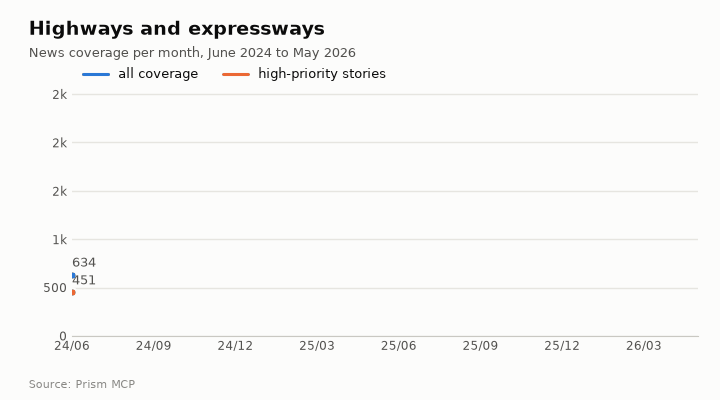
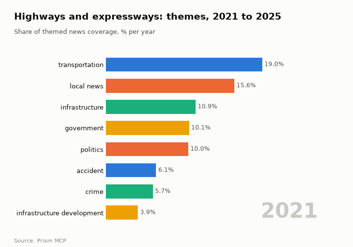
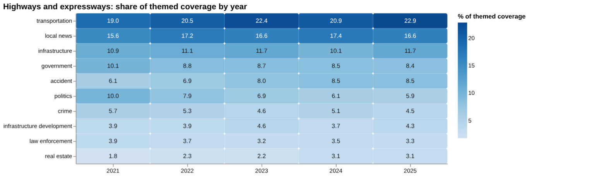
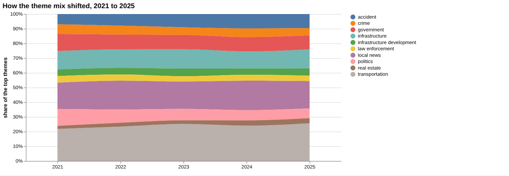
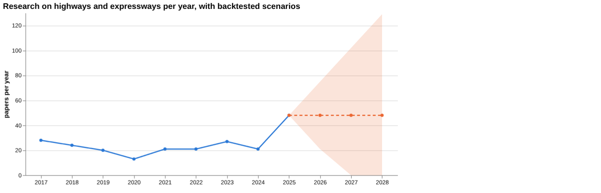
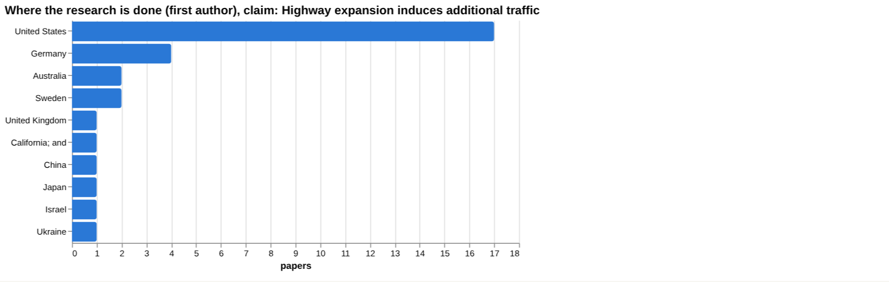
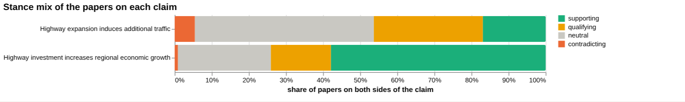
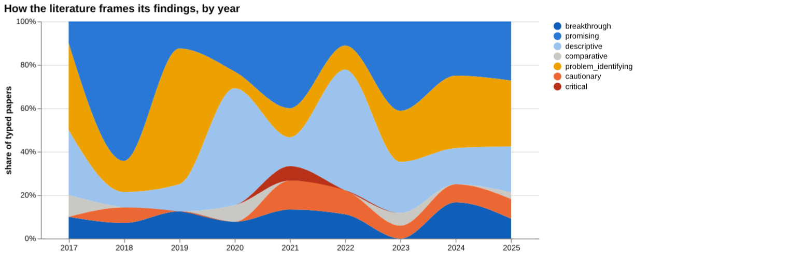
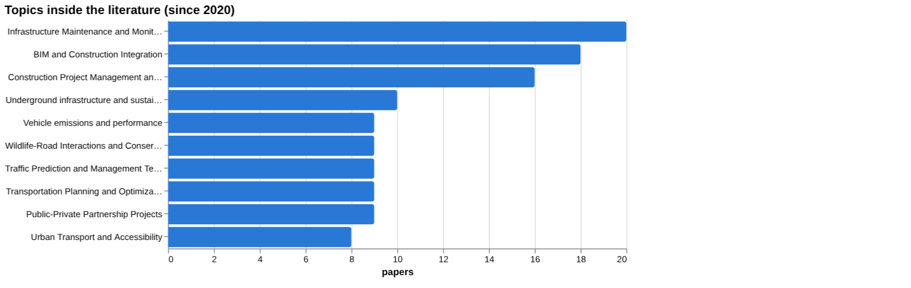
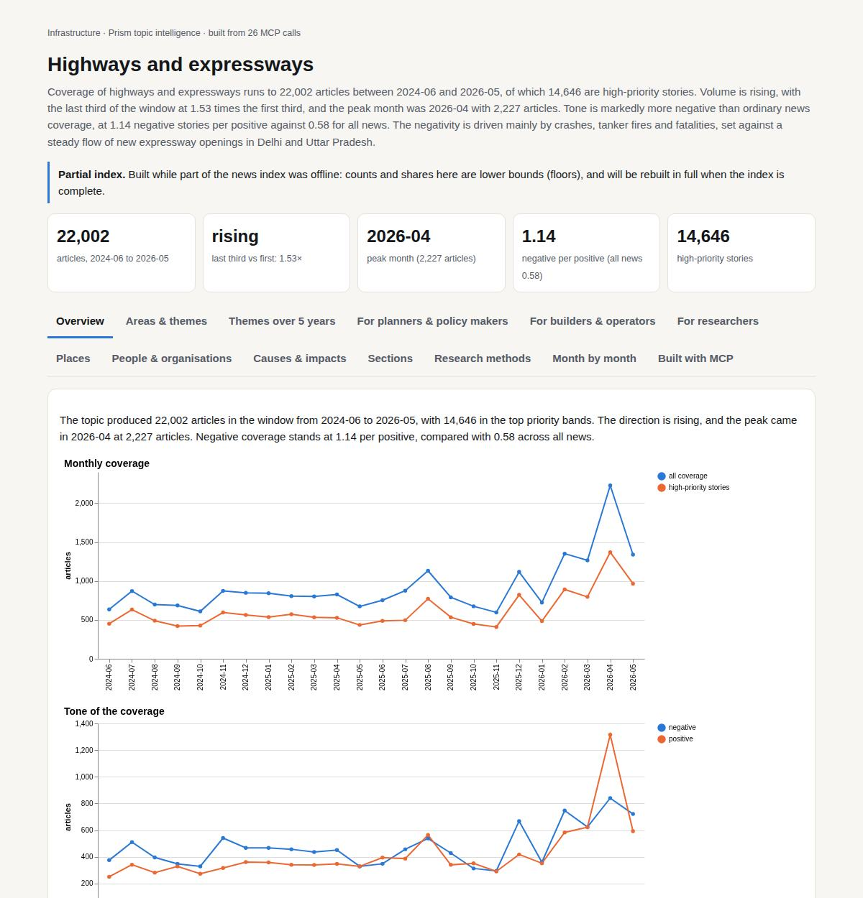

# Highways and expressways

*Infrastructure · Prism topic intelligence* · **[Open the interactive page](https://fliarbi.com/demo/docs/prism-dashboards-3bb43e4c/topics/highways/)** (tabs: Overview · Areas & themes · Themes over 5 years · For planners & policy makers · For builders & operators · For researchers · Places · People & organisations · Causes & impacts · Sections · Research methods · Month by month · Built with MCP)

> **Partial index.** Built while part of the news index was offline: counts and shares here are lower bounds (floors), and will be rebuilt in full when the index is complete.

Coverage of highways and expressways runs to 22,002 articles between 2024-06 and 2026-05, of which 14,646 are high-priority stories. Volume is rising, with the last third of the window at 1.53 times the first third, and the peak month was 2026-04 with 2,227 articles. Tone is markedly more negative than ordinary news coverage, at 1.14 negative stories per positive against 0.58 for all news. The negativity is driven mainly by crashes, tanker fires and fatalities, set against a steady flow of new expressway openings in Delhi and Uttar Pradesh.

| Articles | Direction (last third vs first) | Peak month | Negative per positive | High-priority stories |
| ---: | --- | --- | ---: | ---: |
| 22,002 (2024-06 to 2026-05) | rising (1.53×) | 2026-04 (2,227) | 1.14 (all news 0.58) | 14,646 |

## Coverage over time

The topic produced 22,002 articles in the window from 2024-06 to 2026-05, with 14,646 in the top priority bands. The direction is rising, and the peak came in 2026-04 at 2,227 articles. Negative coverage stands at 1.14 per positive, compared with 0.58 across all news.

## Areas of activity and themes

Activity centres on Construction & Maintenance (6,669 articles), followed by Traffic & Route Planners (4,379) and Civil Engineering (3,882).

| Area of activity | Articles |
| --- | ---: |
| Business & Industrial › Construction & Maintenance | 6,669 |
| Travel & Transportation › Transportation › Traffic & Route Planners | 4,379 |
| Business & Industrial › Construction & Maintenance › Civil Engineering | 3,882 |
| Autos & Vehicles › Vehicle Codes & Driving Laws | 2,857 |
| Travel & Transportation › Transportation › Urban Transit | 2,640 |
| Travel & Transportation › Transportation › Long Distance Bus & Rail | 1,789 |

**Top tags (what the themes are built from):** delhi (3,948), transportation (3,052), uttar pradesh (2,571), accident (1,315), noida (1,314), traffic (1,136), gurugram (1,047), agra (701)

## Where it is reported

| Country | Articles | Lift | | Indian state | Articles | Lift |
| --- | ---: | ---: | --- | --- | ---: | ---: |
| India | 8,014 | 6.9× | | Uttar Pradesh | 4,095 | 36.1× |
| United States | 3,297 | 0.8× | | Delhi | 2,772 | 28.2× |
| Nigeria | 1,209 | 9.6× | | Maharashtra | 1,593 | 9.2× |
| Japan | 482 | 1.8× | | Haryana | 1,073 | 38.9× |
| United Kingdom | 457 | 0.5× | | Maryland | 808 | 2.7× |
| China | 317 | 0.4× | | Rajasthan | 697 | 13.6× |

## People and organisations

Nitin Gadkari, Yogi Adityanath and Narendra Modi are the most prominent people named in coverage. Dapo Abiodun, Anthony Joshua and Eknath Shinde also appear.

## Causes and impacts

Reported causes include a bus losing control and overturning, a gas tanker overturning, a fuel-laden tanker colliding with a tipper truck, and a speeding tanker. Impacts are typically fatalities and injuries, such as five dead and ten injured, six killed and ten injured, and five charred to death.

**Causes named in the coverage:** bus lost control and overturned, gas tanker overturned, fuel-laden tanker collided with tipper truck, speeding tanker, car rammed into truck, gunfire shattered windshield

**Impacts:** five dead and ten injured, six killed and ten injured, four male passengers dead, five charred to death, two killed and eleven injured, four dead and eight injured

## Sections inside the topic

The accident section has 3,483 articles, or 15.83% of the topic, and its tone is far more negative, at 22.32 negative per positive. The toll section is smaller, with 1,333 articles or 6.06% of the topic, and its tone of 1.13 negative per positive is close to the topic figure of 1.14. Toll coverage grew faster over the window, with late-versus-early growth of 1.93 against 1.56 for accidents.

| Section | Articles | Share of the topic | Late vs early | Negative per positive |
| --- | ---: | ---: | ---: | ---: |
| expressway → toll | 1,333 | 6.06% | 1.93× | 1.13 (topic 1.14) |
| expressway → accident | 3,483 | 15.83% | 1.56× | 22.32 (topic 1.14) |

## Research and outlook

The balance of framing is broadly unchanged, with a shift of 2.6 points. The outlook figures show 48.0 for each of 2026, 2027 and 2028, with the upper figure rising from 75.0 to 102.0 and then 129.0.

## Month by month

Coverage moved from new expressway openings and early safety concerns in mid-2025 towards stricter enforcement by December 2025. Turning points were the safety-first model and Delhi expansions in 2025-08, expressways used as flood shelters in 2025-09, and Uttar Pradesh speed-limit cuts and e-challan penalties after fog-induced crashes in 2025-12.

- **2025-08:** Major expressway expansions in Delhi and the adoption of a safety‑first model that banned two‑wheelers and other slow vehicles.
- **2025-09:** Expressways were repurposed as disaster shelters for flood‑displaced populations, showing a shift in functional use.
- **2025-12:** Fog‑induced crashes prompted Uttar Pradesh to slash speed limits and introduce e‑challan penalties, a clear policy response to safety concerns.

## Themes over five years

Transportation was the leading theme throughout, moving from 19.0% of themed coverage in 2021 to 22.9% in 2025. Local news went from 15.6% to 16.6% and infrastructure from 10.9% to 11.7%. Government fell from 10.1% to 8.4% and politics from 10.0% to 5.9%, while accident coverage rose from 6.1% to 8.5%. Crime moved from 5.7% to 4.5%, infrastructure development from 3.9% to 4.3%, law enforcement from 3.9% to 3.3%, and real estate from 1.8% to 3.1%.

| Theme | 2021 | 2022 | 2023 | 2024 | 2025 |
| --- | ---: | ---: | ---: | ---: | ---: |
| transportation | 19.0% | 20.5% | 22.4% | 20.9% | 22.9% |
| local news | 15.6% | 17.2% | 16.6% | 17.4% | 16.6% |
| infrastructure | 10.9% | 11.1% | 11.7% | 10.1% | 11.7% |
| government | 10.1% | 8.8% | 8.7% | 8.5% | 8.4% |
| accident | 6.1% | 6.9% | 8.0% | 8.5% | 8.5% |
| politics | 10.0% | 7.9% | 6.9% | 6.1% | 5.9% |
| crime | 5.7% | 5.3% | 4.6% | 5.1% | 4.5% |
| infrastructure development | 3.9% | 3.9% | 4.6% | 3.7% | 4.3% |
| law enforcement | 3.9% | 3.7% | 3.2% | 3.5% | 3.3% |
| real estate | 1.8% | 2.3% | 2.2% | 3.1% | 3.1% |

## For planners & policy makers

Research output on highways and expressways was 28 papers in 2017 and 48 in 2025, with 21 in 2024, so the latest year is a sharp rise from a flat stretch. The central scenario under a no-change baseline holds at 48 for 2026, 2027 and 2028, with a sensitivity range of 21 to 75 in 2026 and 0 to 129 by 2028. The range widens each year, so the outlook is uncertain. Among studied places the United States has 17 papers, then Germany with 4, Australia and Sweden with 2 each, and the United Kingdom, China and Japan with 1 each. Coverage of accidents has grown in the news mix, from 6.1% in 2021 to 8.5% in 2025, and politics has declined from 10.0% to 5.9%. One story flagged is from 2026-04-26: 'Ahead of 2027 polls, Ganga Eway to put UP in pole position', which ties a major expressway to an election cycle. No country breakdown of news reporting is available.

- Research output of 48 papers in 2025 against 21 in 2024, and whether it holds
- 2026-2028 central scenario of 48, with ranges up to 129 by 2028
- Evidence base concentrated in the United States, with 17 papers
- Accident coverage at 8.5% of themed coverage in 2025
- Election-linked expressway coverage, such as the Ganga Eway story of 2026-04-26

## For builders & operators

For the claim that highway expansion induces additional traffic, the wider corpus of 18,987 papers shows 3,216 supporting, 5,580 qualifying, 1,031 contradicting and 9,160 neutral, with 34.8% contested. That is a substantial cautionary minority. However, the documents read for this claim were all judged unrelated (5 in the claim tally; 6 in the head-to-head), so no verified document verdict supports a wording recommendation. The top sources include one review from 2024 (cited by 18) and articles on migration, regional politics and the China-Pakistan Economic Corridor, which do not address the claim directly. In the head-to-head, the claim that highway investment increases regional economic growth has 19 papers on both poles and 17.1% contested, and the verdict given is that the first claim has more evidence behind it. Key figures reported include traffic delays reduced by up to 30% on average in urban environments and a correlation of r = 0.72 between road quality and commercial property value.

- Induced traffic claim: 34.8% contested across 18,987 papers (corpus-level)
- Document tier: all 5 documents read were articles and judged unrelated; no verdict supports a wording recommendation
- Review tier: one review from 2024, cited by 18, among the top sources
- Reported figures: up to 30% average traffic delay reduction in urban environments; 45% more junctions captured across fifteen cities
- Screening: no value found for traffic volume, travel time or land prices; 4 papers on emissions and 1 on road accidents

**Head to head:** Highway expansion induces additional traffic vs Highway investment increases regional economic growth: the first claim has more evidence behind it.

**Screen:** *What is the effect of highway construction on …?* (one row per line below)

| Row | Figure (quoted) | Measures | Source |
| --- | --- | --- | --- |
| traffic volume | no figure found |  |  |
| economic growth | 2.4 percent | economic growth |  |
| road accidents | no figure found |  | Intrusion Accidents on Highway Construction Projects (2000) |
| land prices | no figure found |  |  |
| emissions | no figure found |  | Carbon Emissions of Infrastructure Development (2013) |
| travel time | no figure found |  |  |

## For researchers

The literature mix across 21,736 papers is 14,828 supporting, 2,439 qualifying, 127 contradicting and 4,342 neutral, with 11.8% contested. The framing is overwhelmingly positive, which could reflect consensus or publication bias. Framing between earlier and recent windows is broadly unchanged, with cautionary share at 12.1% across 6,384 earlier papers and 11.3% across 4,557 recent ones. By orientation, promising papers number 49, descriptive 43 and problem-identifying 32, while cautionary papers number 8 and critical 1. Contributions are mainly empirical (88) and methodological (46), with 9 reviews. Topic clusters centre on infrastructure maintenance and monitoring (20 papers), BIM and construction integration (18) and construction project management (16). The gap check found evidence for increased traffic volume and induced demand but none for higher vehicle miles travelled from new lanes.

- Is the positive framing in 14,828 supporting papers consensus or publication bias?
- Why is there no evidence found for new lanes raising vehicle miles travelled?
- Screening found no figures for traffic volume, travel time or land prices; do studies exist?
- Only 8 cautionary and 1 critical paper by orientation: is critical work missing or classed elsewhere?
- Recent most-cited work is mostly 2025 BIM and monitoring studies with 0 citations so far; which will prove influential?

## Research exploration methods

Nine ways to explore the research, each run on this topic; the interactive report shows each call and its result.

**Chaining them.** Begin with triangulation to assess the overall evidence base for the claim and identify the lack of high‑tier support. Use gap mapping to pinpoint missing components, then apply screening to locate any quantified effect sizes for those components. Examine framing drift and frontier scans to understand how the literature's tone and emerging themes have evolved. Complement this with geographic triangulation to see where studies are concentrated and facets to categorise the types of literature available. Finally, employ history modelling to anticipate future research volume and guide ongoing monitoring.

### Evidence triangulation

*Is a claim supported, and by how strong a design?* `find_evidence` + `find_counter_evidence` + `rank_sources`

The five documents read for the claim that highway expansion induces additional traffic were all judged "unrelated", and all five sit at the "article" tier. The counter-evidence search therefore returned "0" supporting, "0" contradicting and "0" qualifying, with 5 unrelated, and the tool states that no verified document verdict supports a wording recommendation. The wider corpus of "18,987" papers splits into "3,216" supporting, "5,580" qualifying, "1,031" contradicting and "9,160" neutral, with a contested share of 34.8%. That is a mood of the literature, not a test of the claim. The top sources list is telling: it includes "Irregular Migration in Turkey" and "The New Arab Cold War", which have nothing evident to do with road traffic, so the source ranking looks like a retrieval problem rather than a finding. A careful researcher would not cite this as support or opposition, and would instead search directly for studies of lane additions and measured traffic or vehicle-travel change, then re-read those.

### Head-to-head claims

*Which of two interventions has more and stronger evidence?* `compare_claims`

The comparison shows that the first claim, on induced traffic, has more evidence behind it than the second, on regional economic growth, but the underlying figures weaken that verdict. Claim A has "0" papers on both poles; claim B has "19". Claim B's corpus mix is "39,867" supporting, "11,151" qualifying, "592" contradicting and "17,244" neutral, with a contested share of 17.1%, against 34.8 for claim A. Documents read were "0" supporting or contradicting in both cases, with 6 unrelated for A and 12 unrelated for B. The strongest source named for each is unrelated ("Irregular Migration in Turkey" and a paper on delay causes in Egyptian road construction). So the stated verdict does not sit comfortably with these numbers, and it should be treated as unreliable. The comparison does show that claim B's corpus leans more heavily to supporting framing, but that is framing, not tested effect. The next step is to read papers actually on each claim before ranking them.

### Cross-row screening

*Which rows carry a measured, quoted figure, and how large is it?* `research_table`

Of six rows, only one returned a quoted figure: economic growth at "2.4 percent". Even that has no population, no source and no year, and its paper count is "0", so the number cannot be traced or interpreted. Traffic volume, land prices and travel time returned nothing, with "0" papers each. Road accidents ("1" paper, "Intrusion Accidents on Highway Construction Projects", 2000) and emissions ("4" papers, "Carbon Emissions of Infrastructure Development", 2013) found literature but no measured effect. The screening does not show that effects are absent; it shows that no usable quantified figure was extracted. The "2.4 percent" should not be reported until its sentence and source are located. A careful researcher would go to the road accident and emissions papers directly and check whether they measure the effect of construction at all, and would search separately for traffic volume and travel time.

### Framing drift

*Is the literature becoming more hopeful or more cautious?* `stance_trends`

Framing by year does not show a steady direction. Positive share runs from 12.5 in 2017 to 58.8 in 2018, then 11.1 in 2019, 20.0 in 2020, 44.4 in 2021, 10.0 in 2022, 31.8 in 2023, 19.2 in 2024 and 30.0 in 2025. Contested share moves between 5.0 (2020) and 32.5 (2025). The 2025 contested figure is the highest in the series, but the swings between neighbouring years are large enough that it should not be read as a turning point. The yearly samples appear small, which would explain the volatility, though the facts do not give per-year counts. These percentages describe how papers frame themselves, not whether highways help or harm. A careful researcher would pool years into wider windows, check the number of typed papers behind each year, and compare with the frontier scan's finding of broadly unchanged framing.

### Frontier scan

*What is new, and what is the research not reaching?* `research_radar`

The newest highly cited work from 2022 is mostly about road networks in general, not highway expansion: seismic resilience of bridges and road networks ("128" citations), congestion patterns in Dammam ("96"), traffic state estimation ("94") and digital twins for rail and road ("77"). Two items, on emotion recognition ("74") and aerial road detection ("69"), are labelled "breakthrough" and are largely outside the topic or about mapping methods. Between windows, the recent window of "4,557" papers has cautionary_pct 11.3 against 12.1 for the earlier window of "6,384", a delta of -0.8 percentage points, which the tool reads as broadly unchanged. The caveat that orientation labels a paper's own framing, not the truth, applies. The scan suggests the active frontier is monitoring, resilience and data methods rather than the induced-traffic debate. No under-covered topic list was returned, so what the research is missing remains unmapped here.

### Gap mapping

*Which parts of a claim does the literature actually cover?* `research_gaps`

Of three components of the induced-traffic claim, two have a literature: "highway expansion leads to increased traffic volume" and "road widening induces induced demand". The third, "new highway lanes result in higher vehicle miles traveled", has "no" evidence found. A "yes" here means papers exist on the component, not that they support it, and the earlier document reading found nothing relevant. The missing component is the most specific and measurable, as vehicle miles traveled is a standard quantity, so its absence may reflect search wording rather than a true void. A careful researcher would test alternative terms for that component and read what the two covered components actually conclude. Until then, coverage should be described as partial and unverified.

### Count history and backtested scenarios

*Is research on this growing, and where could it be in three years?* `historical_analysis` + `trend_scenarios`

Title-matched papers per year were "28" in 2017, "24" in 2018, "20" in 2019, "13" in 2020, "21" in 2021, "21" in 2022, "27" in 2023, "21" in 2024 and "48" in 2025. The 2025 figure is well above any earlier year, but it is a single observation after a flat-to-uneven run, so it is not yet a trend. The chosen baseline is "no_change", which carries 2025 forward: the central case is "48" for 2026, 2027 and 2028. The sensitivity bands widen from "21" to "75" in 2026, then "0" to "102" in 2027 and "0" to "129" in 2028. The lower bound of "0" shows how little the method constrains the later years. Title matching also counts papers by wording, not by relevance, so it may include off-topic items. A careful researcher would check what drove 2025 before leaning on the central figure.

### Geographic triangulation

*Where is it studied, published, reported and patented?* `global_comparison` + `newsgeo`

The only populated lane is where the research is studied: the United States with "17", Germany "4", Australia "2", Sweden "2", and the United Kingdom, China and Japan with "1" each, plus a malformed entry, "California; and", also "1". That entry is a parsing artefact and likely belongs under the United States, though the facts do not say so and it should not be merged. The ranking shows the United States ahead on count, but the numbers are small. The reported-by-country lane is empty, so nothing can be said about where news coverage originates or what it concerns. That absence means no coverage was matched, not that none exists. The lanes are not added together. A careful researcher would note that evidence on induced traffic here comes mainly from one country and would be cautious about applying it to other road systems.

### Faceted browsing

*What kind of literature is it: empirical, review, position? Problem-identifying or promising?* `browse_research`

Among classified papers, framing is led by "promising" at "49" (33.6 percent), then "descriptive" at "43" (29.5), "problem_identifying" at "32" (21.9), "breakthrough" at "9", "cautionary" at "8", "comparative" at "4" and "critical" at "1". By contribution, "empirical" leads with "88", followed by "methodological" at "46", "review" at "9", "position" at "2" and "theoretical" at "1". The topic list is dominated by infrastructure maintenance and monitoring ("20"), BIM and construction integration ("18") and construction project management ("16"). Induced traffic or economic effects do not appear among the top ten topics. So this slice of the literature is largely about building and managing highways, not about their wider effects. The six most-cited items since 2020 all show "0" citations and are from 2025, so the ordering carries no citation signal. A careful researcher would use these facets to narrow to empirical papers and then check which actually address traffic or growth outcomes.

## Built with MCP

Every number and chart on this page comes from these 26 Prism MCP tool calls, made over MCP (streamable HTTP). Arguments and timings: [mcp_calls.json](mcp_calls.json); responses: [data.json](data.json).

| MCP tool | Calls |
| --- | ---: |
| `news_activities` | 1 |
| `news_geography` | 1 |
| `prism_overview` | 1 |
| `news_drill` | 2 |
| `news_themes` | 5 |
| `news_factors` | 1 |
| `critical_news` | 1 |
| `historical_analysis` | 1 |
| `stance_trends` | 1 |
| `browse_research` | 1 |
| `research_radar` | 1 |
| `research_gaps` | 1 |
| `research_brief` | 1 |
| `global_comparison` | 1 |
| `rank_sources` | 1 |
| `find_counter_evidence` | 1 |
| `find_evidence` | 1 |
| `deep_timeline` | 1 |
| `research_table` | 1 |
| `compare_claims` | 1 |
| `trend_scenarios` | 1 |

Try it: `prism entity "expressway"` · `prism call news.drill term='expressway' scope='toll'` · `prism call analysis.timeline term='expressway'`

