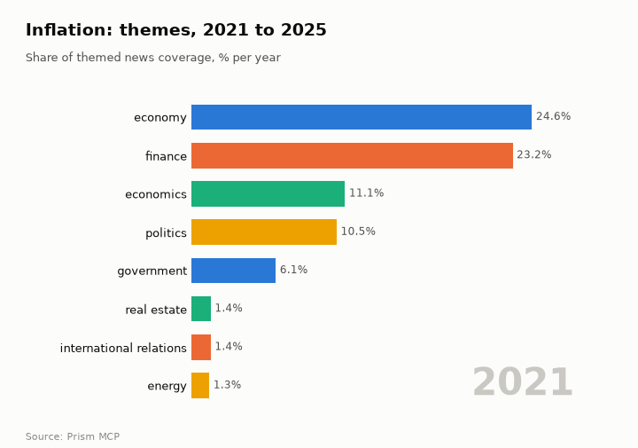
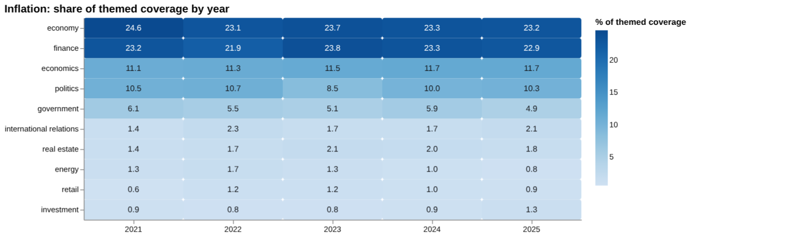
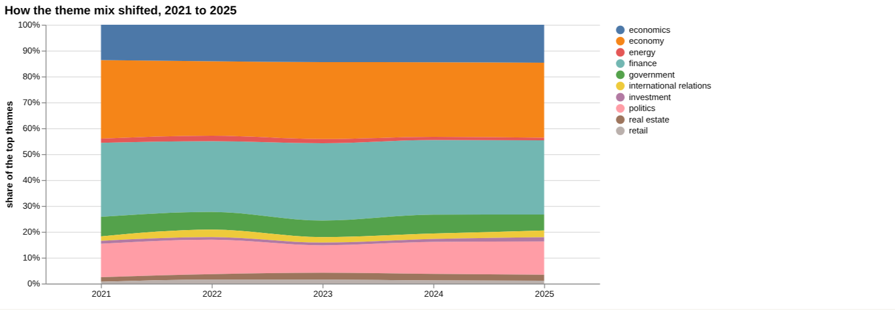
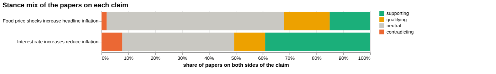
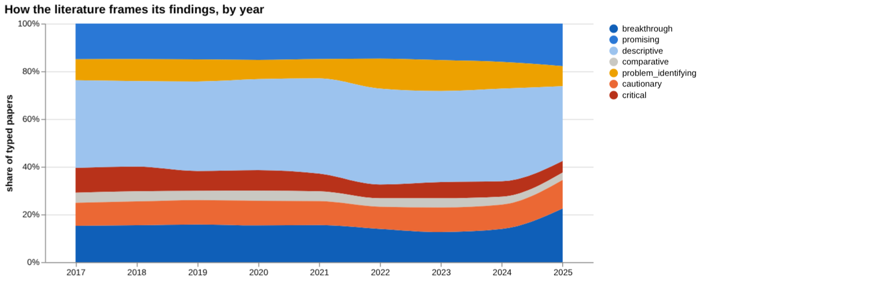
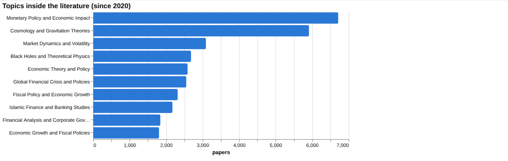
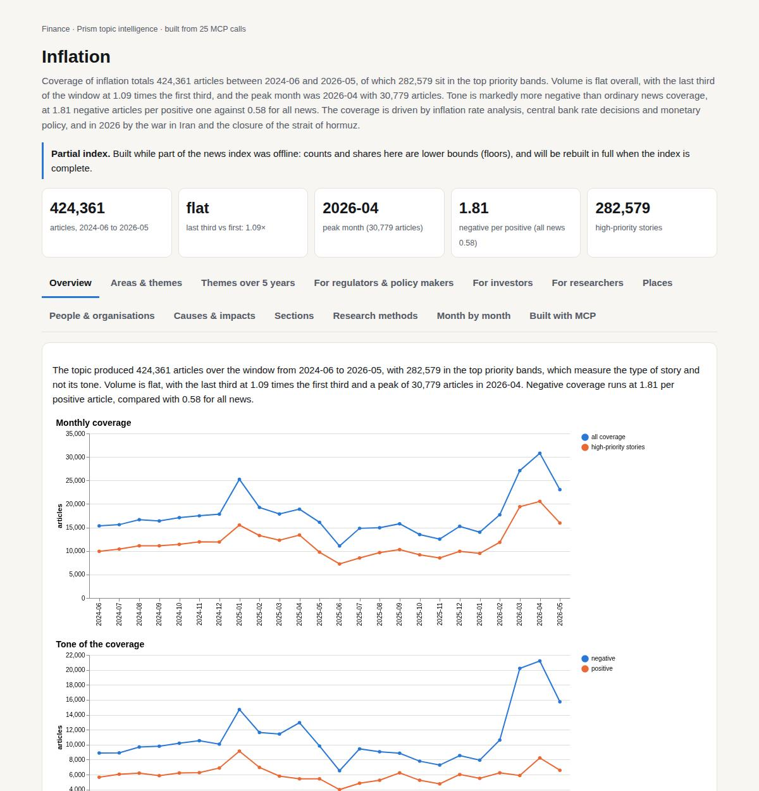

# Inflation

*Finance · Prism topic intelligence* · **[Open the interactive page](https://fliarbi.com/demo/docs/prism-dashboards-3bb43e4c/topics/inflation/)** (tabs: Overview · Areas & themes · Themes over 5 years · For regulators & policy makers · For investors · For researchers · Places · People & organisations · Causes & impacts · Sections · Research methods · Month by month · Built with MCP)

> **Partial index.** Built while part of the news index was offline: counts and shares here are lower bounds (floors), and will be rebuilt in full when the index is complete.

Coverage of inflation totals 424,361 articles between 2024-06 and 2026-05, of which 282,579 sit in the top priority bands. Volume is flat overall, with the last third of the window at 1.09 times the first third, and the peak month was 2026-04 with 30,779 articles. Tone is markedly more negative than ordinary news coverage, at 1.81 negative articles per positive one against 0.58 for all news. The coverage is driven by inflation rate analysis, central bank rate decisions and monetary policy, and in 2026 by the war in Iran and the closure of the strait of hormuz.

| Articles | Direction (last third vs first) | Peak month | Negative per positive | High-priority stories |
| ---: | --- | --- | ---: | ---: |
| 424,361 (2024-06 to 2026-05) | flat (1.09×) | 2026-04 (30,779) | 1.81 (all news 0.58) | 282,579 |

## Coverage over time

The topic produced 424,361 articles over the window from 2024-06 to 2026-05, with 282,579 in the top priority bands, which measure the type of story and not its tone. Volume is flat, with the last third at 1.09 times the first third and a peak of 30,779 articles in 2026-04. Negative coverage runs at 1.81 per positive article, compared with 0.58 for all news.

## Areas of activity and themes

| Area of activity | Articles |
| --- | ---: |
| Law & Government › Government | 96,198 |
| People & Society › Social Sciences › Economics | 94,278 |
| Finance › Banking | 20,867 |
| Business & Industrial › Metals & Mining › Precious Metals | 14,720 |
| Business & Industrial › Shipping & Logistics › Import & Export | 11,852 |
| Finance › Credit & Lending › Loans | 7,898 |

**Top tags (what the themes are built from):** inflation (377,592), fed (71,118), federal reserve (69,407), interest rates (57,673), the federal reserve (41,470), tariffs (35,222), economic trends (29,333), jerome powell (25,394)

## Where it is reported

| Country | Articles | Lift | | Indian state | Articles | Lift |
| --- | ---: | ---: | --- | --- | ---: | ---: |
| United States | 160,702 | 1.3× | | Washington | 19,418 | 2.3× |
| China | 36,541 | 1.3× | | New York | 18,202 | 1.8× |
| India | 35,800 | 1.0× | | Ohio | 17,220 | 3.3× |
| United Kingdom | 31,723 | 1.2× | | California | 15,750 | 1.3× |
| Canada | 19,581 | 1.1× | | Arizona | 15,148 | 4.3× |
| Iran | 16,868 | 1.0× | | Pennsylvania | 14,212 | 1.4× |

## People and organisations

Jerome Powell is the most prominent person, followed by Christopher Waller, Christine Lagarde and Kevin Hassett. Roger Bootle and Kamala Harris also appear, alongside organisations such as the Federal Reserve, the Monetary Policy Committee and the European Central Bank.

## Causes and impacts

The causes cited are the war in Iran, the closure of the strait of hormuz, an energy shock and the blocking of a vital oil route. The impacts named are higher prices, rising and persistent inflation, and a slowdown in consumer demand.

**Causes named in the coverage:** war in Iran, closure of the strait of hormuz, energy shock, record fire activity, blocking this vital oil route, prolonged war in Iran

**Impacts:** higher prices, rising inflation, far higher inflation, persistent inflation, inflation exceeds 67%, slowdown in consumer demand

## Sections inside the topic

Interest rate is the larger section with 40,283 articles, or 9.49% of the topic, against 12,226 articles and 2.88% for food prices. Both sections are fading, with late-versus-early ratios of 0.76 for interest rate and 0.83 for food prices. Food prices coverage is much more negative at 5.29 negative per positive article, while interest rate stands at 2.14, and both are above the topic figure of 1.81.

| Section | Articles | Share of the topic | Late vs early | Negative per positive |
| --- | ---: | ---: | ---: | ---: |
| inflation → food prices | 12,226 | 2.88% | 0.83× | 5.29 (topic 1.81) |
| inflation → interest rate | 40,283 | 9.49% | 0.76× | 2.14 (topic 1.81) |

## Research and outlook

The balance of framing is broadly unchanged, with a shift of -0.7 points. The outlook gives 6981.125 for 2026, 7396.25 for 2027 and 7811.375 for 2028, with ranges widening from 5712.125 to 8250.125 in 2026 to 4004.375 to 11618.375 in 2028.

## Month by month

From 2025-06, Middle East oil shocks and US fiscal stimulus added upward pressure on global inflation, and by 2025-09 and 2025-10 central banks showed diverging signals, with the ECB declaring inflation at its 2% target. The arc turned again in March and April 2026 with the Iran-US conflict and the Strait of Hormuz blockade, and by May 2026 policymakers warned of a potential stagflationary shock as oil prices surged.

- **2025-06:** Middle East oil shocks and US fiscal stimulus introduced new upward pressure on global inflation.
- **2025-09:** The Fed signaled a possible rate cut while new US tariffs and Indian flood risks created mixed inflation signals.
- **2025-10:** Divergent trends emerged: the Fed continued aggressive tightening, the ECB declared inflation at its 2% target, and emerging markets showed mixed currency and price pressures.

## Themes over five years

Coverage of inflation was dominated by the same two themes throughout. Economy moved from 24.6% in 2021 to 23.2% in 2025, and finance from 23.2% to 22.9%. Economics stayed close to steady, from 11.1% to 11.7%, while politics went from 10.5% to 10.3% and government from 6.1% to 4.9%. Among smaller themes, energy went from 1.3% to 0.8%, real estate from 1.4% to 1.8%, international relations from 1.4% to 2.1%, retail from 0.6% to 0.9% and investment from 0.9% to 1.3%.

| Theme | 2021 | 2022 | 2023 | 2024 | 2025 |
| --- | ---: | ---: | ---: | ---: | ---: |
| economy | 24.6% | 23.1% | 23.7% | 23.3% | 23.2% |
| finance | 23.2% | 21.9% | 23.8% | 23.3% | 22.9% |
| economics | 11.1% | 11.3% | 11.5% | 11.7% | 11.7% |
| politics | 10.5% | 10.7% | 8.5% | 10.0% | 10.3% |
| government | 6.1% | 5.5% | 5.1% | 5.9% | 4.9% |
| international relations | 1.4% | 2.3% | 1.7% | 1.7% | 2.1% |
| real estate | 1.4% | 1.7% | 2.1% | 2.0% | 1.8% |
| energy | 1.3% | 1.7% | 1.3% | 1.0% | 0.8% |
| retail | 0.6% | 1.2% | 1.2% | 1.0% | 0.9% |
| investment | 0.9% | 0.8% | 0.8% | 0.9% | 1.3% |

## For regulators & policy makers

News attention to inflation in the index stands at 28,806 articles for 2019-01-01..2026-06-01, and recent stories link it to a war-linked energy shock in Europe, which an IMF expert said is pushing inflation higher. One government forecast a €1.2bn budget deficit and said inflation could reach 6.7% in 2026. Geographic data on where the research is studied or reported were not available, so country-level priorities cannot be drawn from this evidence. The scenario baseline is linear drift, with a central figure of 6,981 for 2026, 7,396 for 2027 and 7,811 for 2028. The sensitivity range widens over that period, from 5,712 to 8,250 in 2026 and from 4,004 to 11,618 in 2028. Threshold studies give reference points: 9.59 percent as the inflation level beyond which growth is harmed, and 5.22 percent when a high-inflation structural break is excluded. For Indonesia, thresholds of 9.64 percent for eastern regions and 5.75 percent for western regions suggest that regional differences matter.

- Energy-linked inflation pressure in Europe, as reported in April 2026
- Government budget forecasts citing inflation of 6.7% in 2026
- Regional thresholds: 9.64 percent in eastern and 5.75 percent in western Indonesia
- Scenario range for 2028 of 4,004 to 11,618 around a central 7,811
- Missing country-level data on where research is concentrated

## For investors

On the claim that interest rate increases reduce inflation, the corpus holds 156 papers: 61 supporting, 18 qualifying, 12 contradicting and 65 neutral, with 19.2% contested and no dominant lean. Document-level checking does not help: the documents read were judged unrelated (12 in the head-to-head, 6 in the counter-evidence tally), with 1 unread, and none supports, contradicts or qualifies. The tool therefore offers no verified basis for a wording recommendation on this claim. The top sources are 21 articles and 2 preprints, and the most cited, a 2019 article on machine learning methods for economists, was judged unrelated. By contrast, the claim that food price shocks increase headline inflation rests on 53 papers, with 1 document read as supporting, a 2023 article on Zimbabwe, and the comparison favours it as having more evidence behind it. Quantified effects found include a 0.1%–0.6% inflation rise due to oil price increases across all countries, and a rebound of 1.7% and 0.71% for advanced economies and emerging markets respectively.

- Interest rates and inflation: 156 papers, 19.2% contested, no dominant lean (corpus)
- Document tier: 9 articles and 1 preprint reviewed, none verified as supporting or contradicting
- Food price claim: 1 supporting article from 2023 (Zimbabwe), against 53 papers in the corpus
- Oil price effect of 0.1%–0.6% on inflation, all countries; screening found 1 paper on oil prices
- Screening found no figure for interest rates or wages, which means none was located, not that there is no effect

**Head to head:** Interest rate increases reduce inflation vs Food price shocks increase headline inflation: the second claim has more evidence behind it.

**Screen:** *What is the effect of … on inflation?* (one row per line below)

| Row | Figure (quoted) | Measures | Source |
| --- | --- | --- | --- |
| interest rates | no figure found |  |  |
| food prices | no figure found |  | The Impact of Food Prices on Consumption: A Systematic Review of Research on the Price Ela (2009) |
| oil prices | no figure found |  | WHY ARE THE 2000s SO DIFFERENT FROM THE 1970s? A STRUCTURAL INTERPRETATION OF CHANGES IN T (2013) |
| exchange rates | no figure found |  | Exchange Rates and Fundamentals (2005) |
| wages | no figure found |  |  |
| money supply | no figure found |  | Is there Causal Relationship between Money Supply Growth and Inflation in China? Evidence  (2016) |

## For researchers

The literature is large, with 36,973 research papers for 2017-2025, but only 1,201 carry a readable abstract, and the health literature index (20), patents (23) and arXiv (3) are small. Mix across the papers is 14,862 supporting, 7,217 qualifying, 1,621 contradicting and 13,273 neutral, with 23.9% contested. Positive framing was 15.0% in 2017 and 20.1% in 2025, while contested framing was 14.4% in 2017 and 12.6% in 2025. Comparing windows, the cautionary share was 22.2% across 9,255 recent papers and 25.1% across 9,171 earlier ones, which the data read as broadly unchanged. Orientation is mostly descriptive at 13,345 papers (37.1%), and the contribution type is mostly empirical at 23,045 papers. Screening shows thin direct evidence on single drivers: 0 papers for interest rates and wages, 1 for oil prices, 2 for exchange rates and 5 for money supply. The topic list also includes Cosmology and Gravitation Theories with 5,913 papers and Black Holes and Theoretical Physics with 2,682, which suggests the term is picking up unrelated physics literature.

- Why do screening rows for interest rates and wages return 0 papers despite a large monetary policy literature of 6,715 papers?
- How much of the corpus is physics-related and unrelated to price inflation?
- Can recent work move beyond descriptive framing, which covers 13,345 papers?
- Does the rise in positive framing to 20.1% in 2025 reflect real change or a labelling effect?
- Thresholds are reported for growth effects (9.59 percent, 5.22 percent); how consistent are they across countries?

## Research exploration methods

Nine ways to explore the research, each run on this topic; the interactive report shows each call and its result.

**Chaining them.** Start with faceted browsing to see the shape of the literature and to remove off-topic material, since cosmology papers are mixed in with economics. Then use gap mapping to split the claim into distinct components, and run triangulation on each with better-matched documents, because the current read found none relevant. Use cross-row screening with narrower questions to find actual effect sizes, and head-to-head comparison only once both claims have verified reads. Framing drift, the frontier scan and count history should come last, on the cleaned set, to show direction and recent activity. Geographic triangulation needs a rerun, as it returned nothing.

### Evidence triangulation

*Is a claim supported, and by how strong a design?* `find_evidence` + `find_counter_evidence` + `rank_sources`

The wider corpus of 156 papers splits into 61 supporting, 18 qualifying, 12 contradicting and 65 neutral, with contested share at 19.2 and a reading of "mixed framing with no dominant lean". The counter-evidence search found 6 documents, all "unrelated", so the absence of contradiction here reflects a failure to find relevant material, not a confirmed lack of disagreement. The top-ranked sources, such as "Machine Learning Methods That Economists Should Know About" (1,042 citations), are general econometrics papers, not tests of the claim, so their citation counts say nothing about how well it is supported. The tool's own recommendation is that no verified document verdict supports a wording recommendation. A careful researcher would treat the claim as unverified by this run and look for central-bank or monetary-transmission studies directly, then read them properly.

### Head-to-head claims

*Which of two interventions has more and stronger evidence?* `compare_claims`

Comparing the interest rate claim with "Food price shocks increase headline inflation" gives the verdict that the second claim has more evidence behind it. That sits oddly beside the paper counts: the first claim has 156 papers on both poles against 53 for the second. The verdict appears to rest on documents read, where the second claim has 1 supporting document and the first has 0 supporting, 12 "unrelated" and 1 "unread". The second claim's strongest source is a 2023 article on pass-through to Zimbabwe's headline inflation, which is a single country case. The contested shares are close, at 19.2 for the first claim and 18.9 for the second. The comparison therefore shows that one claim has a verified read and the other does not; it does not show that food prices matter more or that interest rates matter less. A careful researcher would repeat the read step on the interest rate claim with better-matched documents before relying on this verdict.

### Cross-row screening

*Which rows carry a measured, quoted figure, and how large is it?* `research_table`

The screening asked for the effect of each of six factors on inflation, and every row returned a null value, with no quoted figure, measure or population. Paper counts per row were 0 for interest rates, 0 for food prices, 1 for oil prices, 2 for exchange rates, 0 for wages and 5 for money supply. Some rows still list a source, such as a 2009 review of price elasticity of demand for food, which concerns consumption and not inflation. This suggests the matching is loose and the sources are adjacent, not answers. The table therefore shows no measured effect size for any factor, and it does not show that no effects exist in the literature. The absence means the extraction failed or the question was too broad for this corpus. A careful researcher would rephrase the question by factor and context, for example pass-through or tightening episodes, and extract from known empirical papers.

### Framing drift

*Is the literature becoming more hopeful or more cautious?* `stance_trends`

Positive framing hovers between 14.1 and 15.7 per cent from 2017 to 2024, then reaches 20.1 per cent in 2025. Contested framing stays in a narrow band, from 12.5 in 2021 to 15.2 in 2023, and is 12.6 in 2025. The 2025 jump in positive share is the only visible movement, and it is a single year, so it may reflect a small or incomplete year of papers and not a lasting change. The series measures how papers describe their own findings, not whether those findings are correct. It also covers the whole typed literature, which the facets show includes unrelated topics such as cosmology, so it is not specific to monetary policy. A careful researcher would check the 2025 paper count and look at which papers drive the rise before reading it as growing optimism.

### Frontier scan

*What is new, and what is the research not reaching?* `research_radar`

The most-cited new work since the start year is modest in citations, from 39 down to 16, and mostly concerns single-country or narrow questions: inflation and consumption in Ghana, a growth threshold in Indonesia, ARIMA forecasting of Moroccan inflation, and housing rents. Four of the six are labelled descriptive, so they chart relationships and do not test policy effects. The framing shift between windows is small: cautionary share is 22.2 per cent in the recent window of 9,255 papers against 25.1 per cent in the earlier window of 9,171, a delta of -2.9 percentage points, which the tool reads as broadly unchanged. The orientation labels describe the papers' own framing, not truth. The list does not show a new consensus on rate effects, and it says nothing about topics with little coverage, because no such gaps were returned. A careful researcher would look beyond citation ranking, since recent work has had little time to accumulate citations.

### Gap mapping

*Which parts of a claim does the literature actually cover?* `research_gaps`

The claim was split into three components: higher interest rates lower inflation, monetary tightening reduces price growth, and rate hikes curb consumer price inflation. All three are marked "yes" for evidence, meaning some literature exists for each. This is a coverage check and not a quality check: it does not say how strong, recent or consistent that literature is. It also sits beside the triangulation result, where the documents read were unrelated, so a literature existing does not mean the right papers were retrieved. The three components are close paraphrases of one another, so the split tests wording more than distinct sub-questions such as lags, size of effect, or conditions under which tightening fails. A careful researcher would break the claim into more distinct parts, such as transmission channels, time horizon and economy type, and check each separately.

### Count history and backtested scenarios

*Is research on this growing, and where could it be in three years?* `historical_analysis` + `scenarios`

The yearly count of title-matched papers came back empty, so there is no observed history to inspect and the growth question is unanswered by counts. The scenarios use a linear_drift baseline and give central values of 6,981 for 2026, 7,396 for 2027 and 7,811 for 2028. The sensitivity band widens each year, from 5,712 to 8,250 in 2026, 4,858 to 9,934 in 2027 and 4,004 to 11,618 in 2028. Because the series is empty, these figures cannot be tied to a visible trend here, and the widening band shows increasing uncertainty. They are extrapolations, not predictions, and say nothing about the quality or direction of findings. A careful researcher would first recover the yearly counts with an explicit window and check the backtest before using any scenario figure.

### Geographic triangulation

*Where is it studied, published, reported and patented?* `global_comparison` + `newsgeo`

Both geographic lanes returned empty lists: no countries appear for where the topic is studied or where it is reported. This means no geographic pattern can be read from this run, and it should not be taken to mean that research is absent in any place. The cause could be missing country metadata, a query that was too broad, or a retrieval failure. The earlier results hint at country-specific work, such as Zimbabwe, Ghana, Indonesia and Morocco, but those are individual papers, not a geographic count. A careful researcher would rerun the country lanes with a narrower claim, or tally countries manually from the papers already identified.

### Faceted browsing

*What kind of literature is it: empirical, review, position? Problem-identifying or promising?* `browse_research`

Of the oriented papers, descriptive is the largest orientation at 13,345 papers (37.1 per cent), followed by promising at 5,760 (16.0), breakthrough at 5,694 (15.8), cautionary at 3,756 (10.4), problem_identifying at 3,635 (10.1), critical at 2,468 (6.9) and comparative at 1,301 (3.6). By contribution, empirical leads with 23,045 papers, then theoretical at 5,615, methodological at 4,390, position at 1,894 and review at 1,015. The topic facet shows the pool is not purely about inflation: "Monetary Policy and Economic Impact" is first at 6,715 papers, but "Cosmology and Gravitation Theories" is second at 5,913 and "Black Holes and Theoretical Physics" is fourth at 2,682, which suggests the term "inflation" is also catching cosmology. That contamination weakens every pool-wide figure in this report, including framing and frontier shares. The most-cited since 2020 list is dominated by 2025 papers with 0 or 1 citations, so it reflects recency and not influence. A careful researcher would filter out the physics topics before using these counts.

## Built with MCP

Every number and chart on this page comes from these 25 Prism MCP tool calls, made over MCP (streamable HTTP). Arguments and timings: [mcp_calls.json](mcp_calls.json); responses: [data.json](data.json).

| MCP tool | Calls |
| --- | ---: |
| `news_activities` | 1 |
| `news_geography` | 1 |
| `prism_overview` | 1 |
| `news_drill` | 2 |
| `news_themes` | 5 |
| `critical_news` | 1 |
| `historical_analysis` | 1 |
| `stance_trends` | 1 |
| `news_factors` | 1 |
| `browse_research` | 1 |
| `global_comparison` | 1 |
| `research_gaps` | 1 |
| `research_radar` | 1 |
| `research_brief` | 1 |
| `find_evidence` | 1 |
| `rank_sources` | 1 |
| `find_counter_evidence` | 1 |
| `deep_timeline` | 1 |
| `compare_claims` | 1 |
| `research_table` | 1 |

Try it: `prism entity "inflation"` · `prism call news.drill term='inflation' scope='food prices'` · `prism call analysis.timeline term='inflation'`

